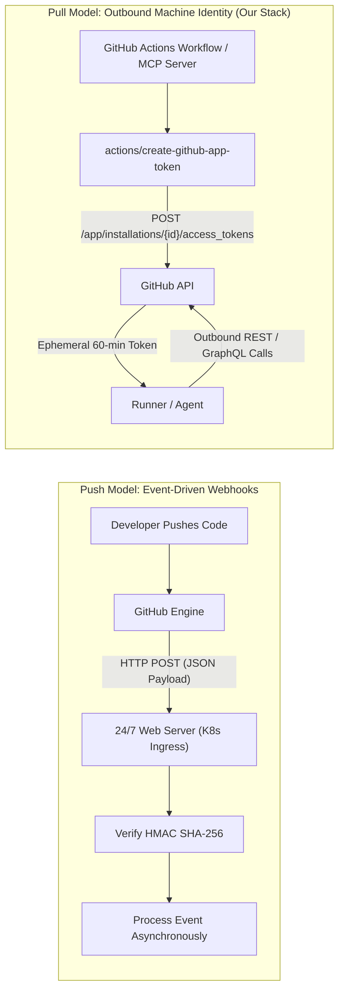
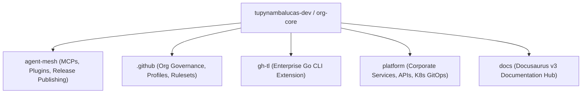
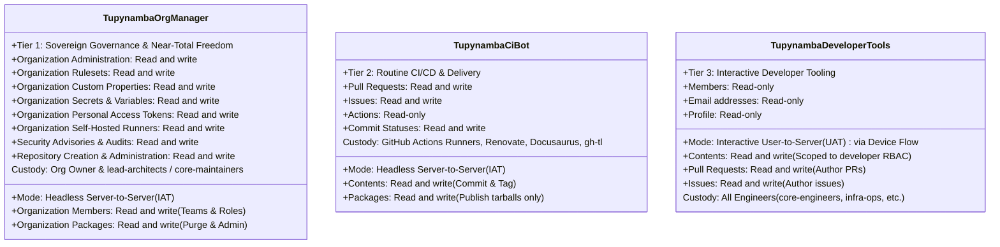
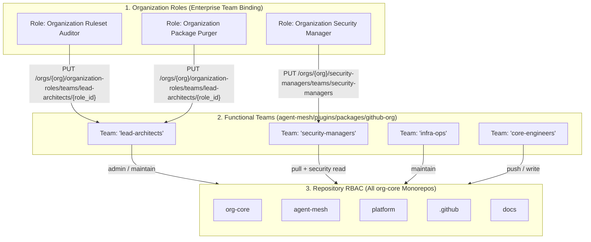
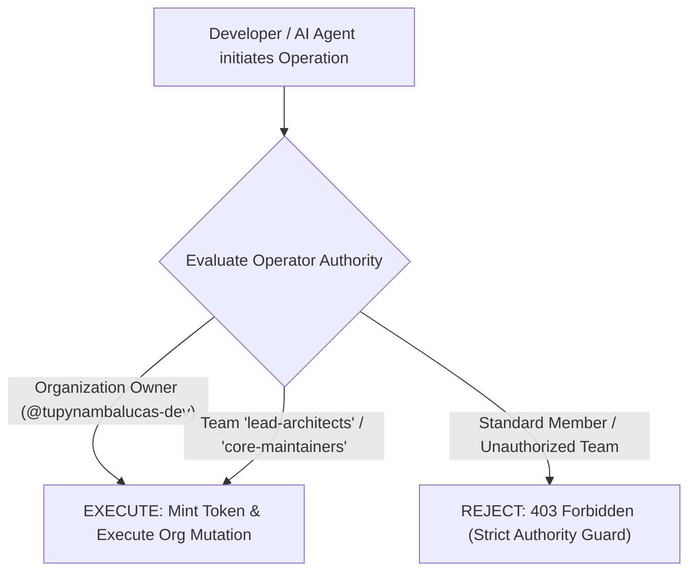
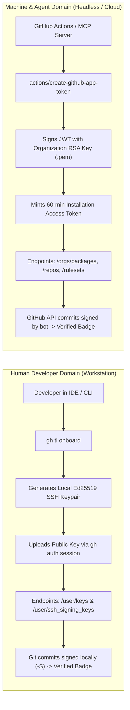
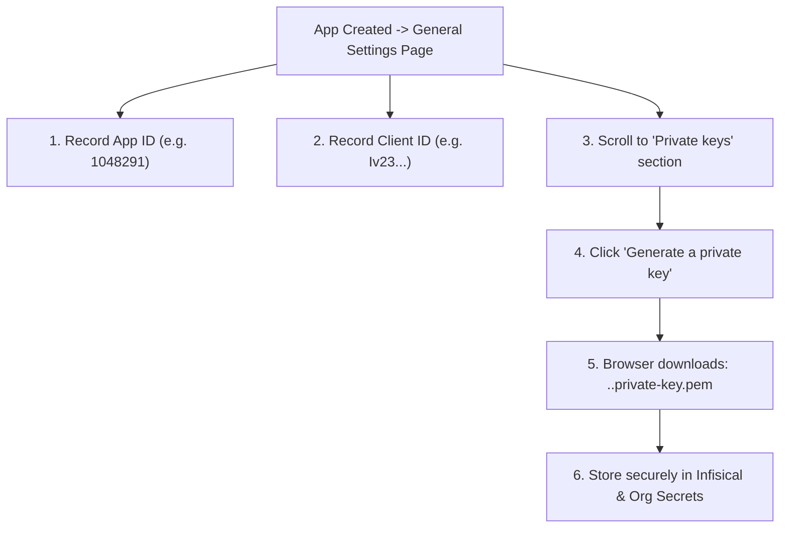

# GitHub App Organizational Architecture & Comprehensive Setup Guide
**Organization**: `tupynambalucas-dev`  
**Domain**: Enterprise Identity, Governance & CI/CD Automation  
**Classification**: Senior Architectural Specification & Didactic Runbook  
**Standard**: en-US Technical Specification (Strict Zero-Emoji Policy)

---

## 1. Executive Summary & Purpose

In modern cloud-native engineering organizations, managing access to source code, deployment artifacts, organizational rulesets, and release distribution requires a robust, zero-trust machine identity layer.

Relying on human developer credentials—such as Personal Access Tokens (Classic or Fine-Grained)—introduces catastrophic operational risks: credential leakage, lack of centralized rotation, attribution pollution in Git histories, hard rate limit exhaustion, and immediate pipeline failures when developers rotate passwords or leave the organization.

This guide provides the authoritative architectural blueprint for establishing sovereign **GitHub Apps** as first-class machine identities across the `tupynambalucas-dev` organization. It provides:
1. Conceptual foundation on what GitHub Apps are mechanically, explaining why they operate as pure permission/identity vehicles and do not require server code or hosting infrastructure.
2. A deep dive into GitHub App Webhooks: push vs pull architecture, why webhooks are unnecessary for outbound machine identities, and the operational hazards of activating webhooks without an active listener.
3. Multi-repository topology analysis across `org-core` (`agent-mesh`, `.github`, `gh-tl`, `platform`, `docs`) establishing a comprehensive **Three-Tier App model** (`tupynambalucas-org-manager`, `tupynambalucas-ci-bot`, and `tupynambalucas-developer-tools`) under the Principle of Least Privilege (PoLP) and Separation of Duties (SoD).
4. Near-Total Organizational Freedom specification for `tupynambalucas-org-manager`, detailing how to pre-configure organization-level roles and repository permissions directly on functional teams rather than individual developers.
5. Dedicated interactive developer identity tier (`tupynambalucas-developer-tools`) implementing OAuth Device Flow, enabling CLI tooling (`gh-tl`) and developer workstations to authenticate seamlessly without private key sprawl.
6. The architectural boundary between human developer workstation configuration (`gh-tl`) and machine automation under the Dual-Verification Standard.
7. Strict Operator Authority Guard governing [`@tupynambalucas-dev/plugin-github-org`](file:///C:/Users/tupyn/projects/organizations/tupynambalucas-dev/org-core/agent-mesh/plugins/packages/github-org), ensuring only organization owners and top-tier administrative teams can execute high-privilege operations.
8. An exhaustive, didactic, screen-by-screen and checkbox-by-checkbox manual setup walkthrough for creating all three apps via GitHub's web interface.
9. Concrete runbooks for generating private keys, installing the apps on the organization, capturing Installation IDs, enrolling secrets into Infisical and GitHub Organization Secrets, and consuming them inside GitHub Actions workflows.

---

## 2. Core Conceptual Fundamentals: How GitHub Apps Work

### 2.1 What is a GitHub App?
A **GitHub App** is a dedicated, first-class machine identity registered within GitHub. Unlike a personal user account, a GitHub App:
- Is owned directly by the organization (`tupynambalucas-dev`), not tied to any individual developer.
- Does not consume a paid GitHub seat.
- Has dedicated, separate API rate limits (5,000 to 15,000 requests per hour depending on organization plan).
- Issues temporary, cryptographically bounded tokens on demand.
- Signs its own Git commits with GitHub's green `Verified` badge under its official bot persona (`[bot]`).

### 2.2 Do GitHub Apps Need Code or Do They Serve Just to Grant Permissions?

> [!IMPORTANT]
> **A GitHub App DOES NOT inherently require external code, hosting infrastructure, or webhook servers to function.**

GitHub Apps operate across two distinct architectural modes:

```mermaid
flowchart TD
    subgraph ModeA ["Mode 1: Headless Machine Identity (Zero Server Code)"]
        A1["GitHub App Registration (App ID + RSA Key)"] --> A2["Client / CI Runner / MCP Server"]
        A2 --> A3["Signs RS256 JWT Locally using .pem"]
        A3 --> A4["Exchanges JWT with GitHub API for Installation Token"]
        A4 --> A5["Performs API Calls, Releases, Git Operations"]
    end

    subgraph ModeB ["Mode 2: Event-Driven Reactive Service (Code-Backed)"]
        B1["GitHub Event Occurs (Push, PR, Issue)"] --> B2["GitHub Webhook POST Request"]
        B2 --> B3["Publicly Hosted Backend Server (Node.js/Go on K8s)"]
        B3 --> B4["Verifies Webhook Secret HMAC SHA-256"]
        B4 --> B5["Executes Automated Response Logic"]
    end
```



1. **Headless Machine Identity (Zero-Code Mode)**:
   - **Operational Purpose**: CI/CD pipelines (GitHub Actions), local CLI tools, automated release publishers (`pnpm publish`), package purgers (`admin-packages.yml`), and MCP servers (`@tupynambalucas-dev/mcp-github`).
   - **How it works**: The app exists purely as an authentication and permission principal. It has **No Webhook URL** (`Active: false`), **No callback server**, and **No hosting cost**. GitHub Actions runners or local developer environments sign a JSON Web Token (JWT) using the app's RSA private key (`.pem`), exchange it with GitHub for a 60-minute ephemeral **Installation Access Token (IAT)**, and execute operations.
2. **Event-Driven Service (Code-Backed Mode)**:
   - **Operational Purpose**: Continuous background daemons that must react in real time to events (e.g. an issue comment triggering a Kubernetes agent pod, or a custom pull request gatekeeper).
   - **How it works**: Requires a public HTTP endpoint (`Webhook URL`) running a server (e.g. Express, Probot, or Go) to receive and verify webhook payloads signed with a shared secret.

For our organizational requirements, our GitHub Apps operate in **Mode 1 (Headless Machine Identity)**, providing sovereign credentials with zero infrastructure overhead.

### 2.3 The Three Authentication Tokens of GitHub Apps

GitHub Apps support three distinct token flows:

| Token Type | Abbreviation | Lifetime | Mechanics | Primary Use Case |
| :--- | :--- | :--- | :--- | :--- |
| **JSON Web Token** | `JWT` | Max 10 minutes | Signed locally via RS256 using App ID and RSA Private Key (`.pem`). | Authenticating as the App itself to query installations or request an installation token. |
| **Installation Access Token** | `IAT` | Exactly 60 minutes | Minted by calling `POST /app/installations/{id}/access_tokens` using a JWT. | **Server-to-Server automation**; all CI/CD, release publishing, repository governance, and package management. |
| **User Access Token** | `UAT` | 8 hours (with refresh token) | Minted via OAuth authorization or Device Flow when a user authorizes the App. | **User-to-Server developer tooling**; interactive CLI commands (`gh-tl`), developer portals, and IDE extensions. |

---

## 3. Webhooks Deep Dive: Push vs. Pull Architecture & Inactive Discipline

### 3.1 Architectural Paradigms: Push (Webhooks) vs Pull (API Tokens)

Understanding whether an organization requires webhooks comes down to the direction of event dispatching:



- **Push Model (Webhooks)**: GitHub actively initiates an outbound HTTP `POST` request to an external server whenever a subscribed repository or organization event occurs. The external server must acknowledge the request with an HTTP 2xx status within 10 seconds.
- **Pull / On-Demand Model (API Tokens)**: Our internal automation tools (GitHub Actions workflows or MCP servers) initiate outbound HTTPS requests to GitHub's REST/GraphQL API using an ephemeral token. GitHub never calls our infrastructure; our infrastructure calls GitHub.

### 3.2 Do We Need Webhooks for Our GitHub Apps?

> [!IMPORTANT]
> **NO, we DO NOT need webhooks for our GitHub Apps.**
> When registering all three apps in GitHub, the **Webhook Active checkbox MUST BE UNCHECKED (Inactive)**.

Here is the exhaustive technical rationale:

1. **GitHub Actions Executes on GitHub Infrastructure**:
   - Our CI/CD workflows (`publish.yml`, `admin-packages.yml`, `ci.yml`, `release.yml`, `renovate.yml`) are triggered internally by GitHub's native workflow engine via triggers like `on: push`, `on: pull_request`, `on: schedule`, or `on: workflow_dispatch`.
   - Workflows do not need an external webhook to wake them up. They generate the GitHub App token inline using the official action `actions/create-github-app-token`.
2. **MCP Agents Execute on Local Developer or Runner Prompts**:
   - Our MCP server (`@tupynambalucas-dev/mcp-github`) operates on demand when an AI agent requests a tool invocation (such as `list_rulesets`, `list_secret_scanning_alerts`, or `get_repo_info`).
   - The MCP server uses the App ID and Private Key to mint an Installation Access Token and execute outbound queries. It never receives inbound webhook events.
3. **Developer CLI Tools Authenticate via Device Flow**:
   - Developer tools (`gh-tl`) use OAuth Device Flow (`POST /login/device/code` and polling `POST /login/oauth/access_token`), which is an outbound HTTP polling flow. Webhooks are not used.
4. **Zero Hosting Requirement**:
   - By leaving webhooks inactive, we eliminate the need to run, monitor, patch, and maintain a publicly reachable HTTP server, domain name, SSL certificate, or Kubernetes ingress controller.

### 3.3 Operational Hazards of Leaving Webhooks Active Without a Listener

If an administrator mistakenly checks **Active** on the Webhook configuration without providing an active, 24/7 web server:

1. **100% Delivery Failures & Red Alarms**:
   - Every single Git push, commit, pull request, or issue created in any repository across the organization will cause GitHub to dispatch an HTTP POST request to the Webhook URL.
   - If the URL is blank, invalid, or pointing to an inactive host, GitHub records a delivery failure.
   - GitHub displays persistent red warning banners in the GitHub App settings dashboard indicating that deliveries are failing.
2. **Resource Waste & Retry Throttling**:
   - GitHub implements automatic retry loops with exponential backoff for failed deliveries, consuming unnecessary outbound queue resources and polluting GitHub audit logs.
3. **Security Ingress Liability**:
   - Activating a webhook requires exposing an endpoint to the public internet, necessitating HMAC-SHA256 signature verification (`X-Hub-Signature-256`), replay attack protection, rate limiting, and DDoS mitigation.

### 3.4 Future Scenarios: When and How Webhooks Would Be Activated

Webhooks would only be activated if the organization chooses to deploy an event-driven bot daemon in the future:

- **Scenario 1: Reactive Kubernetes ChatOps Bot**: An automated agent daemon running in `platform/k8s` that continuously listens for issue or PR comments (e.g. `/deploy staging`, `/run-benchmark`, `/review-a11y`) and acts immediately upon receipt.
- **Scenario 2: Real-Time Organization Audit Sink**: An audit daemon that intercepts `repository.created` or `member.added` events to enforce instant compliance policies before any code is committed.

If such a service is deployed in the future:
1. Navigate to `GitHub -> Organization Settings -> Developer settings -> GitHub Apps -> Edit`.
2. Check **Active**.
3. Set **Webhook URL** to the production ingress endpoint (e.g. `https://api.tupynambalucas.dev/webhooks/github`).
4. Generate a 64-character high-entropy secret, set **Webhook secret**, and record it in Infisical.
5. Subscribe only to specific, required events.

For our current requirements, **keeping Webhook Inactive is strictly mandatory across all three apps**.

---

## 4. Comparative Analysis: GitHub App vs Other Token Types

| Architectural Vector | Personal Access Token (Classic) | Fine-Grained Personal Access Token | Default `GITHUB_TOKEN` | GitHub App (`Installation Token`) | GitHub App (`User Access Token`) |
| :--- | :--- | :--- | :--- | :--- | :--- |
| **Ownership** | Human developer account | Human developer account | GitHub Actions runner | **Organization (`tupynambalucas-dev`)** | **Organization (delegated to User)** |
| **Lifecycle** | Manual / Static (months/years) | Hard expiry (max 1 year) | Per-job ephemeral | **Ephemeral 60-minute dynamic tokens** | **8-hour token with refresh rotation** |
| **Authentication Secret** | Static plaintext string | Static plaintext string | Automatic | **2048-bit RSA Private Key (`.pem`)** | **OAuth Device Flow (No private key)** |
| **Organization Packages** | Can delete if `delete:packages` | **BLOCKED** on org endpoints | **BLOCKED** on org deletion | **FULLY SUPPORTED** (`packages: write`) | Bounded by user team RBAC |
| **Trigger Downstream CI** | Yes (risk of infinite loops) | Yes | **Blocked** (cannot trigger CI) | **Yes (cleanly triggers workflows)** | **Yes (attributed to human user)** |
| **Commit Signature** | Requires developer SSH key | Requires developer SSH key | Generic Actions bot | **Cryptographically `Verified` by Bot** | **Attributed to Developer Account** |
| **Rate Limit** | 5,000/hr (shared with user) | 5,000/hr (shared with user) | 1,000/hr | **5,000 - 15,000/hr dedicated** | 5,000/hr dedicated per user |
| **Role Separation** | Impossible (coarse scopes) | Repository-only granular | Repository-only | **Tiered Organizational Separation** | **App Scopes ∩ Team RBAC** |

---

## 5. Multi-Repository Topology & The Three-Tier Enterprise Identity Architecture

### 5.1 Meta-Repository Analysis (`org-core`)

Our umbrella meta-repository coordinates five distinct repositories:



1. **`agent-mesh`**:
   - Compiles and publishes 17 internal packages (7 MCP servers + 10 domain plugins) to `npm.pkg.github.com`.
   - Administers package registry versions (listing, purging obsolete packages via REST API).
   - Hosts `@tupynambalucas-dev/mcp-github`, interrogating GitHub Security APIs (Secret Scanning, Dependabot), repository rulesets, and pull requests.
2. **`.github`**:
   - Manages organization-level configurations, community health files, issue/PR templates, and organization rulesets.
3. **`gh-tl`**:
   - Compiled Go CLI extension for developer onboarding and readiness verification.
   - Built and released via automated GitHub Actions (`cli/gh-extension-precompile@v2`).
4. **`platform`**:
   - Core monorepo running corporate backend services and frontend applications.
   - Executes Renovate Bot for automated dependency updates (`platform/.github/workflows/renovate.yml`).
   - Hosts Kubernetes GitOps manifests (`k8s/`).
5. **`docs`**:
   - Sovereign documentation hub powered by Docusaurus v3 and Crowdin localization actions.

### 5.2 Why the Three-Tier Model is the Enterprise Gold Standard

In top-tier engineering organizations, identity must be strictly segmented across three orthogonal axes:
1. **Executive Organizational Governance** (High privilege, strictly controlled custody).
2. **Autonomous Machine Delivery** (Headless CI/CD, limited delivery scope, zero administrative rights).
3. **Interactive Developer Tooling** (Developer persona, OAuth Device Flow, zero private key distribution).



#### App 1: `tupynambalucas-org-manager` (Tier 1 - Sovereign Governance & Near-Total Freedom)
- **Primary Persona**: `@tupynambalucas-org-manager[bot]`
- **Authentication Model**: Server-to-Server via RSA Private Key (`.pem`) -> Installation Access Token (`IAT`).
- **Scope of Action**:
  - Sovereign organization-level administration, team provisioning, and member management.
  - Pre-defining organization-level roles directly onto functional teams (`PUT /orgs/{org}/organization-roles/teams/{team_slug}/{role_id}`).
  - Designating official Security Manager teams across all repositories (`PUT /orgs/{org}/security-managers/teams/{team_slug}`).
  - Assigning pre-defined repository RBAC permissions to teams across all monorepos (`PUT /orgs/{org}/teams/{team_slug}/repos/{owner}/{repo}`).
  - Administrative deletion and cleanup of packages on `npm.pkg.github.com` via `admin-packages.yml`.
  - Managing organization secrets, variables, fine-grained PAT requests, and repository rulesets.
- **Custody & Usage**: Strictly restricted to the Organization Owner (`@tupynambalucas-dev`) and the executive engineering council (`lead-architects` / `core-maintainers`). Consumed exclusively in administrative workflow runs (`workflow_dispatch`), MCP security tools, and emergency governance runbooks.

#### App 2: `tupynambalucas-ci-bot` (Tier 2 - Operational Machine Delivery)
- **Primary Persona**: `@tupynambalucas-ci-bot[bot]`
- **Authentication Model**: Server-to-Server via RSA Private Key (`.pem`) -> Installation Access Token (`IAT`).
- **Scope of Action**:
  - Standard package publishing (`pnpm -r publish` in `publish.yml`).
  - Automated pull request creation, comments, and approvals.
  - Renovate Bot automated dependency management (`platform/.github/workflows/renovate.yml`).
  - Creating Git tags and releases for `gh-tl` binaries.
  - Crowdin translation synchronizations in `docs`.
- **Custody & Usage**: Used across routine daily CI/CD pipelines in all repositories. Possesses zero permissions to delete repositories, purge organization packages, alter members, or modify security rulesets.

#### App 3: `tupynambalucas-developer-tools` (Tier 3 - Interactive Developer Self-Service)
- **Primary Persona**: The authenticated human developer (attributed as `actor: octocat`, `programmatic_access_type: GitHub App user-to-server token`).
- **Authentication Model**: Interactive User-to-Server via **OAuth Device Flow** -> User Access Token (`UAT`) with 8-hour rotation.
- **Why Tier 3 Eliminates Developer Friction and Security Vulnerabilities**:
  1. **Zero Personal Access Tokens (PATs)**: Developers no longer create static Personal Access Tokens that leak on disk, bypass SSO, or outlive the developer's tenure.
  2. **Zero Private Key Distribution**: The App's RSA private key is never distributed to developer workstations. The CLI tool (`gh-tl`) only embeds the public `Client ID`.
  3. **Device Flow Authentication**: When running `gh tl login` or internal CLI commands, the developer is prompted to visit `https://github.com/login/device` and enter a temporary 8-character code, granting an ephemeral 8-hour token with refresh tokens.
  4. **Dual-Bounded Principle of Least Privilege**: Actions performed by Tier 3 are strictly bounded by the **intersection** of the App's permissions and the developer's assigned team RBAC. A developer cannot perform actions their team does not allow.
  5. **Instant Central Revocation**: If a developer's laptop is compromised or lost, an administrator can revoke the App's authorization with a single click in GitHub Organization settings, instantly killing all active sessions.

---

### 5.3 Near-Total Organizational Freedom: Pre-Configuring Roles Directly on Teams

A critical requirement of our organization model is that we do not want developers or administrators to manually configure permissions user-by-user or repository-by-repository. Instead, **functional teams must be first-class security principals endowed with pre-defined organization roles and pre-defined repository permissions**.



#### How `tupynambalucas-org-manager` Executes Team Role Bindings:
1. **Assigning Organization Roles to Teams**:
   - Calling `PUT /orgs/{org}/organization-roles/teams/{team_slug}/{role_id}` assigns an organization-level role directly to a team.
   - Any engineer assigned to `lead-architects` or `infra-ops` automatically inherits that organization role without individual user role grants.
2. **Assigning Security Manager Authority**:
   - Calling `PUT /orgs/{org}/security-managers/teams/{team_slug}` designates a team as an official Security Manager, granting its members read access to all private repositories and full access to Secret Scanning, Dependabot, and CodeQL alerts organization-wide.
3. **Pre-Defining Repository Permissions**:
   - Calling `PUT /orgs/{org}/teams/{team_slug}/repos/{owner}/{repo}` binds the team to repositories with pre-configured access levels (`admin`, `maintain`, `push`, `pull`).
   - New repositories provisioned by the bot automatically inherit these team mappings.

---

### 5.4 Operator Authority Guard for `@tupynambalucas-dev/plugin-github-org`

Because `tupynambalucas-org-manager` holds near-total organizational authority, access to invoke [`@tupynambalucas-dev/plugin-github-org`](file:///C:/Users/tupyn/projects/organizations/tupynambalucas-dev/org-core/agent-mesh/plugins/packages/github-org) (`github-org-operator`, `github-app-operator`, `github-ruleset-operator`, `github-security-auditor`) must be strictly governed:



#### Governing Rules:
1. **Repository/Organization Owner Exclusivity**: The organization owner (`tupynambalucas-dev`) retains sovereign, unrestricted authority to trigger all operations.
2. **Near-Maximal Administrative Teams**: In automated environments, only callers belonging to `lead-architects` or `core-maintainers` are authorized to invoke `github-org-operator`.
3. **Cryptographic Boundary**: The App private key (`.pem`) is never exposed in plain text, never saved to developer machines, and is accessible solely via Infisical Cloud Vault and GitHub Actions Organization Secrets.

---

### 5.5 Human Developer Identity (`gh-tl`) vs Machine Identity (GitHub Apps): The Dual-Verification Standard

The enterprise architecture enforces a strict boundary between human workstations and cloud automation:



#### Why `gh-tl` Operates Exclusively on the Developer's Personal Session:
1. **User Scope Isolation**: When a developer runs `gh tl onboard`, the goal is to register an authentication key (`POST /user/keys`) and an SSH signing key (`POST /user/ssh_signing_keys`) on that **individual human's personal GitHub account**. A GitHub App installation token represents the organization or bot, not the human user, and intentionally lacks permission to modify arbitrary personal user profiles.
2. **Native SDK Inheritance**: `gh-tl` uses `github.com/cli/go-gh/v2/pkg/api` (`api.DefaultRESTClient()`), which natively consumes the developer's existing `gh auth login` token or Tier 3 User Access Tokens.
3. **Zero Private Key Sprawl**: Distributing an organizational GitHub App's private key (`.pem`) to developer laptops is a critical security vulnerability. Developer machines must never hold bot master keys.

#### Dual-Verification Compliance Result:
- Human commits: Signed with local SSH Ed25519 keys provisioned by `gh-tl onboard`.
- Bot/Agent commits: Signed by GitHub's bot authority using GitHub App installation tokens.
- Result: 100% `Verified` green commit badges across all 5 repositories with zero credential leakage.

---

## 6. Manual GitHub Web UI Creation Walkthrough (Screen-by-Screen & Field-by-Field)

This section provides the authoritative, exhaustive runbook for manually registering all three GitHub Apps directly through the GitHub Web UI.

### 6.1 Accessing the Registration Interface

1. Open your desktop browser and log in with your administrative account.
2. Navigate directly to the organization app creation portal:
   `https://github.com/organizations/tupynambalucas-dev/settings/apps/new`
   *(Alternative navigation: Click your profile picture -> **Your organizations** -> click **tupynambalucas-dev** -> **Settings** -> left sidebar **Developer settings** -> **GitHub Apps** -> click **New GitHub App**).*

---

### 6.2 Step-by-Step Walkthrough for App 1: `tupynambalucas-org-manager` (Tier 1 - Near-Total Freedom)

Follow each field sequentially:

#### Step 1: App Metadata
- **GitHub App name**: `tupynambalucas-org-manager`  
  *(Must be unique across all of GitHub, maximum 34 characters).*
- **Description**:  
  `Sovereign organizational governance, security auditing, package administration, and RBAC team operator.`
- **Homepage URL**:  
  `https://docs.tupynambalucas.dev`

#### Step 2: Identifying and Authorizing Users (User-to-Server)
- **Callback URL**: *Leave completely empty*  
  *(Not used for headless server-to-server operations).*
- **Allow wildcard matching**: **UNCHECKED**
- **Expire user authorization tokens**: **CHECKED**  
  *(Enforces secure 8-hour expiry if OAuth is ever invoked).*
- **Request user authorization (OAuth) during installation**: **UNCHECKED**  
  *(Prevents confusing user login prompts during organization installation).*
- **Enable Device Flow**: **UNCHECKED**

#### Step 3: Post Installation
- **Setup URL**: *Leave completely empty*
- **Redirect on update**: **UNCHECKED**

#### Step 4: Webhook Configuration
- **Active**: **UNCHECKED (Desmarcado / Inactive)**  
  *(CRITICAL: Disables outbound webhook POST requests from GitHub).*
- **Webhook URL**: *Disabled / Leave empty*
- **Webhook secret**: *Disabled / Leave empty*
- **SSL verification**: *Disabled / Leave default*

#### Step 5: Repository Permissions (Permissions -> Repository permissions)
Click each dropdown and configure the exact values below:

| Permission Name in GitHub UI | Required Setting | Technical Operational Rationale |
| :--- | :--- | :--- |
| **Actions** | **Read and write** | Needed to trigger, cancel, or re-run workflows via API. |
| **Administration** | **Read and write** | Needed to manage repository settings, branch protections, and repo rules. |
| **Checks** | **Read and write** | Needed to create and update status checks and automated annotations. |
| **Code scanning alerts** | **Read and write** | Needed for `@tupynambalucas-dev/mcp-github` security audits. |
| **Commit statuses** | **Read and write** | Needed to publish build status markers on commits. |
| **Contents** | **Read and write** | Needed for reading files, committing changes, creating tags (`v1.0.0`). |
| **Custom properties** | **Read and write** | **Allows reading and setting repository-specific custom property values.** |
| **Dependabot alerts** | **Read and write** | Needed for `@tupynambalucas-dev/mcp-github` vulnerability triage. |
| **Deployments** | **No access** | Not currently used. |
| **Discussions** | **No access** | Not currently used. |
| **Environments** | **Read and write** | Needed for managing deployment environment rules and approvals. |
| **Issues** | **Read and write** | Needed to open governance issues and automated notices. |
| **Metadata** | **Read-only (Mandatory)** | Automatically set by GitHub; allows reading repository names. |
| **Packages** | **Read and write** | **CRITICAL: Grants REST API rights to list and delete package versions.** |
| **Pages** | **No access** | Not currently used (docs hosted via static platform). |
| **Pull requests** | **Read and write** | Needed to inspect, comment, approve, and manage pull requests. |
| **Repository creation** | **Read and write** | **Allows the bot to create new repositories in the organization.** |
| **Repository security advisories** | **Read and write** | Needed to audit repository CVE status and manage security disclosures. |
| **Secret scanning alerts** | **Read and write** | Needed for `@tupynambalucas-dev/mcp-github` secret audits. |
| **Secrets** | **Read and write** | **Allows managing repository-level encrypted secrets for GitHub Actions.** |
| **Variables** | **Read and write** | **Allows managing repository-level configuration variables.** |
| **Webhooks** | **No access** | Not managing repository-level webhooks. |
| **Workflows** | **Read and write** | Needed to update workflow files in `.github/workflows/`. |

*(All other repository permissions not listed above should remain **No access**).*

#### Step 6: Organization Permissions (Permissions -> Organization permissions)
Click each dropdown and configure the exact values below:

| Permission Name in GitHub UI | Required Setting | Technical Operational Rationale |
| :--- | :--- | :--- |
| **Administration** | **Read and write** | **Allows organization-level settings, security managers, and Actions policies.** |
| **Custom organization roles** | **Read-only** | **Allows listing organization roles to retrieve IDs for team assignment.** |
| **Custom properties** | **Read and write** | **Allows defining org property schemas and bulk assigning values to repos.** |
| **Members** | **Read and write** | **MASTER RBAC: Allows creating teams, updating teams, setting team repo access, and assigning organization roles directly to teams.** |
| **Organization rulesets** | **Read and write** | **CRITICAL: Needed to create and enforce org-wide branch and tag protection policies.** |
| **Organization security advisories** | **Read and write** | Needed for organization-wide security posture audits. |
| **Packages** | **Read and write** | **CRITICAL: Needed for organization-level package administrative operations.** |
| **Personal access tokens** | **Read and write** | **Allows auditing and revoking fine-grained personal access tokens.** |
| **Personal access token requests** | **Read and write** | **Allows approving or rejecting fine-grained PAT requests.** |
| **Secrets** | **Read and write** | **Allows managing organization-wide secrets for Actions and Dependabot.** |
| **Self-hosted runners** | **Read and write** | **Allows managing organization runner groups and runner registrations.** |
| **Variables** | **Read and write** | **Allows managing organization-wide configuration variables.** |
| **Webhooks** | **No access** | Not managing organization-level webhooks. |

*(All other organization permissions not listed above should remain **No access**).*

#### Step 7: Account Permissions
- Keep all Account permissions set to **No access**.

#### Step 8: Subscribe to Events
- Because **Active** is unchecked under Webhook, this section is automatically grayed out or inactive. Leave empty.

#### Step 9: Where Can This GitHub App Be Installed?
- Select: **Only on this account** (`@tupynambalucas-dev`).  
  *(Never select "Any account" for internal enterprise tools).*

#### Step 10: Complete Creation
- Click the green button: **Create GitHub App**.

---

### 6.3 Step-by-Step Walkthrough for App 2: `tupynambalucas-ci-bot` (Tier 2 - Operational Delivery)

Follow each field sequentially:

#### Step 1: App Metadata
- **GitHub App name**: `tupynambalucas-ci-bot`
- **Description**:  
  `Autonomous CI/CD delivery bot for releases, dependency updates, and automated workflows.`
- **Homepage URL**:  
  `https://docs.tupynambalucas.dev`

#### Step 2: Identifying and Authorizing Users (User-to-Server)
- **Callback URL**: *Leave completely empty*
- **Allow wildcard matching**: **UNCHECKED**
- **Expire user authorization tokens**: **CHECKED**
- **Request user authorization (OAuth) during installation**: **UNCHECKED**
- **Enable Device Flow**: **UNCHECKED**

#### Step 3: Post Installation
- **Setup URL**: *Leave completely empty*
- **Redirect on update**: **UNCHECKED**

#### Step 4: Webhook Configuration
- **Active**: **UNCHECKED (Desmarcado / Inactive)**
- **Webhook URL**: *Disabled / Leave empty*
- **Webhook secret**: *Disabled / Leave empty*
- **SSL verification**: *Disabled / Leave default*

#### Step 5: Repository Permissions (Permissions -> Repository permissions)
Click each dropdown and configure the exact values below:

| Permission Name in GitHub UI | Required Setting | Technical Operational Rationale |
| :--- | :--- | :--- |
| **Actions** | **Read-only** | Allows checking run states without power to cancel pipelines. |
| **Administration** | **No access** | Strict PoLP isolation: CI bot cannot modify repo settings. |
| **Checks** | **Read and write** | Allows emitting test reports and linting status checks. |
| **Code scanning alerts** | **No access** | Not required for standard delivery. |
| **Commit statuses** | **Read and write** | Allows reporting build status badges on commits. |
| **Contents** | **Read and write** | **Allows pushing release tags (`v1.0.0`) and changelog commits.** |
| **Dependabot alerts** | **No access** | Handled by Tier 1. |
| **Issues** | **Read and write** | Allows opening and commenting on build failure tracking issues. |
| **Metadata** | **Read-only (Mandatory)** | Automatically set by GitHub. |
| **Packages** | **Read and write** | **Allows publishing tarballs (`pnpm -r publish`). Cannot delete.** |
| **Pull requests** | **Read and write** | Allows Renovate Bot and release automations to open PRs. |
| **Secret scanning alerts** | **No access** | Handled by Tier 1. |
| **Workflows** | **Read and write** | Allows automated PRs that modify `.github/workflows/` files. |

*(All other repository permissions should remain **No access**).*

#### Step 6: Organization Permissions (Permissions -> Organization permissions)
- Set all Organization permissions to **No access**.  
  *(Tier 2 has zero organization-level administrative rights).*

#### Step 7: Account Permissions
- Set all Account permissions to **No access**.

#### Step 8: Subscribe to Events
- Grayed out / Inactive.

#### Step 9: Where Can This GitHub App Be Installed?
- Select: **Only on this account** (`@tupynambalucas-dev`).

#### Step 10: Complete Creation
- Click the green button: **Create GitHub App**.

---

### 6.4 Step-by-Step Walkthrough for App 3: `tupynambalucas-developer-tools` (Tier 3 - Interactive Developer Self-Service)

Follow each field sequentially:

#### Step 1: App Metadata
- **GitHub App name**: `tupynambalucas-developer-tools`
- **Description**:  
  `Interactive developer self-service tooling, CLI authentication, and workstation integration.`
- **Homepage URL**:  
  `https://docs.tupynambalucas.dev`

#### Step 2: Identifying and Authorizing Users (User-to-Server)
- **Callback URL**: *Leave completely empty*
- **Allow wildcard matching**: **UNCHECKED**
- **Expire user authorization tokens**: **CHECKED**  
  *(Enforces secure 8-hour token expiration with refresh tokens).*
- **Request user authorization (OAuth) during installation**: **UNCHECKED**
- **Enable Device Flow**: **CHECKED (Obrigatório / Mandatory)**  
  *(CRITICAL: Allows CLI tools like `gh-tl` to authenticate developers via `https://github.com/login/device` without web redirects).*

#### Step 3: Post Installation
- **Setup URL**: *Leave completely empty*
- **Redirect on update**: **UNCHECKED**

#### Step 4: Webhook Configuration
- **Active**: **UNCHECKED (Desmarcado / Inactive)**
- **Webhook URL**: *Disabled / Leave empty*
- **Webhook secret**: *Disabled / Leave empty*
- **SSL verification**: *Disabled / Leave default*

#### Step 5: Repository Permissions (Permissions -> Repository permissions)
Click each dropdown and configure the exact values below:

| Permission Name in GitHub UI | Required Setting | Technical Operational Rationale |
| :--- | :--- | :--- |
| **Actions** | **Read-only** | Allows developer CLI to inspect workflow logs and run statuses. |
| **Administration** | **No access** | Strict PoLP isolation: Developer App cannot alter repository configurations. |
| **Checks** | **Read-only** | Allows developer CLI to inspect test check suites and annotations. |
| **Contents** | **Read and write** | **Allows developer CLI to push feature branches and create commits.** |
| **Issues** | **Read and write** | Allows developer CLI to open, comment, and triage issues on user behalf. |
| **Metadata** | **Read-only (Mandatory)** | Automatically set by GitHub. |
| **Pull requests** | **Read and write** | Allows developer CLI to author PRs, add review comments, and check status. |

*(All other repository permissions should remain **No access**).*

#### Step 6: Organization Permissions (Permissions -> Organization permissions)
| Permission Name in GitHub UI | Required Setting | Technical Operational Rationale |
| :--- | :--- | :--- |
| **Members** | **Read-only** | Allows developer CLI to query team rosters and collaborators. |

*(All other organization permissions should remain **No access**).*

#### Step 7: Account Permissions (Permissions -> Account permissions)
| Permission Name in GitHub UI | Required Setting | Technical Operational Rationale |
| :--- | :--- | :--- |
| **Email addresses** | **Read-only** | Allows CLI to retrieve verified primary email for local Git signature configuration. |
| **Profile** | **Read-only** | Allows CLI to retrieve developer avatar and username for display. |

*(All other account permissions should remain **No access**).*

#### Step 8: Subscribe to Events
- Grayed out / Inactive.

#### Step 9: Where Can This GitHub App Be Installed?
- Select: **Only on this account** (`@tupynambalucas-dev`).

#### Step 10: Complete Creation
- Click the green button: **Create GitHub App**.
- *Note for Tier 3*: Developers only consume the **Client ID** (alphanumeric string). No RSA private key is distributed to developer workstations.

---

### 6.5 Generating and Securing the RSA Private Key (`.pem`)

Immediately after creating `tupynambalucas-org-manager` (Tier 1) and `tupynambalucas-ci-bot` (Tier 2), GitHub displays the **General** settings page for the new app:



1. **Record the App ID**: At the top of the **General** page, find **App ID** (numeric string, e.g. `1149202`). Copy this number.
2. **Record the Client ID**: Right below App ID, find **Client ID** (alphanumeric string, e.g. `Iv23...`). Copy this value.
3. **Generate Private Key**:
   - Scroll down to the section titled **Private keys**.
   - Click the button **Generate a private key**.
   - GitHub generates a 2048-bit RSA private key and downloads a file named `<app-name>.<timestamp>.private-key.pem` to your computer.
   - Store this file securely. Never commit it to any Git repository.

---

### 6.6 Installing the Apps on the Organization and Capturing Installation IDs

A registered GitHub App cannot perform any actions until it is **installed** on the organization:

1. On the left navigation sidebar of your GitHub App settings, click **Install App**.
2. GitHub displays a list of accounts where you have administrative access. Locate `tupynambalucas-dev` and click the green **Install** button next to it.
3. In the repository selection prompt:
   - Select **All repositories** *(ensures all 5 repositories in `org-core` inherit the identity)*.
4. Click **Install**.
5. GitHub redirects you to the organization settings page for the installation:
   - Examine your browser's address bar URL:
     `https://github.com/organizations/tupynambalucas-dev/settings/installations/62345678`
   - The trailing integer (e.g. `62345678`) is your **Installation ID**.
   - Copy this number for Infisical storage.

---

## 7. Alternative Automated Provisioning via Manifest Flow

For developers who prefer command-line automation, the repository provides a pre-configured provisioner in `agent-mesh`:

```bash
cd C:\Users\tupyn\projects\organizations\tupynambalucas-dev\org-core\agent-mesh

# Run the automated manager provisioner:
node plugins/packages/github-org/skills/github-app-operator/scripts/provision-app.js --profile=manager
```

### What the Script Executes:
1. Spawns an ephemeral HTTP callback listener on `http://localhost:3333`.
2. Encodes the complete JSON manifest (name, permissions, inactive webhooks) into a POST form.
3. Automatically launches your desktop browser at `https://github.com/organizations/tupynambalucas-dev/settings/apps/new`.
4. Displays GitHub's pre-filled confirmation screen: click **Create GitHub App**.
5. GitHub redirects back to `http://localhost:3333/callback` with an exchange code.
6. The script exchanges the code with GitHub's API, securely outputs the App ID, Client ID, and saves the RSA Private Key to `tupynambalucas-org-manager.private-key.pem` (mode `0600`).
7. Automatically opens the installation page: select **All repositories** and confirm.

---

## 8. Secret Governance & Storage Runbook

To adhere strictly to Rule 4 (Secret Hygiene):
> [!CAUTION]
> Never commit `.pem` private keys or output raw private keys into terminal logs. All private keys are strictly git-ignored.

### 8.1 GitHub Actions Organization Secrets Enrollment

To make the credentials universally accessible across all workflows in all five repositories, configure them as **Organization Secrets** (`https://github.com/organizations/tupynambalucas-dev/settings/secrets/actions`):

| Secret Name | Value to Input | Repository Access Policy |
| :--- | :--- | :--- |
| **`ORGANIZATION_APP_ID`** | Numeric App ID of `tupynambalucas-org-manager` (Tier 1) | Selected repositories: `agent-mesh`, `platform`, `.github`, `docs`, `gh-tl` |
| **`ORGANIZATION_APP_PRIVATE_KEY`** | Full text content of the downloaded `org-manager` `.pem` file | Selected repositories: `agent-mesh`, `platform`, `.github`, `docs`, `gh-tl` |
| **`CI_APP_ID`** | Numeric App ID of `tupynambalucas-ci-bot` (Tier 2) | All repositories |
| **`CI_APP_PRIVATE_KEY`** | Full text content of the `ci-bot` `.pem` file | All repositories |
| **`DEVELOPER_TOOLS_CLIENT_ID`** | Alphanumeric Client ID of `tupynambalucas-developer-tools` (Tier 3) | All repositories / Publicly accessible configuration |

### 8.2 Infisical Cloud Vault Enrollment

Store all four identity parameters in Infisical project `tupynambalucas-dev-platform` across environments (`dev` and `prod`) for programmatic agent consumption:

```bash
# Tier 1 Vault Enrollment
GITHUB_APP_ID="<Numeric App ID of org-manager>"
GITHUB_APP_CLIENT_ID="<Client ID of org-manager>"
GITHUB_APP_INSTALLATION_ID="<Installation ID of org-manager>"
GITHUB_APP_PRIVATE_KEY="<Complete contents of org-manager .pem file>"

# Tier 2 Vault Enrollment
CI_APP_ID="<Numeric App ID of ci-bot>"
CI_APP_CLIENT_ID="<Client ID of ci-bot>"
CI_APP_INSTALLATION_ID="<Installation ID of ci-bot>"
CI_APP_PRIVATE_KEY="<Complete contents of ci-bot .pem file>"

# Tier 3 Vault Enrollment
DEVELOPER_TOOLS_CLIENT_ID="<Client ID of developer-tools>"
```

---

## 9. Workflow Consumption Architecture

Workflows across `agent-mesh`, `platform`, `docs`, and `gh-tl` consume the GitHub App token via the standard, pinned action `actions/create-github-app-token@c1a285145b9d317df6ced56c09f525b5c2b6f755`:

### 9.1 Package Deletion & Administration (`agent-mesh/.github/workflows/admin-packages.yml`)
```yaml
      - name: Generate GitHub App Token
        id: app-token
        if: ${{ (secrets.ORGANIZATION_APP_ID || secrets.APP_ID) != '' && (secrets.ORGANIZATION_APP_PRIVATE_KEY || secrets.APP_PRIVATE_KEY) != '' }}
        uses: actions/create-github-app-token@c1a285145b9d317df6ced56c09f525b5c2b6f755 # v1.11.1
        with:
          app-id: ${{ secrets.ORGANIZATION_APP_ID || secrets.APP_ID }}
          private-key: ${{ secrets.ORGANIZATION_APP_PRIVATE_KEY || secrets.APP_PRIVATE_KEY }}
          owner: ${{ github.repository_owner }}

      - name: Execute Package Administration Script
        env:
          ADMIN_TOKEN: ${{ steps.app-token.outputs.token || secrets.ADMIN_PACKAGES_TOKEN || secrets.GITHUB_TOKEN }}
          ADMIN_ACTION: ${{ inputs.action }}
          TARGET_PACKAGE: ${{ inputs.package_name }}
          DRY_RUN: ${{ inputs.dry_run }}
        run: node .github/scripts/manage-packages.js
```

### 9.2 Native Package Publishing (`agent-mesh/.github/workflows/publish.yml`)
```yaml
      - name: Generate GitHub App Token
        id: app-token
        if: ${{ (secrets.ORGANIZATION_APP_ID || secrets.APP_ID) != '' && (secrets.ORGANIZATION_APP_PRIVATE_KEY || secrets.APP_PRIVATE_KEY) != '' }}
        uses: actions/create-github-app-token@c1a285145b9d317df6ced56c09f525b5c2b6f755 # v1.11.1
        with:
          app-id: ${{ secrets.ORGANIZATION_APP_ID || secrets.APP_ID }}
          private-key: ${{ secrets.ORGANIZATION_APP_PRIVATE_KEY || secrets.APP_PRIVATE_KEY }}
          owner: ${{ github.repository_owner }}

      - name: Publish Workspace Packages Idempotently (Native pnpm)
        env:
          NODE_AUTH_TOKEN: ${{ steps.app-token.outputs.token || secrets.GITHUB_TOKEN }}
        run: pnpm run packages:publish
```

### 9.3 Cross-Platform CLI Extension Release (`gh-tl/.github/workflows/release.yml`)
```yaml
name: release
on:
  push:
    tags:
      - "v*"

jobs:
  release:
    runs-on: ubuntu-latest
    steps:
      - uses: actions/checkout@11d5960a326750d5838078e36cf38b85af677262 # v4.2.2

      - name: Generate GitHub App Token
        id: app-token
        if: ${{ (secrets.ORGANIZATION_APP_ID || secrets.APP_ID) != '' && (secrets.ORGANIZATION_APP_PRIVATE_KEY || secrets.APP_PRIVATE_KEY) != '' }}
        uses: actions/create-github-app-token@c1a285145b9d317df6ced56c09f525b5c2b6f755 # v1.11.1
        with:
          app-id: ${{ secrets.ORGANIZATION_APP_ID || secrets.APP_ID }}
          private-key: ${{ secrets.ORGANIZATION_APP_PRIVATE_KEY || secrets.APP_PRIVATE_KEY }}
          owner: ${{ github.repository_owner }}

      - uses: cli/gh-extension-precompile@v2
        env:
          GITHUB_TOKEN: ${{ steps.app-token.outputs.token || secrets.GITHUB_TOKEN }}
        with:
          generate_attestations: true
          go_version_file: go.mod
```

---

## 10. Conclusion & Actionable Execution Checklist

Use this checklist during manual setup:

### Phase 1: Register Tier 1 (`tupynambalucas-org-manager`)
1. [ ] Navigate to `https://github.com/organizations/tupynambalucas-dev/settings/apps/new`.
2. [ ] Enter Name: `tupynambalucas-org-manager` and Homepage URL: `https://docs.tupynambalucas.dev`.
3. [ ] Uncheck **Active** under Webhook.
4. [ ] Configure Repository Permissions:
   - [ ] Actions: `Read and write`
   - [ ] Administration: `Read and write`
   - [ ] Checks: `Read and write`
   - [ ] Code scanning alerts: `Read and write`
   - [ ] Commit statuses: `Read and write`
   - [ ] Contents: `Read and write`
   - [ ] Custom properties: `Read and write`
   - [ ] Dependabot alerts: `Read and write`
   - [ ] Environments: `Read and write`
   - [ ] Issues: `Read and write`
   - [ ] Metadata: `Read-only`
   - [ ] Packages: `Read and write`
   - [ ] Pull requests: `Read and write`
   - [ ] Repository creation: `Read and write`
   - [ ] Repository security advisories: `Read and write`
   - [ ] Secret scanning alerts: `Read and write`
   - [ ] Secrets: `Read and write`
   - [ ] Variables: `Read and write`
   - [ ] Workflows: `Read and write`
5. [ ] Configure Organization Permissions:
   - [ ] Administration: `Read and write`
   - [ ] Custom organization roles: `Read-only`
   - [ ] Custom properties: `Read and write`
   - [ ] Members: `Read and write` (Enables team creation and org-role assignments)
   - [ ] Organization rulesets: `Read and write`
   - [ ] Organization security advisories: `Read and write`
   - [ ] Packages: `Read and write`
   - [ ] Personal access tokens: `Read and write`
   - [ ] Personal access token requests: `Read and write`
   - [ ] Secrets: `Read and write`
   - [ ] Self-hosted runners: `Read and write`
   - [ ] Variables: `Read and write`
6. [ ] Select **Only on this account** and click **Create GitHub App**.
7. [ ] Generate RSA Private Key, install on `tupynambalucas-dev` ("All repositories"), and record App ID, Client ID, and Installation ID.

### Phase 2: Register Tier 2 (`tupynambalucas-ci-bot`)
1. [ ] Navigate to `https://github.com/organizations/tupynambalucas-dev/settings/apps/new`.
2. [ ] Enter Name: `tupynambalucas-ci-bot` and Homepage URL: `https://docs.tupynambalucas.dev`.
3. [ ] Uncheck **Active** under Webhook.
4. [ ] Configure Repository Permissions: Actions (`Read-only`), Checks (`Read and write`), Commit statuses (`Read and write`), Contents (`Read and write`), Issues (`Read and write`), Metadata (`Read-only`), Packages (`Read and write`), Pull requests (`Read and write`), Workflows (`Read and write`).
5. [ ] Organization Permissions: All set to `No access`.
6. [ ] Select **Only on this account** and click **Create GitHub App**.
7. [ ] Generate RSA Private Key, install on `tupynambalucas-dev` ("All repositories"), and record credentials.

### Phase 3: Register Tier 3 (`tupynambalucas-developer-tools`)
1. [ ] Navigate to `https://github.com/organizations/tupynambalucas-dev/settings/apps/new`.
2. [ ] Enter Name: `tupynambalucas-developer-tools` and Homepage URL: `https://docs.tupynambalucas.dev`.
3. [ ] Check **Enable Device Flow** under Identifying & Authorizing Users.
4. [ ] Check **Expire user authorization tokens**.
5. [ ] Uncheck **Active** under Webhook.
6. [ ] Configure Repository Permissions: Contents (`Read and write`), Issues (`Read and write`), Pull requests (`Read and write`), Metadata (`Read-only`), Actions (`Read-only`), Checks (`Read-only`).
7. [ ] Configure Organization Permissions: Members (`Read-only`).
8. [ ] Configure Account Permissions: Email addresses (`Read-only`), Profile (`Read-only`).
9. [ ] Select **Only on this account** and click **Create GitHub App**.
10. [ ] Install on `tupynambalucas-dev` ("All repositories") and record the **Client ID** for CLI tooling. (No private key required).

### Phase 4: Configure Organization Secrets & Run Clean Release
1. [ ] Configure `ORGANIZATION_APP_ID`, `ORGANIZATION_APP_PRIVATE_KEY`, `CI_APP_ID`, and `CI_APP_PRIVATE_KEY` in GitHub Organization Secrets.
2. [ ] Trigger `admin-packages.yml` to purge remote packages.
3. [ ] Trigger `publish.yml` to publish inaugural clean `1.0.0` packages to GitHub Packages.
