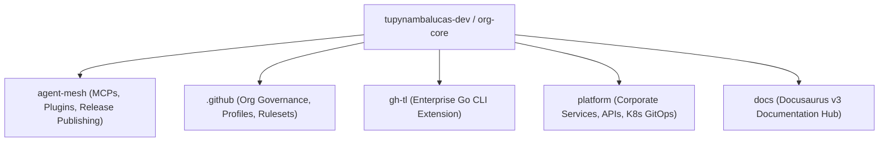
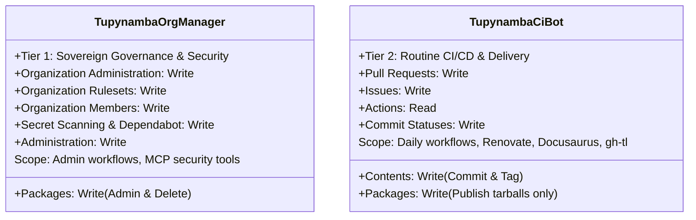
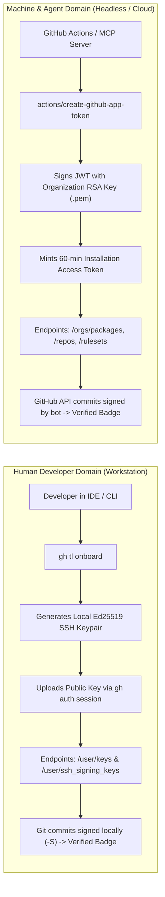

# GitHub App Organizational Architecture & Comprehensive Setup Guide
**Organization**: `tupynambalucas-dev`  
**Domain**: Enterprise Identity, Governance & CI/CD Automation  
**Classification**: Senior Architectural Specification & Didactic Runbook  
**Standard**: en-US Technical Specification (Strict Zero-Emoji Policy)

---

## 1. Executive Summary & Purpose

In modern cloud-native engineering organizations, managing access to source code, deployment artifacts, organizational rulesets, and release distribution requires a robust, zero-trust machine identity layer.

Relying on human developer credentials—such as Personal Access Tokens (Classic or Fine-Grained)—introduces catastrophic operational risks: credential leakage, lack of centralized rotation, attribution pollution in Git histories, hard rate limit exhaustion, and immediate pipeline failures when developers rotate passwords or leave the organization.

This guide provides the authoritative architectural blueprint for establishing sovereign **GitHub Apps** as first-class machine identities across the `tupynambalucas-dev` organization. It examines:
1. What GitHub Apps are mechanically and whether they require server code or function purely as permission/identity vehicles.
2. The multi-repository topology of `org-core` (`agent-mesh`, `.github`, `gh-tl`, `platform`, `docs`) and how many apps are required to satisfy the Principle of Least Privilege (PoLP).
3. The relationship between human developer workstation configuration (`gh-tl`) and machine identities (GitHub Apps) under the Dual-Verification Standard.
4. An exhaustive, didactic, field-by-field breakdown of every single option in GitHub's App registration portal.
5. Concrete runbooks for automated provisioning via GitHub App Manifests, Infisical Cloud Vault enrollment, and GitHub Actions workflow consumption.

---

## 2. Core Conceptual Fundamentals: How GitHub Apps Work

### 2.1 What is a GitHub App?
A **GitHub App** is a dedicated, first-class machine identity registered within GitHub. Unlike a user account, a GitHub App:
- Is owned directly by the organization (`tupynambalucas-dev`), not by an individual human.
- Does not consume a paid GitHub seat.
- Has dedicated, separate API rate limits (5,000 to 15,000 requests per hour).
- Issues temporary, cryptographically bounded tokens on demand.
- Signs its own Git commits with GitHub's green `Verified` badge under its official bot persona (`[bot]`).

### 2.2 Do GitHub Apps Need Code or Do They Serve Just to Grant Permissions?

> [!IMPORTANT]
> **A GitHub App DOES NOT inherently require external code, hosting infrastructure, or webhook servers to function.**

GitHub Apps operate across two distinct architectural modes:

```mermaid
flowchart TD
    subgraph ModeA ["Mode 1: Headless Machine Identity (Zero Server Code)"]
        A1["GitHub App Registration (App ID + RSA Key)"] --> A2["Client / CI Runner / MCP Server"]
        A2 --> A3["Signs RS256 JWT Locally using .pem"]
        A3 --> A4["Exchanges JWT with GitHub API for Installation Token"]
        A4 --> A5["Performs API Calls, Releases, Git Operations"]
    end

    subgraph ModeB ["Mode 2: Event-Driven Reactive Service (Code-Backed)"]
        B1["GitHub Event Occurs (Push, PR, Issue)"] --> B2["GitHub Webhook POST Request"]
        B2 --> B3["Publicly Hosted Backend Server (Node.js/Go on K8s)"]
        B3 --> B4["Verifies Webhook Secret HMAC SHA-256"]
        B4 --> B5["Executes Automated Response Logic"]
    end
```



1. **Headless Machine Identity (Zero-Code Mode)**:
   - **When to use**: CI/CD pipelines (GitHub Actions), local CLI tools, automated release publishers (`pnpm publish`), package purgers (`admin-packages.yml`), and MCP servers (`@tupynambalucas-dev/mcp-github`).
   - **How it works**: The app exists purely as an authentication and permission principal. It has **No Webhook URL** (`Active: false`), **No callback server**, and **No hosting cost**. GitHub Actions or local runners sign a JSON Web Token (JWT) using the app's RSA private key (`.pem`), exchange it with GitHub for a 60-minute ephemeral **Installation Access Token (IAT)**, and execute operations.
2. **Event-Driven Service (Code-Backed Mode)**:
   - **When to use**: Continuous background daemons that must react in real time to events (e.g. an issue comment triggering a Kubernetes agent pod, or a custom pull request gatekeeper).
   - **How it works**: Requires a public HTTP endpoint (`Webhook URL`) running a server (e.g. Express, Probot, or Go) to receive and verify webhook payloads signed with a shared secret.

For our current organization requirements, our GitHub Apps operate predominantly in **Mode 1 (Headless Machine Identity)**, providing sovereign credentials with zero infrastructure overhead.

### 2.3 The Three Authentication Tokens of GitHub Apps

GitHub Apps support three distinct token flows:

| Token Type | Abbreviation | Lifetime | Mechanics | Primary Use Case |
| :--- | :--- | :--- | :--- | :--- |
| **JSON Web Token** | `JWT` | Max 10 minutes | Signed locally via RS256 using App ID and RSA Private Key (`.pem`). | Authenticating as the App itself to query installations or request an installation token. |
| **Installation Access Token** | `IAT` | Exactly 60 minutes | Minted by calling `POST /app/installations/{id}/access_tokens` using a JWT. | **Server-to-Server automation**; all CI/CD, release publishing, repository governance, and package management. |
| **User Access Token** | `UAT` | 8 hours (with refresh token) | Minted via OAuth authorization flow when a user clicks "Authorize App". | User-to-Server interactions where the app acts strictly on behalf of an interactive user. |

---

## 3. Comparative Analysis: GitHub App vs Other Token Types

| Architectural Vector | Personal Access Token (Classic) | Fine-Grained Personal Access Token | Default `GITHUB_TOKEN` | GitHub App (`Installation Token`) |
| :--- | :--- | :--- | :--- | :--- |
| **Ownership** | Human developer account | Human developer account | GitHub Actions runner | **Organization (`tupynambalucas-dev`)** |
| **Lifecycle** | Manual / Static (months/years) | Hard expiry (max 1 year) | Per-job ephemeral | **Ephemeral 60-minute dynamic tokens** |
| **Authentication Secret** | Static plaintext string | Static plaintext string | Automatic | **2048-bit RSA Private Key (`.pem`)** |
| **Organization Packages** | Can delete if `delete:packages` | **BLOCKED** on org endpoints | **BLOCKED** on org deletion | **FULLY SUPPORTED** (`packages: write`) |
| **Trigger Downstream CI** | Yes (risk of infinite loops) | Yes | **Blocked** (cannot trigger CI) | **Yes (cleanly triggers workflows)** |
| **Commit Signature** | Requires developer SSH key | Requires developer SSH key | Generic Actions bot | **Cryptographically `Verified` by GitHub** |
| **Rate Limit** | 5,000/hr (shared with user) | 5,000/hr (shared with user) | 1,000/hr | **5,000 - 15,000/hr dedicated** |
| **Role Separation** | Impossible (coarse scopes) | Repository-only granular | Repository-only | **Full Tiered Organizational Separation** |

---

## 4. Multi-Repository Topology & App Strategy for `tupynambalucas-dev`

### 4.1 Meta-Repository Analysis (`org-core`)

Our umbrella meta-repository coordinates five distinct repositories:



1. **`agent-mesh`**:
   - Compiles and publishes 17 internal packages (7 MCP servers + 10 domain plugins) to `npm.pkg.github.com`.
   - Administers package registry versions (listing, purging obsolete packages).
   - Hosts `@tupynambalucas-dev/mcp-github`, which interrogates GitHub Security APIs (Secret Scanning, Dependabot), repository rulesets, and pull requests.
2. **`.github`**:
   - Manages organization-level configurations, community health files, issue/PR templates, and organization rulesets.
3. **`gh-tl`**:
   - Compiled Go CLI extension for developer onboarding and readiness verification.
   - Built and released via automated GitHub Actions (`cli/gh-extension-precompile@v2`).
4. **`platform`**:
   - Core monorepo running corporate backend services and frontend applications.
   - Executes Renovate Bot for automated dependency updates (`platform/.github/workflows/renovate.yml`).
   - Hosts Kubernetes GitOps manifests (`k8s/`).
5. **`docs`**:
   - Documentation hub powered by Docusaurus v3 and Crowdin localization actions.

### 4.2 How Many Apps Should We Create?

Creating a single monolithic app with full administrative privileges across all operations introduces severe security blast radius concerns. If a regular CI runner executing a third-party dependency build were compromised, having an installation token with organizational administrative rights could compromise the entire organization.

Applying the **Principle of Least Privilege (PoLP)** and **Role-Based Separation of Duties (SoD)**, we mandate **exactly TWO GitHub Apps**:



#### App 1: `tupynambalucas-org-manager` (Tier 1 - High Privilege)
- **Primary Persona**: `@tupynambalucas-org-manager[bot]`
- **Scope of Action**:
  - Administrative deletion and cleanup of packages on `npm.pkg.github.com` via `admin-packages.yml`.
  - Organization-level ruleset and branch protection configuration.
  - Security audit automation (triaging Secret Scanning and Dependabot alerts via `@tupynambalucas-dev/mcp-github`).
  - Organization membership and team management via `github-org-operator`.
- **Usage Context**: Restricted to administrative workflow runs (`workflow_dispatch`), MCP security tools, and emergency governance scripts.

#### App 2: `tupynambalucas-ci-bot` (Tier 2 - Operational Delivery)
- **Primary Persona**: `@tupynambalucas-ci-bot[bot]`
- **Scope of Action**:
  - Standard package publishing (`pnpm -r publish` in `publish.yml`).
  - Automated pull request creation, comments, and approvals.
  - Renovate Bot automated dependency management (`platform/.github/workflows/renovate.yml`).
  - Creating Git tags and releases for `gh-tl` binaries.
  - Crowdin translation synchronizations in `docs`.
- **Usage Context**: Used across routine daily CI/CD pipelines in all repositories. Possesses zero permissions to delete repositories, purge organization packages, alter members, or modify security rulesets.

---

### 4.3 Human Developer Identity (`gh-tl`) vs Machine Identity (GitHub Apps): The Dual-Verification Standard

A common architectural question is whether developer CLI extensions (such as `gh-tl`) should consume a GitHub App.

The enterprise architecture enforces a strict, intentional boundary:



#### Why `gh-tl` Operates Exclusively on the Developer's Personal Session:
1. **User Scope Isolation**: When a developer runs `gh tl onboard`, the goal is to register an authentication key (`POST /user/keys`) and an SSH signing key (`POST /user/ssh_signing_keys`) on that **individual human's personal GitHub account**. A GitHub App installation token represents the organization or bot, not the human user, and intentionally lacks permission to modify arbitrary personal user profiles.
2. **Native SDK Inheritance**: `gh-tl` uses `github.com/cli/go-gh/v2/pkg/api` (`api.DefaultRESTClient()`), which natively and seamlessly consumes the developer's existing `gh auth login` token. No external credentials, tokens, or app configurations are required.
3. **Zero Private Key Sprawl**: Distributing an organizational GitHub App's private key (`.pem`) to developer laptops is a critical security vulnerability. Developer machines must never hold bot master keys.

#### Where GitHub Apps and `gh-tl` Intersect:
1. **Automated Cross-Platform Releases**: The `gh-tl` repository releases precompiled binaries for Windows, Linux, and macOS via `gh-tl/.github/workflows/release.yml`. When release tags are generated by automation, the **Tier 2 App (`tupynambalucas-ci-bot`)** provides the installation token to publish release assets and generate attestations.
2. **Dual-Verification Compliance**: Every commit in the organization is guaranteed to be cryptographically verified:
   - Human commits: Signed with local SSH Ed25519 keys provisioned by `gh-tl onboard`.
   - Bot/Agent commits: Signed by GitHub's bot authority using GitHub App installation tokens.
   - Result: 100% `Verified` green commit badges across all 5 repositories with zero credential leakage.

---

## 5. Didactic Field-by-Field Registration Reference

When navigating to `https://github.com/organizations/tupynambalucas-dev/settings/apps/new`, GitHub presents a comprehensive set of configuration inputs. Below is the authoritative specification for every option.

### 5.1 App Metadata

| Field Name | Expected Value (`org-manager`) | Expected Value (`ci-bot`) | Technical Rationale |
| :--- | :--- | :--- | :--- |
| **GitHub App name** | `tupynambalucas-org-manager` | `tupynambalucas-ci-bot` | Maximum 34 characters. This name identifies the bot in commit histories, PR comments, and audit logs. |
| **Description** | `Sovereign organizational governance, security auditing, and package administration operator.` | `Autonomous CI/CD delivery bot for releases, dependency updates, and automated workflows.` | Displayed in GitHub settings and installation manifests. |
| **Homepage URL** | `https://docs.tupynambalucas.dev` | `https://docs.tupynambalucas.dev` | Canonical public URL representing the owning organization. |

---

### 5.2 Identifying & Authorizing Users (User-to-Server Flow)

These options govern interactive OAuth authorization (logging users into a website via GitHub).

| Option | Recommended Setting | Deep Technical Explanation |
| :--- | :--- | :--- |
| **Callback URL** | `http://localhost:3333/callback` *(or blank)* | Only required if generating User Access Tokens (UAT) via OAuth. For headless machine identities, this is ignored. We specify `http://localhost:3333/callback` solely to support the automated Manifest Provisioner script. |
| **Allow wildcard matching** | **UNCHECKED** | Allowing wildcard URLs (`https://*.example.com`) introduces major open-redirect vulnerabilities. Strict matching is required. |
| **Expire user authorization tokens** | **CHECKED** | Causes user access tokens to expire after 8 hours and issues refresh tokens. Best practice for token hygiene if OAuth is ever invoked. |
| **Request user authorization (OAuth) during installation** | **UNCHECKED** | When installing the app onto `tupynambalucas-dev`, we are establishing an **installation entity**, not authenticating a human user session. Keeping this unchecked prevents unnecessary browser redirect prompts during setup. |
| **Enable Device Flow** | **UNCHECKED** | Device flow allows OAuth authentication on headless devices (e.g. smart TVs or CLI tools showing a verification code). Not applicable to server-side CI/CD. |

---

### 5.3 Post Installation

| Option | Recommended Setting | Deep Technical Explanation |
| :--- | :--- | :--- |
| **Setup URL** | *Leave Empty* | Optional URL where GitHub redirects an administrator after installation. For internal machine identities, no external onboarding portal is needed. |
| **Redirect on update** | **UNCHECKED** | Prevents unwanted redirects when repositories are added or removed from the app's installation scope. |

---

### 5.4 Webhook Configuration

| Option | Recommended Setting | Deep Technical Explanation |
| :--- | :--- | :--- |
| **Active** | **UNCHECKED (Inactive)** | **CRITICAL**: If checked without a live, publicly reachable backend server, GitHub will continuously send POST requests for every event, encounter timeouts, log HTTP failures, and degrade health status. Since these apps operate as outbound machine identities (CI/CD and MCP tools calling GitHub APIs), webhooks must remain inactive. |
| **Webhook URL** | *Leave Empty* | Only configured when deploying an active webhook listener service in Kubernetes (`platform/k8s`). |
| **Webhook secret** | *Leave Empty* | Cryptographic secret for verifying HMAC-SHA256 signatures of incoming payloads. Not needed when inactive. |

---

### 5.5 Permissions Specification

GitHub permissions are strictly partitioned into four categories:

#### Category A: Repository Permissions

| Permission Key | `tupynambalucas-org-manager` | `tupynambalucas-ci-bot` | Operational Purpose |
| :--- | :--- | :--- | :--- |
| **Actions** | Read and write | Read-only | Manager can cancel or re-trigger workflows; CI Bot inspects status. |
| **Administration** | Read and write | No access | Manager configures repo settings, branch protections, and repository rules. |
| **Checks** | Read and write | Read and write | Emits granular check runs and status badges for PRs. |
| **Contents** | Read and write | Read and write | Reading code, committing automated releases, creating tags (`v1.0.0`). |
| **Dependabot alerts** | Read and write | No access | Manager triages and resolves security vulnerabilities. |
| **Issues** | Read and write | Read and write | Opening automated tracking issues, triage, closing resolved bugs. |
| **Packages** | **Read and write** | **Read and write** | **Manager purges/deletes packages; CI Bot uploads/publishes packages.** |
| **Pull requests** | Read and write | Read and write | Opening automated PRs (Renovate, docs translations, release bumps). |
| **Secret scanning alerts** | Read and write | No access | Manager triages leaked credentials and triggers secret rotation. |
| **Workflows** | Read and write | Read and write | Updating `.github/workflows/*.yml` files without permission rejection. |

#### Category B: Organization Permissions

| Permission Key | `tupynambalucas-org-manager` | `tupynambalucas-ci-bot` | Operational Purpose |
| :--- | :--- | :--- | :--- |
| **Administration** | Read and write | No access | Modifying organization settings, billing audit, security defaults. |
| **Members** | Read and write | No access | Managing team rosters, invitations, and repository assignments. |
| **Organization rulesets** | Read and write | No access | Enforcing organization-wide branch and tag protection policies. |
| **Custom repository roles**| Read-only | No access | Inspecting fine-grained organizational permission templates. |

#### Category C & D: Account & Enterprise Permissions
- **Account permissions**: No access needed (pertains to user email, profile, followers).
- **Enterprise permissions**: No access needed (applicable only to GitHub Enterprise Cloud accounts).

---

### 5.6 Subscribe to Events

When **Webhook** is set to **Inactive**, event subscriptions have no effect. When webhooks are activated in the future, subscriptions must align with selected permissions:
- `Release`: Dispatched when new GitHub releases are drafted or published.
- `Workflow run`: Dispatched when Actions pipelines complete or fail.
- `Security advisory`: Dispatched when CVEs impact organization packages.

---

### 5.7 Where Can This GitHub App Be Installed?

| Option | Selection | Deep Technical Explanation |
| :--- | :--- | :--- |
| **Only on this account** | **SELECTED (Mandatory)** | Restricts app installation strictly to `tupynambalucas-dev`. Prevents external entities from installing your machine identity on unauthorized GitHub accounts. |
| **Any account** | **PROHIBITED** | Used exclusively for commercial SaaS products (e.g. Snyk, Datadog) distributed via GitHub Marketplace. Never enable for internal enterprise apps. |

---

## 6. Provisioning Runbooks

### 6.1 Method A: Automated Provisioning via Manifest Flow (Recommended)

The organization provides an automated helper in `agent-mesh` implementing GitHub's official **App Manifest Flow**:

```bash
# In your terminal:
cd C:\Users\tupyn\projects\organizations\tupynambalucas-dev\org-core\agent-mesh

# Run the manager provisioner:
node plugins/packages/github-org/skills/github-app-operator/scripts/provision-app.js --profile=manager
```

#### What the Script Executes:
1. Spawns an ephemeral HTTP callback listener on `http://localhost:3333`.
2. Encodes the complete JSON manifest (name, permissions, inactive webhooks) into a POST form.
3. Automatically launches your default desktop browser at `https://github.com/organizations/tupynambalucas-dev/settings/apps/new`.
4. Displays GitHub's pre-filled confirmation screen: click **Create GitHub App**.
5. GitHub redirects back to `http://localhost:3333/callback` with an exchange code.
6. The script exchanges the code with GitHub's API, securely outputs the App ID, Client ID, and saves the RSA Private Key to `tupynambalucas-org-manager.private-key.pem` (mode `0600`).
7. Automatically opens the installation page: select **All repositories** and confirm.

---

### 6.2 Method B: Manual Registration via GitHub Web UI

If preferred, register manually via the browser:
1. Navigate to: `GitHub -> tupynambalucas-dev Organization Settings -> Developer settings -> GitHub Apps -> New GitHub App`.
2. Fill in metadata, permissions, and settings exactly as specified in **Section 5**.
3. Under **Webhook**, ensure **Active is UNCHECKED**.
4. Click **Create GitHub App**.
5. On the App details page:
   - Note the numeric **App ID** (e.g. `1048291`).
   - Note the **Client ID** (e.g. `Iv23...`).
   - Under **Private keys**, click **Generate a private key**. A `.pem` file will download to your machine.
6. In the left navigation, click **Install App**, find `tupynambalucas-dev`, click **Install**, and choose **All repositories**.
7. Note the **Installation ID** present in your browser URL (`https://github.com/organizations/tupynambalucas-dev/settings/apps/<slug>/installations/<INSTALLATION_ID>`).

---

## 7. Secret Governance & Storage Runbook

To adhere strictly to organizational Rule 4 (Secret Hygiene):
> [!CAUTION]
> Never commit `.pem` private keys or output raw private keys into terminal logs. All private keys are strictly git-ignored.

### 7.1 Infisical Cloud Vault Enrollment

Store the four identity credentials in Infisical project `tupynambalucas-dev-platform` across environments (`dev` and `prod`):

```bash
# Using Infisical CLI or MCP secrets tool:
GITHUB_APP_ID="<Numeric App ID>"
GITHUB_APP_CLIENT_ID="<Client ID>"
GITHUB_APP_INSTALLATION_ID="<Installation ID>"
GITHUB_APP_PRIVATE_KEY="<Complete contents of the .pem file with \n line breaks>"
```

### 7.2 GitHub Actions Secrets Enrollment

To make the credentials universally accessible across all workflows in all five repositories, configure them as **Organization Secrets** (`https://github.com/organizations/tupynambalucas-dev/settings/secrets/actions`):

| Secret Name | Content | Repository Access Policy |
| :--- | :--- | :--- |
| `ORGANIZATION_APP_ID` | Numeric App ID | Selected repositories: `agent-mesh`, `platform`, `.github`, `docs`, `gh-tl` |
| `ORGANIZATION_APP_PRIVATE_KEY` | Full content of `.pem` file | Selected repositories: `agent-mesh`, `platform`, `.github`, `docs`, `gh-tl` |

---

## 8. Workflow Consumption Architecture

Once enrolled, workflows across `agent-mesh`, `platform`, `docs`, and `gh-tl` consume the GitHub App token via the standard, pinned composite action:

### 8.1 Example: Package Deletion & Administration (`agent-mesh/.github/workflows/admin-packages.yml`)
```yaml
      - name: Generate GitHub App Token
        id: app-token
        if: ${{ (secrets.ORGANIZATION_APP_ID || secrets.APP_ID) != '' && (secrets.ORGANIZATION_APP_PRIVATE_KEY || secrets.APP_PRIVATE_KEY) != '' }}
        uses: actions/create-github-app-token@c1a285145b9d317df6ced56c09f525b5c2b6f755 # v1.11.1
        with:
          app-id: ${{ secrets.ORGANIZATION_APP_ID || secrets.APP_ID }}
          private-key: ${{ secrets.ORGANIZATION_APP_PRIVATE_KEY || secrets.APP_PRIVATE_KEY }}
          owner: ${{ github.repository_owner }}

      - name: Execute Package Administration Script
        env:
          ADMIN_TOKEN: ${{ steps.app-token.outputs.token || secrets.ADMIN_PACKAGES_TOKEN || secrets.GITHUB_TOKEN }}
          ADMIN_ACTION: ${{ inputs.action }}
          TARGET_PACKAGE: ${{ inputs.package_name }}
          DRY_RUN: ${{ inputs.dry_run }}
        run: node .github/scripts/manage-packages.js
```

### 8.2 Example: Native Package Publishing (`agent-mesh/.github/workflows/publish.yml`)
```yaml
      - name: Generate GitHub App Token
        id: app-token
        if: ${{ (secrets.ORGANIZATION_APP_ID || secrets.APP_ID) != '' && (secrets.ORGANIZATION_APP_PRIVATE_KEY || secrets.APP_PRIVATE_KEY) != '' }}
        uses: actions/create-github-app-token@c1a285145b9d317df6ced56c09f525b5c2b6f755 # v1.11.1
        with:
          app-id: ${{ secrets.ORGANIZATION_APP_ID || secrets.APP_ID }}
          private-key: ${{ secrets.ORGANIZATION_APP_PRIVATE_KEY || secrets.APP_PRIVATE_KEY }}
          owner: ${{ github.repository_owner }}

      - name: Publish Workspace Packages Idempotently (Native pnpm)
        env:
          NODE_AUTH_TOKEN: ${{ steps.app-token.outputs.token || secrets.GITHUB_TOKEN }}
        run: pnpm run packages:publish
```

### 8.3 Example: Cross-Platform Extension Release (`gh-tl/.github/workflows/release.yml`)
```yaml
name: release
on:
  push:
    tags:
      - "v*"

jobs:
  release:
    runs-on: ubuntu-latest
    steps:
      - uses: actions/checkout@11d5960a326750d5838078e36cf38b85af677262 # v4.2.2

      - name: Generate GitHub App Token
        id: app-token
        if: ${{ (secrets.ORGANIZATION_APP_ID || secrets.APP_ID) != '' && (secrets.ORGANIZATION_APP_PRIVATE_KEY || secrets.APP_PRIVATE_KEY) != '' }}
        uses: actions/create-github-app-token@c1a285145b9d317df6ced56c09f525b5c2b6f755 # v1.11.1
        with:
          app-id: ${{ secrets.ORGANIZATION_APP_ID || secrets.APP_ID }}
          private-key: ${{ secrets.ORGANIZATION_APP_PRIVATE_KEY || secrets.APP_PRIVATE_KEY }}
          owner: ${{ github.repository_owner }}

      - uses: cli/gh-extension-precompile@v2
        env:
          GITHUB_TOKEN: ${{ steps.app-token.outputs.token || secrets.GITHUB_TOKEN }}
        with:
          generate_attestations: true
          go_version_file: go.mod
```

---

## 9. Conclusion & Actionable Execution Checklist

1. **Architecture Confirmed**: GitHub Apps operate without code in headless mode for CI/CD and MCP tools.
2. **Two-Tier Separation**:
   - `tupynambalucas-org-manager` (High Privilege: Packages purge, Org governance, Security alerts).
   - `tupynambalucas-ci-bot` (Operational: Releases, Publishing, PRs, Renovate).
3. **Execution Path**:
   - Run `node plugins/packages/github-org/skills/github-app-operator/scripts/provision-app.js --profile=manager` to instantiate `tupynambalucas-org-manager` via the 1-click manifest flow.
   - Save `ORGANIZATION_APP_ID` and `ORGANIZATION_APP_PRIVATE_KEY` in GitHub Organization Secrets.
   - Re-run `admin-packages.yml` to purge remote packages, and trigger `publish.yml` for the clean inaugural `1.0.0` release.
