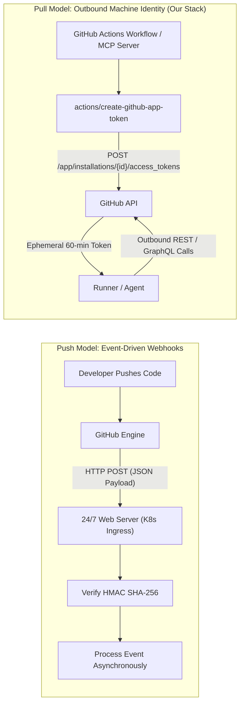
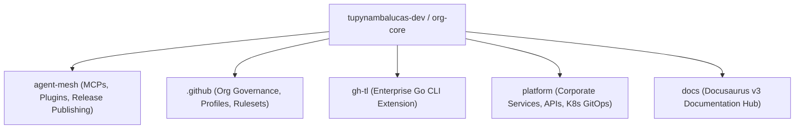
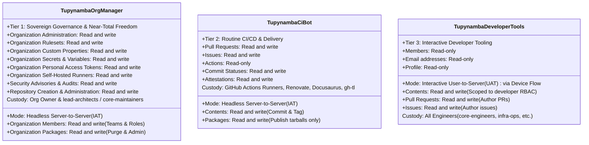
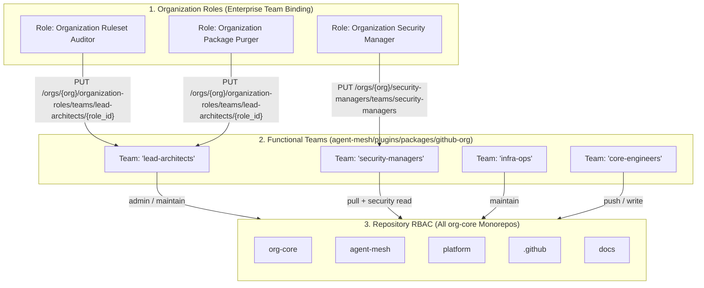
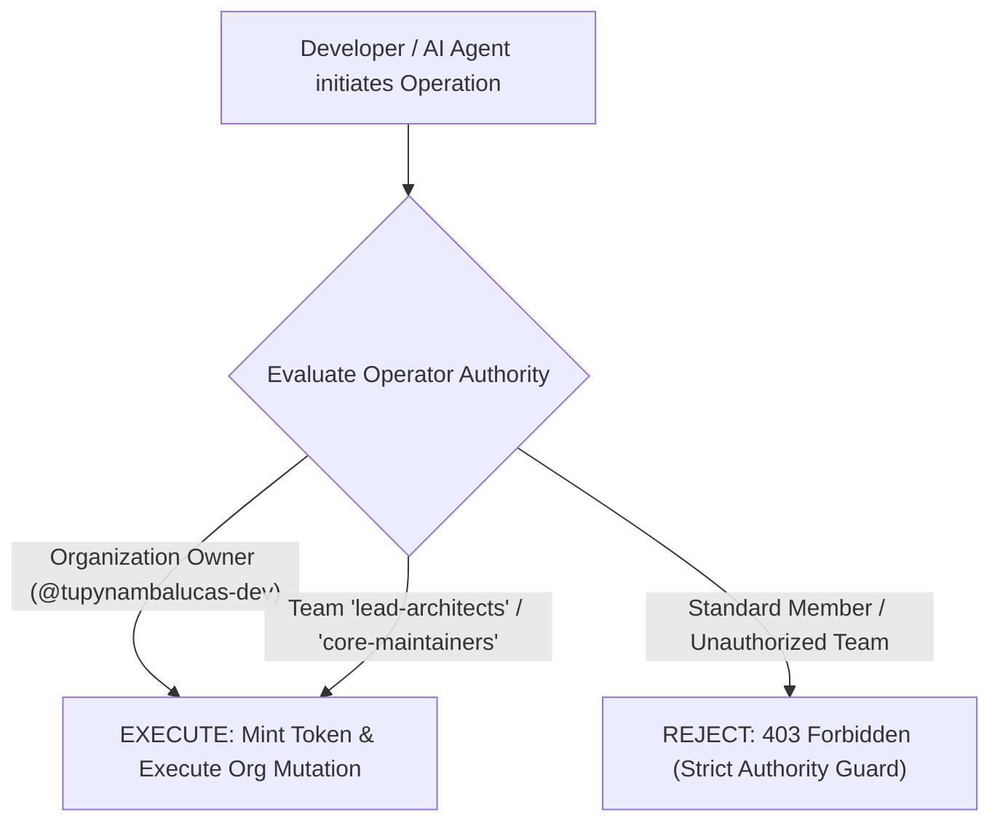
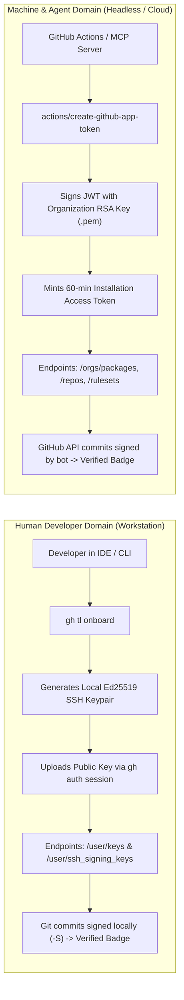
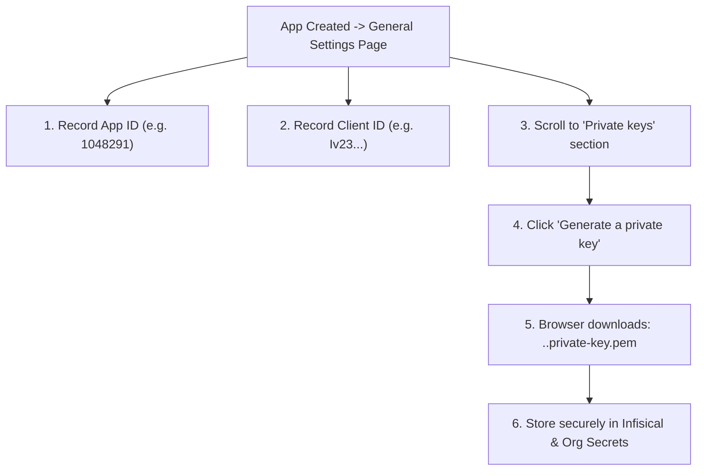

# GitHub App Organizational Architecture & Comprehensive Setup Guide
**Organization**: `tupynambalucas-dev`  
**Domain**: Enterprise Identity, Governance, CI/CD Automation & Workstation Integration  
**Classification**: Senior Architectural Specification & Didactic Runbook  
**Standard**: en-US Technical Specification (Strict Zero-Emoji Policy)

---

## 1. Executive Summary & Purpose

In modern cloud-native engineering organizations, managing access to source code, deployment artifacts, organizational rulesets, and release distribution requires a robust, zero-trust machine identity layer.

Relying on human developer credentials—such as Personal Access Tokens (Classic or Fine-Grained)—introduces catastrophic operational risks: credential leakage, lack of centralized rotation, attribution pollution in Git histories, hard rate limit exhaustion, and immediate pipeline failures when developers rotate passwords or leave the organization.

This guide provides the authoritative architectural blueprint for establishing sovereign **GitHub Apps** as first-class machine identities across the `tupynambalucas-dev` organization. It provides:
1. Conceptual foundation on what GitHub Apps are mechanically, explaining why they operate as pure permission/identity vehicles and do not require server code or hosting infrastructure.
2. A deep dive into GitHub App Webhooks: push vs pull architecture, why webhooks are unnecessary for outbound machine identities, and the operational hazards of activating webhooks without an active listener.
3. Multi-repository topology analysis across `org-core` (`agent-mesh`, `.github`, `gh-tl`, `platform`, `docs`) establishing a comprehensive **Three-Tier App model** (`tupynambalucas-org-manager`, `tupynambalucas-ci-bot`, and `tupynambalucas-developer-tools`) under the Principle of Least Privilege (PoLP) and Separation of Duties (SoD).
4. Near-Total Organizational Freedom specification for `tupynambalucas-org-manager`, detailing how to pre-configure organization-level roles and repository permissions directly on functional teams rather than individual developers.
5. Role-to-App Access Control Architecture and 5-Layer Defense-in-Depth Enforcement Model governing which teams have access to which apps and how unauthorized access is strictly blocked.
6. Exhaustive Master Permission Catalog comparing all 76 permissions supported by GitHub Apps across all three apps, mapped directly to plugin consumers in `agent-mesh/plugins`.
7. Dedicated interactive developer identity tier (`tupynambalucas-developer-tools`) implementing OAuth Device Flow, enabling CLI tooling (`gh-tl`) and developer workstations to authenticate seamlessly without private key sprawl.
8. The architectural boundary between human developer workstation configuration (`gh-tl`) and machine automation under the Dual-Verification Standard.
9. Strict Operator Authority Guard governing [`@tupynambalucas-dev/plugin-github-org`](file:///C:/Users/tupyn/projects/organizations/tupynambalucas-dev/org-core/agent-mesh/plugins/packages/github-org), ensuring only organization owners and top-tier administrative teams can execute high-privilege operations.
10. An exhaustive, didactic, screen-by-screen and checkbox-by-checkbox manual setup walkthrough for creating all three apps and assigning GitHub App Managers via GitHub's web interface.
11. Concrete runbooks for generating private keys, installing the apps on the organization, capturing Installation IDs, enrolling secrets into Infisical and GitHub Organization Secrets, and consuming them inside GitHub Actions workflows.

---

## 2. Core Conceptual Fundamentals: How GitHub Apps Work

### 2.1 What is a GitHub App?
A **GitHub App** is a dedicated, first-class machine identity registered within GitHub. Unlike a personal user account, a GitHub App:
- Is owned directly by the organization (`tupynambalucas-dev`), not tied to any individual developer.
- Does not consume a paid GitHub seat.
- Has dedicated, separate API rate limits (5,000 to 15,000 requests per hour depending on organization plan).
- Issues temporary, cryptographically bounded tokens on demand.
- Signs its own Git commits with GitHub's green `Verified` badge under its official bot persona (`[bot]`).

### 2.2 Do GitHub Apps Need Code or Do They Serve Just to Grant Permissions?

> [!IMPORTANT]
> **A GitHub App DOES NOT inherently require external code, hosting infrastructure, or webhook servers to function.**

GitHub Apps operate across two distinct architectural modes:

```mermaid
flowchart TD
    subgraph ModeA ["Mode 1: Headless Machine Identity (Zero Server Code)"]
        A1["GitHub App Registration (App ID + RSA Key)"] --> A2["Client / CI Runner / MCP Server"]
        A2 --> A3["Signs RS256 JWT Locally using .pem"]
        A3 --> A4["Exchanges JWT with GitHub API for Installation Token"]
        A4 --> A5["Performs API Calls, Releases, Git Operations"]
    end

    subgraph ModeB ["Mode 2: Event-Driven Reactive Service (Code-Backed)"]
        B1["GitHub Event Occurs (Push, PR, Issue)"] --> B2["GitHub Webhook POST Request"]
        B2 --> B3["Publicly Hosted Backend Server (Node.js/Go on K8s)"]
        B3 --> B4["Verifies Webhook Secret HMAC SHA-256"]
        B4 --> B5["Executes Automated Response Logic"]
    end
```



1. **Headless Machine Identity (Zero-Code Mode)**:
   - **Operational Purpose**: CI/CD pipelines (GitHub Actions), local CLI tools, automated release publishers (`pnpm publish`), package purgers (`admin-packages.yml`), and MCP servers (`@tupynambalucas-dev/mcp-github`).
   - **How it works**: The app exists purely as an authentication and permission principal. It has **No Webhook URL** (`Active: false`), **No callback server**, and **No hosting cost**. GitHub Actions runners or local developer environments sign a JSON Web Token (JWT) using the app's RSA private key (`.pem`), exchange it with GitHub for a 60-minute ephemeral **Installation Access Token (IAT)**, and execute operations.
2. **Event-Driven Service (Code-Backed Mode)**:
   - **Operational Purpose**: Continuous background daemons that must react in real time to events (e.g. an issue comment triggering a Kubernetes agent pod, or a custom pull request gatekeeper).
   - **How it works**: Requires a public HTTP endpoint (`Webhook URL`) running a server (e.g. Express, Probot, or Go) to receive and verify webhook payloads signed with a shared secret.

For our organizational requirements, our GitHub Apps operate in **Mode 1 (Headless Machine Identity)**, providing sovereign credentials with zero infrastructure overhead.

### 2.3 The Three Authentication Tokens of GitHub Apps

GitHub Apps support three distinct token flows:

| Token Type | Abbreviation | Lifetime | Mechanics | Primary Use Case |
| :--- | :--- | :--- | :--- | :--- |
| **JSON Web Token** | `JWT` | Max 10 minutes | Signed locally via RS256 using App ID and RSA Private Key (`.pem`). | Authenticating as the App itself to query installations or request an installation token. |
| **Installation Access Token** | `IAT` | Exactly 60 minutes | Minted by calling `POST /app/installations/{id}/access_tokens` using a JWT. | **Server-to-Server automation**; all CI/CD, release publishing, repository governance, and package management. |
| **User Access Token** | `UAT` | 8 hours (with refresh token) | Minted via OAuth authorization or Device Flow when a user authorizes the App. | **User-to-Server developer tooling**; interactive CLI commands (`gh-tl`), developer portals, and IDE extensions. |

---

## 3. Webhooks Deep Dive: Push vs. Pull Architecture & Inactive Discipline

### 3.1 Architectural Paradigms: Push (Webhooks) vs Pull (API Tokens)

Understanding whether an organization requires webhooks comes down to the direction of event dispatching:



- **Push Model (Webhooks)**: GitHub actively initiates an outbound HTTP `POST` request to an external server whenever a subscribed repository or organization event occurs. The external server must acknowledge the request with an HTTP 2xx status within 10 seconds.
- **Pull / On-Demand Model (API Tokens)**: Our internal automation tools (GitHub Actions workflows or MCP servers) initiate outbound HTTPS requests to GitHub's REST/GraphQL API using an ephemeral token. GitHub never calls our infrastructure; our infrastructure calls GitHub.

### 3.2 Do We Need Webhooks for Our GitHub Apps?

> [!IMPORTANT]
> **NO, we DO NOT need webhooks for our GitHub Apps.**  
> When registering all three apps in GitHub, the **Webhook Active checkbox MUST BE UNCHECKED (Inactive)**.

Here is the exhaustive technical rationale:

1. **GitHub Actions Executes on GitHub Infrastructure**:
   - Our CI/CD workflows (`publish.yml`, `admin-packages.yml`, `ci.yml`, `release.yml`, `renovate.yml`) are triggered internally by GitHub's native workflow engine via triggers like `on: push`, `on: pull_request`, `on: schedule`, or `on: workflow_dispatch`.
   - Workflows do not need an external webhook to wake them up. They generate the GitHub App token inline using the official action `actions/create-github-app-token`.
2. **MCP Agents Execute on Local Developer or Runner Prompts**:
   - Our MCP server (`@tupynambalucas-dev/mcp-github`) operates on demand when an AI agent requests a tool invocation (such as `list_rulesets`, `list_secret_scanning_alerts`, or `get_repo_info`).
   - The MCP server uses the App ID and Private Key to mint an Installation Access Token and execute outbound queries. It never receives inbound webhook events.
3. **Developer CLI Tools Authenticate via Device Flow**:
   - Developer tools (`gh-tl`) use OAuth Device Flow (`POST /login/device/code` and polling `POST /login/oauth/access_token`), which is an outbound HTTP polling flow. Webhooks are not used.
4. **Zero Hosting Requirement**:
   - By leaving webhooks inactive, we eliminate the need to run, monitor, patch, and maintain a publicly reachable HTTP server, domain name, SSL certificate, or Kubernetes ingress controller.

### 3.3 Operational Hazards of Leaving Webhooks Active Without a Listener

If an administrator mistakenly checks **Active** on the Webhook configuration without providing an active, 24/7 web server:

1. **100% Delivery Failures & Red Alarms**:
   - Every single Git push, commit, pull request, or issue created in any repository across the organization will cause GitHub to dispatch an HTTP POST request to the Webhook URL.
   - If the URL is blank, invalid, or pointing to an inactive host, GitHub records a delivery failure.
   - GitHub displays persistent red warning banners in the GitHub App settings dashboard indicating that deliveries are failing.
2. **Resource Waste & Retry Throttling**:
   - GitHub implements automatic retry loops with exponential backoff for failed deliveries, consuming unnecessary outbound queue resources and polluting GitHub audit logs.
3. **Security Ingress Liability**:
   - Activating a webhook requires exposing an endpoint to the public internet, necessitating HMAC-SHA256 signature verification (`X-Hub-Signature-256`), replay attack protection, rate limiting, and DDoS mitigation.

### 3.4 Future Scenarios: When and How Webhooks Would Be Activated

Webhooks would only be activated if the organization chooses to deploy an event-driven bot daemon in the future:

- **Scenario 1: Reactive Kubernetes ChatOps Bot**: An automated agent daemon running in `platform/k8s` that continuously listens for issue or PR comments (e.g. `/deploy staging`, `/run-benchmark`, `/review-a11y`) and acts immediately upon receipt.
- **Scenario 2: Real-Time Organization Audit Sink**: An audit daemon that intercepts `repository.created` or `member.added` events to enforce instant compliance policies before any code is committed.

If such a service is deployed in the future:
1. Navigate to `GitHub -> Organization Settings -> Developer settings -> GitHub Apps -> Edit`.
2. Check **Active**.
3. Set **Webhook URL** to the production ingress endpoint (e.g. `https://api.tupynambalucas.dev/webhooks/github`).
4. Generate a 64-character high-entropy secret, set **Webhook secret**, and record it in Infisical.
5. Subscribe only to specific, required events.

For our current requirements, **keeping Webhook Inactive is strictly mandatory across all three apps**.

---

## 4. Comparative Analysis: GitHub App vs Other Token Types

| Architectural Vector | Personal Access Token (Classic) | Fine-Grained Personal Access Token | Default `GITHUB_TOKEN` | GitHub App (`Installation Token`) | GitHub App (`User Access Token`) |
| :--- | :--- | :--- | :--- | :--- | :--- |
| **Ownership** | Human developer account | Human developer account | GitHub Actions runner | **Organization (`tupynambalucas-dev`)** | **Organization (delegated to User)** |
| **Lifecycle** | Manual / Static (months/years) | Hard expiry (max 1 year) | Per-job ephemeral | **Ephemeral 60-minute dynamic tokens** | **8-hour token with refresh rotation** |
| **Authentication Secret** | Static plaintext string | Static plaintext string | Automatic | **2048-bit RSA Private Key (`.pem`)** | **OAuth Device Flow (No private key)** |
| **Organization Packages** | Can delete if `delete:packages` | **BLOCKED** on org endpoints | **BLOCKED** on org deletion | **FULLY SUPPORTED** (`packages: write`) | Bounded by user team RBAC |
| **Trigger Downstream CI** | Yes (risk of infinite loops) | Yes | **Blocked** (cannot trigger CI) | **Yes (cleanly triggers workflows)** | **Yes (attributed to human user)** |
| **Commit Signature** | Requires developer SSH key | Requires developer SSH key | Generic Actions bot | **Cryptographically `Verified` by Bot** | **Attributed to Developer Account** |
| **Rate Limit** | 5,000/hr (shared with user) | 5,000/hr (shared with user) | 1,000/hr | **5,000 - 15,000/hr dedicated** | 5,000/hr dedicated per user |
| **Role Separation** | Impossible (coarse scopes) | Repository-only granular | Repository-only | **Tiered Organizational Separation** | **App Scopes ∩ Team RBAC** |

---

## 5. Multi-Repository Topology & The Three-Tier Enterprise Identity Architecture

### 5.1 Meta-Repository Analysis (`org-core`)

Our umbrella meta-repository coordinates five distinct repositories:



1. **`agent-mesh`**:
   - Compiles and publishes 17 internal packages (7 MCP servers + 10 domain plugins) to `npm.pkg.github.com`.
   - Administers package registry versions (listing, purging obsolete packages via REST API).
   - Hosts `@tupynambalucas-dev/mcp-github`, interrogating GitHub Security APIs (Secret Scanning, Dependabot), repository rulesets, and pull requests.
2. **`.github`**:
   - Manages organization-level configurations, community health files, issue/PR templates, and organization rulesets.
3. **`gh-tl`**:
   - Compiled Go CLI extension for developer onboarding and readiness verification.
   - Built and released via automated GitHub Actions (`cli/gh-extension-precompile@v2`).
4. **`platform`**:
   - Core monorepo running corporate backend services and frontend applications.
   - Executes Renovate Bot for automated dependency updates (`platform/.github/workflows/renovate.yml`).
   - Hosts Kubernetes GitOps manifests (`k8s/`).
5. **`docs`**:
   - Sovereign documentation hub powered by Docusaurus v3 and Crowdin localization actions.

### 5.2 Why the Three-Tier Model is the Enterprise Gold Standard

In top-tier engineering organizations, identity must be strictly segmented across three orthogonal axes:
1. **Executive Organizational Governance** (High privilege, strictly controlled custody).
2. **Autonomous Machine Delivery** (Headless CI/CD, limited delivery scope, zero administrative rights).
3. **Interactive Developer Tooling** (Developer persona, OAuth Device Flow, zero private key distribution).



#### App 1: `tupynambalucas-org-manager` (Tier 1 - Sovereign Governance & Near-Total Freedom)
- **Primary Persona**: `@tupynambalucas-org-manager[bot]`
- **Authentication Model**: Server-to-Server via RSA Private Key (`.pem`) -> Installation Access Token (`IAT`).
- **Scope of Action**:
  - Sovereign organization-level administration, team provisioning, and member management.
  - Pre-defining organization-level roles directly onto functional teams (`PUT /orgs/{org}/organization-roles/teams/{team_slug}/{role_id}`).
  - Designating official Security Manager teams across all repositories (`PUT /orgs/{org}/security-managers/teams/{team_slug}`).
  - Assigning pre-defined repository RBAC permissions to teams across all monorepos (`PUT /orgs/{org}/teams/{team_slug}/repos/{owner}/{repo}`).
  - Administrative deletion and cleanup of packages on `npm.pkg.github.com` via `admin-packages.yml`.
  - Managing organization secrets, variables, fine-grained PAT requests, and repository rulesets.
- **Custody & Usage**: Strictly restricted to the Organization Owner (`@tupynambalucas-dev`) and the executive engineering council (`lead-architects` / `core-maintainers`). Consumed exclusively in administrative workflow runs (`workflow_dispatch`), MCP security tools, and emergency governance runbooks.

#### App 2: `tupynambalucas-ci-bot` (Tier 2 - Operational Machine Delivery)
- **Primary Persona**: `@tupynambalucas-ci-bot[bot]`
- **Authentication Model**: Server-to-Server via RSA Private Key (`.pem`) -> Installation Access Token (`IAT`).
- **Scope of Action**:
  - Standard package publishing (`pnpm -r publish` in `publish.yml`).
  - Automated pull request creation, comments, and approvals.
  - Renovate Bot automated dependency management (`platform/.github/workflows/renovate.yml`).
  - Creating Git tags and releases for `gh-tl` binaries.
  - Crowdin translation synchronizations in `docs`.
- **Custody & Usage**: Used across routine daily CI/CD pipelines in all repositories. Possesses zero permissions to delete repositories, purge organization packages, alter members, or modify security rulesets.

#### App 3: `tupynambalucas-developer-tools` (Tier 3 - Interactive Developer Self-Service)
- **Primary Persona**: The authenticated human developer (attributed as `actor: octocat`, `programmatic_access_type: GitHub App user-to-server token`).
- **Authentication Model**: Interactive User-to-Server via **OAuth Device Flow** -> User Access Token (`UAT`) with 8-hour rotation.
- **Why Tier 3 Eliminates Developer Friction and Security Vulnerabilities**:
  1. **Zero Personal Access Tokens (PATs)**: Developers no longer create static Personal Access Tokens that leak on disk, bypass SSO, or outlive the developer's tenure.
  2. **Zero Private Key Distribution**: The App's RSA private key is never distributed to developer workstations. The CLI tool (`gh-tl`) only embeds the public `Client ID`.
  3. **Device Flow Authentication**: When running `gh tl login` or internal CLI commands, the developer is prompted to visit `https://github.com/login/device` and enter a temporary 8-character code, granting an ephemeral 8-hour token with refresh tokens.
  4. **Dual-Bounded Principle of Least Privilege**: Actions performed by Tier 3 are strictly bounded by the **intersection** of the App's permissions and the developer's assigned team RBAC. A developer cannot perform actions their team does not allow.
  5. **Instant Central Revocation**: If a developer's laptop is compromised or lost, an administrator can revoke the App's authorization with a single click in GitHub Organization settings, instantly killing all active sessions.

---

### 5.3 Near-Total Organizational Freedom: Pre-Configuring Roles Directly on Teams

A critical requirement of our organization model is that we do not want developers or administrators to manually configure permissions user-by-user or repository-by-repository. Instead, **functional teams must be first-class security principals endowed with pre-defined organization roles and pre-defined repository permissions**.



#### How `tupynambalucas-org-manager` Executes Team Role Bindings:
1. **Assigning Organization Roles to Teams**:
   - Calling `PUT /orgs/{org}/organization-roles/teams/{team_slug}/{role_id}` assigns an organization-level role directly to a team.
   - Any engineer assigned to `lead-architects` or `infra-ops` automatically inherits that organization role without individual user role grants.
2. **Assigning Security Manager Authority**:
   - Calling `PUT /orgs/{org}/security-managers/teams/{team_slug}` designates a team as an official Security Manager, granting its members read access to all private repositories and full access to Secret Scanning, Dependabot, and CodeQL alerts organization-wide.
3. **Pre-Defining Repository Permissions**:
   - Calling `PUT /orgs/{org}/teams/{team_slug}/repos/{owner}/{repo}` binds the team to repositories with pre-configured access levels (`admin`, `maintain`, `push`, `pull`).
   - New repositories provisioned by the bot automatically inherit these team mappings.

---

### 5.4 Operator Authority Guard for `@tupynambalucas-dev/plugin-github-org`

Because `tupynambalucas-org-manager` holds near-total organizational authority, access to invoke [`@tupynambalucas-dev/plugin-github-org`](file:///C:/Users/tupyn/projects/organizations/tupynambalucas-dev/org-core/agent-mesh/plugins/packages/github-org) (`github-org-operator`, `github-app-operator`, `github-ruleset-operator`, `github-security-auditor`) must be strictly governed:



#### Governing Rules:
1. **Repository/Organization Owner Exclusivity**: The organization owner (`tupynambalucas-dev`) retains sovereign, unrestricted authority to trigger all operations.
2. **Near-Maximal Administrative Teams**: In automated environments, only callers belonging to `lead-architects` or `core-maintainers` are authorized to invoke `github-org-operator`.
3. **Cryptographic Boundary**: The App private key (`.pem`) is never exposed in plain text, never saved to developer machines, and is accessible solely via Infisical Cloud Vault and GitHub Actions Organization Secrets.

---

### 5.5 Role-to-App Access Control Architecture & 5-Layer Defense-in-Depth Enforcement Model

To resolve the fundamental governance question of how access to each App is granted to specific roles while strictly preventing unauthorized teams or developers from abusing elevated privileges, the organization implements a **5-Layer Defense-in-Depth Security Model**:

```mermaid
flowchart TD
    subgraph Layer1 ["Layer 1: GitHub Web UI 'App Managers' Delegation"]
        L1["Organization Settings -> GitHub Apps -> App managers"]
        L1 --> L1A["App 1 (org-manager): Assigned ONLY to 'lead-architects' & Owner"]
        L1 --> L1B["App 2 (ci-bot): Assigned to 'lead-architects' & 'infra-ops'"]
        L1 --> L1C["App 3 (developer-tools): Managed by 'lead-architects'"]
    end

    subgraph Layer2 ["Layer 2: Cryptographic Vault Isolation (Infisical RBAC)"]
        L2["Infisical Cloud Vault Permissions"]
        L2 --> L2A["Project: platform / Environment: prod (Folder: /governance)"]
        L2A -->|Holds Org Manager .pem| L2A1["Readable ONLY by Owner & 'lead-architects'"]
        L2 --> L2B["Project: platform / Environment: staging / ci-cd"]
        L2B -->|Holds CI Bot .pem| L2B1["Readable by CI Machine Identities & 'infra-ops'"]
        L2 --> L2C["App 3: NO RSA KEY EXISTS (Public Client ID only)"]
    end

    subgraph Layer3 ["Layer 3: GitHub Organization Secrets Repository & Environment Scoping"]
        L3["GitHub Organization Secrets Policy"]
        L3 --> L3A["ORGANIZATION_APP_PRIVATE_KEY: Scoped ONLY to .github and org-core"]
        L3 --> L3B["CI_APP_PRIVATE_KEY: Scoped to all delivery monorepos"]
        L3 --> L3C["Environment Approval Gates: Production deployment requires Owner sign-off"]
    end

    subgraph Layer4 ["Layer 4: Runtime Operator Authority Guard (Plugin Hook)"]
        L4["resolve-operator-role.js in @tupynambalucas-dev/plugin-github-org"]
        L4 --> L4A{"Evaluate Caller Team Membership"}
        L4A -- "Caller in lead-architects or Owner" --> L4B["Permit Execution (privilegeLevel = level-3)"]
        L4A -- "Caller in other teams" --> L4C["Reject with 403 Forbidden: Missing Level-3 Privilege"]
    end

    subgraph Layer5 ["Layer 5: OAuth Device Flow User Access Token (UAT) Dual-Boundary"]
        L5["Developer Workstations running gh-tl login"]
        L5 --> L5A["Mints User Access Token (UAT) for App 3"]
        L5A --> L5B["Effective Rights = App 3 Scopes ∩ Developer Team RBAC"]
        L5B --> L5C["Zero Org Admin Rights physically possible via App 3"]
    end
```



#### 5.5.1 The Complete Organizational Role-to-App Access Matrix

| Functional Role / Team | Privilege Tier | Access to App 1 (`org-manager`) | Access to App 2 (`ci-bot`) | Access to App 3 (`developer-tools`) | Primary Enforcement Mechanism |
| :--- | :---: | :---: | :---: | :---: | :--- |
| **Organization Owner** (`@tupynambalucas-dev`) | **Sovereign** | **Full Direct Access** | **Full Direct Access** | **Full Direct Access** | GitHub Root Owner + Infisical Master Key. |
| **`lead-architects`** / `core-maintainers` | **Level 3 (Admin)** | **Authorized Operator** | Audit / Manage | **Authorized User** | GitHub App Manager + Infisical Prod Vault (`/governance`). |
| **`security-managers`** | **Level 2 (Security)** | Read Alerts via Security Role | No Access | **Authorized User** | Designated via `PUT /security-managers/teams/security-managers`. |
| **`infra-ops`** | **Level 2 (DevOps)** | **BLOCKED** | CI Runner Execution | **Authorized User** | GitHub App Manager on CI Bot + Infisical Staging Vault. |
| **`core-engineers`** | **Level 1 (Developer)** | **BLOCKED** | Indirect via CI Triggers | **Authorized User** | Device Flow UAT (`gh tl login`) ∩ Repository `push` RBAC. |
| **`technical-writers`** | **Level 1 (Docs)** | **BLOCKED** | Indirect via CI Triggers | **Authorized User** | Device Flow UAT (`gh tl login`) ∩ Repository `maintain` on `docs`. |
| **`creative-team`** | **Level 1 (Creative)** | **BLOCKED** | Indirect via CI Triggers | **Authorized User** | Device Flow UAT (`gh tl login`) ∩ Repository `push` on assets. |
| **`contractors`** | **Level 0 (External)** | **BLOCKED** | **BLOCKED** | **BLOCKED** (or Delegated) | Org Third-Party App Policy blocks unauthorized app installation. |

#### 5.5.2 How Unauthorized Roles Are Physically and Cryptographically Blocked:
1. **Why `core-engineers` Cannot Use `tupynambalucas-org-manager`**:
   - `tupynambalucas-org-manager` is a Server-to-Server App. It has no user login, no device flow, and no OAuth web interface.
   - To invoke it, a client MUST sign a JWT using the 2048-bit RSA Private Key (`.pem`).
   - The RSA Private Key is vaulted in Infisical under `tupynambalucas-dev-platform [prod] /governance/`.
   - The Infisical RBAC policy restricts access to `/governance/` strictly to identities bound to `lead-architects` and the Organization Owner.
   - When a core engineer runs `infisical export`, Infisical denies access with `403 Forbidden`. Without the `.pem` file, generating an Installation Access Token is cryptographically impossible.
2. **Why `infra-ops` Cannot Escalate to Org Administration**:
   - `infra-ops` engineers manage CI/CD pipelines and infrastructure, having access to Infisical `staging` and GitHub Actions secrets for daily delivery.
   - They are granted App Manager status on `tupynambalucas-ci-bot` (Tier 2), allowing them to manage CI bot credentials.
   - However, they are NOT granted App Manager on `tupynambalucas-org-manager` (Tier 1), preventing them from viewing or regenerating the Tier 1 key.
   - Furthermore, the runtime Operator Authority Guard script (`resolve-operator-role.js`) assigns `privilegeLevel = level-2` to `infra-ops`, automatically disabling `capabilities.organizationAdmin`.
3. **Why Developers Authenticating via App 3 Cannot Elevate Privileges**:
   - When developers run `gh tl login`, they authenticate through **App 3 (`tupynambalucas-developer-tools`)** via OAuth Device Flow.
   - The token issued by GitHub is a **User Access Token (UAT)**.
   - GitHub enforces: `Effective Permissions = App 3 Scopes ∩ Developer's Personal/Team Permissions`.
   - Even if App 3 declares `Contents: Read and write`, if a developer only has `pull` access to `org-core`, GitHub prevents write operations.
   - Additionally, App 3 declares **zero administrative scopes** on the organization (`organization_administration: no access`, `organization_secrets: no access`, `organization_rulesets: no access`), making privilege escalation structurally impossible.

---

### 5.6 Human Developer Identity (`gh-tl`) vs Machine Identity (GitHub Apps): The Dual-Verification Standard

The enterprise architecture enforces a strict boundary between human workstations and cloud automation:



#### Why `gh-tl` Operates Exclusively on the Developer's Personal Session:
1. **User Scope Isolation**: When a developer runs `gh tl onboard`, the goal is to register an authentication key (`POST /user/keys`) and an SSH signing key (`POST /user/ssh_signing_keys`) on that **individual human's personal GitHub account**. A GitHub App installation token represents the organization or bot, not the human user, and intentionally lacks permission to modify arbitrary personal user profiles.
2. **Native SDK Inheritance**: `gh-tl` uses `github.com/cli/go-gh/v2/pkg/api` (`api.DefaultRESTClient()`), which natively consumes the developer's existing `gh auth login` token or Tier 3 User Access Tokens.
3. **Zero Private Key Sprawl**: Distributing an organizational GitHub App's private key (`.pem`) to developer laptops is a critical security vulnerability. Developer machines must never hold bot master keys.

#### Dual-Verification Compliance Result:
- Human commits: Signed with local SSH Ed25519 keys provisioned by `gh-tl onboard`.
- Bot/Agent commits: Signed by GitHub's bot authority using GitHub App installation tokens.
- Result: 100% `Verified` green commit badges across all 5 repositories with zero credential leakage.

---

## 6. Manual GitHub Web UI Creation Walkthrough (Screen-by-Screen & Field-by-Field)

This section provides the authoritative, exhaustive runbook for manually registering all three GitHub Apps directly through the GitHub Web UI.

### 6.1 Master GitHub App Permission Matrix (Exhaustive Catalog)

The following master catalog maps all permissions supported by GitHub Apps, comparing the exact required levels across our three apps and identifying the primary consumer plugins in `agent-mesh/plugins`:

#### 6.1.1 Repository Permissions (34 Total Permissions)

| UI Permission Name | API Slug | Tier 1: `org-manager` | Tier 2: `ci-bot` | Tier 3: `developer-tools` | Primary Consumers & Purpose |
| :--- | :--- | :---: | :---: | :---: | :--- |
| **Actions** | `actions` | **Read and write** | **Read-only** | **Read-only** | `plugin-github-flow` (`github-actions-operator`), CI runner inspection, `gh-tl`. |
| **Administration** | `administration` | **Read and write** | No access | No access | `plugin-github-org` (`github-org-operator`, `github-ruleset-operator`). |
| **Agent secrets** | `agent_secrets` | No access | No access | No access | Copilot custom agent secrets (not currently utilized). |
| **Agent variables** | `agent_variables` | No access | No access | No access | Copilot custom agent variables (not currently utilized). |
| **Artifact metadata** | `artifact_metadata` | **Read and write** | **Read and write** | No access | Build artifact provenance inspection and release publishing. |
| **Attestations** | `attestations` | **Read and write** | **Read and write** | No access | Sigstore/SLSA build attestations for npm packages and `gh-tl` binaries. |
| **Checks** | `checks` | **Read and write** | **Read and write** | **Read-only** | `plugin-github-flow`, test suites, linting reports, CI checks. |
| **Code quality** | `code_quality` | No access | No access | No access | Automated code quality metrics (reserved for future linters). |
| **Code scanning alerts** | `code_scanning_alerts` | **Read and write** | No access | No access | `plugin-github-org` (`github-security-auditor`), CodeQL triage. |
| **Codespaces** | `codespaces` | No access | No access | No access | Codespace instance lifecycle management. |
| **Codespaces lifecycle admin** | `codespaces_lifecycle_admin` | No access | No access | No access | Codespace auto-shutdown policies. |
| **Codespaces metadata** | `codespaces_metadata` | No access | No access | No access | Codespace devcontainer specifications. |
| **Codespaces secrets** | `codespaces_secrets` | No access | No access | No access | Codespace repository secret injection. |
| **Commit statuses** | `statuses` | **Read and write** | **Read and write** | **Read-only** | `plugin-github-flow`, CI commit status markers, `gh-tl` status checks. |
| **Contents** | `contents` | **Read and write** | **Read and write** | **Read and write** | `plugin-github-flow`, `plugin-repo`, `gh-tl`, Git branching, commits, release tags. |
| **Copilot agent settings** | `copilot_agent_settings` | No access | No access | No access | Repository-level Copilot extension enablement. |
| **Custom properties** | `custom_properties` | **Read and write** | No access | No access | `plugin-github-org`, repository custom property definitions. |
| **Dependabot alerts** | `dependabot_alerts` | **Read and write** | No access | No access | `plugin-github-org` (`github-security-auditor`), Dependabot alert audits. |
| **Dependabot secrets** | `dependabot_secrets` | **Read and write** | No access | No access | `plugin-github-org`, private registry secrets for Dependabot. |
| **Deployments** | `deployments` | **Read and write** | **Read and write** | **Read-only** | CI deployment tracking, environment rollouts, `gh-tl`. |
| **Discussions** | `discussions` | No access | No access | **Read and write** | Developer community discussions and Q&A interactions. |
| **Environments** | `environments` | **Read and write** | **Read-only** | No access | `plugin-github-org`, deployment protection rules, reviewer requirements. |
| **Issues** | `issues` | **Read and write** | **Read and write** | **Read and write** | `plugin-github-flow`, `gh-tl`, CI issue reporting, triage workflows. |
| **Metadata** | `metadata` | **Read-only (Mandatory)** | **Read-only (Mandatory)** | **Read-only (Mandatory)** | Universal repository metadata inspection (always enforced by GitHub). |
| **Packages** | `packages` | **Read and write** | **Read and write** | No access | `agent-mesh` release publishing (Tier 2) and package purging/admin (Tier 1). |
| **Pages** | `pages` | No access | No access | No access | GitHub Pages deployment (docs hosted via sovereign platform). |
| **Pull requests** | `pull_requests` | **Read and write** | **Read and write** | **Read and write** | `plugin-github-flow`, `plugin-repo`, `gh-tl`, Renovate PR creation and review. |
| **Repository creation** | `repository_creation` | **Read and write** | No access | No access | `plugin-github-org` (`github-org-operator`), new repo provisioning. |
| **Repository security advisories** | `repository_security_advisories` | **Read and write** | No access | No access | `plugin-github-org` (`github-security-auditor`), CVE disclosure management. |
| **Repository app installation access** | `repository_app_installation_access` | **Read and write** | No access | No access | `plugin-github-org`, managing which repos an app is installed on. |
| **Secret scanning alerts** | `secret_scanning_alerts` | **Read and write** | No access | No access | `plugin-github-org` (`github-security-auditor`), token leak triage. |
| **Secrets** | `secrets` | **Read and write** | No access | No access | `plugin-github-org`, repository encrypted secret management. |
| **Variables** | `variables` | **Read and write** | No access | No access | `plugin-github-org`, repository configuration variables. |
| **Webhooks** | `webhooks` | No access | No access | No access | Inactive per Section 3 discipline. |
| **Workflows** | `workflows` | **Read and write** | **Read and write** | **Read and write** | `plugin-github-flow`, `plugin-repo`, editing `.github/workflows/` files. |

#### 6.1.2 Organization Permissions (28 Total Permissions)

| UI Permission Name | API Slug | Tier 1: `org-manager` | Tier 2: `ci-bot` | Tier 3: `developer-tools` | Primary Consumers & Purpose |
| :--- | :--- | :---: | :---: | :---: | :--- |
| **Administration** | `organization_administration` | **Read and write** | No access | No access | `plugin-github-org`, org settings, security managers, Actions policies. |
| **Agent secrets** | `organization_agent_secrets` | No access | No access | No access | Org-wide Copilot agent secrets (not currently utilized). |
| **Agent variables** | `organization_agent_variables` | No access | No access | No access | Org-wide Copilot agent variables (not currently utilized). |
| **API Insights** | `organization_api_insights` | **Read-only** | No access | No access | Rate limit usage analytics and route-by-actor statistics. |
| **Blocking users** | `organization_user_blocking` | **Read and write** | No access | No access | `plugin-github-org`, blocking abusive accounts from org repos. |
| **Campaigns** | `organization_campaigns` | No access | No access | No access | Code scanning remediation campaigns across the organization. |
| **Copilot Spaces** | `organization_copilot_spaces` | No access | No access | No access | Shared context containers for GitHub Copilot. |
| **Copilot agent settings** | `organization_copilot_agent_settings` | No access | No access | No access | Organizational Copilot agent extension settings. |
| **Copilot content exclusion** | `organization_copilot_content_exclusion` | No access | No access | No access | Excluding proprietary repos from Copilot indexing. |
| **Custom organization roles** | `organization_custom_org_roles` | **Read and write** | No access | No access | `plugin-github-org`, managing and assigning custom org roles to teams. |
| **Custom properties** | `organization_custom_properties` | **Read and write** | No access | No access | `plugin-github-org`, defining org property schemas and values. |
| **Events** | `organization_events` | **Read-only** | No access | **Read-only** | Org public event audit logs, developer activity monitoring. |
| **GitHub Copilot Business** | `organization_copilot_business` | No access | No access | No access | Managing Copilot seats for functional teams. |
| **Issue Fields** | `organization_issue_fields` | No access | No access | No access | Custom field schemas for organization projects. |
| **Issue Types** | `organization_issue_types` | No access | No access | No access | Custom organization issue types (Bug, Feature, Chore, Epic). |
| **Members** | `organization_members` | **Read and write** | No access | **Read-only** | **MASTER RBAC**: Team creation, team repo binding, org roles on teams. |
| **Organization Copilot metrics** | `organization_copilot_metrics` | No access | No access | No access | Aggregated Copilot engagement reports. |
| **Organization private registries** | `organization_private_registries` | **Read and write** | No access | No access | Configuring access to external private package registries. |
| **Organization rulesets** | `organization_rulesets` | **Read and write** | No access | No access | `plugin-github-org` (`github-ruleset-operator`), branch/tag protection. |
| **Organization security advisories** | `organization_security_advisories` | **Read and write** | No access | No access | `plugin-github-org` (`github-security-auditor`), org-wide CVE posture. |
| **Packages** | `organization_packages` | **Read and write** | No access | No access | `agent-mesh` administrative package deletion via `admin-packages.yml`. |
| **Personal access token requests** | `organization_personal_access_token_requests` | **Read and write** | No access | No access | `plugin-github-org`, approving/denying fine-grained PAT requests. |
| **Personal access tokens** | `organization_personal_access_tokens` | **Read and write** | No access | No access | `plugin-github-org`, auditing and revoking active personal tokens. |
| **Projects** | `organization_projects` | **Read and write** | No access | No access | Managing organization-level GitHub Projects (v2) boards and views. |
| **Secrets** | `organization_secrets` | **Read and write** | No access | No access | `plugin-github-org`, organization-wide encrypted secret management. |
| **Self-hosted runners** | `organization_self_hosted_runners` | **Read and write** | No access | No access | Managing org-wide runner groups and registration tokens. |
| **Variables** | `organization_variables` | **Read and write** | No access | No access | `plugin-github-org`, organization-wide configuration variables. |
| **Webhooks** | `organization_hooks` | No access | No access | No access | Inactive per Section 3 discipline. |

#### 6.1.3 Account (User) Permissions (14 Total Permissions)

| UI Permission Name | API Slug | Tier 1: `org-manager` | Tier 2: `ci-bot` | Tier 3: `developer-tools` | Primary Consumers & Purpose |
| :--- | :--- | :---: | :---: | :---: | :--- |
| **Block another user** | `block_another_user` | No access | No access | No access | User-level blocked user management. |
| **Codespaces user secrets** | `codespaces_user_secrets` | No access | No access | No access | User personal Codespaces secret management. |
| **Email addresses** | `email_addresses` | No access | No access | **Read-only** | `gh-tl`, retrieving verified primary email for local Git config. |
| **Followers** | `followers` | No access | No access | No access | Social following capabilities. |
| **Gists** | `gists` | No access | No access | No access | Personal gist authoring. |
| **Git SSH keys** | `git_ssh_keys` | No access | No access | No access | SSH keys managed directly via developer session in `gh-tl`. |
| **GPG keys** | `gpg_keys` | No access | No access | No access | GPG signing keys management. |
| **Interaction limits** | `interaction_limits` | No access | No access | No access | User-level interaction restriction management. |
| **Plan** | `plan` | No access | No access | **Read-only** | `gh-tl`, querying user billing tier for CLI capability checks. |
| **Private repository invitations** | `private_repository_invitations` | No access | No access | No access | Accepting incoming collaborator invitations. |
| **Profile** | `profile` | No access | No access | **Read-only** | `gh-tl`, retrieving developer avatar, bio, and username for terminal UI. |
| **SSH signing keys** | `ssh_signing_keys` | No access | No access | No access | SSH signing keys provisioned via personal session in `gh-tl`. |
| **Starring** | `starring` | No access | No access | **Read and write** | Developer bookmarking and repository starring. |
| **Watching** | `watching` | No access | No access | **Read and write** | Developer repository notification and thread subscriptions. |

---

### 6.2 Accessing the Registration Interface

1. Open your desktop browser and log in with your administrative account.
2. Navigate directly to the organization app creation portal:
   `https://github.com/organizations/tupynambalucas-dev/settings/apps/new`
   *(Alternative navigation: Click your profile picture -> **Your organizations** -> click **tupynambalucas-dev** -> **Settings** -> left sidebar **Developer settings** -> **GitHub Apps** -> click **New GitHub App**).*

---

### 6.3 Step-by-Step Walkthrough for App 1: `tupynambalucas-org-manager` (Tier 1 - Near-Total Freedom)

Follow each field sequentially:

#### Step 1: App Metadata
- **GitHub App name**: `tupynambalucas-org-manager`  
  *(Must be unique across all of GitHub, maximum 34 characters).*
- **Description** *(Markdown supported - copy and paste the formatted block below directly into GitHub's Description field)*:

````markdown
### Sovereign Organizational Governance & Machine Identity Operator

`tupynambalucas-org-manager` is the Tier-1 executive machine identity for `tupynambalucas-dev`, providing automated organizational governance, team RBAC orchestration, security posture oversight, and package lifecycle administration.

#### Core Responsibilities
- **RBAC & Team Administration**: Programmatic management of functional teams (`lead-architects`, `security-managers`, `infra-ops`, `core-engineers`) and direct assignment of organization roles to teams.
- **Rulesets & Protection**: Enforcement of organization-wide branch protection rulesets, tag protection policies, and required status checks.
- **Security Auditing**: Comprehensive oversight of Secret Scanning alerts, Dependabot vulnerabilities, and CodeQL security scanning via `@tupynambalucas-dev/mcp-github`.
- **Package Governance**: Administrative deletion and cleanup of obsolete package versions on GitHub Packages (`npm.pkg.github.com`).
- **Secrets & Token Governance**: Centralized audit and management of fine-grained personal access tokens and organization variables.

#### Custody & Security Architecture
- **Authentication**: Headless Server-to-Server via 2048-bit RSA Private Key (`.pem`) minting ephemeral 60-minute Installation Access Tokens (IAT).
- **Custody**: Strictly restricted to the Organization Owner (`@tupynambalucas-dev`) and executive leadership (`lead-architects` / `core-maintainers`).
- **Vaulting**: Vaulted in Infisical Cloud (`tupynambalucas-dev-platform [prod] /governance/`) and repository-scoped GitHub Organization Secrets (`.github`, `org-core`).
- **Webhooks**: Strictly disabled (`Active: false`) for outbound-only on-demand operations.

> [!NOTE]
> Automated operations authored by this machine identity carry GitHub's official **Verified** badge under `@tupynambalucas-org-manager[bot]`.
````

- **Homepage URL**:  
  `https://docs.tupynambalucas.dev`

#### Step 2: Identifying and Authorizing Users (User-to-Server)
- **Callback URL**: *Leave completely empty*  
  *(Not used for headless server-to-server operations).*
- **Allow wildcard matching**: **UNCHECKED**
- **Expire user authorization tokens**: **CHECKED**  
  *(Enforces secure 8-hour expiry if OAuth is ever invoked).*
- **Request user authorization (OAuth) during installation**: **UNCHECKED**  
  *(Prevents confusing user login prompts during organization installation).*
- **Enable Device Flow**: **UNCHECKED**

#### Step 3: Post Installation
- **Setup URL**: *Leave completely empty*
- **Redirect on update**: **UNCHECKED**

#### Step 4: Webhook Configuration
- **Active**: **UNCHECKED (Desmarcado / Inactive)**  
  *(CRITICAL: Disables outbound webhook POST requests from GitHub).*
- **Webhook URL**: *Disabled / Leave empty*
- **Webhook secret**: *Disabled / Leave empty*
- **SSL verification**: *Disabled / Leave default*

#### Step 5: Repository Permissions (Permissions -> Repository permissions)
Click each dropdown and configure the exact values below:

| Permission Name in GitHub UI | Required Setting | Technical Operational Rationale |
| :--- | :--- | :--- |
| **Actions** | **Read and write** | Trigger, cancel, or re-run workflows via API. |
| **Administration** | **Read and write** | Manage repository settings, branch protections, and repo rules. |
| **Artifact metadata** | **Read and write** | Inspect and publish metadata and attestations for build artifacts. |
| **Attestations** | **Read and write** | Cryptographically sign and write artifact provenance attestations (Sigstore/SLSA). |
| **Checks** | **Read and write** | Create and update status checks and automated annotations. |
| **Code scanning alerts** | **Read and write** | Needed for `@tupynambalucas-dev/mcp-github` security audits. |
| **Commit statuses** | **Read and write** | Publish build status markers on commits. |
| **Contents** | **Read and write** | Read code, commit files, create branches, push tags (`v1.0.0`). |
| **Custom properties** | **Read and write** | Read and set repository-specific custom property values. |
| **Dependabot alerts** | **Read and write** | Needed for `@tupynambalucas-dev/mcp-github` vulnerability triage. |
| **Dependabot secrets** | **Read and write** | Manage private registry tokens consumed by Dependabot. |
| **Deployments** | **Read and write** | Create deployment records, track environment rollouts. |
| **Environments** | **Read and write** | Manage deployment environment rules and approvals. |
| **GitHub App installation repository access** | **Read and write** | Manage which GitHub App installations have access to the repo. |
| **Issues** | **Read and write** | Open governance issues and automated notices. |
| **Metadata** | **Read-only (Mandatory)** | Automatically set by GitHub; allows reading repository names. |
| **Packages** | **Read and write** | **CRITICAL: Grants REST API rights to list and delete package versions.** |
| **Pull requests** | **Read and write** | Inspect, comment, approve, and manage pull requests. |
| **Repository creation** | **Read and write** | Allows the bot to create new repositories in the organization. |
| **Repository security advisories** | **Read and write** | Audit repository CVE status and manage security disclosures. |
| **Secret scanning alerts** | **Read and write** | Needed for `@tupynambalucas-dev/mcp-github` secret audits. |
| **Secrets** | **Read and write** | Manage repository-level encrypted secrets for GitHub Actions. |
| **Variables** | **Read and write** | Manage repository-level configuration variables. |
| **Workflows** | **Read and write** | Update workflow files in `.github/workflows/`. |

*(All other repository permissions not listed above should remain **No access**).*

#### Step 6: Organization Permissions (Permissions -> Organization permissions)
Click each dropdown and configure the exact values below:

| Permission Name in GitHub UI | Required Setting | Technical Operational Rationale |
| :--- | :--- | :--- |
| **Administration** | **Read and write** | Organization-level settings, security managers, and Actions policies. |
| **API Insights** | **Read-only** | Retrieve API rate usage statistics by actor, route, and subject. |
| **Blocking users** | **Read and write** | Block abusive accounts from interacting with organization repos. |
| **Custom organization roles** | **Read and write** | Manage custom organization roles and retrieve IDs for team assignment. |
| **Custom properties** | **Read and write** | Define org property schemas and bulk assign values to repos. |
| **Events** | **Read-only** | Organization-wide event audit logs for compliance tracking. |
| **Members** | **Read and write** | **MASTER RBAC: Create teams, update teams, set team repo access, and assign organization roles directly to teams.** |
| **Organization private registries** | **Read and write** | Configure access to external private package registries. |
| **Organization rulesets** | **Read and write** | **CRITICAL: Create and enforce org-wide branch and tag protection policies.** |
| **Organization security advisories** | **Read and write** | Organization-wide security posture audits. |
| **Packages** | **Read and write** | **CRITICAL: Organization-level package administrative operations and purge.** |
| **Personal access tokens** | **Read and write** | Audit and revoke fine-grained personal access tokens. |
| **Personal access token requests** | **Read and write** | Approve or deny fine-grained PAT requests. |
| **Projects** | **Read and write** | Manage organization-level GitHub Projects (v2) boards and views. |
| **Secrets** | **Read and write** | Manage organization-wide secrets for Actions and Dependabot. |
| **Self-hosted runners** | **Read and write** | Manage organization runner groups and runner registrations. |
| **Variables** | **Read and write** | Manage organization-wide configuration variables. |

*(All other organization permissions not listed above should remain **No access**).*

#### Step 7: Account Permissions
- Keep all Account permissions set to **No access**.

#### Step 8: Subscribe to Events
- Inactive / Grayed out per Webhook Unchecked setting.

#### Step 9: Where Can This GitHub App Be Installed?
- Select: **Only on this account** (`@tupynambalucas-dev`).

#### Step 10: Complete Creation
- Click the green button: **Create GitHub App**.

---

### 6.4 Step-by-Step Walkthrough for App 2: `tupynambalucas-ci-bot` (Tier 2 - Operational Delivery)

Follow each field sequentially:

#### Step 1: App Metadata
- **GitHub App name**: `tupynambalucas-ci-bot`
- **Description** *(Markdown supported - copy and paste the formatted block below directly into GitHub's Description field)*:

````markdown
### Autonomous CI/CD Delivery & Package Release Automation Bot

`tupynambalucas-ci-bot` is the Tier-2 headless delivery identity for `tupynambalucas-dev`, driving routine continuous integration, automated package releases, dependency maintenance, and build attestations across all monorepos.

#### Core Responsibilities
- **Package Publishing**: Automated publishing of workspace packages to GitHub Packages (`npm.pkg.github.com`) with Sigstore/SLSA provenance attestations.
- **Continuous Integration**: Reporting commit status markers, publishing check runs, and surfacing automated test/lint annotations.
- **Dependency Automation**: Opening, updating, and auto-merging dependency PRs via Renovate Bot (`platform/.github/workflows/renovate.yml`).
- **Binary Releases**: Compiling, tagging, and distributing multi-platform release binaries for `gh-tl` via `cli/gh-extension-precompile`.
- **Documentation Localization**: Synchronizing CrowdIn translation pull requests and previews for `docs`.

#### Custody & Security Architecture
- **Authentication**: Server-to-Server Installation Access Tokens (IAT) generated in-memory on ephemeral GitHub Actions runners.
- **Principle of Least Privilege**: Strictly isolated from organization administration, repository deletion, member management, and security ruleset modification.
- **Custody**: Co-managed by `lead-architects` and `infra-ops`.
- **Webhooks**: Strictly disabled (`Active: false`) for outbound-only token consumption via `actions/create-github-app-token`.

> [!NOTE]
> Routine CI/CD commits and release tags authored by this bot carry the cryptographic **Verified** badge under `@tupynambalucas-ci-bot[bot]`.
````

- **Homepage URL**:  
  `https://docs.tupynambalucas.dev`

#### Step 2: Identifying and Authorizing Users (User-to-Server)
- **Callback URL**: *Leave completely empty*
- **Allow wildcard matching**: **UNCHECKED**
- **Expire user authorization tokens**: **CHECKED**
- **Request user authorization (OAuth) during installation**: **UNCHECKED**
- **Enable Device Flow**: **UNCHECKED**

#### Step 3: Post Installation
- **Setup URL**: *Leave completely empty*
- **Redirect on update**: **UNCHECKED**

#### Step 4: Webhook Configuration
- **Active**: **UNCHECKED (Desmarcado / Inactive)**
- **Webhook URL**: *Disabled / Leave empty*
- **Webhook secret**: *Disabled / Leave empty*
- **SSL verification**: *Disabled / Leave default*

#### Step 5: Repository Permissions (Permissions -> Repository permissions)
Click each dropdown and configure the exact values below:

| Permission Name in GitHub UI | Required Setting | Technical Operational Rationale |
| :--- | :--- | :--- |
| **Actions** | **Read-only** | Check workflow run states without power to cancel pipelines. |
| **Administration** | **No access** | Strict PoLP isolation: CI bot cannot modify repo settings. |
| **Artifact metadata** | **Read and write** | Publish metadata and build digests during package release. |
| **Attestations** | **Read and write** | Write Sigstore artifact provenance attestations for releases. |
| **Checks** | **Read and write** | Emit test reports and linting status checks. |
| **Commit statuses** | **Read and write** | Report build status badges on commits. |
| **Contents** | **Read and write** | **Push release tags (`v1.0.0`) and automated changelog commits.** |
| **Deployments** | **Read and write** | Track deployment statuses and environments for releases. |
| **Issues** | **Read and write** | Open and comment on build failure tracking issues. |
| **Metadata** | **Read-only (Mandatory)** | Automatically set by GitHub. |
| **Packages** | **Read and write** | **Publish tarballs (`pnpm -r publish`). Cannot delete.** |
| **Pull requests** | **Read and write** | Renovate Bot and release automations to open PRs. |
| **Workflows** | **Read and write** | Automated PRs modifying `.github/workflows/` files. |

*(All other repository permissions should remain **No access**).*

#### Step 6: Organization Permissions
- Set all Organization permissions to **No access**.

#### Step 7: Account Permissions
- Set all Account permissions to **No access**.

#### Step 8: Subscribe to Events
- Grayed out / Inactive.

#### Step 9: Where Can This GitHub App Be Installed?
- Select: **Only on this account** (`@tupynambalucas-dev`).

#### Step 10: Complete Creation
- Click the green button: **Create GitHub App**.

---

### 6.5 Step-by-Step Walkthrough for App 3: `tupynambalucas-developer-tools` (Tier 3 - Interactive Developer Self-Service)

Follow each field sequentially:

#### Step 1: App Metadata
- **GitHub App name**: `tupynambalucas-developer-tools`
- **Description** *(Markdown supported - copy and paste the formatted block below directly into GitHub's Description field)*:

````markdown
### Interactive Developer Tooling & Workstation Self-Service Identity

`tupynambalucas-developer-tools` is the Tier-3 developer enablement identity for `tupynambalucas-dev`, providing secure, passwordless authentication for developer workstations, internal CLI extensions (`gh-tl`), IDE tools, and local engineering workflows without static access tokens.

#### Core Capabilities
- **OAuth Device Flow Integration**: Authenticates engineers via `https://github.com/login/device` with auto-expiring 8-hour User Access Tokens (UAT) and automatic refresh rotation.
- **Zero Static Personal Access Tokens**: Completely eliminates high-risk classic and fine-grained PATs from developer laptops.
- **Workstation Verification & Onboarding**: Powers `gh tl onboard` and `gh tl verify` to validate local Git configuration, SSH commit signing keys, and repository remotes.
- **Interactive Developer Workflows**: Enables human-attributed Git branching, PR authoring, code review comments, and issue triage from terminal and IDE interfaces.

#### Dual-Boundary Security Architecture
- **Zero Private Key Distribution**: No RSA private key is ever generated or distributed to developer machines; CLI clients embed only the public `Client ID`.
- **Intersection of Rights**: Operates strictly within the intersection of the App permissions and the individual developer's team RBAC (`Effective Rights = App Scopes ∩ Team RBAC`).
- **Zero Administrative Authority**: Holds zero organization-level administrative scopes, ensuring developer sessions cannot alter security rulesets, teams, or billing.
- **Instant Revocation**: Compromised or decommissioned workstations can be revoked instantly by an administrator via Organization Settings with zero key rotation impact on CI/CD.

> [!IMPORTANT]
> Commits and pull request reviews created through this tool are attributed to the individual developer's verified human username with `programmatic_access_type: GitHub App user-to-server token`.
````

- **Homepage URL**:  
  `https://docs.tupynambalucas.dev`

#### Step 2: Identifying and Authorizing Users (User-to-Server)
- **Callback URL**: *Leave completely empty*
- **Allow wildcard matching**: **UNCHECKED**
- **Expire user authorization tokens**: **CHECKED**  
  *(Enforces secure 8-hour token expiration with refresh tokens).*
- **Request user authorization (OAuth) during installation**: **UNCHECKED**
- **Enable Device Flow**: **CHECKED (Obrigatório / Mandatory)**  
  *(CRITICAL: Allows CLI tools like `gh-tl` to authenticate developers via `https://github.com/login/device` without web redirects).*

#### Step 3: Post Installation
- **Setup URL**: *Leave completely empty*
- **Redirect on update**: **UNCHECKED**

#### Step 4: Webhook Configuration
- **Active**: **UNCHECKED (Desmarcado / Inactive)**
- **Webhook URL**: *Disabled / Leave empty*
- **Webhook secret**: *Disabled / Leave empty*
- **SSL verification**: *Disabled / Leave default*

#### Step 5: Repository Permissions (Permissions -> Repository permissions)
Click each dropdown and configure the exact values below:

| Permission Name in GitHub UI | Required Setting | Technical Operational Rationale |
| :--- | :--- | :--- |
| **Actions** | **Read-only** | Inspect workflow logs and run statuses from CLI. |
| **Administration** | **No access** | Strict PoLP isolation: Developer App cannot alter repository configurations. |
| **Checks** | **Read-only** | Inspect test check suites and annotations from CLI. |
| **Commit statuses** | **Read-only** | View status indicators on pull request branches. |
| **Contents** | **Read and write** | **Push feature branches and create commits on assigned repos.** |
| **Deployments** | **Read-only** | View environment rollout states from developer CLI. |
| **Discussions** | **Read and write** | Participate in repository discussions and technical Q&A. |
| **Issues** | **Read and write** | Open, comment, and triage issues on user behalf. |
| **Metadata** | **Read-only (Mandatory)** | Automatically set by GitHub. |
| **Pull requests** | **Read and write** | Author PRs, add review comments, and inspect review statuses. |
| **Workflows** | **Read and write** | Allow developers to create and edit workflow files in feature branches. |

*(All other repository permissions should remain **No access**).*

#### Step 6: Organization Permissions (Permissions -> Organization permissions)
| Permission Name in GitHub UI | Required Setting | Technical Operational Rationale |
| :--- | :--- | :--- |
| **Events** | **Read-only** | Query organization activity stream from developer dashboard. |
| **Members** | **Read-only** | Query functional team rosters and organization collaborators. |

*(All other organization permissions should remain **No access**).*

#### Step 7: Account Permissions (Permissions -> Account permissions)
| Permission Name in GitHub UI | Required Setting | Technical Operational Rationale |
| :--- | :--- | :--- |
| **Email addresses** | **Read-only** | Retrieve verified primary email for local Git signature configuration. |
| **Plan** | **Read-only** | Query user billing tier for CLI capability validation. |
| **Profile** | **Read-only** | Retrieve developer avatar, name, and username for terminal UI. |
| **Starring** | **Read and write** | Developer bookmarking and starring repositories. |
| **Watching** | **Read and write** | Managing repository subscriptions and notifications. |

*(All other account permissions should remain **No access**).*

#### Step 8: Subscribe to Events
- Grayed out / Inactive.

#### Step 9: Where Can This GitHub App Be Installed?
- Select: **Only on this account** (`@tupynambalucas-dev`).

#### Step 10: Complete Creation
- Click the green button: **Create GitHub App**.
- *Note for Tier 3*: Developers consume exclusively the **Client ID** (alphanumeric string). No RSA private key is ever generated or distributed for Tier 3.

---

### 6.6 Generating and Securing the RSA Private Key (`.pem`)

Immediately after creating `tupynambalucas-org-manager` (Tier 1) and `tupynambalucas-ci-bot` (Tier 2), GitHub displays the **General** settings page for the new app:



1. **Record the App ID**: At the top of the **General** page, find **App ID** (numeric string, e.g. `1149202`). Copy this number.
2. **Record the Client ID**: Right below App ID, find **Client ID** (alphanumeric string, e.g. `Iv23...`). Copy this value.
3. **Generate Private Key**:
   - Scroll down to the section titled **Private keys**.
   - Click the button **Generate a private key**.
   - GitHub generates a 2048-bit RSA private key and downloads a file named `<app-name>.<timestamp>.private-key.pem` to your computer.
   - Store this file securely. Never commit it to any Git repository.

---

### 6.7 Installing the Apps on the Organization and Capturing Installation IDs

A registered GitHub App cannot perform any actions until it is **installed** on the organization:

1. On the left navigation sidebar of your GitHub App settings, click **Install App**.
2. GitHub displays a list of accounts where you have administrative access. Locate `tupynambalucas-dev` and click the green **Install** button next to it.
3. In the repository selection prompt:
   - Select **All repositories** *(ensures all 5 repositories in `org-core` inherit the identity)*.
4. Click **Install**.
5. GitHub redirects you to the organization settings page for the installation:
   - Examine your browser's address bar URL:
     `https://github.com/organizations/tupynambalucas-dev/settings/installations/62345678`
   - The trailing integer (e.g. `62345678`) is your **Installation ID**.
   - Copy this number for Infisical storage.

---

### 6.8 Configuring GitHub App Managers (Step-by-Step UI Guide)

To enforce Layer 1 of our Defense-in-Depth model, the Organization Owner must delegate App Management authority strictly to authorized functional teams:

#### 6.8.1 Assigning App Managers to `tupynambalucas-org-manager` (Tier 1)
1. In the top-right corner of GitHub, click your profile picture -> **Your organizations** -> click **tupynambalucas-dev**.
2. Click the **Settings** tab under the organization profile.
3. In the left navigation sidebar, scroll down to **Developer settings** and click **GitHub Apps**.
4. In the list of GitHub Apps, click on the name or icon of **`tupynambalucas-org-manager`**.
5. In the inner left sidebar of the app settings, click **App managers**.
6. In the search box under *App managers*, type the team name: `lead-architects`.
7. Click **Grant**.
8. Confirm that `lead-architects` appears in the App managers list.
9. Verify that NO OTHER TEAMS (`core-engineers`, `infra-ops`, etc.) are listed.

#### 6.8.2 Assigning App Managers to `tupynambalucas-ci-bot` (Tier 2)
1. Repeat steps 1 to 4 and select **`tupynambalucas-ci-bot`**.
2. In the inner left sidebar, click **App managers**.
3. In the search box, type `lead-architects` and click **Grant**.
4. In the search box, type `infra-ops` and click **Grant**.
5. Confirm that both `lead-architects` and `infra-ops` appear as managers.

---

## 7. Alternative Automated Provisioning via Manifest Flow

For developers who prefer command-line automation, the repository provides a pre-configured provisioner in `agent-mesh`:

```bash
cd C:\Users\tupyn\projects\organizations\tupynambalucas-dev\org-core\agent-mesh

# Run the automated manager provisioner:
node plugins/packages/github-org/skills/github-app-operator/scripts/provision-app.js --profile=manager
```

### What the Script Executes:
1. Spawns an ephemeral HTTP callback listener on `http://localhost:3333`.
2. Encodes the complete JSON manifest (name, permissions, inactive webhooks) into a POST form.
3. Automatically launches your desktop browser at `https://github.com/organizations/tupynambalucas-dev/settings/apps/new`.
4. Displays GitHub's pre-filled confirmation screen: click **Create GitHub App**.
5. GitHub redirects back to `http://localhost:3333/callback` with an exchange code.
6. The script exchanges the code with GitHub's API, securely outputs the App ID, Client ID, and saves the RSA Private Key to `tupynambalucas-org-manager.private-key.pem` (mode `0600`).
7. Automatically opens the installation page: select **All repositories** and confirm.

---

## 8. Secret Governance & Storage Runbook

To adhere strictly to Rule 4 (Secret Hygiene):
> [!CAUTION]
> Never commit `.pem` private keys or output raw private keys into terminal logs. All private keys are strictly git-ignored.

### 8.1 GitHub Actions Organization Secrets Enrollment

To make the credentials universally accessible across all workflows in all five repositories, configure them as **Organization Secrets** (`https://github.com/organizations/tupynambalucas-dev/settings/secrets/actions`):

| Secret Name | Value to Input | Repository Access Policy |
| :--- | :--- | :--- |
| **`ORGANIZATION_APP_ID`** | Numeric App ID of `tupynambalucas-org-manager` (Tier 1) | Selected repositories: `agent-mesh`, `platform`, `.github`, `docs`, `gh-tl` |
| **`ORGANIZATION_APP_PRIVATE_KEY`** | Full text content of the downloaded `org-manager` `.pem` file | Selected repositories: `agent-mesh`, `platform`, `.github`, `docs`, `gh-tl` |
| **`CI_APP_ID`** | Numeric App ID of `tupynambalucas-ci-bot` (Tier 2) | All repositories |
| **`CI_APP_PRIVATE_KEY`** | Full text content of the `ci-bot` `.pem` file | All repositories |
| **`DEVELOPER_TOOLS_CLIENT_ID`** | Alphanumeric Client ID of `tupynambalucas-developer-tools` (Tier 3) | All repositories / Publicly accessible configuration |

### 8.2 Infisical Cloud Vault Enrollment & Path-Based Access Control

Store all identity parameters in Infisical project `tupynambalucas-dev-platform` with path-based access segregation:

```bash
# Tier 1 Vault Enrollment (Restricted Folder: /governance - Lead Architects Only)
infisical secrets set --env=prod --path=/governance GITHUB_APP_ID="<Numeric App ID of org-manager>"
infisical secrets set --env=prod --path=/governance GITHUB_APP_CLIENT_ID="<Client ID of org-manager>"
infisical secrets set --env=prod --path=/governance GITHUB_APP_INSTALLATION_ID="<Installation ID of org-manager>"
infisical secrets set --env=prod --path=/governance GITHUB_APP_PRIVATE_KEY="<Complete contents of org-manager .pem file>"

# Tier 2 Vault Enrollment (CI/CD Folder: /ci-cd - Runners & Infra-Ops)
infisical secrets set --env=staging --path=/ci-cd CI_APP_ID="<Numeric App ID of ci-bot>"
infisical secrets set --env=staging --path=/ci-cd CI_APP_CLIENT_ID="<Client ID of ci-bot>"
infisical secrets set --env=staging --path=/ci-cd CI_APP_INSTALLATION_ID="<Installation ID of ci-bot>"
infisical secrets set --env=staging --path=/ci-cd CI_APP_PRIVATE_KEY="<Complete contents of ci-bot .pem file>"

# Tier 3 Vault Enrollment (Developer Tools - Accessible to All Workspace Projects)
infisical secrets set --env=dev --path=/tooling DEVELOPER_TOOLS_CLIENT_ID="<Client ID of developer-tools>"
```

---

## 9. Workflow Consumption Architecture

Workflows across `agent-mesh`, `platform`, `docs`, and `gh-tl` consume the GitHub App token via the standard, pinned action `actions/create-github-app-token@c1a285145b9d317df6ced56c09f525b5c2b6f755`:

### 9.1 Package Deletion & Administration (`agent-mesh/.github/workflows/admin-packages.yml`)
```yaml
      - name: Generate GitHub App Token
        id: app-token
        if: ${{ (secrets.ORGANIZATION_APP_ID || secrets.APP_ID) != '' && (secrets.ORGANIZATION_APP_PRIVATE_KEY || secrets.APP_PRIVATE_KEY) != '' }}
        uses: actions/create-github-app-token@c1a285145b9d317df6ced56c09f525b5c2b6f755 # v1.11.1
        with:
          app-id: ${{ secrets.ORGANIZATION_APP_ID || secrets.APP_ID }}
          private-key: ${{ secrets.ORGANIZATION_APP_PRIVATE_KEY || secrets.APP_PRIVATE_KEY }}
          owner: ${{ github.repository_owner }}

      - name: Execute Package Administration Script
        env:
          ADMIN_TOKEN: ${{ steps.app-token.outputs.token || secrets.ADMIN_PACKAGES_TOKEN || secrets.GITHUB_TOKEN }}
          ADMIN_ACTION: ${{ inputs.action }}
          TARGET_PACKAGE: ${{ inputs.package_name }}
          DRY_RUN: ${{ inputs.dry_run }}
        run: node .github/scripts/manage-packages.js
```

### 9.2 Native Package Publishing (`agent-mesh/.github/workflows/publish.yml`)
```yaml
      - name: Generate GitHub App Token
        id: app-token
        if: ${{ (secrets.ORGANIZATION_APP_ID || secrets.APP_ID) != '' && (secrets.ORGANIZATION_APP_PRIVATE_KEY || secrets.APP_PRIVATE_KEY) != '' }}
        uses: actions/create-github-app-token@c1a285145b9d317df6ced56c09f525b5c2b6f755 # v1.11.1
        with:
          app-id: ${{ secrets.ORGANIZATION_APP_ID || secrets.APP_ID }}
          private-key: ${{ secrets.ORGANIZATION_APP_PRIVATE_KEY || secrets.APP_PRIVATE_KEY }}
          owner: ${{ github.repository_owner }}

      - name: Publish Workspace Packages Idempotently (Native pnpm)
        env:
          NODE_AUTH_TOKEN: ${{ steps.app-token.outputs.token || secrets.GITHUB_TOKEN }}
        run: pnpm run packages:publish
```

### 9.3 Cross-Platform CLI Extension Release (`gh-tl/.github/workflows/release.yml`)
```yaml
name: release
on:
  push:
    tags:
      - "v*"

jobs:
  release:
    runs-on: ubuntu-latest
    steps:
      - uses: actions/checkout@11d5960a326750d5838078e36cf38b85af677262 # v4.2.2

      - name: Generate GitHub App Token
        id: app-token
        if: ${{ (secrets.ORGANIZATION_APP_ID || secrets.APP_ID) != '' && (secrets.ORGANIZATION_APP_PRIVATE_KEY || secrets.APP_PRIVATE_KEY) != '' }}
        uses: actions/create-github-app-token@c1a285145b9d317df6ced56c09f525b5c2b6f755 # v1.11.1
        with:
          app-id: ${{ secrets.ORGANIZATION_APP_ID || secrets.APP_ID }}
          private-key: ${{ secrets.ORGANIZATION_APP_PRIVATE_KEY || secrets.APP_PRIVATE_KEY }}
          owner: ${{ github.repository_owner }}

      - uses: cli/gh-extension-precompile@v2
        env:
          GITHUB_TOKEN: ${{ steps.app-token.outputs.token || secrets.GITHUB_TOKEN }}
        with:
          generate_attestations: true
          go_version_file: go.mod
```

---

## 10. Conclusion & Actionable Execution Checklist

Use this checklist during manual setup:

### Phase 1: Register Tier 1 (`tupynambalucas-org-manager`)
1. [ ] Navigate to `https://github.com/organizations/tupynambalucas-dev/settings/apps/new`.
2. [ ] Enter Name: `tupynambalucas-org-manager` and Homepage URL: `https://docs.tupynambalucas.dev`.
3. [ ] In the **Description** field, copy and paste the formatted GitHub Flavored Markdown block from Section 6.3 (Step 1).
4. [ ] Uncheck **Active** under Webhook.
4. [ ] Configure Repository Permissions:
   - [ ] Actions: `Read and write`
   - [ ] Administration: `Read and write`
   - [ ] Artifact metadata: `Read and write`
   - [ ] Attestations: `Read and write`
   - [ ] Checks: `Read and write`
   - [ ] Code scanning alerts: `Read and write`
   - [ ] Commit statuses: `Read and write`
   - [ ] Contents: `Read and write`
   - [ ] Custom properties: `Read and write`
   - [ ] Dependabot alerts: `Read and write`
   - [ ] Dependabot secrets: `Read and write`
   - [ ] Deployments: `Read and write`
   - [ ] Environments: `Read and write`
   - [ ] GitHub App installation repository access: `Read and write`
   - [ ] Issues: `Read and write`
   - [ ] Metadata: `Read-only`
   - [ ] Packages: `Read and write`
   - [ ] Pull requests: `Read and write`
   - [ ] Repository creation: `Read and write`
   - [ ] Repository security advisories: `Read and write`
   - [ ] Secret scanning alerts: `Read and write`
   - [ ] Secrets: `Read and write`
   - [ ] Variables: `Read and write`
   - [ ] Workflows: `Read and write`
5. [ ] Configure Organization Permissions:
   - [ ] Administration: `Read and write`
   - [ ] API Insights: `Read-only`
   - [ ] Blocking users: `Read and write`
   - [ ] Custom organization roles: `Read and write`
   - [ ] Custom properties: `Read and write`
   - [ ] Events: `Read-only`
   - [ ] Members: `Read and write` (Enables team creation and org-role assignments)
   - [ ] Organization private registries: `Read and write`
   - [ ] Organization rulesets: `Read and write`
   - [ ] Organization security advisories: `Read and write`
   - [ ] Packages: `Read and write`
   - [ ] Personal access tokens: `Read and write`
   - [ ] Personal access token requests: `Read and write`
   - [ ] Projects: `Read and write`
   - [ ] Secrets: `Read and write`
   - [ ] Self-hosted runners: `Read and write`
   - [ ] Variables: `Read and write`
6. [ ] Select **Only on this account** and click **Create GitHub App**.
7. [ ] Generate RSA Private Key, install on `tupynambalucas-dev` ("All repositories"), and record App ID, Client ID, and Installation ID.

### Phase 2: Register Tier 2 (`tupynambalucas-ci-bot`)
1. [ ] Navigate to `https://github.com/organizations/tupynambalucas-dev/settings/apps/new`.
2. [ ] Enter Name: `tupynambalucas-ci-bot` and Homepage URL: `https://docs.tupynambalucas.dev`.
3. [ ] In the **Description** field, copy and paste the formatted GitHub Flavored Markdown block from Section 6.4 (Step 1).
4. [ ] Uncheck **Active** under Webhook.
4. [ ] Configure Repository Permissions:
   - [ ] Actions: `Read-only`
   - [ ] Artifact metadata: `Read and write`
   - [ ] Attestations: `Read and write`
   - [ ] Checks: `Read and write`
   - [ ] Commit statuses: `Read and write`
   - [ ] Contents: `Read and write`
   - [ ] Deployments: `Read and write`
   - [ ] Issues: `Read and write`
   - [ ] Metadata: `Read-only`
   - [ ] Packages: `Read and write`
   - [ ] Pull requests: `Read and write`
   - [ ] Workflows: `Read and write`
5. [ ] Organization Permissions: All set to `No access`.
6. [ ] Select **Only on this account** and click **Create GitHub App**.
7. [ ] Generate RSA Private Key, install on `tupynambalucas-dev` ("All repositories"), and record credentials.

### Phase 3: Register Tier 3 (`tupynambalucas-developer-tools`)
1. [ ] Navigate to `https://github.com/organizations/tupynambalucas-dev/settings/apps/new`.
2. [ ] Enter Name: `tupynambalucas-developer-tools` and Homepage URL: `https://docs.tupynambalucas.dev`.
3. [ ] In the **Description** field, copy and paste the formatted GitHub Flavored Markdown block from Section 6.5 (Step 1).
4. [ ] Check **Enable Device Flow** under Identifying & Authorizing Users.
4. [ ] Check **Expire user authorization tokens**.
5. [ ] Uncheck **Active** under Webhook.
6. [ ] Configure Repository Permissions:
   - [ ] Actions: `Read-only`
   - [ ] Checks: `Read-only`
   - [ ] Commit statuses: `Read-only`
   - [ ] Contents: `Read and write`
   - [ ] Deployments: `Read-only`
   - [ ] Discussions: `Read and write`
   - [ ] Issues: `Read and write`
   - [ ] Metadata: `Read-only`
   - [ ] Pull requests: `Read and write`
   - [ ] Workflows: `Read and write`
7. [ ] Configure Organization Permissions:
   - [ ] Events: `Read-only`
   - [ ] Members: `Read-only`
8. [ ] Configure Account Permissions:
   - [ ] Email addresses: `Read-only`
   - [ ] Plan: `Read-only`
   - [ ] Profile: `Read-only`
   - [ ] Starring: `Read and write`
   - [ ] Watching: `Read and write`
9. [ ] Select **Only on this account** and click **Create GitHub App**.
10. [ ] Install on `tupynambalucas-dev` ("All repositories") and record the **Client ID** for CLI tooling. (No private key required).

### Phase 4: Configure GitHub App Managers
1. [ ] In `tupynambalucas-org-manager` settings -> **App managers**: Add team `lead-architects`.
2. [ ] In `tupynambalucas-ci-bot` settings -> **App managers**: Add teams `lead-architects` and `infra-ops`.
3. [ ] In `tupynambalucas-developer-tools` settings -> **App managers**: Add team `lead-architects`.

### Phase 5: Configure Organization Secrets & Run Clean Release
1. [ ] Configure `ORGANIZATION_APP_ID`, `ORGANIZATION_APP_PRIVATE_KEY`, `CI_APP_ID`, and `CI_APP_PRIVATE_KEY` in GitHub Organization Secrets.
2. [ ] Trigger `admin-packages.yml` to purge remote packages.
3. [ ] Trigger `publish.yml` to publish inaugural clean `1.0.0` packages to GitHub Packages.
