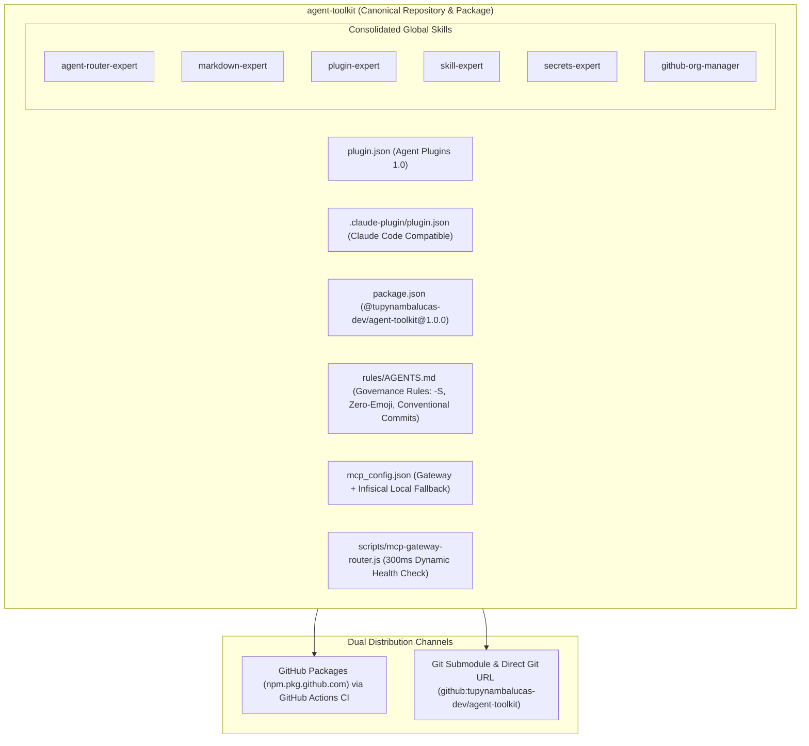
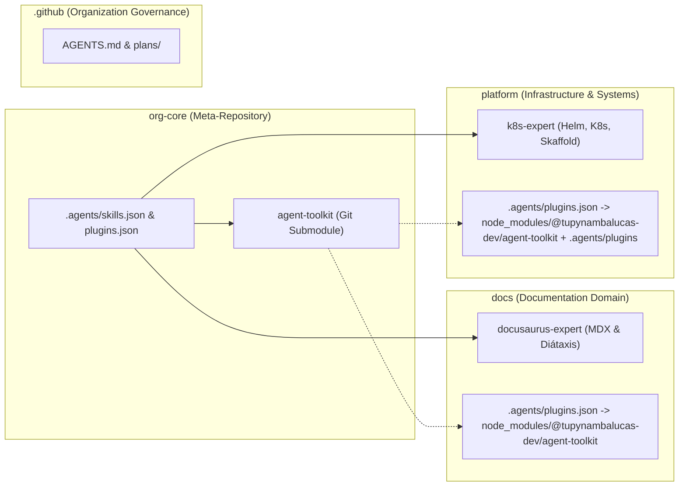

# Organizational Agent Tooling Architecture: Meta-Repository Consolidation, Agent Toolkit Package, and Submodule Harmonization Report

## 1. Executive Summary and Problem Statement

Prior to this architectural migration, the AI agent infrastructure across the `tupynambalucas-dev` organization suffered from severe configuration drift, triple file redundancy, and security vulnerabilities:
1. **Uncontrolled Redundancy**: Identical copies of skills (`agent-router-expert`, `markdown-expert`, `plugin-expert`, `skill-expert`) and plugins (`cortex`, `cortex-fallback`, `github-organization`, `secrets-expert`) were copied across `.github/.agents`, `platform/.agents`, and `docs/.agents`.
2. **Credential Hygiene Violations**: Plaintext API tokens and hardcoded secrets were committed directly into local `mcp_config.json` files.
3. **Fragile Monorepo Discovery**: When working from the meta-repository root ([`org-core`](file:///C:/Users/tupyn/projects/organizations/tupynambalucas-dev/org-core)), the agent runtime only recognized root-level tools; specialized skills like `docusaurus-expert` (in `docs`) and `k8s-expert` (in `platform`) were invisible without code duplication.

This migration established a unified, enterprise-grade agent foundation:
- Consolidating all shared agent tooling into an independent, universal repository: [`agent-toolkit`](file:///C:/Users/tupyn/projects/organizations/tupynambalucas-dev/org-core/agent-toolkit) (`git@github.com:tupynambalucas-dev/agent-toolkit.git`).
- Publishing the tooling as an enterprise package: `@tupynambalucas-dev/agent-toolkit@1.0.0` on GitHub Packages and direct Git distribution.
- Implementing **Approach A (Meta-Repository Configuration Manifests)** in `org-core`, making all child skills globally available at root without duplicating files.
- Purging all redundant files and plaintext secrets, supported by a 100% verified immutable backup.

---

## 2. Immutable Backup Verification

Before modifying or deleting any files, a complete, immutable backup of all `.agents` directories was executed to `C:\Users\tupyn\projects\organizations\tupynambalucas-dev\backup\agents/`:

| Source Directory | File Count | Total Size | Verification Status |
| :--- | :--- | :--- | :--- |
| `org-core/.github/.agents` | 314 files | 2.09 MB | Verified (100% matched) |
| `org-core/platform/.agents` | 308 files | 2.05 MB | Verified (100% matched) |
| `org-core/docs/.agents` | 268 files | 1.73 MB | Verified (100% matched) |

---

## 3. Architecture of `agent-toolkit`



### 3.1 Key Technical Highlights
- **Strict Validation**: Validated via `agy plugin validate agent-toolkit --strict` with zero errors.
- **Multi-Agent Interoperability**: Compatible with Google Antigravity (AGY) via `plugin.json` and Claude Code via `.claude-plugin/plugin.json`.
- **Dynamic MCP Gateway Router**: `scripts/mcp-gateway-router.js` tests upstream gateway health within 300ms. If the gateway is unreachable, it automatically falls back to local Infisical-managed processes without crashing agent sessions.
- **Sanitized Secrets**: Zero hardcoded credentials. All tokens resolve through `${TUPYNAMBA_GATEWAY_TOKEN}` and Infisical Universal Auth.

---

## 4. Implementation of Approach A in `org-core`

To solve the child skill discovery problem when running agents from the meta-repository root, `org-core` implements **Approach A** using root configuration manifests:

### 4.1 Root Skills Manifest ([`org-core/.agents/skills.json`](file:///C:/Users/tupyn/projects/organizations/tupynambalucas-dev/org-core/.agents/skills.json))
```json
{
  "entries": [
    { "path": "docs/.agents/skills" },
    { "path": "platform/.agents/skills" }
  ]
}
```
*Result*: The agent runtime directly exposes `/docusaurus-expert` (from `docs`) and any platform skills directly at root.

### 4.2 Root Plugins Manifest ([`org-core/.agents/plugins.json`](file:///C:/Users/tupyn/projects/organizations/tupynambalucas-dev/org-core/.agents/plugins.json))
```json
{
  "entries": [
    { "path": "agent-toolkit" },
    { "path": "platform/.agents/plugins" }
  ]
}
```
*Result*: All 6 global skills from `agent-toolkit` and domain plugins like `k8s-expert` (from `platform`) are loaded simultaneously.

---

## 5. Child Monorepo Harmonization and Bounded Context Segregation

All redundant duplicate files and plaintext secrets were purged from the child monorepos:



### 5.1 Segregation Audit

| Monorepo | Retained Elements | Purged Redundancies | Dependency Registration |
| :--- | :--- | :--- | :--- |
| **`docs`** | `docusaurus-expert`, local rules. | `agent-router-expert`, `markdown-expert`, `plugin-expert`, `skill-expert`. | `"@tupynambalucas-dev/agent-toolkit": "github:tupynambalucas-dev/agent-toolkit"` in `package.json`, referenced via `.agents/plugins.json`. |
| **`platform`** | `k8s-expert` (with corrected frontmatter), local rules. | `agent-router-expert`, `markdown-expert`, `plugin-expert`, `skill-expert`, plaintext `cortex`, `cortex-fallback`, `github-organization`, `secrets-expert`. | `"@tupynambalucas-dev/agent-toolkit": "github:tupynambalucas-dev/agent-toolkit"` in `package.json`, referenced via `.agents/plugins.json`. |
| **`.github`** | Enterprise `AGENTS.md` (governance rules), `.agents/plans/`. | All duplicate skills and plugins. | Managed directly as organizational SSOT. |

---

## 6. Operational Workflows: Meta-Repository vs. Standalone Projects

### 6.1 Operating from `org-core` (Unified Workspace)
When developing inside `org-core`:
- All submodules (`platform`, `docs`, `agent-toolkit`, `.github`) are mounted.
- Agents immediately inherit all global rules (`agent-toolkit/rules/AGENTS.md`) and discover both global and domain-specific skills via `org-core/.agents/skills.json` and `plugins.json`.
- Edits made to `agent-toolkit` are immediately live in the workspace without requiring re-installation.

### 6.2 Operating from an Isolated Clone (e.g. `platform` or `docs` Standalone)
When an external developer or CI pipeline clones only `platform` or `docs`:
- Running `pnpm install` fetches `@tupynambalucas-dev/agent-toolkit` into `node_modules/@tupynambalucas-dev/agent-toolkit`.
- The local `.agents/plugins.json` instructs Antigravity to load the toolkit from `node_modules`.
- The developer receives all governance rules, MCP configurations, and global skills with zero dependency on the outer `org-core` meta-repository.

### 6.3 Update Propagation Lifecycle
When changes are made to `agent-toolkit`:
1. Commit and push changes inside `agent-toolkit` (`git commit -S`, `git push origin main`).
2. GitHub Actions CI automatically triggers `.github/workflows/publish.yml` and publishes a new semver version to GitHub Packages.
3. In child monorepos (`platform`, `docs`), run `pnpm update @tupynambalucas-dev/agent-toolkit` to update the lockfile.
4. In `org-core`, stage the updated submodule pointer (`git add agent-toolkit docs platform`) and commit with `git commit -S`.

---

## 7. Verification and State Sign-Off

All repositories have been verified clean, tested, and synchronized:
- `agent-toolkit`: CI workflow `publish.yml` succeeded; package published to GitHub Packages; local git tree clean.
- `docs`: `pnpm typecheck` passed (4 packages successful, full turbo cache); committed with `-S` and pushed to `develop`.
- `platform`: `pnpm corporate:typecheck` passed (4 packages successful); committed with `-S` and pushed to `develop`.
- `.github`: Committed with `-S` and pushed to `main`.
- `org-core`: Submodule pointers bumped and pushed to `main`.
