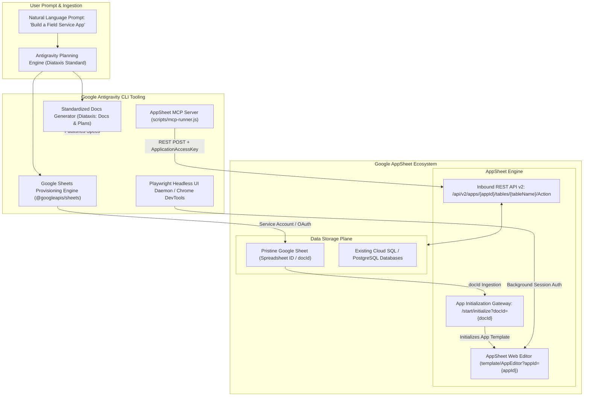
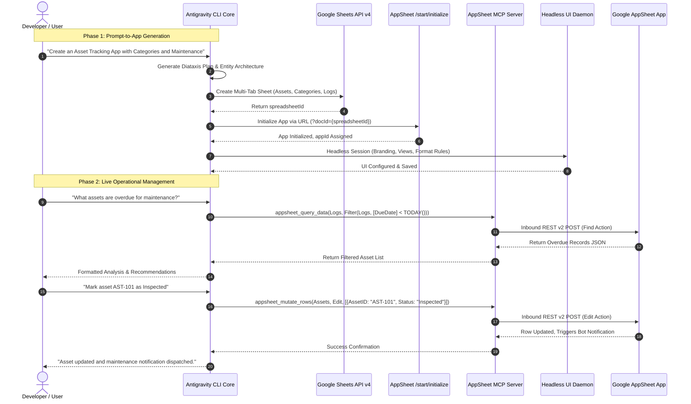

# Google AppSheet Hybrid Lifecycle Architecture: Prompt-to-App Generation, Database Provisioning, and Unified MCP Management

## 1. Executive Summary

This architecture specification defines the enterprise design for a **Hybrid Agentic Lifecycle** connecting the **Google Antigravity CLI** to **Google AppSheet**. 

The architecture supports two core operational trajectories:
1. **Greenfield Generation (Prompt-to-App)**: The agent translates natural language user prompts into architectural plans, writes standardized technical documentation, provisions pristine multi-table Google Sheets (with enforced keys, relationships, and data validation), and automatically initializes AppSheet applications via deterministic ingestion URLs.
2. **Brownfield Operations (Existing App Administration)**: The agent connects to existing AppSheet applications through an enterprise **Model Context Protocol (MCP)** server, performing full-scale database querying (`Find`), row mutations (`Add`, `Edit`, `Delete`), action/workflow triggers (`Invoke Action`), and underlying database schema evolution.
3. **Professional UI/UX and Automation Management**: Evaluating interactive Chrome DevTools MCP versus background Playwright headless daemons and semantic schema-driven UI synthesis to alter app views, format rules, and branding without requiring manual user intervention.

---

## 2. Hybrid System Architecture



---

## 3. Greenfield Flow: Prompt-to-App Generation

### 3.1 Step 1: Architectural Planning and Entity-Relationship Modeling

When a user requests a new app, Antigravity executes the following deterministic workflow:
1. Analyzes domain entities, key columns (`UUID`), parent-child relationships (`Ref`), and enum types.
2. Formulates column naming conventions that trigger AppSheet's native column type inference:
   - Suffixes like `_ID`, `ID` map to key columns.
   - Names containing `Date`, `Timestamp`, `Email`, `Phone`, `Address`, `Photo`, `Image`, `Price`, `Progress` are automatically recognized by AppSheet as specialized UI widgets without manual configuration.
3. Generates a formal specification document before executing infrastructure actions.

### 3.2 Step 2: Programmatic Spreadsheet Creation (Google Sheets API v4)

Rather than manual file editing, Antigravity uses the Google Sheets API (`googleapis` in Node.js) with Google Service Account credentials to construct the workbook:

- Creates multiple sheets (one per data entity).
- Formats row 1 with bold text, frozen rows, background colors, and column headers.
- Inserts data validation rules (dropdown lists for `Status` or `Category` columns).
- Populates seed rows for initial validation.

#### Implementation: `scripts/create-appsheet-sheet.js`

```javascript
import { google } from "googleapis";
import path from "path";

export async function createCleanAppSheetWorkbook(appName, tables) {
  const auth = new google.auth.GoogleAuth({
    scopes: [
      "https://www.googleapis.com/auth/spreadsheets",
      "https://www.googleapis.com/auth/drive",
    ],
  });

  const sheets = google.sheets({ version: "v4", auth });

  const spreadsheetRequest = {
    resource: {
      properties: { title: `${appName} - Database` },
      sheets: tables.map((table) => ({
        properties: {
          title: table.name,
          gridProperties: {
            frozenRowCount: 1,
            rowCount: 100,
            columnCount: table.columns.length,
          },
        },
      })),
    },
  };

  const created = await sheets.spreadsheets.create(spreadsheetRequest);
  const spreadsheetId = created.data.spreadsheetId;

  // Populate headers and formatting for each sheet
  for (const table of tables) {
    await sheets.spreadsheets.values.update({
      spreadsheetId,
      range: `${table.name}!A1`,
      valueInputOption: "RAW",
      resource: {
        values: [table.columns],
      },
    });
  }

  return {
    spreadsheetId,
    spreadsheetUrl: `https://docs.google.com/spreadsheets/d/${spreadsheetId}/edit`,
    appInitUrl: `https://www.appsheet.com/start/initialize?docId=${spreadsheetId}`,
  };
}
```

### 3.3 Step 3: Instant AppSheet Initialization

Once the Google Sheet is created and assigned a `docId`, the application is provisioned using AppSheet's direct initialization gateway:

```text
https://www.appsheet.com/start/initialize?docId={SPREADSHEET_ID}
```

When opened (or requested through the headless engine), AppSheet:
1. Connects to the Google Drive document.
2. Ingests all sheet tabs as distinct tables.
3. Configures default views (`Table`, `Detail`, `Form`).
4. Generates an `appId`.

---

## 4. UI/UX Customization: Professional Headless Engine vs. Interactive DevTools

### 4.1 Comparative Analysis of UI Customization Methods

Because Google AppSheet does not provide a public REST API for metadata/app configuration, we evaluate the optimal methods for agentic UI and automation editing:

| Dimension | Option A: Semantic Schema Conventions | Option B: Interactive Chrome DevTools MCP | Option C: Playwright Headless Automation (Recommended) | Option D: Reverse-Engineered Internal RPC |
| :--- | :--- | :--- | :--- | :--- |
| **Mechanic** | Intelligent column naming in Google Sheets (`Photo`, `LatLong`, `Progress`, `Ref`). | Agent connects to an open Chrome window (`--remote-debugging-port`). | Background headless browser using stored session tokens (`auth.json`). | Direct HTTP calls to internal endpoints (`api/template/saveApp`). |
| **User Disruption** | Zero (100% automated at database creation). | High (requires open browser window and active screen control). | Zero (runs silently in the background as a CLI task). | High risk of sudden breaking changes by Google; session CSRF required. |
| **Visual Expressiveness** | 70% of UI needs (pickers, cards, dropdowns, maps). | 100% of AppSheet UI capabilities. | 100% of AppSheet UI capabilities. | Partial / Undocumented. |
| **Enterprise Viability** | Standard and highly recommended baseline. | Good for interactive pair-programming. | **Best for fully autonomous, professional pipelines**. | Unstable; violates Google API terms. |

### 4.2 The Hybrid UI Strategy: Semantic Conventions + Headless Playwright Daemon

The optimal enterprise architecture combines **Option A** with **Option C**:

1. **Layer 1 (Baseline Generation)**: 
   The agent applies strict semantic naming in the Google Sheet. AppSheet automatically configures 70% to 80% of views (image carousels, map views, form dropdowns, child inline views) during initialization.
2. **Layer 2 (Fine-Grained Polish via Playwright Daemon)**:
   For branding (primary color, logo, dark mode), custom Dashboards, and Format Rules (color alerts), an unattended headless Playwright script runs in the background using an authenticated Google session cookie (`~/.gemini/auth/appsheet-session.json`).

#### Headless Automation Script Pattern: `scripts/appsheet-headless-config.js`

```javascript
import { chromium } from "playwright";
import fs from "fs";

export async function configureAppVisuals(appId, config) {
  const sessionPath = process.env.APPSHEET_SESSION_STORAGE || "./appsheet-session.json";
  if (!fs.existsSync(sessionPath)) {
    throw new Error(`Authentication session file not found: ${sessionPath}`);
  }

  const browser = await chromium.launch({ headless: true });
  const context = await browser.newContext({ storageState: sessionPath });
  const page = await context.newPage();

  await page.goto(`https://www.appsheet.com/template/AppEditor?appId=${encodeURIComponent(appId)}`);
  await page.waitForSelector('[aria-label="Navigation"]');

  // Navigate to Theme & Brand
  await page.click('button:has-text("Settings")');
  await page.click('button:has-text("Theme & Brand")');

  if (config.primaryColor) {
    await page.fill('input[aria-label="Primary Color"]', config.primaryColor);
  }
  if (config.darkMode !== undefined) {
    const isDarkChecked = await page.isChecked('input[aria-label="Dark Mode"]');
    if (isDarkChecked !== config.darkMode) {
      await page.click('input[aria-label="Dark Mode"]');
    }
  }

  // Trigger Save
  await page.keyboard.press("Control+S");
  await page.waitForSelector('text=App saved successfully', { timeout: 15000 });

  await browser.close();
}
```

---

## 5. Brownfield Flow: Managing Existing Applications via MCP

For existing AppSheet applications, the Antigravity agent uses the **AppSheet MCP Server** to discover schemas, observe data, and execute transactions.

### 5.1 MCP Toolset Specification

```
+---------------------------------------------------------------------------------+
|                               APPSHEET MCP SERVER                               |
+---------------------------------------------------------------------------------+
| Tool: appsheet_list_tables                                                      |
|   Inputs: none                                                                  |
|   Outputs: Array of table names configured in the target AppSheet application.  |
|                                                                                 |
| Tool: appsheet_get_schema                                                       |
|   Inputs: { table_name: string }                                                |
|   Outputs: Columns, key fields, computed virtual columns, data types.           |
|                                                                                 |
| Tool: appsheet_query_data                                                       |
|   Inputs: { table_name: string, selector?: string }                             |
|   Outputs: Records matching AppSheet expressions (Filter, Select, OrderBy, Top).|
|                                                                                 |
| Tool: appsheet_mutate_rows                                                      |
|   Inputs: { table_name: string, action: "Add"|"Edit"|"Delete", rows: object[] } |
|   Outputs: Mutation execution result and updated rows.                          |
|                                                                                 |
| Tool: appsheet_invoke_action                                                    |
|   Inputs: { table_name: string, action_name: string, rows: object[] }           |
|   Outputs: Result of triggering AppSheet automations, bots, or notifications.   |
|                                                                                 |
| Tool: appsheet_sync_underlying_db                                               |
|   Inputs: { spreadsheet_id: string, table_name: string, new_columns: string[] }|
|   Outputs: Appends new headers to Google Sheet and triggers schema reload.      |
+---------------------------------------------------------------------------------+
```

### 5.2 Direct Underlying Database Evolution

When modifying an existing app's data model:
1. The agent appends new column headers to the underlying Google Sheet via Google Sheets API.
2. The agent executes a schema regeneration command either:
   - Via the headless Playwright daemon (`Data > Tables > Regenerate Structure`).
   - Or via AppSheet sync triggers.
3. The new columns become immediately available to the Inbound REST API and UI views.

---

## 6. End-to-End Hybrid Lifecycle Sequence



---

## 7. Implementation Roadmap and Deliverables

| Milestone | Component | Task Description |
| :--- | :--- | :--- |
| **M1: Core MCP Connector** | `agent-toolkit` | Implement `appsheet-mcp-server.js` with CRUD, query selectors, and action execution. Register under `scripts/mcp-runner.js`. |
| **M2: Google Sheets Provisioner** | `agent-toolkit/scripts` | Implement `create-appsheet-sheet.js` leveraging `@googleapis/sheets` with automated entity formatting and frozen headers. |
| **M3: Headless Visual Daemon** | `agent-toolkit/scripts` | Build `appsheet-headless-config.js` with Playwright to manage themes, views, and schema regeneration silently. |
| **M4: Skill Packaging** | `skills/appsheet-expert` | Author `SKILL.md` containing Diataxis templates for prompt-to-app specification generation and selector syntax guides. |
| **M5: Secret Enrollment** | Infisical Cloud | Configure `APPSHEET_APP_ID`, `APPSHEET_APPLICATION_ACCESS_KEY`, and `GOOGLE_SERVICE_ACCOUNT_JSON` under `tupynambalucas-dev`. |
