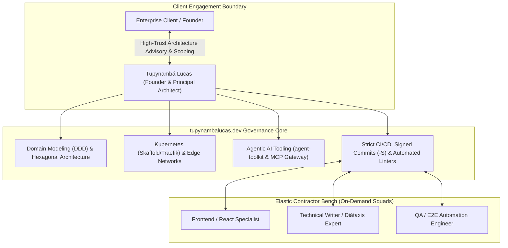

# Enterprise Identity & Branding Architecture: Nomenclature Strategy for Solopreneurship, Contractor Scaling, and Domain Positioning

## 1. Executive Summary and Strategic Context

As software engineering practices evolve toward autonomous AI orchestration, cloud-native distributed platforms, and domain-driven design, the corporate identity of high-tier technical consultancies must reconcile two critical forces:
1. **Personal Reputation and Architectural Authority**: Clients seeking fractional CTOs, principal systems architects, and high-stakes platform engineering contract directly for the founder's intellectual pedigree, design taste, and deterministic execution.
2. **Operational Scalability and Team Elasticity**: Complex platform deliveries require surge capacity, delegating specialized modules (UI components, documentation, automated test harnesses) to vetted, on-demand contractors without misleading clients into expecting 100% manual keyboard time from the founder.

This architectural strategy formalizes the organizational brand identity **`tupynambalucas.dev`** as the enterprise entity across all repositories, manifests, documentation portals, and client communications. It establishes a rigorous dual-identity framework separating the individual founder (`Tupynambá Lucas`) from the sovereign engineering consulting firm (`tupynambalucas.dev`).

---

## 2. Business Model: The Hub-and-Spoke Engineering Studio

### 2.1 Operational Architecture
The operational model of `tupynambalucas.dev` is defined as a **Boutique Engineering Studio** (or **Hub-and-Spoke Solopreneurship**):



### 2.2 Addressing the "Key-Person" and "Bait-and-Switch" Dilemma
In software consulting, naming an organization solely after a person's civil name ("Tupynambá Lucas") introduces commercial friction when contractors are deployed:
- **Expectation Mismatch**: If an invoice, repository, or meeting invite states "Tupynambá Lucas", clients expect every line of code to be typed exclusively by that individual. PRs submitted by contractors create distrust or fee pushback.
- **Contractor Invisibility**: Professional contractors prefer working under a respected corporate banner or engineering collective rather than feeling like invisible ghostwriters for an individual.
- **The Sovereign Solution**: Branding as **`tupynambalucas.dev`** establishes an engineering collective. In proposals and Master Service Agreements (MSAs), the positioning is deterministic:
  > *"tupynambalucas.dev is a specialized engineering studio. All architectural design, system boundaries, security guardrails, and pull request reviews are directly governed by Principal Architect Tupynambá Lucas, supported by specialized technical cells under our strict quality gates."*

---

## 3. Nomenclature Comparative Matrix: Eponymous vs. Agency vs. Domain Brand

| Dimension | Eponymous Civil Name (`Tupynambá Lucas`) | Domain Brand (`tupynambalucas.dev`) | Abstract Agency Name (e.g. `Nexus Systems`) |
| :--- | :--- | :--- | :--- |
| **Market Perception** | Individual freelancer / contractor. High trust for advisory, low perceived operational scale. | Sovereign technical studio / lab. Modern, tech-native, and highly credible for elite engineering. | Traditional software agency or dev shop. Generic unless heavily capitalized with brand marketing. |
| **Contractor Integration** | High friction. Clients question non-founder Git commits. | Zero friction. Collaborators push code under the `tupynambalucas.dev` engineering standard. | Zero friction. Standard agency delivery mechanism. |
| **Brand Equity & SEO** | Split between personal social media and separate business entities. | **100% Consolidated**. Every commit, package (`@tupynambalucas-dev/agent-toolkit`), and article compounds the same domain authority. | Diluted across two completely disconnected brands. |
| **Enterprise Procurement** | Procurement departments hesitate to sign 6-figure MSAs with individual personal names. | Fully accepted. The `.dev` domain and `@tupynambalucas-dev` organization project institutional rigor. | Standard corporate procurement fit. |
| **Exit & Transferability** | Zero enterprise value without the founder's physical presence. | Moderate transferability if products, tooling, and client contracts are systematized. | Highly transferrable as a stand-alone sellable asset. |

---

## 4. Repository Governance and Brand Consistency Guidelines

To eliminate ambiguity, all organizational assets adhere to the following naming standards:

### 4.1 Platform Monorepo ([`platform/README.md`](file:///C:/Users/tupyn/projects/organizations/tupynambalucas-dev/org-core/platform/README.md))
- **Title**: `# tupynambalucas.dev Platform Monorepo` (Replacing `# Tupynambalucas Platform Monorepo`).
- **Description**: The core platform monorepo powering the `tupynambalucas.dev` ecosystem.
- **Configuration SSOT ([`project.config.ts`](file:///C:/Users/tupyn/projects/organizations/tupynambalucas-dev/org-core/platform/shared/config/src/project.config.ts))**:
  ```typescript
  export const ProjectConfig = {
    PROJECT_NAME: 'tupynambalucas.dev',
    PROJECT_DISPLAY_NAME: 'tupynambalucas.dev',
    PROJECT_DOMAIN: 'tupynambalucas.dev',
    PROJECT_DOCS_URL: 'https://docs.tupynambalucas.dev',
    PROJECT_INTERNAL_HOST: 'tupynambalucas.internal',
    GITHUB_ORG: 'tupynambalucas-dev',
    REPOSITORY_NAME: 'platform',
    REPOSITORY_OWNER: 'tupynambalucas-dev',
    AUTHOR_NAME: 'Tupynambá Lucas Varela Rodrigues',
    AUTHOR_EMAIL: 'contato@tupynambalucas.dev',
  } as const;
  ```

### 4.2 GitHub Organization Profile ([`.github/profile/README.md`](file:///C:/Users/tupyn/projects/organizations/tupynambalucas-dev/org-core/.github/profile/README.md))
- **Lead Statement**: `tupynambalucas.dev is a specialized software engineering and technology consulting organization providing enterprise architecture, autonomous agentic AI infrastructure, cloud-native platforms, and high-performance distributed systems.`
- **Identity Invariant**: The organization must never refer to itself as "Tupynamba Lucas" in any business overview, architectural documentation, or package description.

### 4.3 Personal GitHub Profile (`github.com/tupynambalucas`)
- **Title**: `# Tupynambá Lucas`
- **Sub-headline**: `Software Engineer & Systems Architect`
- **Organizational Affiliation**: `Founder & Principal Systems Architect at [tupynambalucas.dev](https://tupynambalucas.dev)`
- **Role**: Serves as the intellectual showcase and authority driver, directing enterprise and consulting traffic to `tupynambalucas.dev`.

---

## 5. Decision Triggers for Future Brand Splitting

A separate, abstract corporate brand (e.g., spinning off an entity named `Varela Systems` or `Nexus Labs`) is ONLY justified if one of the following triggers occurs:
1. **Commercial Product Transition**: Launching a multi-tenant B2B SaaS platform that operates independently of consulting services.
2. **Enterprise Institutionalization**: Scaling to 15+ permanent full-time employees with independent engineering managers, where the founder no longer reviews pull requests or participates in project architectures.
3. **M&A / Acquisition Preparation**: Preparing the consulting contracts and intellectual property for a formal corporate acquisition by another agency or holding group.

Until those specific milestones are reached, the **`tupynambalucas.dev`** domain brand provides the highest conversion rate, lowest overhead, and cleanest professional authority in the global marketplace.
