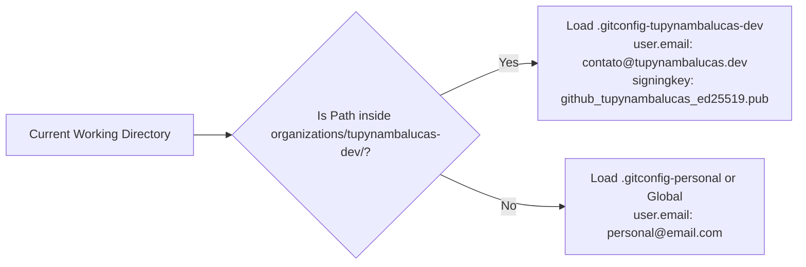

# Master Plan: Developer Workstation Provisioning and GitHub Governance Onboarding

This document establishes the official enterprise onboarding standard and workstation provisioning
runbook for developers across all functional teams in `tupynambalucas-dev`. It integrates Git
architecture, cryptographic commit signing, identity isolation, GitHub CLI authentication, and
Infisical secret vault workflows.

---

## 1. Executive Overview and Architecture Principles

To reconcile autonomy, compliance, and multi-tenant security, every developer workstation operates
under four architectural principles:

```mermaid
graph TD
  subgraph Layer1 ["Layer 1: Git Protocol & Cryptographic Integrity"]
    SSH["Ed25519 SSH Keypair<br/>(Signing Key & Auth Key)"]
    GitConfig["Git includeIf Namespace Isolation<br/>(Personal vs tupynambalucas-dev)"]
    SSH --> GitConfig
    GitConfig --> SignedCommit["Cryptographically Signed Commits (-S)<br/>Verified Badge on GitHub"]
  end

  subgraph Layer2 ["Layer 2: Platform API & Operator Governance"]
    GhCli["GitHub CLI (gh auth login)<br/>(OAuth Token in OS Credential Manager)"]
    OpRole["resolve-operator-role.js<br/>(Dynamic Domain Enforcement)"]
    GhCli --> OpRole
    OpRole --> DevPRs["PR Creation, CODEOWNERS, CI/CD Triage"]
  end

  subgraph Layer3 ["Layer 3: Secret Management (Zero-Disk)"]
    Infisical["Infisical CLI (infisical login)<br/>(RBAC Scoped by Team & Project)"]
    Infisical --> RAMEnv["Volatile RAM Injection (infisical run)<br/>0 Plaintext Secret Files on Disk"]
  end
```



1. **Cryptographic Accountability (Zero Unsigned Commits)**: All commits and annotated tags must be
   signed using an Ed25519 SSH key (`commit.gpgsign = true`, `gpg.format = ssh`). Commits failing
   verification are rejected by organization branch rulesets on `main` and `develop`.
2. **Physical Namespace Delegation (`includeIf`)**: Developers working on both personal and corporate
   repositories on the same machine must keep identities strictly isolated to prevent metadata leaks.
3. **Zero-Disk Plaintext Credentials**: No API keys, personal access tokens, or private `.pem` keys
   may ever be written in plaintext configuration files or `.env` files committed to disk.
4. **Least-Privilege Domain Separation**: Human developers authenticate with individual accounts,
   while automated CI/CD and bot operations authenticate via the Centralized GitHub App.

---

## 2. Team Capability and Tooling Requirement Matrix

Different functional teams interact with distinct layers of the infrastructure:

| Requirement / Tool | `lead-architects` | `infra-ops` | `security-managers` | `core-engineers` | `technical-writers` | `creative-team` | `contractors` |
| :--- | :---: | :---: | :---: | :---: | :---: | :---: | :---: |
| **Ed25519 SSH Signing Key** | Mandatory | Mandatory | Mandatory | Mandatory | Mandatory | Mandatory | Mandatory (scoped) |
| **Git `includeIf` Config** | Mandatory | Mandatory | Mandatory | Mandatory | Mandatory | Mandatory | Recommended |
| **`url.insteadOf` SSH Rewrite** | Mandatory | Mandatory | Mandatory | Mandatory | Mandatory | Mandatory | Mandatory |
| **GitHub CLI (`gh`)** | Mandatory | Mandatory | Recommended | Recommended | Recommended | Optional | Optional |
| **Infisical CLI (`infisical`)** | Mandatory | Mandatory | Mandatory | Mandatory | Mandatory | Optional | Forbidden |
| **Permitted Governance Domain** | Domain 1, 2, 3 | Domain 1, 2 | Domain 1, 2 | Domain 1 | Domain 1 | Domain 1 | Scoped Domain 1 |
| **Target Infisical Project** | `platform` (prod) | `platform` (stage)| `agent-toolkit` (dev)| `agent-toolkit` (dev)| `agent-toolkit` (dev)| N/A | Local BYOT |

---

## 3. Phase 1: Local Workstation Prerequisites

Before configuring Git, install the required toolchain:

### 3.1 Toolchain Verification

| Utility | Minimum Version | Installation Command (Windows) | Installation Command (macOS) | Installation Command (Linux) |
| :--- | :--- | :--- | :--- | :--- |
| **Git** | `>= 2.34.0` (SSH signing) | `winget install --id Git.Git` | `brew install git` | `sudo apt install git` |
| **GitHub CLI** | `>= 2.40.0` | `winget install --id GitHub.cli` | `brew install gh` | `sudo apt install gh` |
| **Node.js** | `>= 20.0.0` | `winget install --id OpenJS.NodeJS.LTS` | `brew install node` | `sudo apt install nodejs` |
| **pnpm** | `>= 9.0.0` | `npm install -g pnpm` | `brew install pnpm` | `npm install -g pnpm` |
| **Infisical CLI** | `>= 0.40.0` | `pnpm dlx @infisical/cli` | `brew install infisical/get-cli/infisical` | `curl -1sLf ... \| bash` |

---

## 4. Phase 2: Cryptographic SSH Key Setup and GitHub Registration

### 4.1 Generating the Dedicated SSH Keypair

Generate a dedicated Ed25519 keypair for organizational work:

```bash
# Windows / macOS / Linux
ssh-keygen -t ed25519 -C "contato@tupynambalucas.dev" -f "$HOME/.ssh/github_tupynambalucas_ed25519"
```

When prompted, set a secure passphrase.

### 4.2 Registering the Public Key on GitHub (Crucial Dual-Registration)

GitHub distinguishes between **Authentication Keys** and **Signing Keys**:

1. Log into [GitHub Settings -> SSH and GPG keys](https://github.com/settings/keys).
2. **Add as Authentication Key**:
   - Click **New SSH key**.
   - Title: `Workstation - Personal Laptop (Auth)`.
   - Key type: **Authentication Key**.
   - Paste contents of `~/.ssh/github_tupynambalucas_ed25519.pub`.
   - Click **Add SSH key**.
3. **Add as Signing Key**:
   - Click **New SSH key** again.
   - Title: `Workstation - Personal Laptop (Signing)`.
   - Key type: **Signing Key**.
   - Paste the same public key contents (`github_tupynambalucas_ed25519.pub`).
   - Click **Add SSH key**.

> [!IMPORTANT]
> If the key is not registered explicitly as a **Signing Key**, GitHub will accept your `git push`
> over SSH but will flag every signed commit with an **Unverified** warning badge, causing automated
> PR ruleset checks to reject your pull requests.

---

## 5. Phase 3: Git Architecture Configuration (`~/.gitconfig` & `includeIf`)

### 5.1 Why Conditional Inclusion (`includeIf`) is Mandatory

Developers frequently maintain both personal repositories (under `~/projects/personal/`) and
enterprise repositories (under `~/projects/organizations/tupynambalucas-dev/`).

Hardcoding a single `user.email` globally causes personal commits to be authored with corporate
emails, or corporate commits to leak personal email addresses into organizational commit logs.

Using `includeIf` delegates configuration dynamically based on the directory path of the active
workspace:



### 5.2 Step-by-Step Configuration Files

#### File 1: Global Git Configuration (`~/.gitconfig`)

Create or update `~/.gitconfig`:

```ini
[init]
	defaultBranch = main

[url "git@github.com:"]
	insteadOf = https://github.com/

[core]
	autocrlf = true
	fscache = true
	symlinks = false

[gpg]
	format = ssh

[commit]
	gpgsign = true

[tag]
	gpgsign = true

# Dynamic Workspace Identity Delegation
[includeIf "gitdir:C:/Users/tupyn/projects/organizations/tupynambalucas-dev/"]
	path = C:/Users/tupyn/.gitconfig-tupynambalucas-dev

[includeIf "gitdir:C:/Users/tupyn/projects/personal/"]
	path = C:/Users/tupyn/.gitconfig-personal
```

> [!NOTE]
> On Linux and macOS, replace the Windows paths (`C:/Users/...`) with standard POSIX paths
> (e.g. `gitdir:~/projects/organizations/tupynambalucas-dev/` and `path = ~/.gitconfig-tupynambalucas-dev`).
> Note the mandatory trailing slash `/` in `gitdir:`.

#### File 2: Corporate Git Configuration (`~/.gitconfig-tupynambalucas-dev`)

Create `~/.gitconfig-tupynambalucas-dev`:

```ini
[user]
	name = tupynambalucasdev
	email = contato@tupynambalucas.dev
	signingkey = C:/Users/tupyn/.ssh/github_tupynambalucas_ed25519.pub

[commit]
	gpgsign = true

[tag]
	gpgsign = true

[gpg]
	format = ssh
```

### 5.3 The Purpose of `url."git@github.com:".insteadOf = https://github.com/`

This setting automatically rewrites all HTTPS GitHub URLs to SSH transport transparently:
- Submodules (`git submodule update --init --recursive`) defined with HTTPS URLs will clone over SSH.
- Package managers (`npm install`, `pnpm install`, `go get`) querying GitHub repositories clone
  via SSH without triggering interactive password or PAT prompts.

---

## 6. Phase 4: GitHub CLI Authentication and Credential Helper

### 6.1 Authentication via Browser OAuth

Run the interactive login command:

```bash
gh auth login
```

1. **What account do you want to log into?** -> `GitHub.com`
2. **What is your preferred protocol for Git operations?** -> `SSH`
3. **Upload your SSH key?** -> Select the key created in Phase 2
4. **How would you like to authenticate?** -> `Login with a web browser`
5. Authorize the `GitHub CLI` application on the browser prompt.

### 6.2 Enabling the Git Credential Helper

```bash
gh auth setup-git
```

This ensures `gh` manages credentials in the OS vault without saving tokens to disk.

---

## 7. Phase 5: Enterprise Secrets Onboarding via Infisical

Internal developers authenticate to Infisical Cloud to obtain fallback and runtime API keys:

1. **Authenticate to Infisical**:
   ```bash
   pnpm dlx @infisical/cli login
   ```
2. **Verify Vault Access**:
   Core team members test secret injection into volatile RAM:
   ```bash
   pnpm dlx @infisical/cli run --project=tupynambalucas-dev-agent-toolkit --env=dev -- node -e "console.log('Infisical session active')"
   ```
3. **Zero Plaintext Rule**: Developers must never run `infisical export > .env`. Secrets must remain
   in volatile RAM during execution.

---

## 8. Phase 6: Onboarding Verification Runbook

Every new engineer executes this verification checklist prior to opening their first PR:

### Step 1: Verify Git Configuration Resolution

Navigate to an organizational repository:
```bash
cd ~/projects/organizations/tupynambalucas-dev/org-core
git config user.email
# Expected output: contato@tupynambalucas.dev

git config commit.gpgsign
# Expected output: true

git config gpg.format
# Expected output: ssh
```

### Step 2: Verify Cryptographic Commit Signing

Create a temporary test commit in a scratch branch:
```bash
git checkout -b test/verify-signing
git commit --allow-empty -S -m "test(onboarding): verify ssh cryptographic signature"
git log --show-signature -1
```

Expected output:
```text
commit abc1234... (HEAD -> test/verify-signing)
Good "ssh" signature for contato@tupynambalucas.dev with ED25519 key SHA256:...
Author: tupynambalucasdev <contato@tupynambalucas.dev>
```

Clean up the test branch:
```bash
git checkout main
git branch -D test/verify-signing
```

### Step 3: Verify Operator Governance Domain

Run the operator role inspection script:
```bash
node agent-toolkit/skills/github-org-manager/scripts/resolve-operator-role.js
```

Confirm that:
1. `User` matches your GitHub handle.
2. `Organization` is `tupynambalucas-dev`.
3. `Teams` reflects your assigned functional group.
4. `Permitted Operations` reflects your authorized domain.

---

## 9. Troubleshooting and Known Edge Cases

### Gotcha 1: `error: Load key ... no such file or directory` or `gpg failed to sign the data`
- **Cause**: Path in `user.signingkey` is incorrectly formatted or contains unescaped backslashes.
- **Fix**: On Windows, always use forward slashes `/` in `.gitconfig` (e.g. `C:/Users/tupyn/.ssh/...`, not `C:\Users\tupyn\...`).

### Gotcha 2: Submodule Pointer Conflicts on Windows (CRLF vs LF)
- **Cause**: Git converted Unix line endings (`LF`) to Windows (`CRLF`) in scripts or configs.
- **Fix**: Ensure `core.autocrlf = true` is set, or run:
  ```bash
  git config --global core.autocrlf true
  ```

### Gotcha 3: Commits Marked "Unverified" on GitHub Web UI
- **Cause**: The SSH key was added only under "Authentication Keys" and not under "Signing Keys".
- **Fix**: Visit [GitHub SSH Keys](https://github.com/settings/keys), click **New SSH Key**, select **Key Type: Signing Key**, and paste the public key.

### Gotcha 4: HTTP 403 Forbidden on Submodule Clones
- **Cause**: Git is attempting to clone via HTTPS using cached Windows credentials rather than SSH.
- **Fix**: Verify `url.git@github.com:.insteadOf = https://github.com/` is present in `~/.gitconfig`.
