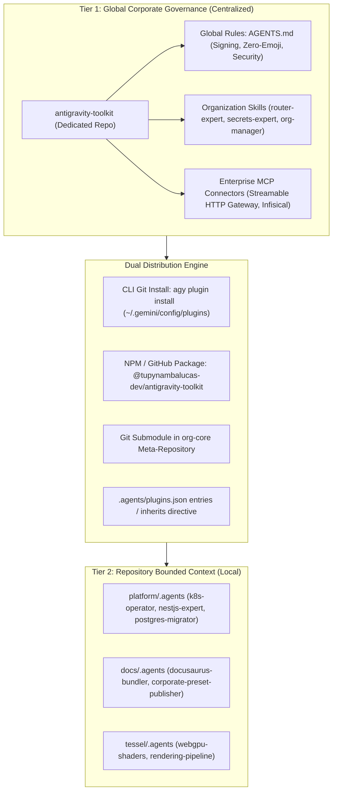
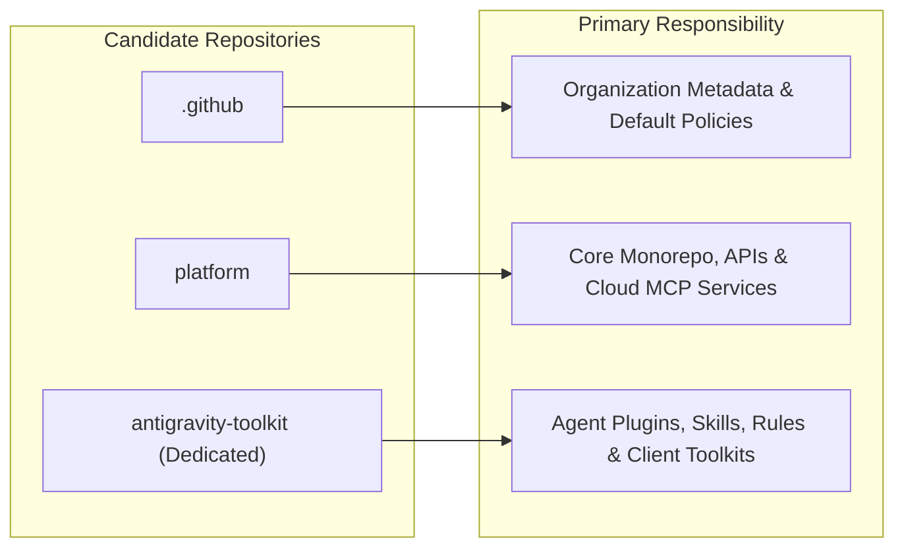
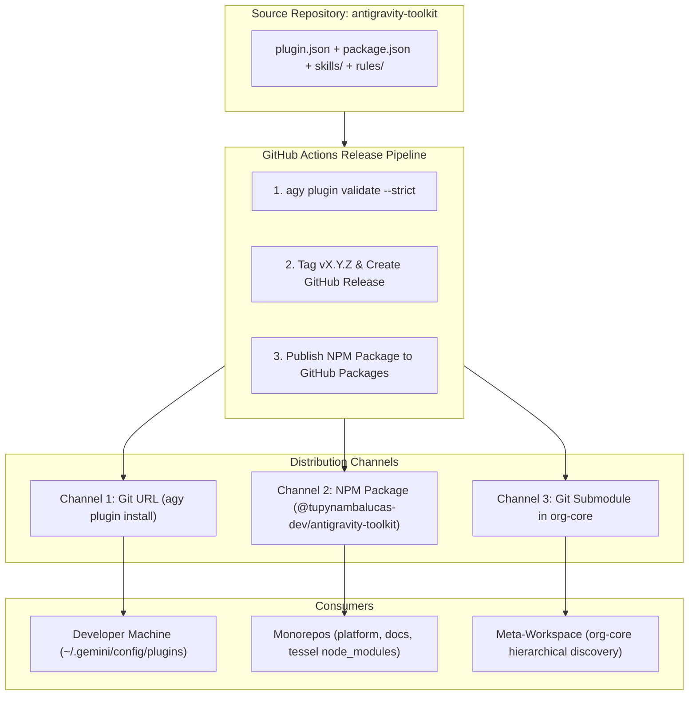
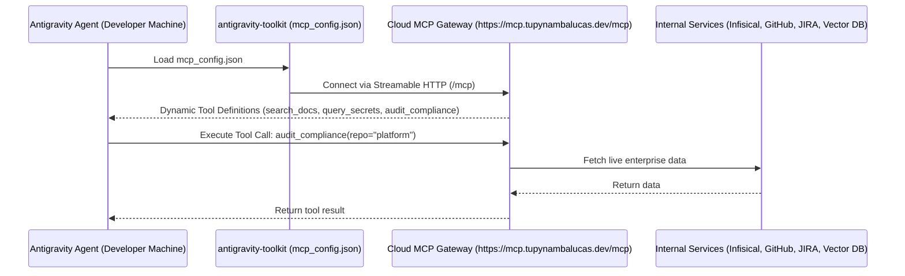

# Enterprise AI Agent Plugins and Governance Architecture

## 1. Executive Summary and Problem Statement

As software engineering organizations scale with agentic AI workflows, maintaining consistency, security, and developer velocity across multiple repositories becomes a critical architectural challenge. In an organization comprising a meta-repository ([`org-core`](file:///C:/Users/tupyn/projects/organizations/tupynambalucas-dev/org-core)), specialized monorepos ([`platform`](file:///C:/Users/tupyn/projects/organizations/tupynambalucas-dev/org-core/platform), [`docs`](file:///C:/Users/tupyn/projects/organizations/tupynambalucas-dev/org-core/docs)), independent products ([`tessel`](file:///C:/Users/tupyn/projects/organizations/tupynambalucas-dev/tessel), `omni-channel`), and organizational governance ([`.github`](file:///C:/Users/tupyn/projects/organizations/tupynambalucas-dev/org-core/.github)), AI agent configuration faces two conflicting failure modes:

1. **Fragmentation and Drift**: If every repository maintains its own disconnected rules, skills, and Model Context Protocol (MCP) servers, corporate guidelines (cryptographic signing, conventional commits, secret hygiene, zero-emoji policy) drift out of synchronization, requiring N pull requests for every governance change.
2. **Brittle Isolation**: If agent configurations are stored exclusively in an external global environment or parent meta-repo, an engineer cloning a single repository (such as `platform` or `tessel`) standalone in an isolated environment loses access to necessary tools, skills, and contextual constraints.

This document presents a comprehensive comparative analysis of architectural approaches, specifies the canonical schema for an Enterprise Antigravity Plugin, evaluates repository placement options ([`.github`](file:///C:/Users/tupyn/projects/organizations/tupynambalucas-dev/org-core/.github) vs. [`platform`](file:///C:/Users/tupyn/projects/organizations/tupynambalucas-dev/org-core/platform) vs. a dedicated repository), defines package distribution via GitHub Packages and Git, and establishes cloud dynamic provisioning models.

---

## 2. Comparative Analysis: Approach A vs. Approach B vs. Approach C

### 2.1 Approach A: Global Enterprise Plugin (Distributed via Antigravity CLI / Git)

In Approach A, the organization packages all shared skills, corporate rules, MCP configurations, and hooks into a centralized Antigravity plugin (e.g., `tupynambalucas-dev-plugin`). This plugin is published to a Git repository or enterprise registry and installed into each developer's workstation profile located at `~/.gemini/config/plugins/` using the Antigravity CLI:

```bash
agy plugin install https://github.com/tupynambalucas-dev/antigravity-toolkit
```

#### Advantages
- **Single Source of Truth**: All corporate security policies, shared tools, and organization skills are defined in one place. Updating the plugin immediately propagates across all repositories opened by that developer.
- **Zero Monorepo / Repository Bloat**: Application repositories do not contain duplicate skill files, MCP scripts, or generic tooling configurations.
- **Cross-Repository Omnipresence**: When a developer opens any repository—including legacy repositories, forks, or new Greenfield projects—the agent automatically possesses full enterprise capabilities (`agent-router-expert`, `secrets-expert`, `conventional-commits`).
- **Centralized MCP Governance**: Sensitive MCP configurations (such as Infisical gateways, corporate GitHub connectors, or internal documentation endpoints) are configured and patched centrally without committing credentials or environment scripts into product repos.

#### Disadvantages & Trade-offs
- **Onboarding Friction**: New team members or contractors must execute an explicit installation step (`agy plugin install`) before their agent behaves according to company standards.
- **Headless CI/CD Complexity**: Running agentic workflows inside GitHub Actions runners or containerized pipelines requires an explicit staging step to install or mount the global plugin.
- **Potential Machine Drift**: Developers who fail to run `agy plugin update` or lack automated sync mechanisms may run outdated versions of corporate plugins while repository code assumes updated behavior.

---

### 2.2 Approach B: Self-Contained Local Repository (`<repo>/.agents/`)

In Approach B, every repository is completely autonomous. All required skills, rules, and configurations are committed directly to the version control system within `<repo>/.agents/` (e.g., `platform/.agents/`, `docs/.agents/`, `tessel/.agents/`):

```text
platform/
├── .agents/
│   ├── rules/
│   │   └── AGENTS.md
│   ├── skills/
│   │   ├── router-expert/
│   │   ├── conventional-commits/
│   │   └── k8s-operator/
│   └── plugins/
└── ...
```

#### Advantages
- **Zero Setup / Instant Discovery**: Anyone running `git clone <repo>` immediately receives all agent instructions, rules, and skills upon launching Antigravity in that folder. No global installation is required.
- **Atomic Versioning with Code**: Changes to agent behaviors, framework prompts, or build skills are committed in the exact same Git commits and pull requests as the application code changes.
- **CI/CD Native**: Headless CI/CD pipelines (GitHub Actions, GitLab CI) read the local `.agents/` folder automatically without requiring external network calls or registry credentials.
- **Air-Gapped and Contractor-Safe**: Fully isolated contractors or external contributors get the exact tools allowed for that specific repository without accessing the broader organizational infrastructure.

#### Disadvantages & Trade-offs
- **Severe Duplication and Maintenance Overhead**: Generic corporate skills (`conventional-commits`, `secrets-expert`, `markdown-expert`) must be manually replicated across every repository. A single policy change requires synchronized pull requests across dozens of repositories.
- **Siloed Context**: An agent operating in `platform` has zero awareness of `docs`, `tessel`, or organizational governance unless duplicate documentation is manually copied into its local tree.
- **Repository Clutter**: Monorepos and domain services become burdened with non-domain operational skills and agent configurations.

---

### 2.3 Approach C: The Hybrid Federated Architecture (Enterprise Standard)

The recommended production architecture combines Approach A and Approach B into a **two-tier federated hierarchy**, leveraging the native precedence and inheritance model of Antigravity:



1. **Tier 1 (Global Corporate Governance)**:
   - Packaged as a standard Antigravity Plugin and published both as a standalone Git repo and an NPM package via GitHub Packages (`@tupynambalucas-dev/antigravity-toolkit`).
   - Distributes immutable corporate policies: cryptographic commit signing (`-S`), conventional commit validation, zero emojis, Infisical secrets resolution, and high-level routing.
   - Installed globally on workstations or inherited via package manifests.
2. **Tier 2 (Repository Bounded Context)**:
   - Each individual repository retains a lightweight root `AGENTS.md` and repository-specific `.agents/skills/` tailored strictly to its technology stack (e.g., NestJS/Kubernetes in `platform`, Docusaurus in `docs`, WebGPU in `tessel`).
   - If a developer opens `platform` in standalone mode, standard `package.json` resolution loads `@tupynambalucas-dev/antigravity-toolkit` directly from `node_modules`.
   - If the developer has the global plugin installed (or opens the workspace via `org-core`), the global enterprise rules and skills seamlessly layer over the local context.

---

### 2.4 Architectural Comparison Matrix

| Evaluation Dimension | Approach A: Pure Global Plugin | Approach B: Pure Local Repo | Approach C: Hybrid Federated (Recommended) |
| :--- | :--- | :--- | :--- |
| **Single Source of Truth** | High (Central repository) | Very Low (Duplicated N times) | High (Global governance centralized, domain local) |
| **Setup Friction (New Dev)** | Medium (Requires `agy plugin install`) | Zero (`git clone` is sufficient) | Zero (Automated via `pnpm install` in repo) |
| **Atomic PRs with Code** | Low (Plugin changes decoupled) | High (Agent rules committed with code) | High (Domain skills versioned with code) |
| **Cross-Repo Context Awareness** | High (Global knowledge accessible) | None (Siloed to single repo) | High (Hierarchical resolution) |
| **Maintenance & Patching Effort** | Low (Update once centrally) | Extreme (Sync across N repos) | Low (Corporate policies updated centrally) |
| **CI/CD Pipeline Portability** | Requires plugin installation step | 100% Native | 100% Native (Reads from `node_modules` or local rules) |
| **Security Credential Protection** | High (No secrets stored in repos) | Low (Risk of committing MCP envs) | High (Centralized MCP endpoints and Infisical) |
| **Antigravity CLI Compatibility** | Native (`~/.gemini/config/plugins/`) | Native (`.agents/` in workspace) | Fully Optimized (Multi-tier resolution engine) |

---

## 3. Strategic Repository Placement: `.github` vs. `platform` vs. Dedicated Repository

A critical architectural decision is determining where the global plugin codebase should reside. We evaluate the three primary options:



### 3.1 Option 1: The `.github` Repository (`tupynambalucas-dev/.github`)

- **Role**: GitHub special administrative repository for organization-wide default profiles, issue templates, workflow templates, security disclosures, and repository health files.
- **Why NOT suitable for full plugin software hosting**:
  - **Separation of Concerns**: `.github` is designed for static administrative markdown and workflow templates. Bundling executable TypeScript scripts, testing suites, MCP connector code, and node modules bloats this administrative hub.
  - **Git URL Clone Overhead**: Running `agy plugin install https://github.com/tupynambalucas-dev/.github` clones the entire administrative repository into developer machines, downloading issue templates and profile media.
  - **Release Cadence Coupling**: Tagging release versions (`v1.0.0`, `v1.1.0`) on `.github` conflates organization-wide administrative changes with agent software releases.
- **Architectural Role for `.github`**: Keep high-level corporate governance declarations (`AGENTS.md`) and standard issue/PR templates in `.github`. Do NOT make `.github` the build/publishing repository for agent plugins.

### 3.2 Option 2: Inside the `platform` Monorepo (`tupynambalucas-dev/platform`)

- **Role**: The core business application monorepo (NestJS backend, web apps, databases, Kubernetes deployments).
- **Why NOT suitable for client-side global plugin distribution**:
  - **Monorepo Coupling**: `platform` is a large monorepo with hundreds of application dependencies and heavy Turborepo build graphs. Requiring developers working on `docs`, `tessel`, or `omni-channel` to clone or depend on `platform` creates unnecessary coupling.
  - **CI/CD Noise**: Every minor prompt revision in an agent skill would trigger Turborepo build analysis and potentially run tests across unrelated platform services.
  - **Access Boundary & Blast Radius**: External contractors or developers working exclusively on documentation or client SDKs should not need repository read/write access to `platform` just to consume or contribute agent skills.
- **Architectural Role for `platform`**: `platform` should host and deploy **Cloud-Hosted Remote MCP Gateways** (e.g., NestJS-based Streamable HTTP MCP services running on Kubernetes) and maintain its own domain-specific skills (`k8s-operator`, `nest-architect`).

### 3.3 Option 3: Dedicated Repository (`tupynambalucas-dev/antigravity-toolkit`) *(Recommended)*

- **Role**: A purpose-built, lightweight repository dedicated 100% to agent engineering, custom skills, shared rules, lifecycle hooks, and MCP client configurations.
- **Decisive Advantages**:
  1. **Canonical Plugin Root**: The repository root contains `plugin.json`. Running `agy plugin install https://github.com/tupynambalucas-dev/antigravity-toolkit` works immediately out-of-the-box without requiring complex subpath workarounds.
  2. **Ultra-Fast Clone & Staging**: Clones in under 1 second (no application bloat, no heavy node modules).
  3. **Isolated Semantic Versioning**: Release tags (`v1.0.0`, `v1.1.0`, `v2.0.0`) belong strictly to the agent toolkit and generate automated GitHub Releases with explicit changelogs.
  4. **Dual Distribution Capability**: Can act as a Git plugin repository AND publish an automated package to GitHub Packages (`@tupynambalucas-dev/antigravity-toolkit`).
  5. **Submodule Integration**: Can be mounted cleanly inside [`org-core`](file:///C:/Users/tupyn/projects/organizations/tupynambalucas-dev/org-core) as a submodule alongside `platform` and `docs`.

---

## 4. Distribution and Packaging: GitHub Packages vs. Git Repository

To achieve zero-friction onboarding, deterministic versioning, and cloud-driven dynamic updates, the organization should employ a **Dual-Distribution Model**:



### 4.1 Packaging as a GitHub Package (NPM Registry)

Packaging the plugin as an NPM module published to GitHub Packages (`npm.pkg.github.com/@tupynambalucas-dev/antigravity-toolkit`) is the most powerful technique for application monorepos:

1. **`package.json` in `antigravity-toolkit`**:
   ```json
   {
     "name": "@tupynambalucas-dev/antigravity-toolkit",
     "version": "1.0.0",
     "description": "Enterprise AI agent governance, shared MCP connectors, and domain routing skills.",
     "repository": "git@github.com:tupynambalucas-dev/antigravity-toolkit.git",
     "publishConfig": {
       "registry": "https://npm.pkg.github.com"
     },
     "files": [
       "plugin.json",
       "mcp_config.json",
       "hooks.json",
       "rules/",
       "skills/"
     ]
   }
   ```

2. **Integration into `platform`, `docs`, and `tessel`**:
   In `platform/package.json`:
   ```json
   {
     "devDependencies": {
       "@tupynambalucas-dev/antigravity-toolkit": "^1.0.0"
     }
   }
   ```
   In `platform/.agents/plugins.json`:
   ```json
   {
     "entries": [
       { "path": "node_modules/@tupynambalucas-dev/antigravity-toolkit" }
     ]
   }
   ```

3. **Why this eliminates developer friction**:
   - **Zero Onboarding Setup**: When a developer runs `pnpm install`, the exact version of the enterprise toolkit is placed into `node_modules/`. Antigravity's `.agents/plugins.json` immediately discovers it.
   - **Deterministic Lockfiles**: The agent toolkit version is pinned in `pnpm-lock.yaml`. Different branches or historical commits use the exact agent rules that matched the code at that point in time.
   - **Automated Update PRs**: Dependabot and Renovate automatically submit pull requests when a new version of `@tupynambalucas-dev/antigravity-toolkit` is published.

### 4.2 Git-Based Workstation Installation (`agy plugin install`)

For developers who want the enterprise toolkit available across all projects globally (even when working outside initialized Node repositories):

```bash
agy plugin install https://github.com/tupynambalucas-dev/antigravity-toolkit
```
This stages the plugin into `~/.gemini/config/plugins/antigravity-toolkit` and registers it in `~/.gemini/config/config.json`.

---

## 5. Cloud Dynamic Provisioning and Remote MCP Gateways

Updating prompt markdown or local scripts requires updating client-side files. However, updating **tools, capabilities, and backend integrations** can be handled 100% dynamically via the cloud using **Streamable HTTP MCP Gateways**.

### 5.1 Remote Streamable HTTP MCP Architecture

Instead of running local Node/Python processes on developer machines for enterprise tools, the organization deploys a centralized **MCP Gateway** (hosted within `platform` infrastructure on Kubernetes or Cloudflare Workers):



### 5.2 Dynamic Tool Evolution without Client Updates

In the plugin's `mcp_config.json`:
```json
{
  "mcpServers": {
    "enterprise-gateway": {
      "url": "https://mcp.tupynambalucas.dev/mcp"
    }
  }
}
```

- When the DevOps or Security team adds a new tool (e.g., `query_cloudflared_tunnels` or `scan_vulnerabilities`) to the cloud gateway, the next time a developer's agent starts a session, the new tool is **instantly available**.
- No `git pull`, no `agy plugin update`, and no client-side rebuilds are required.

---

## 6. Enterprise Plugin Anatomy (`tupynambalucas-dev-plugin`)

The enterprise plugin must strictly follow the Antigravity Customization System specification. It bundles **Manifest**, **Rules**, **Skills**, **Lifecycle Hooks**, and **MCP Servers** into a single versioned unit.

### 6.1 Canonical Directory Layout

```text
antigravity-toolkit/
├── package.json             # NPM package manifest for GitHub Packages
├── plugin.json              # Canonical Antigravity plugin manifest
├── mcp_config.json          # Enterprise MCP server configurations
├── hooks.json               # Security, formatting, and verification lifecycle hooks
├── rules/
│   └── AGENTS.md            # Consolidated enterprise governance rules
└── skills/
    ├── agent-router-expert/
    │   ├── SKILL.md         # Progressive disclosure workflow
    │   └── references/
    ├── conventional-commits/
    │   ├── SKILL.md
    │   └── scripts/
    ├── secrets-expert/
    │   ├── SKILL.md
    │   └── references/
    └── github-org-manager/
        ├── SKILL.md
        └── references/
```

### 6.2 Canonical Manifest Specification (`plugin.json`)

```json
{
  "$schema": "https://antigravity.google/schemas/v1/plugin.json",
  "name": "antigravity-toolkit",
  "displayName": "Tupynamba Lucas Enterprise Toolkit",
  "version": "1.0.0",
  "description": "Enterprise AI agent governance, security guardrails, shared MCP connectors, and domain routing skills for the tupynambalucas-dev organization.",
  "author": {
    "name": "Tupynamba Lucas Development Team",
    "email": "contato@tupynambalucas.dev",
    "url": "https://tupynambalucas.dev"
  },
  "homepage": "https://github.com/tupynambalucas-dev/antigravity-toolkit",
  "repository": "https://github.com/tupynambalucas-dev/antigravity-toolkit",
  "license": "UNLICENSED",
  "keywords": [
    "enterprise-governance",
    "antigravity",
    "router-expert",
    "secrets-expert",
    "conventional-commits",
    "infisical"
  ],
  "suggestedPrompts": [
    "Route task to specialized domain expert",
    "Verify cryptographic signing and conventional commit structure",
    "Audit repository compliance against enterprise governance"
  ]
}
```

### 6.3 Enterprise MCP Configuration (`mcp_config.json`)

```json
{
  "mcpServers": {
    "enterprise-gateway": {
      "url": "https://mcp.tupynambalucas.dev/mcp",
      "tools": {
        "search_enterprise_docs": {
          "eager": true
        },
        "query_architecture_decision_records": {
          "eager": false
        }
      }
    },
    "infisical-vault": {
      "command": "infisical",
      "args": ["export", "--format=json"],
      "env": {
        "INFISICAL_WORKSPACE_ID": "org-production"
      }
    },
    "github-enterprise": {
      "command": "pnpm",
      "args": ["dlx", "github-mcp-server-js"],
      "env": {
        "GITHUB_PERSONAL_ACCESS_TOKEN": "${GITHUB_TOKEN}"
      }
    }
  }
}
```

### 6.4 Consolidated Governance Rules (`rules/AGENTS.md`)

```markdown
---
trigger: always_on
---

# Tupynamba Lucas Enterprise Governance Constraints

1. Cryptographic Signature Requirement:
   - All Git commits and annotated tags MUST be cryptographically signed using SSH or GPG: `git commit -S -m "..."`.
   - Never push unsigned commits to any organizational repository.

2. Conventional Commits Standard:
   - All commit messages must follow the Conventional Commits v1.0.0 specification: `<type>(<scope>): <description>`.
   - Allowed types: `feat`, `fix`, `docs`, `style`, `refactor`, `perf`, `test`, `build`, `ci`, `chore`, `revert`.

3. Zero-Emoji Invariant:
   - Do NOT emit emojis anywhere: chat responses, code comments, commit messages, PR descriptions, or documentation.

4. Secret Hygiene:
   - Never output, log, or commit plaintext credentials, access tokens, API keys, or private SSH keys.
   - Use Infisical or environment variable expansion `${VAR_NAME}` for all secret resolution.

5. Technical Language Policy:
   - Technical documentation, code, configuration files, and Git commit messages must be written strictly in en-US.
   - Conversational responses to the user must follow the user's prompt language (defaulting to pt-BR when prompted in Portuguese).
```

### 6.5 Lifecycle Hooks (`hooks.json`)

```json
{
  "enterprise-safety-guard": {
    "enabled": true,
    "PreToolUse": [
      {
        "matcher": "run_command",
        "hooks": [
          {
            "command": "powershell -NoProfile -Command \"if ($env:COMMAND -match 'PRIVATE_KEY|ghp_|github_pat_') { Write-Error 'Potential secret leak prevented'; exit 1 }\""
          }
        ]
      }
    ],
    "PostToolUse": [
      {
        "matcher": "edit_file",
        "hooks": [
          {
            "command": "pnpm -w lint --fix"
          }
        ]
      }
    ]
  }
}
```

---

## 7. Local Repositories Integration and Graceful Degradation

### 7.1 Scenario A: Developer in Meta-Workspace (`org-core`)
- Working directory: `C:\Users\tupyn\projects\organizations\tupynambalucas-dev\org-core`.
- Antigravity walks up from any file (e.g., `platform/apps/web/main.ts`) to the repository root.
- The `antigravity-toolkit` submodule is detected.
- All enterprise plugins, rules, and skills are active without requiring any global configuration.

### 7.2 Scenario B: Developer Clones Standalone `platform` (Isolated Workspace)
- Working directory: `C:\Users\tupyn\projects\organizations\tupynambalucas-dev\platform`.
- **Condition 1 (Installed via NPM in `node_modules`)**:
  - `platform/.agents/plugins.json` points to `node_modules/@tupynambalucas-dev/antigravity-toolkit`.
  - Full enterprise skills and MCP configurations load identically to the meta-workspace.
- **Condition 2 (Global Plugin Installed)**:
  - Antigravity loads `platform/AGENTS.md` (local NestJS rules) and merges them with `~/.gemini/config/plugins/antigravity-toolkit/` (global signing and routing rules).
  - Priority: Local repository rules override conflicting global plugin rules.
- **Condition 3 (Zero External Dependencies / Clean Clone)**:
  - Antigravity loads `platform/AGENTS.md`.
  - The local `AGENTS.md` includes a **fallback section**:
    ```markdown
    <!-- Local Governance Fallback -->
    > [!NOTE]
    > Global enterprise plugin not detected. Applying standalone fallback rules:
    > - Conventional commits required.
    > - Cryptographic signing required: git commit -S.
    > - To activate full enterprise skills, run: pnpm install or agy plugin install https://github.com/tupynambalucas-dev/antigravity-toolkit
    ```
  - Result: The agent does not break or crash; it operates with full local capabilities and basic governance enforcement.

---

## 8. Implementation Roadmap

### Phase 1: Canonicalization of Existing Governance Plugins
- [ ] Run `agy plugin validate` on all directories inside [`.github/.agents/plugins/`](file:///C:/Users/tupyn/projects/organizations/tupynambalucas-dev/org-core/.github/.agents/plugins).
- [ ] Fix frontmatter trigger issues in `github-organization/rules/github-governance.md` (convert to `trigger: always_on` or consolidate into `rules/AGENTS.md`).
- [ ] Sanitize environment variable configurations in `mcp_config.json` to prevent token leakage.

### Phase 2: Setup Dedicated Repository (`tupynambalucas-dev/antigravity-toolkit`)
- [ ] Initialize repository `git@github.com:tupynambalucas-dev/antigravity-toolkit.git`.
- [ ] Place `plugin.json` and `package.json` at root.
- [ ] Consolidate core skills:
  - `agent-router-expert`
  - `conventional-commits`
  - `secrets-expert`
  - `github-org-manager`
- [ ] Author standard `rules/AGENTS.md` and `hooks.json`.

### Phase 3: Setup GitHub Packages & Actions CI Pipeline
- [ ] Add `.github/workflows/ci.yml` in `antigravity-toolkit` to run `agy plugin validate --strict` on PRs.
- [ ] Add release workflow to build tarball, tag releases, and publish `@tupynambalucas-dev/antigravity-toolkit` to GitHub Packages (`npm.pkg.github.com`).

### Phase 4: Integration Across Repositories and Workstations
- [ ] Add `antigravity-toolkit` as a Git submodule in `org-core`.
- [ ] Add `@tupynambalucas-dev/antigravity-toolkit` to `devDependencies` in `platform` and `docs`.
- [ ] Configure `.agents/plugins.json` in child repositories to read from `node_modules`.
- [ ] Document single-command CLI onboarding: `agy plugin install https://github.com/tupynambalucas-dev/antigravity-toolkit`.
