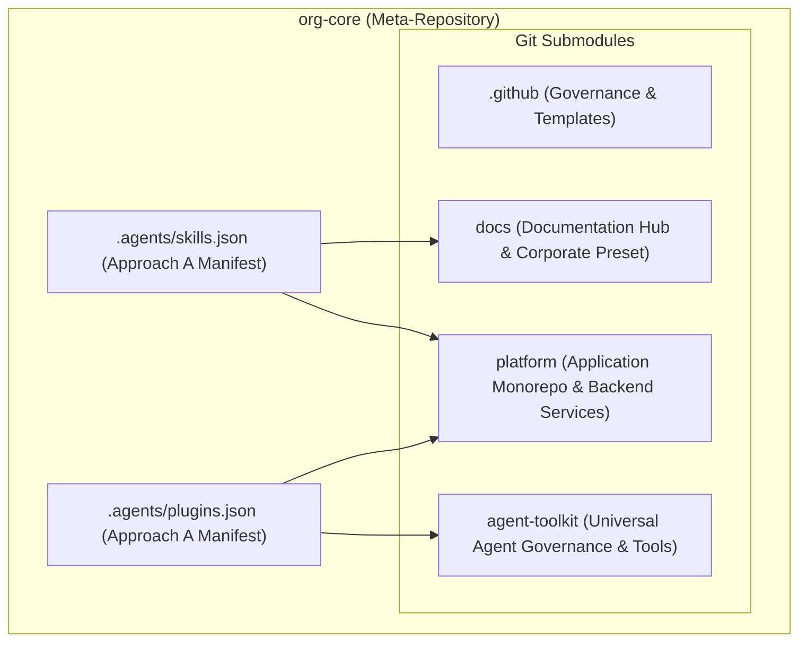

# Enterprise AI Agent Plugins and Governance Architecture: Multi-Agent Interoperability, Gateway Fallback, and Repository Harmonization

## 1. Executive Summary and Problem Statement

As software engineering organizations scale with agentic AI workflows, maintaining consistency, security, and developer velocity across multiple repositories becomes a critical architectural challenge. In an organization comprising a meta-repository ([`org-core`](file:///C:/Users/tupyn/projects/organizations/tupynambalucas-dev/org-core)), specialized monorepos ([`platform`](file:///C:/Users/tupyn/projects/organizations/tupynambalucas-dev/org-core/platform), [`docs`](file:///C:/Users/tupyn/projects/organizations/tupynambalucas-dev/org-core/docs)), independent products ([`tessel`](file:///C:/Users/tupyn/projects/organizations/tupynambalucas-dev/tessel), `omni-channel`), and organizational governance ([`.github`](file:///C:/Users/tupyn/projects/organizations/tupynambalucas-dev/org-core/.github)), AI agent configuration faces two conflicting failure modes:

1. **Fragmentation and Severe Duplication**: As revealed by our codebase audit, identical copies of `agent-router-expert`, `markdown-expert`, `plugin-expert`, `skill-expert`, `cortex`, and `cortex-fallback` were replicated across `.github`, `platform`, and `docs`. Hardcoded API tokens and secrets were committed directly into local `mcp_config.json` files, creating high-risk governance drift.
2. **Brittle Isolation & Gateway Outages**: If an agent relies exclusively on a remote or local MCP gateway (`agentgateway`) that is offline or misconfigured, the agent session experiences connection timeouts or tool invocation failures, leaving developers stranded without access to core search, scraping, or scraping tools.

This document establishes the definitive production architecture:
- Creation of the dedicated, vendor-neutral repository [`agent-toolkit`](file:///C:/Users/tupyn/projects/organizations/tupynambalucas-dev/org-core/agent-toolkit) inside [`org-core`](file:///C:/Users/tupyn/projects/organizations/tupynambalucas-dev/org-core) as a first-class Git submodule, published to `git@github.com:tupynambalucas-dev/agent-toolkit.git`.
- Adoption of **Approach A (Meta-Repository Configuration Manifest)** via `org-core/.agents/skills.json` and `org-core/.agents/plugins.json`, enabling immediate global recognition of child skills like `/docusaurus-expert` and `/k8s-expert` without code duplication.
- Mandatory backup of all historical `.agents` directories to `projects/organizations/tupynambalucas-dev/backup/agents/` prior to any file deletion.
- Elimination of redundant skills and vulnerable plaintext credentials from `platform`, `docs`, and `.github`.
- Dual distribution of `agent-toolkit` via direct Git URL and GitHub Packages (`@tupynambalucas-dev/agent-toolkit`).

---

## 2. Meta-Repository Architecture: Approach A Implementation

### 2.1 The Child Skill Recognition Problem
When an engineer or agent operates at the root of [`org-core`](file:///C:/Users/tupyn/projects/organizations/tupynambalucas-dev/org-core), Antigravity's default discovery engine traverses upward from the current working directory to the Git root (`org-core/.git`). By default, it does not scan into nested submodules (`docs/`, `platform/`). Consequently, specialized skills like `docusaurus-expert` (located in `docs/.agents/skills/`) would not be recognized as slash commands (`/docusaurus-expert`) at the root without explicit configuration.

### 2.2 Approach A Specification: Root Configuration Manifests
To resolve this, `org-core` implements **Approach A**, declaring discovery manifests directly at its root:

1. **`org-core/.agents/skills.json`**:
   ```json
   {
     "entries": [
       { "path": "docs/.agents/skills" },
       { "path": "platform/.agents/skills" }
     ]
   }
   ```
2. **`org-core/.agents/plugins.json`**:
   ```json
   {
     "entries": [
       { "path": "agent-toolkit" },
       { "path": "platform/.agents/plugins" }
     ]
   }
   ```

### 2.3 Operational Benefits
- **Immediate Slash Command Recognition**: Typing `/docusaurus-expert` or `/k8s-expert` works natively from the root of `org-core` in both Antigravity CLI and IDE.
- **Zero Duplication**: `docusaurus-expert` lives exclusively in `docs/`, and `k8s-expert` lives exclusively in `platform/`.
- **Hierarchical Progressive Disclosure**: Only YAML frontmatter metadata is loaded at startup; skill instructions are ingested on demand.

---

## 3. Dedicated Submodule Repository: `agent-toolkit`

Instead of coupling global tooling to `.github` or the `platform` monorepo, the organization creates a dedicated, lightweight repository:



### 3.1 Repository Identity and Scope
- **Repository Name**: `tupynambalucas-dev/agent-toolkit`
- **Location in Meta-Repo**: `org-core/agent-toolkit` (tracked as Git submodule)
- **Remote Origin**: `git@github.com:tupynambalucas-dev/agent-toolkit.git`
- **Visibility**: Public
- **Vendor Neutrality**: Designed to support Google Antigravity, Anthropic Claude Code, Cursor, and GitHub Copilot without vendor lock-in.

### 3.2 Canonical Internal Layout
```text
agent-toolkit/
├── package.json             # NPM package manifest for GitHub Packages
├── plugin.json              # Antigravity & Agent Plugins 1.0 manifest
├── .claude-plugin/
│   └── plugin.json          # Claude Code manifest
├── mcp_config.json          # Secure MCP configurations
├── rules/
│   └── AGENTS.md            # Consolidated enterprise governance rules
├── skills/
│   ├── agent-router-expert/ # Domain query orchestrator
│   ├── markdown-expert/     # Syntax & table formatting
│   ├── plugin-expert/       # Plugin authoring standards
│   ├── skill-expert/        # Skill validation & progressive disclosure
│   ├── secrets-expert/      # Infisical & secret hygiene
│   └── github-org-manager/  # GitHub RBAC and organization governance
├── scripts/
│   └── mcp-gateway-router.js# 300ms probe proxy for zero-downtime fallback
└── README.md
```

---

## 4. Pre-Refactor Safety: Mandatory Backup Protocol

Before deleting any duplicated or obsolete files from the existing repositories, a complete, immutable backup of all `.agents` directories must be taken.

### 4.1 Backup Destination
- **Backup Root**: `C:\Users\tupyn\projects\organizations\tupynambalucas-dev\backup\agents\`
- **Structure**:
  ```text
  backup/agents/
  ├── .github/
  │   └── .agents/          # Full pre-refactor snapshot of .github/.agents
  ├── platform/
  │   └── .agents/          # Full pre-refactor snapshot of platform/.agents
  └── docs/
      └── .agents/          # Full pre-refactor snapshot of docs/.agents
  ```

### 4.2 Backup Verification Invariant
No file may be deleted from `.github`, `platform`, or `docs` until the backup script confirms 100% file count parity and non-zero byte size for all archived directories.

---

## 5. Repository Harmonization & Segregation Matrix

Following the codebase audit, skills and plugins are segregated strictly by bounded context. All redundant duplicates and exposed credentials are removed:

| Component | Pre-Refactor State | Final Target Location | Actions & Rationale |
| :--- | :--- | :--- | :--- |
| **`agent-router-expert`** | Duplicated in 3 repos | **`agent-toolkit/skills/`** | Move to toolkit. Delete duplicates from `platform`, `docs`, and `.github`. |
| **`docusaurus-expert`** | Duplicated in 3 repos | **`docs/.agents/skills/`** | Keep in `docs`. Delete from `platform` and `.github`. Discovered at root via `skills.json`. |
| **`markdown-expert`** | Duplicated in 3 repos | **`agent-toolkit/skills/`** | Move to toolkit. Delete duplicates from `platform`, `docs`, and `.github`. |
| **`plugin-expert`** | Duplicated in 3 repos | **`agent-toolkit/skills/`** | Move to toolkit. Delete duplicates from `platform`, `docs`, and `.github`. |
| **`skill-expert`** | Duplicated in 3 repos | **`agent-toolkit/skills/`** | Move to toolkit. Delete duplicates from `platform`, `docs`, and `.github`. |
| **`secrets-expert`** | Duplicated in 2 repos | **`agent-toolkit/skills/`** | Move to toolkit. Sanitize hardcoded tokens. Delete from `platform` and `.github`. |
| **`github-organization`** | Duplicated in 2 repos | **`agent-toolkit/skills/`** | Migrate `github-org-manager` to toolkit skills. Sanitize tokens. Delete plugin folders. |
| **`k8s-expert`** | Duplicated in 2 repos | **`platform/.agents/plugins/`** | Keep in `platform`. Delete from `.github`. Discovered at root via `plugins.json`. |
| **`cortex` / `cortex-fallback`** | Duplicated in 2 repos | **`agent-toolkit/`** | Replace with unified `mcp-gateway-router.js` inside toolkit. Delete legacy plugins. |
| **`AGENTS.md` (Governance)** | `.github/AGENTS.md` | **`.github/` & `agent-toolkit`** | Enterprise baseline (commits `-S`, zero-emoji, conventional commits). |
| **`AGENTS.md` (Platform)** | `platform/AGENTS.md` | **`platform/AGENTS.md`** | Domain rules for NestJS, Prisma, Turborepo, microservices. |
| **`AGENTS.md` (Docs)** | `docs/AGENTS.md` | **`docs/AGENTS.md`** | Domain rules for Docusaurus, MDX, corporate preset. |

---

## 6. MCP Gateway Fallback and Secret Sanitization

### 6.1 Transparent Gateway Router Pattern
The legacy setup ran `cortex` (HTTP gateway) and `cortex-fallback` (stdio subprocesses) simultaneously, creating tool naming collisions and startup hangs when the gateway was offline.

The new architecture unifies both under `agent-toolkit/scripts/mcp-gateway-router.js`:
1. **Health Probe**: Performs an asynchronous 300ms HTTP health probe against `https://mcp.tupynambalucas.dev/mcp/health`.
2. **Online Mode**: Routes tool executions over Streamable HTTP to the cloud gateway.
3. **Offline Mode**: Automatically falls back to local subprocesses (`pnpm dlx firecrawl-mcp`, `@upstash/context7-mcp`) wrapped with Infisical.

### 6.2 Zero-Plaintext Secret Architecture
- **Cloud Gateway**: Authenticates via `Authorization: Bearer ${TUPYNAMBA_GATEWAY_TOKEN}`. All third-party provider keys (Firecrawl, Context7, GitHub PAT) remain strictly in the cloud vault.
- **Local Fallback**: Secrets are injected into memory via Infisical wrappers:
  ```json
  {
    "mcpServers": {
      "firecrawl-mcp": {
        "command": "infisical",
        "args": ["run", "--env=dev", "--", "pnpm", "dlx", "firecrawl-mcp"]
      }
    }
  }
  ```
  No credentials ever touch JSON configuration files or Git commits.

---

## 7. Multi-AI Interoperability Standards

The `agent-toolkit` supports Google Antigravity, Claude Code, Cursor, and GitHub Copilot interchangeably:

1. **Manifest Parity**:
   - `plugin.json` conforms to Agent Plugins 1.0 & Antigravity specification.
   - `.claude-plugin/plugin.json` mirrors metadata for Claude Code's native plugin manager.
2. **Universal Rules & Skills**:
   - `rules/AGENTS.md` is ingested natively across all modern AI engines.
   - `skills/*/SKILL.md` uses open YAML frontmatter (`name`, `description`) recognized by both Antigravity and Claude Code.
3. **Dual Distribution**:
   - Workstations install directly via Git: `agy plugin install https://github.com/tupynambalucas-dev/agent-toolkit`.
   - Projects consume deterministically via NPM: `pnpm add -D @tupynambalucas-dev/agent-toolkit`.

---

## 8. Execution Roadmap & Verification Checklist

- [ ] **Step 1: Backup**: Archive `.agents` directories from `platform`, `docs`, and `.github` to `tupynambalucas-dev/backup/agents/`.
- [ ] **Step 2: Initialize `agent-toolkit`**:
  - [ ] Create GitHub repository `tupynambalucas-dev/agent-toolkit`.
  - [ ] Assemble `plugin.json`, `package.json`, `.claude-plugin/plugin.json`, and `mcp_config.json`.
  - [ ] Populate shared skills (`agent-router-expert`, `markdown-expert`, `plugin-expert`, `skill-expert`, `secrets-expert`, `github-org-manager`).
  - [ ] Create `scripts/mcp-gateway-router.js`.
  - [ ] Validate with `agy plugin validate agent-toolkit --strict`.
  - [ ] Push to `agent-toolkit` with signed commit (`-S`).
- [ ] **Step 3: Cleanup Repositories**:
  - [ ] Remove redundant skills and plugins from `platform/.agents/`.
  - [ ] Remove redundant skills from `docs/.agents/`.
  - [ ] Remove redundant plugins and skills from `.github/.agents/`.
- [ ] **Step 4: Configure Approach A in `org-core`**:
  - [ ] Add `agent-toolkit` as a Git submodule in `org-core`.
  - [ ] Create `org-core/.agents/skills.json` and `org-core/.agents/plugins.json`.
  - [ ] Update `tupynambalucas-dev.code-workspace`.
- [ ] **Step 5: Verification & Synchronization**:
  - [ ] Verify signed commits (`-S`) and push across all repositories (`agent-toolkit`, `.github`, `platform`, `docs`, `org-core`).
  - [ ] Generate comprehensive execution report.
