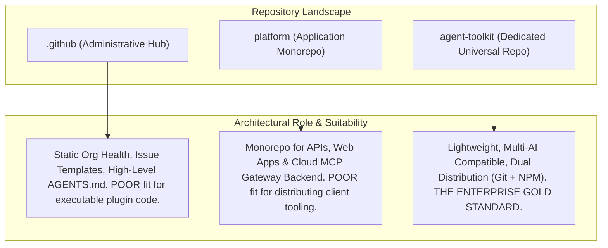
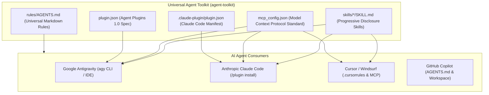
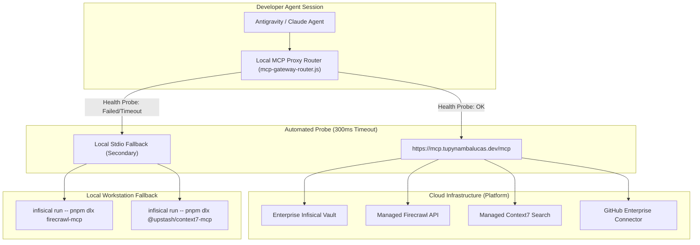
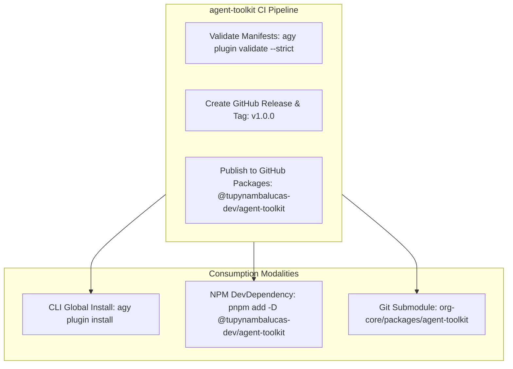

# Enterprise AI Agent Plugins and Governance Architecture: Multi-Agent Interoperability, Gateway Fallback, and Repository Harmonization

## 1. Executive Summary and Problem Statement

As software engineering organizations scale with agentic AI workflows, maintaining consistency, security, and developer velocity across multiple repositories becomes a critical architectural challenge. In an organization comprising a meta-repository ([`org-core`](file:///C:/Users/tupyn/projects/organizations/tupynambalucas-dev/org-core)), specialized monorepos ([`platform`](file:///C:/Users/tupyn/projects/organizations/tupynambalucas-dev/org-core/platform), [`docs`](file:///C:/Users/tupyn/projects/organizations/tupynambalucas-dev/org-core/docs)), independent products ([`tessel`](file:///C:/Users/tupyn/projects/organizations/tupynambalucas-dev/tessel), `omni-channel`), and organizational governance ([`.github`](file:///C:/Users/tupyn/projects/organizations/tupynambalucas-dev/org-core/.github)), AI agent configuration faces two conflicting failure modes:

1. **Fragmentation and Severe Duplication**: As revealed by our codebase audit, identical copies of `agent-router-expert`, `markdown-expert`, `plugin-expert`, `skill-expert`, `cortex`, and `cortex-fallback` were replicated across `.github`, `platform`, and `docs`. Hardcoded API tokens and secrets were committed directly into local `mcp_config.json` files, creating high-risk governance drift.
2. **Brittle Isolation & Gateway Outages**: If an agent relies exclusively on a remote or local MCP gateway (`agentgateway`) that is offline or misconfigured, the agent session experiences connection timeouts or tool invocation failures, leaving developers stranded without access to core search, scraping, or scraping tools.

This document presents a comprehensive architectural solution that:
- Establishes a **vendor-neutral, multi-AI repository** (`tupynambalucas-dev/agent-toolkit`) compatible with Google Antigravity, Claude Code, Cursor, and GitHub Copilot.
- Solves the **MCP Gateway vs. Fallback dilemma** using transparent proxy routing and zero-plaintext secret management via Infisical.
- Audits and classifies all existing skills and plugins across `.github`, `platform`, and `docs`, defining an exact boundary between domain-specific skills and global organizational toolkits.
- Implements the **Dual Distribution Model** via Git URL and GitHub Packages (`@tupynambalucas-dev/agent-toolkit`).

---

## 2. Strategic Repository Placement: Why `agent-toolkit` Over `.github` or `platform`

We evaluated three potential repository candidates for hosting organizational agent capabilities:



### 2.1 The Case Against Hosting Full Plugins in `.github`
- **Separation of Concerns**: `.github` is GitHub's designated administrative repository for organizational metadata, issue templates, workflow templates, security advisories, and profile readmes. Bundling executable TypeScript scripts, validation suites, and node dependencies into `.github` violates this boundary.
- **Git Clone Overhead**: Running `agy plugin install https://github.com/tupynambalucas-dev/.github` clones the entire administrative repository into developer profiles (`~/.gemini/config/plugins/`), including templates and graphic assets.
- **Release Cadence Coupling**: Versioning plugins with semantic release tags (`v1.0.0`, `v1.1.0`) directly in `.github` pollutes organizational commit history.

### 2.2 The Case Against Distributing Plugins from `platform`
- **Monorepo Coupling**: `platform` is a heavy monorepo containing NestJS backend services, web applications, databases, Prisma migrations, and Kubernetes configurations. Developers working on `docs`, `tessel`, or client SDKs should not depend on a 500MB+ monorepo just to load agent skills.
- **CI/CD Inefficiency**: Any update to an agent skill prompt would trigger Turborepo build graph analysis, potentially running unrelated linting and test suites across the monorepo.
- **Proper Role for `platform`**: `platform` should host and deploy the **Cloud MCP Gateway backend service** (e.g., NestJS-based Streamable HTTP MCP server) and maintain its own domain-specific skills (`k8s-expert`, `nest-architect`).

### 2.3 The Solution: Dedicated Universal Repository (`tupynambalucas-dev/agent-toolkit`)
- **Canonical Root**: The repository root contains `plugin.json` and `package.json`. Native installation works seamlessly:
  ```bash
  agy plugin install https://github.com/tupynambalucas-dev/agent-toolkit
  ```
- **Universal Multi-AI Compatibility**: Avoids vendor-specific branding in the name. Works equally for Antigravity, Claude Code, Cursor, and VSCode Copilot.
- **Submodule Inclusion**: Mounts cleanly inside [`org-core`](file:///C:/Users/tupyn/projects/organizations/tupynambalucas-dev/org-core) as a Git submodule alongside `platform` and `docs`.

---

## 3. Multi-AI Interoperability: Antigravity, Claude Code, Cursor, and Copilot

The emerging industry consensus in 2026 centers on open, vendor-neutral agent standards. The `agent-toolkit` repository is architected to be 100% cross-compatible across all major AI coding platforms:



### 3.1 Standards Alignment
1. **Universal Rules (`AGENTS.md`)**:
   Supported natively by Antigravity, Claude Code, Cursor, Windsurf, and GitHub Copilot. Placing `rules/AGENTS.md` ensures identical governance enforcement regardless of which AI tool a developer launches.
2. **Progressive Disclosure Skills (`skills/<name>/SKILL.md`)**:
   Both Antigravity and Claude Code adhere to the identical YAML frontmatter specification (`name`, `description`) and progressive disclosure loading pattern.
3. **Model Context Protocol (`mcp_config.json`)**:
   The MCP open standard (invented by Anthropic and adopted by Google Antigravity, Cursor, and Zed) provides unified tool discovery and execution across all clients.
4. **Dual Manifest Compatibility**:
   - `plugin.json` at root satisfies Antigravity and the open Agent Plugins 1.0 specification.
   - `.claude-plugin/plugin.json` (or a symlink to `plugin.json`) satisfies Claude Code's native plugin manager:
     ```bash
     # Claude Code installation
     /plugin marketplace add tupynambalucas-dev/agent-toolkit
     /plugin install agent-toolkit
     ```

---

## 4. MCP Gateway vs. Fallback Resilience Architecture

A major challenge in enterprise AI operations is balancing a centralized cloud gateway with workstation resilience during network disconnects or gateway outages.



### 4.1 The Transparent Gateway Router Pattern (Recommended)

Rather than forcing developers to manually toggle between `cortex` and `cortex-fallback` plugins when the gateway goes down, the toolkit provides a single, transparent **MCP Proxy Router** (`scripts/mcp-gateway-router.js`):

1. **Operation**:
   - The agent connects to a local Stdio bridge configured in `mcp_config.json`:
     ```json
     {
       "mcpServers": {
         "cortex-gateway": {
           "command": "node",
           "args": ["./scripts/mcp-gateway-router.js"]
         }
       }
     }
     ```
   - When the bridge initializes, it performs an asynchronous HTTP health probe to `https://mcp.tupynambalucas.dev/mcp/health` with a 300ms timeout.
   - **Primary Path (Cloud Gateway Online)**:
     The proxy forwards MCP tool calls to the cloud gateway over Streamable HTTP.
   - **Fallback Path (Cloud Gateway Offline or Air-Gapped)**:
     The proxy automatically spawns the local subprocesses (`firecrawl-mcp`, `context7-mcp`) via `infisical run`.
2. **Advantages**:
   - **Zero Tool Collisions**: The agent is presented with exactly one set of tools (`firecrawl_scrape`, `context7_docs`).
   - **Zero Session Failures**: The agent never hangs or fails to boot if the cloud gateway is undergoing maintenance.
   - **Completely Transparent**: Developers do not need to run manual switch commands.

### 4.2 Config-Level Active/Passive Profile (Alternative)
For environments where running a local bridge script is undesirable:
- Primary: `cortex` plugin (`"disabled": false` in `plugin.json`).
- Secondary: `cortex-fallback` plugin (`"disabled": true` in `plugin.json`).
- If the gateway is offline, developers switch using the native Antigravity CLI:
  ```bash
  agy plugin disable cortex && agy plugin enable cortex-fallback
  ```

---

## 5. Enterprise Secret Management & Authentication Architecture

A critical security vulnerability identified in the audit was the presence of hardcoded API tokens (`FIRECRAWL_API_KEY`, `context7-mcp --api-key`, and Infisical client secrets) directly inside committed `mcp_config.json` files.

```mermaid
flowchart LR
    subgraph Risk["Previous State (Vulnerable)"]
        K1["Hardcoded tokens in mcp_config.json"] --> G1["Committed to Git Repository"]
    end

    subgraph SecureGateway["Cloud Gateway Auth (Primary)"]
        D1["Developer Workstation"] -->|Bearer Token: ${TUPYNAMBA_GATEWAY_TOKEN}| GW["Cloud MCP Gateway"]
        GW -->|Zero Developer Exposure| SEC["Cloud Secrets Vault (Infisical)"]
    end

    subgraph SecureFallback["Local Fallback Auth (Secondary)"]
        D2["Developer Workstation"] -->|infisical run --| SUB["Local Stdio Process (Memory-Only)"]
    end
```

### 5.1 Cloud Gateway Authentication
In the primary cloud-hosted model:
- Third-party API keys (`FIRECRAWL_API_KEY`, `CONTEXT7_API_KEY`, GitHub PATs) are stored **exclusively in cloud infrastructure** (Infisical Cloud / Kubernetes Secrets).
- Developer machines do **NOT** store or require third-party vendor credentials.
- The developer agent authenticates to the cloud gateway using a personal or machine Bearer token configured via environment variable:
  ```json
  {
    "mcpServers": {
      "enterprise-gateway": {
        "serverUrl": "https://mcp.tupynambalucas.dev/mcp",
        "headers": {
          "Authorization": "Bearer ${TUPYNAMBA_GATEWAY_TOKEN}"
        }
      }
    }
  }
  ```
- `TUPYNAMBA_GATEWAY_TOKEN` is provisioned during workstation setup or retrieved via `infisical login`.

### 5.2 Local Fallback Secret Injection (Memory-Only)
When running local fallbacks (`cortex-fallback`), secrets must never be written to JSON config files. Instead, leverage Infisical's process wrapper:
```json
{
  "mcpServers": {
    "firecrawl-mcp": {
      "command": "infisical",
      "args": ["run", "--env=dev", "--", "pnpm", "dlx", "firecrawl-mcp"]
    },
    "context7-mcp": {
      "command": "infisical",
      "args": ["run", "--env=dev", "--", "pnpm", "dlx", "@upstash/context7-mcp"]
    }
  }
}
```
**Mechanism**: Infisical injects the requested environment variables into the spawned process's memory space only. No plain-text keys exist on disk or in version control.

---

## 6. Multi-Repository Bounded Context Audit & Skill Allocation Matrix

### 6.1 Audit Findings Across Repositories
The audit revealed extreme duplication across the organization's repositories:
- `agent-router-expert`: Copied identically in `.github`, `platform`, and `docs`.
- `docusaurus-expert`: Copied in `platform` and `.github` despite being exclusive to documentation.
- `markdown-expert`, `plugin-expert`, `skill-expert`: Replicated in all 3 repositories.
- `k8s-expert`: Copied in `.github` and `platform`.
- `cortex` & `cortex-fallback`: Duplicated with hardcoded tokens in `.github` and `platform`.

### 6.2 Target Allocation Matrix

| Skill / Plugin / Rule | Current Location(s) | Target Location | Rationale & Bounded Context |
| :--- | :--- | :--- | :--- |
| **`agent-router-expert`** | `.github`, `platform`, `docs` | `agent-toolkit` (Global) | Cross-cutting orchestrator directing queries to specialized domains. |
| **`docusaurus-expert`** | `.github`, `platform`, `docs` | **`docs/.agents/skills/` (Local ONLY)** | Exclusive to Docusaurus documentation, MDX, and corporate preset. Remove from `platform` and `.github`. |
| **`markdown-expert`** | `.github`, `platform`, `docs` | `agent-toolkit` (Global) | Universal documentation linting, tables, and syntax standards. |
| **`plugin-expert`** | `.github`, `platform`, `docs` | `agent-toolkit` (Global) | Antigravity and Agent Plugins 1.0 development procedures. |
| **`skill-expert`** | `.github`, `platform`, `docs` | `agent-toolkit` (Global) | Skill authoring, progressive disclosure optimization, and validation scripts. |
| **`secrets-expert`** | `.github`, `platform` | `agent-toolkit` (Global) | Universal Infisical integration, secret hygiene, and zero-leakage enforcement. |
| **`github-organization`** | `.github`, `platform` | `agent-toolkit` (Global) | Organization RBAC, ruleset schemas, and team permission synchronization. |
| **`k8s-expert`** | `.github`, `platform` | **`platform/.agents/plugins/` (Local ONLY)** | Kubernetes, Helm, ArgoCD, and infrastructure deployers belong exclusively in `platform`. Remove from `.github`. |
| **`cortex` (Gateway)** | `.github`, `platform` | `agent-toolkit` (Global) | Universal Cloud MCP Gateway connector. |
| **`cortex-fallback`** | `.github`, `platform` | `agent-toolkit` (Global) | Universal local MCP fallback (sanitized with Infisical wrapper). |
| **`AGENTS.md` (Governance)** | `.github/AGENTS.md` | `.github/` & `agent-toolkit` | Corporate standards (commits `-S`, zero-emoji, conventional commits). |
| **`AGENTS.md` (Platform)** | `platform/AGENTS.md` | `platform/AGENTS.md` (Local) | Domain rules for NestJS, Prisma, Turborepo, microservices. |
| **`AGENTS.md` (Docs)** | `docs/AGENTS.md` | `docs/AGENTS.md` (Local) | Domain rules for Docusaurus, corporate preset, technical writing. |

---

## 7. Dual Distribution: Git URL and GitHub Packages (NPM)

To provide zero-friction onboarding, deterministic versioning, and automated dependency updates, the `agent-toolkit` implements a **Dual Distribution Model**:



### 7.1 GitHub Packages NPM Distribution
1. **`package.json` in `agent-toolkit`**:
   ```json
   {
     "name": "@tupynambalucas-dev/agent-toolkit",
     "version": "1.0.0",
     "description": "Universal enterprise AI agent toolkit: governance, MCP gateway, routing, and skills.",
     "repository": "git@github.com:tupynambalucas-dev/agent-toolkit.git",
     "publishConfig": {
       "registry": "https://npm.pkg.github.com"
     },
     "files": [
       "plugin.json",
       ".claude-plugin/",
       "mcp_config.json",
       "hooks.json",
       "rules/",
       "skills/",
       "scripts/"
     ]
   }
   ```
2. **Deterministic Consumption in `platform` and `docs`**:
   In `platform/package.json` and `docs/package.json`:
   ```json
   {
     "devDependencies": {
       "@tupynambalucas-dev/agent-toolkit": "^1.0.0"
     }
   }
   ```
   In `.agents/plugins.json`:
   ```json
   {
     "entries": [
       { "path": "node_modules/@tupynambalucas-dev/agent-toolkit" }
     ]
   }
   ```
3. **Automated Maintenance**:
   - `pnpm install` deterministically provisions the exact version into `node_modules/`.
   - The Antigravity engine and Claude Code instantly discover the package.
   - Renovate and Dependabot automatically submit PRs when new toolkit versions are released.

---

## 8. Step-by-Step Implementation and Migration Roadmap

### Phase 1: Repository Creation and Core Asset Assembly
- [ ] Create repository `git@github.com:tupynambalucas-dev/agent-toolkit.git`.
- [ ] Initialize `plugin.json`, `.claude-plugin/plugin.json`, and `package.json`.
- [ ] Assemble global skills:
  - `agent-router-expert`
  - `markdown-expert`
  - `plugin-expert`
  - `skill-expert`
  - `secrets-expert`
  - `conventional-commits`
  - `github-org-manager`
- [ ] Implement the `mcp-gateway-router.js` proxy with 300ms health checking.
- [ ] Sanitize `mcp_config.json` (replace plaintext credentials with `${TUPYNAMBA_GATEWAY_TOKEN}` and `infisical run`).

### Phase 2: CI/CD Pipeline & GitHub Packages Publishing
- [ ] Configure `.github/workflows/ci.yml` in `agent-toolkit` to run `agy plugin validate . --strict --json`.
- [ ] Configure `.github/workflows/release.yml` to publish to GitHub Packages (`npm.pkg.github.com`).
- [ ] Verify signed tagging (`-S`) and release notes generation.

### Phase 3: Monorepo & Documentation Cleanup
- [ ] In `platform/.agents/`:
  - Retain `k8s-expert` and local `AGENTS.md`.
  - Delete duplicated `docusaurus-expert`, `agent-router-expert`, `markdown-expert`, `plugin-expert`, `skill-expert`, `cortex`, `cortex-fallback`, `secrets-expert`.
  - Add `@tupynambalucas-dev/agent-toolkit` to `devDependencies`.
  - Configure `.agents/plugins.json` pointing to `node_modules/@tupynambalucas-dev/agent-toolkit`.
- [ ] In `docs/.agents/`:
  - Retain `docusaurus-expert` and local `AGENTS.md`.
  - Delete duplicated `agent-router-expert`, `markdown-expert`, `plugin-expert`, `skill-expert`.
  - Add `@tupynambalucas-dev/agent-toolkit` to `devDependencies`.
- [ ] In `.github/.agents/`:
  - Retain high-level governance `AGENTS.md` and plans registry.
  - Delete duplicate runtime plugins.

### Phase 4: Verification and Developer Onboarding
- [ ] Test CLI installation: `agy plugin install https://github.com/tupynambalucas-dev/agent-toolkit`.
- [ ] Test Claude Code compatibility: `/plugin marketplace add tupynambalucas-dev/agent-toolkit`.
- [ ] Test simulated gateway downtime to confirm zero-downtime fallback to local Infisical-wrapped Stdio MCPs.
- [ ] Verify signed commits (`-S`) across all repositories.
