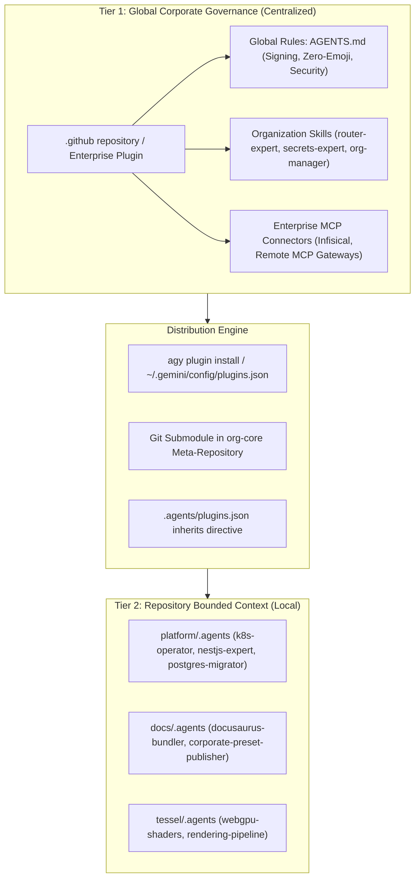

# Enterprise AI Agent Plugins and Governance Architecture

## 1. Executive Summary and Problem Statement

As software engineering organizations scale with agentic AI workflows, maintaining consistency, security, and developer velocity across multiple repositories becomes a critical architectural challenge. In an organization comprising a meta-repository ([`org-core`](file:///C:/Users/tupyn/projects/organizations/tupynambalucas-dev/org-core)), specialized monorepos ([`platform`](file:///C:/Users/tupyn/projects/organizations/tupynambalucas-dev/org-core/platform), [`docs`](file:///C:/Users/tupyn/projects/organizations/tupynambalucas-dev/org-core/docs)), independent products ([`tessel`](file:///C:/Users/tupyn/projects/organizations/tupynambalucas-dev/tessel), `omni-channel`), and organizational governance ([`.github`](file:///C:/Users/tupyn/projects/organizations/tupynambalucas-dev/org-core/.github)), AI agent configuration faces two conflicting failure modes:

1. **Fragmentation and Drift**: If every repository maintains its own disconnected rules, skills, and Model Context Protocol (MCP) servers, corporate guidelines (cryptographic signing, conventional commits, secret hygiene, zero-emoji policy) drift out of synchronization, requiring N pull requests for every governance change.
2. **Brittle Isolation**: If agent configurations are stored exclusively in an external global environment or parent meta-repo, an engineer cloning a single repository (such as `platform` or `tessel`) standalone in an isolated environment loses access to necessary tools, skills, and contextual constraints.

This document presents a comprehensive comparative analysis of architectural approaches, specifies the canonical schema for an Enterprise Antigravity Plugin hosted in the [`.github`](file:///C:/Users/tupyn/projects/organizations/tupynambalucas-dev/org-core/.github) repository, and establishes the deployment, dynamic updating, and graceful degradation models for enterprise-grade autonomous agents.

---

## 2. Comparative Analysis: Approach A vs. Approach B vs. Approach C

### 2.1 Approach A: Global Enterprise Plugin (Distributed via Antigravity CLI / Git)

In Approach A, the organization packages all shared skills, corporate rules, MCP configurations, and hooks into a centralized Antigravity plugin (e.g., `tupynambalucas-dev-plugin`). This plugin is published to a Git repository or enterprise registry and installed into each developer's workstation profile located at `~/.gemini/config/plugins/` using the Antigravity CLI:

```bash
agy plugin install https://github.com/tupynambalucas-dev/.github
# or via dedicated plugin repository / release artifact
agy plugin install tupynambalucas-dev-plugin@tupynambalucas-registry
```

#### Advantages
- **Single Source of Truth**: All corporate security policies, shared tools, and organization skills are defined in one place. Updating the plugin immediately propagates across all repositories opened by that developer.
- **Zero Monorepo / Repository Bloat**: Application repositories do not contain duplicate skill files, MCP scripts, or generic tooling configurations.
- **Cross-Repository Omnipresence**: When a developer opens any repository—including legacy repositories, forks, or new Greenfield projects—the agent automatically possesses full enterprise capabilities (`agent-router-expert`, `secrets-expert`, `conventional-commits`).
- **Centralized MCP Governance**: Sensitive MCP configurations (such as Infisical gateways, corporate GitHub connectors, or internal documentation endpoints) are configured and patched centrally without committing credentials or environment scripts into product repos.

#### Disadvantages & Trade-offs
- **Onboarding Friction**: New team members or contractors must execute an explicit installation step (`agy plugin install`) before their agent behaves according to company standards.
- **Headless CI/CD Complexity**: Running agentic workflows inside GitHub Actions runners or containerized pipelines requires an explicit staging step to install or mount the global plugin.
- **Potential Machine Drift**: Developers who fail to run `agy plugin update` or lack automated sync mechanisms may run outdated versions of corporate plugins while repository code assumes updated behavior.

---

### 2.2 Approach B: Self-Contained Local Repository (`<repo>/.agents/`)

In Approach B, every repository is completely autonomous. All required skills, rules, and configurations are committed directly to the version control system within `<repo>/.agents/` (e.g., `platform/.agents/`, `docs/.agents/`, `tessel/.agents/`):

```text
platform/
├── .agents/
│   ├── rules/
│   │   └── AGENTS.md
│   ├── skills/
│   │   ├── router-expert/
│   │   ├── conventional-commits/
│   │   └── k8s-operator/
│   └── plugins/
└── ...
```

#### Advantages
- **Zero Setup / Instant Discovery**: Anyone running `git clone <repo>` immediately receives all agent instructions, rules, and skills upon launching Antigravity in that folder. No global installation is required.
- **Atomic Versioning with Code**: Changes to agent behaviors, framework prompts, or build skills are committed in the exact same Git commits and pull requests as the application code changes.
- **CI/CD Native**: Headless CI/CD pipelines (GitHub Actions, GitLab CI) read the local `.agents/` folder automatically without requiring external network calls or registry credentials.
- **Air-Gapped and Contractor-Safe**: Fully isolated contractors or external contributors get the exact tools allowed for that specific repository without accessing the broader organizational infrastructure.

#### Disadvantages & Trade-offs
- **Severe Duplication and Maintenance Overhead**: Generic corporate skills (`conventional-commits`, `secrets-expert`, `markdown-expert`) must be manually replicated across every repository. A single policy change requires synchronized pull requests across dozens of repositories.
- **Siloed Context**: An agent operating in `platform` has zero awareness of `docs`, `tessel`, or organizational governance unless duplicate documentation is manually copied into its local tree.
- **Repository Clutter**: Monorepos and domain services become burdened with non-domain operational skills and agent configurations.

---

### 2.3 Approach C: The Hybrid Federated Architecture (Enterprise Standard)

The recommended production architecture combines Approach A and Approach B into a **two-tier federated hierarchy**, leveraging the native precedence and inheritance model of Antigravity:



1. **Tier 1 (Global Corporate Governance)**:
   - Packaged as a standard Antigravity Plugin hosted in [`.github`](file:///C:/Users/tupyn/projects/organizations/tupynambalucas-dev/org-core/.github) (`tupynambalucas-dev-plugin`).
   - Distributes immutable corporate policies: cryptographic commit signing (`-S`), conventional commit validation, zero emojis, Infisical secrets resolution, and high-level routing.
   - Installed globally on workstations or inherited via configuration manifests.
2. **Tier 2 (Repository Bounded Context)**:
   - Each individual repository retains a lightweight root `AGENTS.md` and repository-specific `.agents/skills/` tailored strictly to its technology stack (e.g., NestJS/Kubernetes in `platform`, Docusaurus in `docs`, WebGPU in `tessel`).
   - If a developer opens `platform` in standalone mode without the global plugin, the local `AGENTS.md` provides **graceful degradation** (the agent can still build, test, and run the service).
   - If the developer has the global plugin installed (or opens the workspace via `org-core`), the global enterprise rules and skills seamlessly layer over the local context.

---

### 2.4 Architectural Comparison Matrix

| Evaluation Dimension | Approach A: Pure Global Plugin | Approach B: Pure Local Repo | Approach C: Hybrid Federated (Recommended) |
| :--- | :--- | :--- | :--- |
| **Single Source of Truth** | High (Central repository) | Very Low (Duplicated N times) | High (Global governance centralized, domain local) |
| **Setup Friction (New Dev)** | Medium (Requires `agy plugin install`) | Zero (`git clone` is sufficient) | Low (Zero for local dev; full tools via one command) |
| **Atomic PRs with Code** | Low (Plugin changes decoupled) | High (Agent rules committed with code) | High (Domain skills versioned with code) |
| **Cross-Repo Context Awareness** | High (Global knowledge accessible) | None (Siloed to single repo) | High (Hierarchical resolution) |
| **Maintenance & Patching Effort** | Low (Update once centrally) | Extreme (Sync across N repos) | Low (Corporate policies updated centrally) |
| **CI/CD Pipeline Portability** | Requires plugin installation step | 100% Native | 100% Native (Falls back to local rules in CI) |
| **Security Credential Protection** | High (No secrets stored in repos) | Low (Risk of committing MCP envs) | High (Centralized MCP endpoints and Infisical) |
| **Antigravity CLI Compatibility** | Native (`~/.gemini/config/plugins/`) | Native (`.agents/` in workspace) | Fully Optimized (Multi-tier resolution engine) |

---

## 3. Enterprise Plugin Anatomy (`tupynambalucas-dev-plugin`)

The enterprise plugin must strictly follow the Antigravity Customization System specification. It bundles **Manifest**, **Rules**, **Skills**, **Lifecycle Hooks**, and **MCP Servers** into a single versioned unit.

### 3.1 Canonical Directory Layout

```text
tupynambalucas-dev-plugin/
├── plugin.json              # Canonical plugin manifest
├── mcp_config.json          # Enterprise MCP server configurations
├── hooks.json               # Security, formatting, and verification lifecycle hooks
├── rules/
│   └── AGENTS.md            # Consolidated enterprise governance rules
└── skills/
    ├── agent-router-expert/
    │   ├── SKILL.md         # Progressive disclosure workflow
    │   └── references/
    ├── conventional-commits/
    │   ├── SKILL.md
    │   └── scripts/
    ├── secrets-expert/
    │   ├── SKILL.md
    │   └── references/
    └── github-org-manager/
        ├── SKILL.md
        └── references/
```

### 3.2 Canonical Manifest Specification (`plugin.json`)

The manifest identifies the package and sets metadata recognized by `agy plugin validate` and the Antigravity Marketplace:

```json
{
  "$schema": "https://antigravity.google/schemas/v1/plugin.json",
  "name": "tupynambalucas-dev-plugin",
  "displayName": "Tupynamba Lucas Enterprise Toolkit",
  "version": "1.0.0",
  "description": "Enterprise AI agent governance, security guardrails, shared MCP connectors, and domain routing skills for the tupynambalucas-dev organization.",
  "author": {
    "name": "Tupynamba Lucas Development Team",
    "email": "contato@tupynambalucas.dev",
    "url": "https://tupynambalucas.dev"
  },
  "homepage": "https://github.com/tupynambalucas-dev/.github",
  "repository": "https://github.com/tupynambalucas-dev/.github",
  "license": "UNLICENSED",
  "keywords": [
    "enterprise-governance",
    "antigravity",
    "router-expert",
    "secrets-expert",
    "conventional-commits",
    "infisical"
  ],
  "suggestedPrompts": [
    "Route task to specialized domain expert",
    "Verify cryptographic signing and conventional commit structure",
    "Audit repository compliance against enterprise governance"
  ]
}
```

### 3.3 Enterprise MCP Configuration (`mcp_config.json`)

Antigravity supports both **Stdio** and **Streamable HTTP** transports. In an enterprise environment, MCP configurations must avoid hardcoded tokens. Tokens must resolve from system environment variables or secure credential providers:

```json
{
  "mcpServers": {
    "infisical-vault": {
      "command": "infisical",
      "args": ["export", "--format=json"],
      "env": {
        "INFISICAL_WORKSPACE_ID": "org-production"
      }
    },
    "github-enterprise": {
      "command": "pnpm",
      "args": ["dlx", "github-mcp-server-js"],
      "env": {
        "GITHUB_PERSONAL_ACCESS_TOKEN": "${GITHUB_TOKEN}"
      }
    },
    "enterprise-knowledge-gateway": {
      "url": "https://mcp.tupynambalucas.dev/mcp",
      "tools": {
        "search_enterprise_docs": {
          "eager": true
        },
        "query_architecture_decision_records": {
          "eager": false
        }
      }
    }
  }
}
```

> [!IMPORTANT]
> The legacy HTTP+SSE transport (MCP spec 2024-11-05) is deprecated in Antigravity. Enterprise remote endpoints must expose the **Streamable HTTP** transport (`/mcp` endpoint) or bridge through a local Stdio proxy (`mcp-remote`).

### 3.4 Consolidated Governance Rules (`rules/AGENTS.md`)

In Antigravity, placing a single consolidated `AGENTS.md` file under `rules/` is the official standard. This prevents rule fragmentation and guarantees deduplicated injection:

```markdown
---
trigger: always_on
---

# Tupynamba Lucas Enterprise Governance Constraints

1. Cryptographic Signature Requirement:
   - All Git commits and annotated tags MUST be cryptographically signed using SSH or GPG: `git commit -S -m "..."`.
   - Never push unsigned commits to any organizational repository.

2. Conventional Commits Standard:
   - All commit messages must follow the Conventional Commits v1.0.0 specification: `<type>(<scope>): <description>`.
   - Allowed types: `feat`, `fix`, `docs`, `style`, `refactor`, `perf`, `test`, `build`, `ci`, `chore`, `revert`.

3. Zero-Emoji Invariant:
   - Do NOT emit emojis anywhere: chat responses, code comments, commit messages, PR descriptions, or documentation.

4. Secret Hygiene:
   - Never output, log, or commit plaintext credentials, access tokens, API keys, or private SSH keys.
   - Use Infisical or environment variable expansion `${VAR_NAME}` for all secret resolution.

5. Technical Language Policy:
   - Technical documentation, code, configuration files, and Git commit messages must be written strictly in en-US.
   - Conversational responses to the user must follow the user's prompt language (defaulting to pt-BR when prompted in Portuguese).
```

### 3.5 Lifecycle Hooks (`hooks.json`)

Lifecycle hooks enforce security guardrails before and after tool executions:

```json
{
  "enterprise-safety-guard": {
    "enabled": true,
    "PreToolUse": [
      {
        "matcher": "run_command",
        "hooks": [
          {
            "command": "powershell -NoProfile -Command \"if ($env:COMMAND -match 'PRIVATE_KEY|ghp_|github_pat_') { Write-Error 'Potential secret leak prevented'; exit 1 }\""
          }
        ]
      }
    ],
    "PostToolUse": [
      {
        "matcher": "edit_file",
        "hooks": [
          {
            "command": "pnpm -w lint --fix"
          }
        ]
      }
    ]
  }
}
```

---

## 4. Hosting, Dynamic Updates, and Distribution via GitHub

### 4.1 Hosting in the `.github` Repository

GitHub treats the repository named `.github` (e.g., `tupynambalucas-dev/.github`) as the default configuration source for the entire organization. By hosting the enterprise plugin inside `.github`, the organization aligns its agent configurations with its default profile, security policies, and issue templates.

#### Directory Placement Options in `.github`:
1. **Root-Level Plugin (`.github/plugin.json`)**:
   - The entire `.github` repository behaves directly as an Antigravity plugin.
   - Installation: `agy plugin install https://github.com/tupynambalucas-dev/.github`.
2. **Packaged Plugin Subdirectory (`.github/.agents/plugins/tupynambalucas-dev/`)** *(Recommended)*:
   - Keeps the repository root clean for standard GitHub health files (`SECURITY.md`, `README.md`, `profile/`).
   - Allows multiple plugins to be hosted in the governance repository (`tupynambalucas-dev-plugin`, `compliance-plugin`).

### 4.2 Dynamic Distribution Channels

#### Channel 1: Declarative Inheritance via `plugins.json` (Zero-Copy)
In the meta-repository [`org-core`](file:///C:/Users/tupyn/projects/organizations/tupynambalucas-dev/org-core) or individual repositories, Antigravity supports explicit inheritance in `.agents/plugins.json`:

```json
{
  "inherits": [
    {
      "path": ".github/.agents/plugins/tupynambalucas-dev/plugins.json"
    }
  ],
  "entries": [
    {
      "path": ".agents/plugins"
    }
  ]
}
```
When opened in a multi-root workspace or meta-repository, Antigravity resolves the path dynamically against the workspace root.

#### Channel 2: Workstation CLI Installation (`agy plugin install`)
For standalone repository clones, developers run a one-time onboarding command:

```bash
agy plugin install https://github.com/tupynambalucas-dev/.github --subpath .agents/plugins/tupynambalucas-dev
```
This stages the bundle into `~/.gemini/config/plugins/tupynambalucas-dev/` and registers it in `~/.gemini/config/config.json`:

```json
{
  "plugins": {
    "tupynambalucas-dev": {
      "installedFrom": {
        "id": "tupynambalucas-dev/plugin/tupynambalucas-dev",
        "marketplace": "git",
        "version": "1.0.0"
      }
    }
  }
}
```

#### Channel 3: Git-Based Synchronous Updates via GitHub Actions
To automate dynamic updates across developer machines and repositories:
1. **Automated Validation on Pull Request**:
   Every PR modifying `.agents/` in `.github` executes `agy plugin validate`:
   ```yaml
   name: Validate Enterprise Plugin
   on:
     pull_request:
       paths:
         - '.agents/**'
   jobs:
     validate:
       runs-on: ubuntu-latest
       steps:
         - uses: actions/checkout@v4
         - name: Install Antigravity CLI
           run: curl -fsSL https://antigravity.google/install.sh | bash
         - name: Validate Plugin
           run: agy plugin validate .agents/plugins/tupynambalucas-dev --strict --json
   ```
2. **Semantic Versioning & Release Tagging**:
   On merging to `main`, an Action cuts a release tag (e.g., `v1.2.0`) and publishes release metadata.
3. **Automated Submodule Bump**:
   A repository dispatch trigger updates the `.github` submodule in `org-core`, ensuring that all engineers pulling `org-core` receive the latest pointer immediately.

---

## 5. Local Repositories Integration and Graceful Degradation

### 5.1 Scenario A: Developer in Meta-Workspace (`org-core`)
- Working directory: `C:\Users\tupyn\projects\organizations\tupynambalucas-dev\org-core`.
- Antigravity walks up from any file (e.g., `platform/apps/web/main.ts`) to the repository root.
- The root `.github` submodule is detected.
- All enterprise plugins, rules, and skills are active without requiring any global configuration.

### 5.2 Scenario B: Developer Clones Standalone `platform` (Isolated Workspace)
- Working directory: `C:\Users\tupyn\projects\organizations\tupynambalucas-dev\platform`.
- **Condition 1 (Global Plugin Installed)**:
  - Antigravity loads `platform/AGENTS.md` (local NestJS rules) and merges them with `~/.gemini/config/plugins/tupynambalucas-dev/` (global signing and routing rules).
  - Priority: Local repository rules override conflicting global plugin rules.
- **Condition 2 (Global Plugin NOT Installed)**:
  - Antigravity loads `platform/AGENTS.md`.
  - The local `AGENTS.md` includes a **fallback section**:
    ```markdown
    <!-- Local Governance Fallback -->
    > [!NOTE]
    > Global enterprise plugin not detected. Applying standalone fallback rules:
    > - Conventional commits required.
    > - Cryptographic signing required: git commit -S.
    > - For enterprise routing skills, install: agy plugin install https://github.com/tupynambalucas-dev/.github
    ```
  - Result: The agent does not break or crash; it operates with full local capabilities and basic governance enforcement.

---

## 6. Implementation Roadmap

### Phase 1: Canonicalization of Existing Governance Plugins
- [ ] Run `agy plugin validate` on all directories inside [`.github/.agents/plugins/`](file:///C:/Users/tupyn/projects/organizations/tupynambalucas-dev/org-core/.github/.agents/plugins).
- [ ] Fix frontmatter trigger issues in `github-organization/rules/github-governance.md` (convert to `trigger: always_on` or consolidate into `rules/AGENTS.md`).
- [ ] Sanitize environment variable configurations in `mcp_config.json` to prevent token leakage.

### Phase 2: Consolidation of Enterprise Toolkit Plugin
- [ ] Create the canonical `tupynambalucas-dev` umbrella plugin under `.github/.agents/plugins/tupynambalucas-dev/`.
- [ ] Consolidate core skills:
  - `agent-router-expert`
  - `conventional-commits`
  - `secrets-expert`
  - `github-org-manager`
- [ ] Author standard `rules/AGENTS.md` and `plugin.json`.

### Phase 3: Setup CI/CD Verification Pipeline
- [ ] Add `.github/workflows/validate-plugins.yml` to run `agy plugin validate --strict` on PRs.
- [ ] Configure automatic signed tagging on release merges.

### Phase 4: Workstation Onboarding and Verification
- [ ] Document the single-command onboarding script for developers: `agy plugin install ...`.
- [ ] Test standalone isolation in `platform` and `tessel` to confirm graceful degradation.
