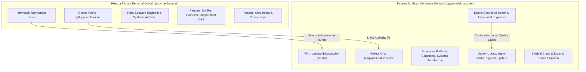
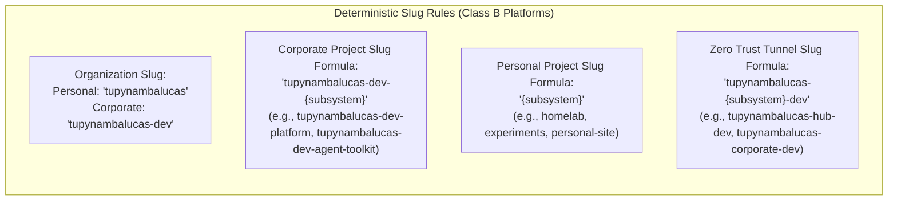
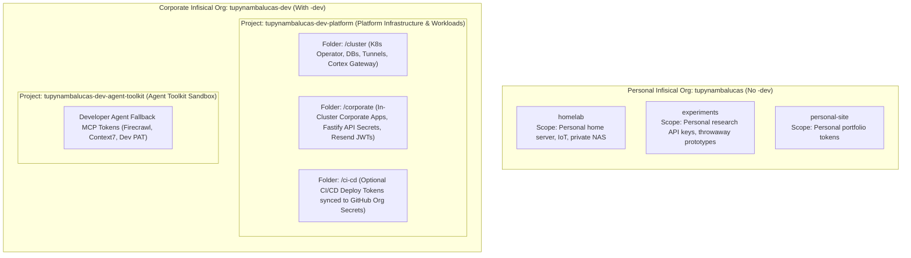
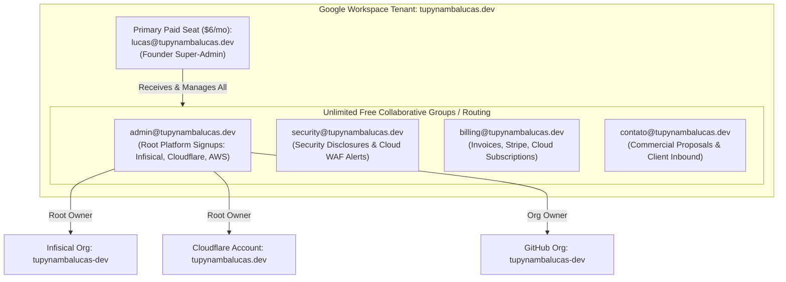

# Master Architectural Plan: Enterprise Identity, Sovereign Brand Demarcation, and Multi-Platform Nomenclature Architecture

## 1. Executive Summary & Master Governance Charter

As modern software engineering organizations evolve toward AI-driven platform engineering, sovereign distributed systems, and elastic contractor scaling, maintaining unambiguous boundaries between the **individual founder (Pessoa Física)** and the **corporate consulting firm (Pessoa Jurídica)** is paramount.

### 1.1 The Core Identity Invariant
1. **The Corporate Entity / Commercial Firm**: **`tupynambalucas.dev`**.
   - This is the sovereign legal and commercial trading name of the engineering studio.
   - It is **NOT** "Tupynambá Lucas" or "Tupynamba Lucas".
   - The `.dev` is an inseparable part of the company's brand identity, signaling tech-native authority and platform engineering excellence.
2. **The Individual Founder / Principal Architect**: **`Tupynambá Lucas`** (civil name: `Tupynambá Lucas Varela Rodrigues`).
   - Serves as Founder, Principal Systems Architect, and Fractional CTO.
   - Provides architectural oversight, cryptographic sign-off (`-S`), and technical leadership.
3. **The Personal Handle (Pessoa Física)**: **`tupynambalucas`** (Strictly NO `-dev`).
   - Used for the personal GitHub profile (`github.com/tupynambalucas`), personal Infisical organization (`tupynambalucas`), personal Cloudflare account (`tupynambalucas`), personal open-source experiments, dotfiles, and individual career reputation.
4. **The Corporate Technical Handle (Pessoa Jurídica)**: **`tupynambalucas-dev`** (WITH `-dev` suffix).
   - Used across technical platforms where the dot (`.`) is prohibited by validation schemas (GitHub Organization `github.com/tupynambalucas-dev`, NPM package scope `@tupynambalucas-dev`, Infisical organization slug `tupynambalucas-dev`).
5. **The Universal Demarcator Rule**:
   - **No suffix (`tupynambalucas`)** = Pessoa Física (Personal boundary, personal accounts, personal credentials).
   - **Suffix `-dev` / `.dev` (`tupynambalucas-dev` / `tupynambalucas.dev`)** = Pessoa Jurídica (Corporate studio, enterprise platform, contractor access).

### 1.2 Purpose of this Master Plan
This document establishes the **Single Source of Truth (SSOT)** for all branding, nomenclature, identity governance, and infrastructure asset naming across the organization. It consolidates, formalizes, and harmonizes the guidelines previously defined across earlier strategy documents (including the consolidated `company-nomenclature-and-branding-strategy.md` and related drafts), working in tandem with:
- [`personal-github-profile-strategy.md`](./personal-github-profile-strategy.md) (Individual career portfolio & identity)
- [`infisical-secret-governance-and-multi-layer-fallback.md`](./infisical-secret-governance-and-multi-layer-fallback.md) (Infisical dual-tenant setup, token segregation, and agent fallback)

---

## 2. The Dual-Entity Taxonomy: Physical Person vs. Enterprise Firm

To prevent operational ambiguity, client expectation mismatches, and compliance friction, every asset in the ecosystem maps strictly to one of two boundaries:

### 2.1 Demarcation Matrix

| Operational Dimension | Personal Boundary (`tupynambalucas`) | Enterprise Boundary (`tupynambalucas.dev`) |
| :--- | :--- | :--- |
| **Legal / Brand Entity** | Tupynambá Lucas (Individual Citizen / Architect) | `tupynambalucas.dev` (Engineering Studio & Consultancy) |
| **Universal Demarcator** | **No Suffix**: `tupynambalucas` | **Suffix `-dev` / `.dev`**: `tupynambalucas-dev` / `tupynambalucas.dev` |
| **Public GitHub Handle** | `github.com/tupynambalucas` | `github.com/tupynambalucas-dev` |
| **Infisical Tenant** | Org: `tupynambalucas` (Personal, zero contractors) | Org: `tupynambalucas-dev` (Corporate, RBAC enabled) |
| **Cloudflare Account** | Account: `tupynambalucas` (Personal homelab/hobby) | Account: `tupynambalucas.dev` (Corporate apex & tunnels) |
| **Repository Ownership** | Personal repositories, research prototypes, dotfiles | Corporate monorepos (`platform`, `docs`, `agent-toolkit`) |
| **Commit Authorship** | Author name: `Tupynambá Lucas Varela Rodrigues` | Founder Executive (`lucas@tupynambalucas.dev`) or `contato@tupynambalucas.dev` |
| **Email Architecture** | Civil personal email (`tupynambalucas@gmail.com`) | `lucas@tupynambalucas.dev`, `contato@tupynambalucas.dev` |
| **Secret Management** | Dedicated personal Infisical org `tupynambalucas` | Corporate Infisical org `tupynambalucas-dev` |
| **Client Contracts / MSAs** | Personal advisory contracts / Fractional CTO | Master Services Agreements (MSAs) with `tupynambalucas.dev` |
| **Contractor Integration** | Never: Contractors do not touch personal profile | Native: Contractors push code to `tupynambalucas-dev` PRs |

### 2.2 Account-Level Isolation vs. In-Org Slug Segregation

A fundamental architectural principle of this governance model is **Account-Level Segregation**:
- **Why NOT put personal projects inside the enterprise organization?**
  1. **Zero Blast Radius**: In platforms like Infisical and Cloudflare, members invited to an organization can view project lists, audit logs, and resource metadata. Putting personal sandboxes inside `tupynambalucas-dev` exposes founder private assets to contractor visibility or RBAC misconfiguration.
  2. **Billing and Tax Segregation**: Corporate tooling is paid via corporate company cards/CNPJ; personal tools belong to CPF/personal accounts. Mixing them violates fiscal boundaries.
  3. **Universal Demarcation**: By defining that `tupynambalucas` (no suffix) is personal and `tupynambalucas-dev` is corporate, all platforms reflect identical structural purity.

---

## 3. Multi-Platform Character Validation: The "Dot" vs. "Dash" Rule

Different cloud platforms, version control systems, and package managers enforce distinct regex validation patterns for names, usernames, and slugs. This variance dictates two deterministic naming rules:

### 3.1 Class A: Lenient Platforms (Dots and Spaces Allowed)
Platforms that permit dots (`.`), spaces, and mixed case in display names or identifiers:
- **Cloudflare** (Account Name, Domain Zones)
- **Stripe / Financial Entities** (Business Name)
- **LinkedIn / Discord / Slack** (Company / Organization Name)
- **Docusaurus / Portal Frontends** (Header, Brand Identity)

**Mandatory Rule for Class A**:
Always use the exact corporate brand name:
$$\mathbf{tupynambalucas.dev}$$

---

### 3.2 Class B: Strict Platforms (Alphanumeric, Dashes, Underscores Only - No Dots Allowed)
Platforms whose schemas reject dots (`Name can only contain alphanumeric characters, dashes, underscores, and spaces`):
- **Infisical Cloud** (Organization Name/Slug, Project Names/Slugs)
- **GitHub** (Organization Slug, Usernames)
- **NPM Package Registry** (Package Scopes: `@tupynambalucas-dev/*`)
- **AWS / GCP / Cloud IAM** (Account Aliases, IAM Roles, Resource Groups)
- **Kubernetes / Docker Hub** (Namespaces, Container Image Registries)

**Mandatory Rule for Class B**:
Transform the dot into a single hyphen (`-`):
$$\mathbf{tupynambalucas-dev}$$
*(Never use underscores `_`, never concatenate without a separator `tupynambalucasdev`, and never append arbitrary hashes).*

---

### 3.3 Deterministic Slug Architecture Across Strict Ecosystems

When generating slugs for organizations, projects, tunnels, and repositories across platforms where dots (`.`) are prohibited:

1. **Organization Slugs**:
   - Corporate: Strictly `tupynambalucas-dev` (hyphenated).
   - Personal: Strictly `tupynambalucas` (no suffix).
2. **Corporate Project Slugs**:
   - Formula: `tupynambalucas-dev-{subsystem}`
   - Rationale: Reflects the parent organization slug (`tupynambalucas-dev`) precisely, maintaining full traceability and avoiding any collision with the physical person handle (`tupynambalucas`). To avoid project sprawl, corporate applications run inside the cluster and are consolidated directly into `platform` via internal folders (`/corporate`), leaving exactly two sovereign projects:
     - `tupynambalucas-dev-platform` (Cluster infrastructure, in-cluster corporate apps, tunnels, and optional CI/CD)
     - `tupynambalucas-dev-agent-toolkit` (Developer agent fallback MCP tokens for engineers and contractors)
3. **Personal Project Slugs**:
   - Formula: `{subsystem}` (clean, un-prefixed).
   - Rationale: The personal organization is strictly single-tenant and never shared with contractors. Prefixing `tupynambalucas-` inside a personal-only tenant is redundant noise.
   - Standard Slugs:
     - `homelab`
     - `experiments`
     - `personal-site`
4. **Cloudflare Zero Trust Tunnel Slugs**:
   - Formula: `tupynambalucas-{subsystem}-dev`
   - Corporate: `tupynambalucas-hub-dev`, `tupynambalucas-corporate-dev`.
   - Personal: `tupynambalucas-homelab-dev`, `tupynambalucas-desktop-dev`.
5. **NPM Package Scopes**:
   - Corporate: `@tupynambalucas-dev/*`
   - Personal: `@tupynambalucas/*` (if personal packages are ever published).

---

## 4. Multi-Platform Nomenclature Specifications

### 4.1 Infisical Cloud Governance: Dual-Tenant Architecture

Rather than mingling personal and corporate secrets within the same organization, Infisical is split into two distinct tenant organizations, leveraging the universal `-dev` demarcator:

#### A. Corporate Infisical Organization (`tupynambalucas-dev`)
- **Organization Slug**: `tupynambalucas-dev`.
- **Display Name**: `tupynambalucas.dev` (or `tupynambalucas-dev`).
- **Access Governance**: RBAC enabled. Elastic contractors receive scoped read-only access strictly to `tupynambalucas-dev-agent-toolkit`. Zero contractor access to `tupynambalucas-dev-platform`.
- **Project Directory & Security Matrix**:

| Infisical Project Slug | Display Name | Internal Folder | Scope & Target Secrets | Target Consumers |
| :--- | :--- | :--- | :--- | :--- |
| **`tupynambalucas-dev-platform`** | `Platform Infrastructure & Workloads` | `/cluster` | `CORTEX_MCP_TOKEN`, `CLOUDFLARE_TUNNEL_TOKEN_HUB`, `GRAFANA_ADMIN_PASSWORD`, `MONGO_INITDB_ROOT_PASSWORD`, `REDIS_PASSWORD`. | Kubernetes Operator (`InfisicalSecret` CRD). |
| | | `/corporate` | `FASTIFY_JWT_SECRET`, `RESEND_API_KEY`, `CORPORATE_DB_URL`, `CORPORATE_API_KEY`. | In-cluster corporate microservices & APIs. |
| | | `/ci-cd` | `CLOUDFLARE_API_TOKEN`, `CLOUDFLARE_ACCOUNT_ID` (if centrally synced). | Synced to GitHub Organization Secrets via Infisical Integration. |
| **`tupynambalucas-dev-agent-toolkit`** | `Agent Toolkit` | `/` | `FIRECRAWL_API_KEY`, `CONTEXT7_API_KEY`, `GITHUB_TOKEN`, `TUPYNAMBA_GATEWAY_TOKEN`. | Local developer agents via `infisical run` / fallback. |

> [!IMPORTANT]
> **GitHub Actions & Documentation Deploy Boundary**:
> The static documentation portal ([`docs`](https://github.com/tupynambalucas-dev/docs)) does **NOT** use Infisical directly in its CI/CD workflows. Querying Infisical during static site compilation adds 15–30s build delays and introduces an unnecessary single point of failure. Instead, `CLOUDFLARE_API_TOKEN` and `CLOUDFLARE_ACCOUNT_ID` are defined as native **GitHub Organization Secrets** (or managed via Cloudflare Pages native Git integration). If centralized rotation in Infisical is desired, use Infisical's native GitHub Integration (push sync from `/ci-cd` to GitHub Org Secrets), keeping workflows fast and native.

#### B. Personal Infisical Organization (`tupynambalucas`)
- **Organization Slug**: `tupynambalucas` (strictly NO `-dev`).
- **Display Name**: `Tupynambá Lucas (Personal)`.
- **Access Governance**: Strict single-user boundary. Zero contractors, zero associates.
- **Projects**:
  - `homelab`: Personal homelab infrastructure, local VPNs, NAS credentials.
  - `experiments`: Independent algorithmic experiments and personal AI testing.
  - `personal-site`: Personal domain and portfolio deployment secrets.

#### C. Infisical Operational Runbook (Tenant Creation & Migration)

1. **Corporate Organization Setup**:
   - Navigate to Infisical Cloud -> Switch Organization -> **Create New Organization** (or rename current).
   - Enter Display Name: `tupynambalucas.dev` (or `tupynambalucas-dev`).
   - Enter Organization Slug: `tupynambalucas-dev`.
   - **Rename Core Project**: Access project `tupynambalucas-core-ez7a` -> Project Settings -> General -> Rename Display Name to `Platform Infrastructure & Workloads` and Slug to `tupynambalucas-dev-platform`.
   - **Create Internal Folders**: Inside `tupynambalucas-dev-platform`, create `/cluster`, `/corporate`, and `/ci-cd`.
   - **Provision Toolkit Project**: Create Project -> Display Name: `Agent Toolkit`, Slug: `tupynambalucas-dev-agent-toolkit`. Populate fallback keys (`FIRECRAWL_API_KEY`, `CONTEXT7_API_KEY`, `GITHUB_TOKEN`, `TUPYNAMBA_GATEWAY_TOKEN`).
   - **No Redundant Projects**: Do NOT create separate `docs` or `corporate` projects. Corporate apps live in `/corporate` and docs deploy secrets live in GitHub Org Secrets.
   - **Invite Governance**: When onboarding contractors, invite them exclusively with **Project-Level Role: Viewer / Developer** scoped to `tupynambalucas-dev-agent-toolkit`. Never grant Organization Owner or Organization Admin.

2. **Personal Organization Setup**:
   - Navigate to Infisical Cloud -> Switch Organization -> **Create New Organization**.
   - Enter Display Name: `Tupynambá Lucas (Personal)`.
   - Enter Organization Slug: `tupynambalucas` (strictly without `-dev`).
   - Create clean, un-prefixed projects: `homelab`, `experiments`, `personal-site`.
   - **Invite Governance**: Zero invitations. This organization is 100% private to the physical founder.

---

### 4.2 Cloudflare Infrastructure: Dual-Account Architecture

Cloudflare fully supports dots in account names and domain zones. To ensure pristine isolation between personal network tunnels and corporate production traffic:

1. **Corporate Account (`tupynambalucas.dev`)**:
   - **Account Name**: `tupynambalucas.dev`
   - **Sovereign DNS Apex**: `tupynambalucas.dev`
   - **Subdomain Routing**:
     - `docs.tupynambalucas.dev` -> Corporate Docusaurus portal (Pages)
     - `web.tupynambalucas.dev` / `api.tupynambalucas.dev` -> Corporate production services
     - `mcp.tupynambalucas.dev` -> Cortex AgentGateway Ingress
     - `*-dev.tupynambalucas.dev` -> Platform development tunnels via Traefik
   - **Zero Trust Tunnels**:
     - `tupynambalucas-hub-dev`: Traefik platform routing (Grafana, Loki, Cortex).
     - `tupynambalucas-corporate-dev`: Traefik corporate routing (Web, API, Docs).
   - **Cloudflare Pages**:
     - `tupynambalucas-dev-docs`: Automated production builds from `docs` repository.
   - **Billing & Entity**: Linked to corporate credit card / PJ CNPJ.

2. **Personal Account (`tupynambalucas`)**:
   - **Account Name**: `tupynambalucas` (strictly NO `-dev`).
   - **Purpose**: Strictly personal homelab tunnels (e.g. personal home desktop, private homelab cluster), personal hobby domains (`tupynambalucas.com`, `tupynambalucas.me` or `lucasvarela.com.br`), and personal Cloudflare Workers experiments. Zero corporate traffic routes through this account.
   - **Zero Trust Tunnels**:
     - `tupynambalucas-homelab-dev`: Remote access to home NAS / Proxmox node.
     - `tupynambalucas-desktop-dev`: Remote SSH to private workstation.
   - **Billing & Entity**: Linked to CPF / personal card. Zero corporate co-mingling.

---

### 4.3 GitHub Organization vs. Personal Profile

1. **Personal Profile (`github.com/tupynambalucas`)**:
   - **Header Title**: `# Tupynambá Lucas`
   - **Bio**: `Software Engineer & Systems Architect. Strong SE foundations, DDD & Bounded Contexts, distributed systems, and AI-driven platform engineering.`
   - **Affiliation**: `Founder & Principal Systems Architect at [tupynambalucas.dev](https://tupynambalucas.dev)`.
   - **Repository Focus**: Personal open-source tools, algorithmic research, profile README renderer.

2. **Corporate Organization (`github.com/tupynambalucas-dev`)**:
   - **Display Name**: `tupynambalucas.dev`
   - **Lead Overview**: `tupynambalucas.dev is a specialized software engineering and technology consulting organization providing enterprise architecture, autonomous agentic AI infrastructure, cloud-native platforms, and high-performance distributed systems.`
   - **Core Repositories**:
     - `org-core`: Meta-repository umbrella orchestrator.
     - `platform`: Core monorepo (TypeScript, Fastify, React, K8s, Skaffold).
     - `docs`: Sovereign documentation portal (Docusaurus Diátaxis).
     - `agent-toolkit`: Universal AI agent governance package & plugins.
     - `.github`: Organization-wide governance SSOT and workflows.

3. **GitHub Ownership Architecture & Multi-Email Attribution Model**:
   - **Native GitHub Architecture**: In GitHub's security architecture, Organizations do **not** have independent login credentials (username/password). An Organization is a corporate governance container for repositories, teams, policies, and billing.
   - **User-Led Governance**: An Organization is **always** created, owned, and governed by **Individual User Accounts** granted the `Owner` role. Having the personal account `github.com/tupynambalucas` as the Super Admin / Owner of `github.com/tupynambalucas-dev` is **100% correct, standard, and required**.
   - **Multi-Email Linking Strategy**: On GitHub, a single user account can hold multiple verified email addresses (GitHub Settings -> Emails):
     - *Primary / Personal Identity*: `tupynambalucas@gmail.com` (or civil email).
     - *Corporate Identity*: `contato@tupynambalucas.dev` (or `lucas@tupynambalucas.dev`).
     - *Cryptographic Commit Attribution*: When commits in `org-core`, `platform`, or `agent-toolkit` are signed using `user.email = contato@tupynambalucas.dev`, GitHub matches the verified secondary email, displays the founder's verified avatar, and renders the green `Verified` badge.
   - **Enterprise Break-Glass Owner**: Best practice dictates provisioning a secondary backup `Owner` account with passkeys stored in a secure offline vault for disaster recovery.

---

### 4.4 NPM Package Registries

- **Scope**: `@tupynambalucas-dev`
- **Canonical Packages**:
  - `@tupynambalucas-dev/agent-toolkit`: Enterprise AI agent tooling and fallback connectors.
  - `@tupynambalucas-dev/shared-config`: ESLint, Prettier, and TypeScript base configurations.
  - `@tupynambalucas-dev/corporate-preset`: Docusaurus architectural theme and collections.

---

### 4.5 Git Commit Authorship and Cryptographic Signatures

To ensure legal clarity and non-repudiation while preserving the founder's personal reputation:
- **`user.name`**: `tupynambalucasdev` (or `Tupynambá Lucas Varela Rodrigues`)
- **`user.email`**: `contato@tupynambalucas.dev`
- **Signing Format**: `gpg.format = ssh`
- **Signing Key**: `C:/Users/tupyn/.ssh/github_tupynambalucas_ed25519.pub`
- **Commit Flag**: All commits must pass `-S` (`git commit -S -m "..."`).
- **Emoji Invariant**: Strict zero-emoji policy across all commit messages, PR descriptions, and markdown documentation.

---

## 5. Sovereign Domain, Subdomain, and Email Architecture

### 5.1 The TLD Strategic Charter: Why `tupynambalucas.dev` is Sovereign and `.org` is Rejected

A critical strategic decision is the choice of Top-Level Domain (TLD) for the enterprise firm versus personal identity.

**Architectural Verdict: `tupynambalucas.dev` is the immutable corporate domain. `tupynambalucas.org` is REJECTED.**

#### Why `.org` is an Anti-Pattern for the Firm:
1. **Commercial Misalignment**: Semantically and historically, `.org` is reserved for non-profit entities, open-source foundations (e.g. `python.org`, `apache.org`, `w3.org`), and charities. `tupynambalucas.dev` is a commercial software engineering studio and architectural consultancy that executes Master Services Agreements (MSAs), issues invoices, and scales enterprise platforms. Presenting as a `.org` generates confusion during enterprise vendor onboarding and corporate procurement.
2. **Authority of `.dev`**: Operated directly by Google Registry with strict HSTS (enforced SSL out of the box), `.dev` is the global standard for elite platform engineering, developer ecosystems, and tech-native consulting firms.
3. **Established Equity**: The entire repository ecosystem (`platform`, `docs`, `agent-toolkit`, monorepos, and `project.config.ts`) is already anchored on `tupynambalucas.dev`. Diverting to `.org` would dilute brand equity.

---

### 5.2 The GitHub Personal Handle Invariant: Why `@tupynambalucas` Must NOT be Renamed

**Architectural Verdict: Retain `github.com/tupynambalucas` with zero modifications.**

#### Strategic Justification:
1. **The Global Founder Model**: Industry leaders maintain personal handles without sufix and firm organizations with technical suffixes:
   - Founder / Individual Architect: `github.com/tupynambalucas` (Pessoa Física).
   - Studio / Enterprise Monorepos: `github.com/tupynambalucas-dev` (Pessoa Jurídica).
   - The `-dev` suffix provides 100% semantic clarity, entirely eliminating any conflict or ambiguity between personal and corporate repos.
2. **Handle Rarity and Prestige**: "Tupynambá" is a rare, culturally rich, and highly distinctive name. Renaming to a common variation (e.g. `lucasvarela`) would diminish discoverability, break external inbound backlinks, and dilute historical Git commit attribution.
3. **Bidirectional Authority Link**: The personal profile declares: *"Founder & Principal Systems Architect at [tupynambalucas.dev](https://tupynambalucas.dev)"*. The individual's reputation elevates the firm, and the firm's architecture proves the individual's pedigree.

---

### 5.3 Civil Personal Domain Architecture (Pessoa Física Sovereign Identity)

For personal civil affairs, domestic utility bills, personal banking, private subscriptions, and non-commercial portfolio hosting, the founder should decouple completely from the corporate domain `tupynambalucas.dev`.

| Option | Domain Candidate | TLD Category | Strategic Value | Recommended Use Case |
| :--- | :--- | :--- | :--- | :--- |
| **Option 1 (Top Pick)** | **`tupynambalucas.com`** / **`.com.br`** | Commercial / General Global | - 100% consistency with GitHub handle `@tupynambalucas`. - Defensive brand protection preventing third-party squatting. - Highest global trust score for personal correspondence. | - Civil personal email (`lucas@tupynambalucas.com`). - Defensive DNS forwarder to `tupynambalucas.dev`. |
| **Option 2** | **`tupynambalucas.me`** | Personal / Identity | - `.me` explicitly designates individual persona. - Clear contrast: `.me` (personal) vs `.dev` (engineering studio). | - Independent personal blog, non-corporate essays, personal bio. |
| **Option 3** | **`lucasvarela.com.br`** | Formal Civil Name | - Decouples tech handle entirely from legal identity. - Maximum discretion for legal, banking, family, and domestic affairs. | - Formal civil communications, domestic utilities, private family correspondence. |
| **Option 4 (Existing Baseline)**| **`tupynambalucas.v.r@gmail.com`** / **`tupynambalucas@gmail.com`** | Managed Secure Provider | - Zero infrastructure overhead. - Zero DNS configuration or renewal risks. - Clear segregation: `tupynambalucas.v.r@gmail.com` (Civil/Domestic) vs `tupynambalucas@gmail.com` (Tech Personal). | - `tupynambalucas.v.r@gmail.com` for civil domestic life (personal banking, family). - `tupynambalucas@gmail.com` for personal GitHub user profile. |

---

### 5.4 The Subdomain Anti-Pattern: Rejection of `personal.tupynambalucas.dev`

A common question in founder-led engineering firms is whether to create subdomains like `personal.tupynambalucas.dev` and emails such as `contato@personal.tupynambalucas.dev`.

**Architectural Verdict: REJECTED (Anti-Pattern)**.

#### Why `personal.tupynambalucas.dev` is an Anti-Pattern:
1. **Semantic Contradiction**: The address `contato@personal.tupynambalucas.dev` creates cognitive friction. "Contato" (Contact) is an impersonal, institutional inbox keyword; "personal" denotes a private individual. Combining them under a commercial domain signals amateur brand positioning and identity confusion to enterprise clients.
2. **Email Deliverability & Spam Scoring (SPF, DKIM, DMARC)**: Deep tertiary subdomains (like `sub.domain.com`) have lower domain reputation baselines. Major mail servers (Google Workspace, Microsoft 365) apply stricter heuristics and higher spam penalties to mail sent from nested subdomains. Maintaining separate MX, SPF, DKIM, and DMARC records for a subdomain introduces unnecessary DNS fragility.
3. **Legal & Compliance Boundary Violation**: If an individual conducts domestic civil life (banking, streaming, utility bills) on a corporate domain or subdomain, any future enterprise tax audit, investor due diligence, or corporate legal discovery would technically subpoena the corporate email system, entangling personal domestic correspondence in company legal proceedings.

---

### 5.5 The Sovereign Email Topology

To achieve institutional prestige, pristine auditability, and personal privacy, all email communications follow a three-tier topology:

```mermaid
flowchart TD
  subgraph CorporateInboxes ["Corporate Institutional (tupynambalucas.dev)"]
    direction TB
    C_Admin["admin@tupynambalucas.dev<br/>(Root Platform Signups: Infisical, Cloudflare, AWS)"]
    C_Contato["contato@tupynambalucas.dev<br/>(Inbound client leads, partnerships, RFP responses)"]
    C_Sec["security@tupynambalucas.dev<br/>(Vulnerability disclosure, compliance, CVE reporting)"]
    C_Bill["billing@tupynambalucas.dev<br/>(Invoicing, accounts receivable/payable)"]
  end

  subgraph FounderExec ["Founder Executive Persona (tupynambalucas.dev)"]
    direction TB
    F_Lucas["lucas@tupynambalucas.dev<br/>(High-trust client advisory, Fractional CTO engagements, official Git signing)"]
  end

  subgraph PhysicalPersonIdentities ["Physical Person / Personal Boundaries"]
    direction TB
    P_Tech["tupynambalucas@gmail.com<br/>(GitHub User Account, Personal Open-Source, Homelab Tenants)"]
    P_Civil["tupynambalucas.v.r@gmail.com<br/>(Civil Domestic Life: Personal banking, domestic utilities, legal affairs, family)"]
  end
```

1. **Corporate Institutional Tier (`@tupynambalucas.dev`)**:
   - `admin@tupynambalucas.dev`: Root owner for enterprise cloud platforms (Infisical Org, Cloudflare Corporate Account, GitHub Organization).
   - `contato@tupynambalucas.dev`: Inbound business inquiries, client communication, official company announcements.
   - `security@tupynambalucas.dev`: Security audits, bug disclosures, RFC 9116 `security.txt` endpoint.
   - `billing@tupynambalucas.dev`: SaaS subscriptions, vendor billing, client invoicing.
2. **Founder Executive Tier (`lucas@tupynambalucas.dev`)**:
   - Direct high-level email representing the Founder & Principal Systems Architect.
   - Used for board-level consulting, advisory retainers, and signing official cryptographic commits for the organization.
3. **Tech Personal Persona (`tupynambalucas@gmail.com`)**:
   - Primary login for the personal GitHub account `github.com/tupynambalucas`.
   - Holder of personal Infisical Org (`tupynambalucas`) and personal Cloudflare account (`tupynambalucas`).
4. **Civil Domestic Persona (`tupynambalucas.v.r@gmail.com`)**:
   - Strictly reserved for offline civil life, personal bank accounts, domestic utility bills, family, and physical person affairs. Completely isolated from the tech ecosystem.

---

### 5.6 Platform Root Identity: Google Workspace vs. Consumer Gmail

A critical operational question is: **"Which email should be used to sign up and hold root ownership of platforms like Infisical, Cloudflare, AWS, and GitHub?"**

#### A. Evaluation of `tupynambalucasdev@gmail.com`
**Architectural Verdict: REJECTED (Unnecessary & Amateur Anti-Pattern)**.

Creating a third consumer Gmail account (such as `tupynambalucasdev@gmail.com`) is strongly rejected:
1. **Redundancy & Fragmentation**: The founder already possesses `tupynambalucas.v.r@gmail.com` (Civil Domestic) and `tupynambalucas@gmail.com` (Tech Personal). Adding a third consumer account (`tupynambalucasdev@gmail.com`) fragments attention across three distinct Google accounts without solving any enterprise requirement.
2. **Lack of Corporate Legal Ownership**: Free `@gmail.com` accounts are bound to Google's Consumer Terms of Service. If Google's automated systems flag the account for unusual automated activity or SMS verification issues, the entire company loses access to its root cloud accounts.
3. **Key-Person Single Point of Failure (SPOF)**: A consumer Gmail account cannot be transferred, audited, or governed via enterprise Identity Provider (IdP) policies.
4. **Professional Incredibility**: Presenting `@gmail.com` on vendor invoices, Cloudflare accounts, Infisical tenant owner cards, or enterprise MSA contracts signals an amateur hobby project rather than an elite platform consultancy.
5. **The Sovereign Path**: All corporate platforms should use `admin@tupynambalucas.dev` (via free Cloudflare Email Routing forwarding to `tupynambalucas@gmail.com`, or via Google Workspace).

---

#### B. The Enterprise Standard: Google Workspace Identity Provider (IdP)

The gold standard for engineering consultancies and boutique software studios is deploying **Google Workspace** on the corporate domain `tupynambalucas.dev`.

#### Cost-Effective Single-Seat Architecture:
- **Only 1 Paid User Required**: The founder purchases exactly **one** Google Workspace Business Starter license (`lucas@tupynambalucas.dev`) at ~$6/month.
- **Zero Cost for Functional Addresses**: Google Workspace allows creating **unlimited Google Groups (collaborative inboxes) and aliases for free**.
- **Root Admin Address (`admin@tupynambalucas.dev`)**:
  - Used strictly for registering and holding Super Admin ownership of enterprise platforms (Infisical Org, Cloudflare Corporate Account, GitHub Organization, AWS Root Account, Stripe).
  - All critical security alerts and verification tokens route directly to the founder's inbox without polluting personal communication.
- **Single Sign-On (SSO / OIDC)**: Enterprise platforms (Infisical, Cloudflare Zero Trust, GitHub Enterprise) natively support "Log in with Google" using `@tupynambalucas.dev`, providing unified MFA and instant credential revocation.

---

#### C. Transition Runbook for Current State (`tupynambalucas@gmail.com`)

Currently, both Infisical and Cloudflare are registered under `tupynambalucas@gmail.com`. The transition follows a deterministic 3-phase path:

| Phase | Milestone | Action Items | Target Email State |
| :--- | :--- | :--- | :--- |
| **Phase 1 (Immediate)** | Tenant Segregation | - Maintain `tupynambalucas@gmail.com` as the owner of the **Personal Infisical Org** (`tupynambalucas`) and **Personal Cloudflare Account** (`tupynambalucas`). - This is 100% compliant with Pessoa Física boundaries. | Personal accounts: `tupynambalucas@gmail.com`. |
| **Phase 2 (Bootstrap)** | Free Domain Forwarding | - Enable **Cloudflare Email Routing** on zone `tupynambalucas.dev` (free, zero setup cost). - Create route `admin@tupynambalucas.dev` forwarding to `tupynambalucas@gmail.com`. - Update root email of Corporate Infisical Org and Corporate Cloudflare Account to `admin@tupynambalucas.dev`. | Corporate root: `admin@tupynambalucas.dev` (forwarded). |
| **Phase 3 (Enterprise)** | Google Workspace IdP | - Provision Google Workspace for `tupynambalucas.dev` (1 paid seat `lucas@tupynambalucas.dev`). - Configure groups: `admin@`, `security@`, `billing@`, `contato@`. - Enable Google OIDC SSO across Infisical and Cloudflare. | Full enterprise identity governance. |

---

### 5.7 Web Routing and Personal Portfolio Subdomain

If the founder desires a dedicated personal showcase, engineering essays, or curriculum vitae hosted under the corporate brand umbrella:
- **Canonical Subdomain**:
  $$\mathbf{lucas.tupynambalucas.dev} \quad \text{or} \quad \mathbf{tupynambalucas.dev/founder}$$
- **Prohibited Subdomain**: `personal.tupynambalucas.dev` (strictly prohibited).
- **Public Profile Linkage**: The personal GitHub profile (`github.com/tupynambalucas`) lists website `https://tupynambalucas.dev` and bio affiliation with `tupynambalucas.dev`.

---

## 6. Contractor Onboarding & Bring-Your-Own-Token (BYOT) Workflows

When an external contractor or temporary engineer joins a project:
1. **Repository Access**: The contractor is invited to `github.com/tupynambalucas-dev` with role-based access to specific repositories (e.g. `platform` or `docs`). They **never** receive access to `github.com/tupynambalucas` (personal).
2. **Secret Resolution Workflow (3 Cascading Layers)**:
   - **Tier 1 (Enterprise Infisical)**: If authorized, the contractor runs `pnpm dlx @infisical/cli login` and receives scoped read-only access to `tupynambalucas-dev-agent-toolkit`.
   - **Tier 2 (BYOT Local `.env`)**: If the contractor does not have Infisical access, they copy `.env.example` to `.env` in their local workspace and provide their own personal Firecrawl, Context7, or GitHub keys.
   - **Tier 3 (Antigravity Interactive Setup)**: If no `.env` exists, the contractor runs `/plugin agent-toolkit` in the Antigravity CLI and enters their personal keys, which are persisted locally in `~/.gemini/config/config.json`.
3. **Pull Request Protocol**: All contractor contributions are submitted via pull requests against `develop`, requiring review and signed approval before merging.

---

## 7. Implementation Checklist & Governance Sign-Off

- [x] Standardize `# tupynambalucas.dev Platform Monorepo` in `platform/README.md`.
- [x] Standardize `PROJECT_NAME: 'tupynambalucas.dev'` in `platform/shared/config/src/project.config.ts`.
- [x] Standardize `tupynambalucas.dev is a specialized...` in `.github/profile/README.md`.
- [x] Add root `.gitignore` and `.env.example` in `org-core`.
- [x] Add strict validation and variables declaration in `agent-toolkit/mcp_config.json`.
- [x] Add `.vscode` workspace configuration in `agent-toolkit`.
- [x] Confirm personal GitHub username retention as `tupynambalucas` (zero modification).
- [x] Formalize immutable corporate apex domain as `tupynambalucas.dev` (rejection of `.org`).
- [ ] Provision personal Infisical organization `tupynambalucas` for homelab and personal experiments.
- [ ] Rename corporate Infisical project slug `tupynambalucas-core-ez7a` to `tupynambalucas-dev-platform` under org `tupynambalucas-dev`.
- [ ] Provision dedicated corporate Infisical project `tupynambalucas-dev-agent-toolkit` with developer fallback tokens under org `tupynambalucas-dev`.
- [ ] Verify Cloudflare Corporate Account Name is set to `tupynambalucas.dev`.
- [ ] Verify Cloudflare Personal Account Name is set to `tupynambalucas`.
- [ ] Configure `admin@tupynambalucas.dev` via Cloudflare Email Routing (Bootstrap) or Google Workspace (Enterprise IdP).
- [ ] Migrate corporate Infisical and Cloudflare root account emails from `tupynambalucas@gmail.com` to `admin@tupynambalucas.dev`.
- [ ] (Optional) Register `tupynambalucas.com` or `tupynambalucas.me` for defensive brand protection and civil correspondence.
