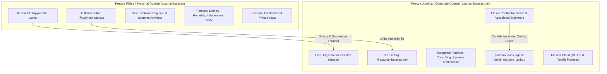
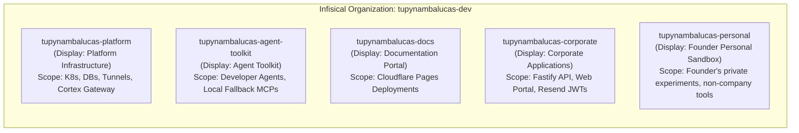

# Master Architectural Plan: Enterprise Identity, Sovereign Brand Demarcation, and Multi-Platform Nomenclature Architecture

## 1. Executive Summary & Master Governance Charter

As modern software engineering organizations evolve toward AI-driven platform engineering, sovereign distributed systems, and elastic contractor scaling, maintaining unambiguous boundaries between the **individual founder (Pessoa Física)** and the **corporate consulting firm (Pessoa Jurídica)** is paramount.

### 1.1 The Core Identity Invariant
1. **The Corporate Entity / Commercial Firm**: **`tupynambalucas.dev`**.
   - This is the sovereign legal and commercial trading name of the engineering studio.
   - It is **NOT** "Tupynambá Lucas" or "Tupynamba Lucas".
   - The `.dev` is an inseparable part of the company's brand identity, signaling tech-native authority and platform engineering excellence.
2. **The Individual Founder / Principal Architect**: **`Tupynambá Lucas`** (civil name: `Tupynambá Lucas Varela Rodrigues`).
   - Serves as Founder, Principal Systems Architect, and Fractional CTO.
   - Provides architectural oversight, cryptographic sign-off (`-S`), and technical leadership.
3. **The Personal Handle (Pessoa Física)**: **`tupynambalucas`**.
   - Used for the personal GitHub profile (`github.com/tupynambalucas`), personal open-source experiments, dotfiles, and individual career reputation.
4. **The Corporate Technical Handle (Pessoa Jurídica)**: **`tupynambalucas-dev`**.
   - Used across technical platforms where the dot (`.`) is prohibited by validation schemas (GitHub Organization `github.com/tupynambalucas-dev`, NPM package scope `@tupynambalucas-dev`, Infisical organization slug `tupynambalucas-dev`).

### 1.2 Purpose of this Master Plan
This document establishes the **Single Source of Truth (SSOT)** for all branding, nomenclature, and infrastructure asset naming across the organization. It consolidates, formalizes, and harmonizes the guidelines previously defined in:
- [`personal-github-profile-strategy.md`](file:///C:/Users/tupyn/projects/organizations/tupynambalucas-dev/org-core/.github/.agents/plans/personal-github-profile-strategy.md)
- [`company-nomenclature-and-branding-strategy.md`](file:///C:/Users/tupyn/projects/organizations/tupynambalucas-dev/org-core/.github/.agents/plans/company-nomenclature-and-branding-strategy.md)
- [`infisical-secret-governance-and-multi-layer-fallback.md`](file:///C:/Users/tupyn/projects/organizations/tupynambalucas-dev/org-core/.github/.agents/plans/infisical-secret-governance-and-multi-layer-fallback.md)

---

## 2. The Dual-Entity Taxonomy: Physical Person vs. Enterprise Firm

To prevent operational ambiguity, client expectation mismatches, and compliance friction, every asset in the ecosystem maps strictly to one of two boundaries:

### 2.1 Demarcation Matrix

| Operational Dimension | Personal Boundary (`tupynambalucas`) | Enterprise Boundary (`tupynambalucas.dev`) |
| :--- | :--- | :--- |
| **Legal / Brand Entity** | Tupynambá Lucas (Individual Citizen / Architect) | `tupynambalucas.dev` (Engineering Studio & Consultancy) |
| **Public GitHub Handle** | `github.com/tupynambalucas` | `github.com/tupynambalucas-dev` |
| **Repository Ownership** | Personal repositories, research prototypes, dotfiles | Corporate monorepos (`platform`, `docs`, `agent-toolkit`) |
| **Commit Authorship** | Author name: `Tupynambá Lucas Varela Rodrigues` | Organization commit signing key & corporate email |
| **Email Standard** | Personal communications | `contato@tupynambalucas.dev`, `security@tupynambalucas.dev` |
| **Secret Management** | Local machine user store / personal password vault | Infisical Cloud (`tupynambalucas-platform`, `tupynambalucas-agent-toolkit`)|
| **Client Contracts / MSAs** | Personal advisory contracts / Fractional CTO | Master Services Agreements (MSAs) with `tupynambalucas.dev` |
| **Contractor Integration** | Never: Contractors do not touch personal profile | Native: Contractors push code to `tupynambalucas-dev` PRs |

---

## 3. Multi-Platform Character Validation: The "Dot" vs. "Dash" Rule

Different cloud platforms, version control systems, and package managers enforce distinct regex validation patterns for names, usernames, and slugs. This variance dictates two deterministic naming rules:

### 3.1 Class A: Lenient Platforms (Dots and Spaces Allowed)
Platforms that permit dots (`.`), spaces, and mixed case in display names or identifiers:
- **Cloudflare** (Account Name, Domain Zones)
- **Stripe / Financial Entities** (Business Name)
- **LinkedIn / Discord / Slack** (Company / Organization Name)
- **Docusaurus / Portal Frontends** (Header, Brand Identity)

**Mandatory Rule for Class A**:
Always use the exact corporate brand name:
$$\mathbf{tupynambalucas.dev}$$

---

### 3.2 Class B: Strict Platforms (Alphanumeric, Dashes, Underscores Only - No Dots Allowed)
Platforms whose schemas reject dots (`Name can only contain alphanumeric characters, dashes, underscores, and spaces`):
- **Infisical Cloud** (Organization Name/Slug, Project Names/Slugs)
- **GitHub** (Organization Slug, Usernames)
- **NPM Package Registry** (Package Scopes: `@tupynambalucas-dev/*`)
- **AWS / GCP / Cloud IAM** (Account Aliases, IAM Roles, Resource Groups)
- **Kubernetes / Docker Hub** (Namespaces, Container Image Registries)

**Mandatory Rule for Class B**:
Transform the dot into a single hyphen (`-`):
$$\mathbf{tupynambalucas-dev}$$
*(Never use underscores `_`, never concatenate without a separator `tupynambalucasdev`, and never append arbitrary hashes).*

---

## 4. Multi-Platform Nomenclature Specifications

### 4.1 Infisical Cloud Governance

In Infisical, organizations manage billing and identity, while projects isolate secrets, access tokens, and RBAC boundaries.

#### A. Organization Level
- **Organization Display Name**: `tupynambalucas-dev` (or `tupynambalucas dev` if spaces are permitted by validation).
- **Organization Slug**: `tupynambalucas-dev`.

#### B. Project Level (The Anti-Hash Rule)
*All auto-generated suffixes (e.g., `-ez7a`) must be purged.* The formula for all Infisical projects is strictly:
$$\text{\{organization-slug\}}-\text{\{context-or-product\}}$$

#### C. Infisical Project Directory & Security Matrix:

| Infisical Project Slug | Display Name | Boundary | Scope & Target Secrets | Target Consumers |
| :--- | :--- | :--- | :--- | :--- |
| **`tupynambalucas-platform`** | `Platform Infrastructure` | Corporate | `CORTEX_MCP_TOKEN`, `CLOUDFLARE_TUNNEL_TOKEN_HUB`, `GRAFANA_ADMIN_PASSWORD`, `MONGO_INITDB_ROOT_PASSWORD`, `REDIS_PASSWORD`. | Kubernetes Operator (`InfisicalSecret` CRD). |
| **`tupynambalucas-agent-toolkit`** | `Agent Toolkit` | Corporate | `FIRECRAWL_API_KEY`, `CONTEXT7_API_KEY`, `GITHUB_TOKEN`, `TUPYNAMBA_GATEWAY_TOKEN`. | Local developer agents via `infisical run` / fallback. |
| **`tupynambalucas-docs`** | `Documentation Portal` | Corporate | `CLOUDFLARE_API_TOKEN`, `CLOUDFLARE_ACCOUNT_ID`. | GitHub Actions CI/CD for Cloudflare Pages. |
| **`tupynambalucas-corporate`** | `Corporate Applications`| Corporate | `FASTIFY_JWT_SECRET`, `RESEND_API_KEY`, `CLOUDFLARE_TUNNEL_TOKEN_CORPORATE`. | Production Web and API microservices. |
| **`tupynambalucas-personal`** | `Personal Sandbox` | Personal | Founder's personal private keys, individual home-lab tokens, personal blog APIs. | Founder only (Pessoa Física). |

---

### 4.2 Cloudflare Infrastructure

Cloudflare fully supports dots in account names and domain zones:

1. **Account Level**:
   - **Enterprise Account Name**: `tupynambalucas.dev`
   - **Personal Account Name (Optional)**: `tupynambalucas` (strictly for personal hobby domains if needed).
2. **DNS Zones**:
   - Primary Sovereign Zone: `tupynambalucas.dev`
   - Subdomain Routing:
     - `docs.tupynambalucas.dev` -> Corporate Docusaurus portal (Pages)
     - `web.tupynambalucas.dev` / `api.tupynambalucas.dev` -> Corporate production services
     - `mcp.tupynambalucas.dev` -> Cortex AgentGateway Ingress
     - `*-dev.tupynambalucas.dev` -> Local development tunnels via Traefik
3. **Zero Trust Tunnels**:
   - `tupynambalucas-hub-dev`: Traefik platform routing (Grafana, Loki, Cortex).
   - `tupynambalucas-corporate-dev`: Traefik corporate routing (Web, API, Docs).
4. **Cloudflare Pages**:
   - `tupynambalucas-docs`: Automated production builds from `docs` repository.

---

### 4.3 GitHub Organization vs. Personal Profile

1. **Personal Profile (`github.com/tupynambalucas`)**:
   - **Header Title**: `# Tupynambá Lucas`
   - **Bio**: `Software Engineer & Systems Architect. Strong SE foundations, DDD & Bounded Contexts, distributed systems, and AI-driven platform engineering.`
   - **Affiliation**: `Founder & Principal Systems Architect at [tupynambalucas.dev](https://tupynambalucas.dev)`.
   - **Repository Focus**: Personal open-source tools, algorithmic research, profile README renderer.

2. **Corporate Organization (`github.com/tupynambalucas-dev`)**:
   - **Display Name**: `tupynambalucas.dev`
   - **Lead Overview**: `tupynambalucas.dev is a specialized software engineering and technology consulting organization providing enterprise architecture, autonomous agentic AI infrastructure, cloud-native platforms, and high-performance distributed systems.`
   - **Core Repositories**:
     - `org-core`: Meta-repository umbrella orchestrator.
     - `platform`: Core monorepo (TypeScript, Fastify, React, K8s, Skaffold).
     - `docs`: Sovereign documentation portal (Docusaurus Diátaxis).
     - `agent-toolkit`: Universal AI agent governance package & plugins.
     - `.github`: Organization-wide governance SSOT and workflows.

---

### 4.4 NPM Package Registries

- **Scope**: `@tupynambalucas-dev`
- **Canonical Packages**:
  - `@tupynambalucas-dev/agent-toolkit`: Enterprise AI agent tooling and fallback connectors.
  - `@tupynambalucas-dev/shared-config`: ESLint, Prettier, and TypeScript base configurations.
  - `@tupynambalucas-dev/corporate-preset`: Docusaurus architectural theme and collections.

---

### 4.5 Git Commit Authorship and Cryptographic Signatures

To ensure legal clarity and non-repudiation while preserving the founder's personal reputation:
- **`user.name`**: `tupynambalucasdev` (or `Tupynambá Lucas Varela Rodrigues`)
- **`user.email`**: `contato@tupynambalucas.dev`
- **Signing Format**: `gpg.format = ssh`
- **Signing Key**: `C:/Users/tupyn/.ssh/github_tupynambalucas_ed25519.pub`
- **Commit Flag**: All commits must pass `-S` (`git commit -S -m "..."`).
- **Emoji Invariant**: Strict zero-emoji policy across all commit messages, PR descriptions, and markdown documentation.

---

## 5. Contractor Onboarding & Bring-Your-Own-Token (BYOT) Workflows

When an external contractor or temporary engineer joins a project:
1. **Repository Access**: The contractor is invited to `github.com/tupynambalucas-dev` with role-based access to specific repositories (e.g. `platform` or `docs`). They **never** receive access to `github.com/tupynambalucas` (personal).
2. **Secret Resolution Workflow (3 Cascading Layers)**:
   - **Tier 1 (Enterprise Infisical)**: If authorized, the contractor runs `pnpm dlx @infisical/cli login` and receives scoped read-only access to `tupynambalucas-agent-toolkit`.
   - **Tier 2 (BYOT Local `.env`)**: If the contractor does not have Infisical access, they copy `.env.example` to `.env` in their local workspace and provide their own personal Firecrawl, Context7, or GitHub keys.
   - **Tier 3 (Antigravity Interactive Setup)**: If no `.env` exists, the contractor runs `/plugin agent-toolkit` in the Antigravity CLI and enters their personal keys, which are persisted locally in `~/.gemini/config/config.json`.
3. **Pull Request Protocol**: All contractor contributions are submitted via pull requests against `develop`, requiring review and signed approval before merging.

---

## 6. Implementation Checklist & Governance Sign-Off

- [x] Standardize `# tupynambalucas.dev Platform Monorepo` in `platform/README.md`.
- [x] Standardize `PROJECT_NAME: 'tupynambalucas.dev'` in `platform/shared/config/src/project.config.ts`.
- [x] Standardize `tupynambalucas.dev is a specialized...` in `.github/profile/README.md`.
- [x] Add root `.gitignore` and `.env.example` in `org-core`.
- [x] Add strict validation and variables declaration in `agent-toolkit/mcp_config.json`.
- [x] Add `.vscode` workspace configuration in `agent-toolkit`.
- [ ] Rename Infisical project slug `tupynambalucas-core-ez7a` to `tupynambalucas-platform`.
- [ ] Provision dedicated Infisical project `tupynambalucas-agent-toolkit` with developer fallback tokens.
- [ ] Verify Cloudflare Account Name is set to `tupynambalucas.dev`.
