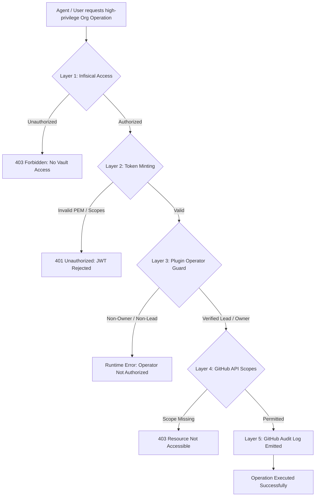

# GitHub App Enterprise Identity & Machine Architecture Suite

Master architectural plan, operational framework, and manual setup suite for sovereign **GitHub App Machine Identities** across the `tupynambalucas-dev` organization.

---

## 1. Strategic Decisions & Architecture Baseline

- **Three-Tier Machine Identity Model**: Eliminates monolithic God-tokens and fragile Personal Access Tokens (PATs) by strictly segregating machine identities into three functional tiers under Separation of Duties (SoD) and Least Privilege (PoLP):
  - **Tier 1 (`tupynambalucas-org-manager`)**: High-privilege administrative operator governing organizational RBAC, team creation, branch protection rulesets, and security triage. Custody is strictly restricted to Organization Owners and Lead Architects via Infisical.
  - **Tier 2 (`tupynambalucas-ci-bot`)**: Operational continuous delivery bot executing automated package publishing (`npm.pkg.github.com`), commit status reporting, and release distribution with zero organizational administrative reach.
  - **Tier 3 (`tupynambalucas-developer-tools`)**: Interactive developer workstation identity powering `gh-tl` CLI onboarding and IDE extensions via OAuth 2.0 Device Authorization Flow (`https://github.com/login/device`), enforcing the dual-boundary standard (`App Scopes ∩ Team RBAC`) with zero private keys distributed to local machines.
- **Zero-Code & Headless Operation**: All GitHub Apps operate in Mode 1 (Headless Machine Identity). They do NOT require servers, webhooks, or hosting infrastructure. Webhooks are deliberately left **Inactive** (`Active: false`), preventing unnecessary GitHub retry overhead and attack surfaces.
- **Direct Team Role Pre-Configuration**: `tupynambalucas-org-manager` enables near-total organizational freedom by provisioning and binding permissions directly to functional teams (`@tupynambalucas-dev/core-maintainers`, `@tupynambalucas-dev/platform-engineers`), ensuring that newly onboarded developers inherit fine-grained access deterministically without manual repository-by-repository configuration.
- **5-Layer Defense-in-Depth Enforcement**: Restricts access to high-privilege apps across five distinct boundaries: Infisical path-based RBAC, token minting boundaries, `@tupynambalucas-dev/plugin-github-org` operator authority checks, dedicated GitHub App Managers, and GitHub Audit Log monitoring.
- **Zero-Plaintext Secret Custody**: Private keys (`.pem`) are generated once, loaded into Infisical Cloud Vault, injected into GitHub Actions Organization Secrets, and purged from local filesystems.

---

## 2. Architecture & Topology

```mermaid
flowchart TD
  subgraph Tier1 ["Tier 1: Sovereign Org Governance (Custody: Owners & Lead Architects)"]
    App1["GitHub App: tupynambalucas-org-manager"]
    Priv1["Org Administration, Members, Rulesets, Alerts"]
    Consumer1["@tupynambalucas-dev/plugin-github-org (MCP Agent Mesh)"]
    App1 --> Priv1
    Consumer1 --> App1
  end

  subgraph Tier2 ["Tier 2: Autonomous Delivery (Custody: GitHub Actions Workflows)"]
    App2["GitHub App: tupynambalucas-ci-bot"]
    Priv2["Packages R/W, Actions R/W, Contents R/W, Workflows R/W"]
    Consumer2["GitHub Actions Workflows (publish.yml, release.yml, admin-packages.yml)"]
    App2 --> Priv2
    Consumer2 --> App2
  end

  subgraph Tier3 ["Tier 3: Developer Enablement (Custody: Developer Workstations)"]
    App3["GitHub App: tupynambalucas-developer-tools"]
    Priv3["OAuth Device Flow: Members Read, Contents Read, Issues R/W, PRs R/W"]
    Consumer3["gh-tl CLI Extension (gh tl onboard, gh tl verify)"]
    App3 --> Priv3
    Consumer3 --> App3
  end
```

---

## 3. Five-Layer Defense-in-Depth Model

---

## 4. Document Suite Catalog

| # | Document | Primary Focus | Key Audience / Consumers |
| :-: | :--- | :--- | :--- |
| **01** | [Core Fundamentals, Webhook Architecture & Token Taxonomy](./core-fundamentals-and-webhooks.md) | Architectural modes (Zero-code vs Code-backed), token types (JWT, IAT, UAT), push vs pull, why webhooks are disabled, and comparison matrix vs PATs. | Architects, Security Engineers, DevOps |
| **02** | [Three-Tier Identity Topology & Master Permissions Catalog](./topology-and-permissions-catalog.md) | Multi-repo topology analysis, 3-tier model, direct team roles, 5-layer defense-in-depth, operator guards, and exhaustive 76-permission catalog. | Architects, Team Leads, Security Auditors |
| **03** | [Manual Setup Guide: Organization Manager App (Tier 1)](./setup-org-manager-app.md) | Screen-by-screen, field-by-field web UI creation guide for `tupynambalucas-org-manager` with rich GFM description and 19 permissions. | Organization Owners, GitHub App Managers |
| **04** | [Manual Setup Guide: CI/CD Automation Bot (Tier 2)](./setup-ci-bot-app.md) | Screen-by-screen, field-by-field web UI creation guide for `tupynambalucas-ci-bot` with rich GFM description and 8 permissions. | Organization Owners, CI/CD Engineers |
| **05** | [Manual Setup Guide: Developer Tools Identity (Tier 3)](./setup-developer-tools-app.md) | Screen-by-screen, field-by-field web UI creation guide for `tupynambalucas-developer-tools` with Device Flow and 5 permissions. | Organization Owners, Tooling Engineers |
| **06** | [Secret Governance, Key Generation & Workflows](./secrets-governance-and-workflows.md) | Generating RSA `.pem` keys, installing apps, configuring App Managers, Infisical Cloud Vault storage, Organization Secrets, and workflow consumption. | DevOps, Platform Engineers, SecOps |
| **07** | [Actionable Execution Checklist & Roadmap](./execution-checklist-and-roadmap.md) | Phased step-by-step checklist for registering all three apps, downloading keys, enrolling secrets, and running verification tests. | Implementation Lead, Reviewers |
| **08** | [Plugin Integration, Custom MCP & Multi-User Authorization](./plugin-integration-and-mcp-authorization-model.md) | Architectural coupling between `plugin-github-org`, `mcp-github`, and `org-manager`, including the 5-layer defense-in-depth authorization model for multi-user workspaces. | Lead Architects, Security Engineers, AI Mesh Developers |
| **09** | [CI/CD Workflow Integration & Runner Architecture](./ci-cd-workflow-integration-and-runner-architecture.md) | GitHub Actions expression parser rules, why enterprise CI/CD mandates GitHub Apps over PATs/GITHUB_TOKEN, cascade triggers, workflow-to-app mapping, and SLSA Level 3 compliance. | CI/CD Engineers, DevOps, Platform Architects |

---

## 5. Navigation

- [Parent Architectural Plans Index](../README.md)
- [Organization Governance Root (.github)](../../../README.md)
- [Enterprise Agent Mesh Context Router (agent-mesh)](../../../../agent-mesh/AGENTS.md)
