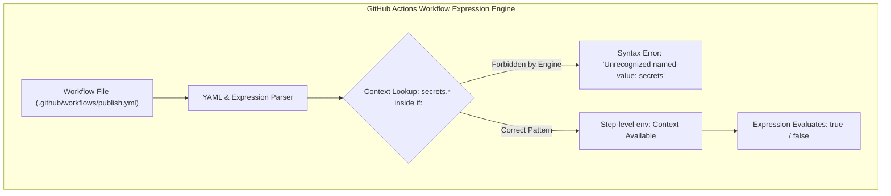
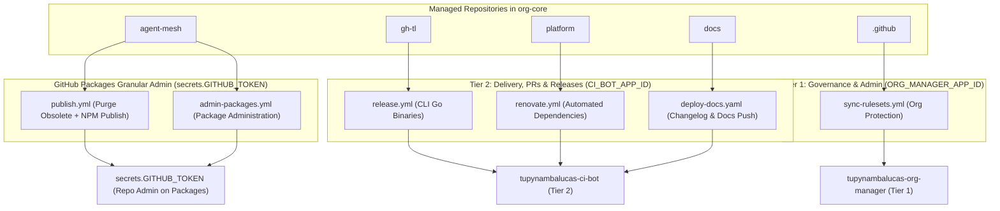

# CI/CD Workflow Integration, GitHub Actions Runner Architecture & Enterprise Token Strategy
**Organization**: `tupynambalucas-dev`  
**Domain**: Enterprise CI/CD, Supply Chain Security & Automated Delivery  
**Suite**: [GitHub App Architecture Suite](./README.md)  
**Classification**: Senior Architectural Specification & Troubleshooting Guide  
**Standard**: en-US Technical Specification (Strict Zero-Emoji Policy)

---

## 1. Executive Summary & Problem Diagnosis

When invoking automated workflows in GitHub Actions, such as `agent-mesh/.github/workflows/publish.yml`, the runner compiler rejects workflows attempting to directly inspect the `secrets.*` context inside an `if:` conditional:

```text
Invalid workflow file: .github/workflows/publish.yml#L1
(Line: 32, Col: 13): Unrecognized named-value: 'secrets'. Located at position 2 within expression: (secrets.ORGANIZATION_APP_ID || secrets.APP_ID) != '' && (secrets.ORGANIZATION_APP_PRIVATE_KEY || secrets.APP_PRIVATE_KEY) != ''
```

### 1.1 Root-Cause Anatomy: The Parser Restriction

This error is **not** caused by missing GitHub Apps or unregistered organization secrets. It is a fundamental Abstract Syntax Tree (AST) compilation error in GitHub Actions.



GitHub Actions evaluates `if:` conditionals using a restricted set of execution contexts:
- **Available Contexts in Step `if:`**: `github`, `inputs`, `vars`, `job`, `steps`, `runner`, `matrix`, `needs`, and `env`.
- **Unavailable Context in `if:`**: `secrets`.

#### Why GitHub Restricts `secrets` in Conditionals:
1. **Secret Masking and Leak Prevention**: GitHub Actions workflow expression evaluators log conditional resolutions. Allowing `secrets` in expressions could leak secret presence, entropy, length, or substrings via boolean differential side-channels.
2. **Deterministic Pre-flight Compilation**: Workflows are parsed before secrets are bound to the runner instance.
3. **Execution Context Isolation**: Step environments (`env:`) act as explicit, auditable security boundaries for variable passing.

### 1.2 The Resolution Pattern

To conditionally execute a step based on whether a secret exists without triggering parser errors, map the secret into the step's `env:` block first, then evaluate the resulting environment variable:

```yaml
      # CORRECT PATTERN: Map secrets to env, then evaluate env in if:
      - name: Generate CI Bot Token
        id: app-token
        env:
          APP_ID: ${{ secrets.CI_BOT_APP_ID || secrets.CI_APP_ID }}
          APP_PRIVATE_KEY: ${{ secrets.CI_BOT_APP_PRIVATE_KEY || secrets.CI_APP_PRIVATE_KEY }}
        if: ${{ env.APP_ID != '' && env.APP_PRIVATE_KEY != '' }}
        uses: actions/create-github-app-token@d72941d797fd3113feb6b93fd0dec494b13a2547 # v1.12.0
        with:
          app-id: ${{ env.APP_ID }}
          private-key: ${{ env.APP_PRIVATE_KEY }}
          owner: ${{ github.repository_owner }}
```

If the secrets are not configured or are unavailable (e.g., in a community pull request from a fork), GitHub Actions initializes `env.APP_ID` and `env.APP_PRIVATE_KEY` as empty strings (`""`). The `if:` conditional cleanly evaluates to `false`, the step is skipped, and downstream steps fall back to `secrets.GITHUB_TOKEN`.

---

## 2. Why Enterprise CI/CD Mandates GitHub Apps

In enterprise software engineering, relying on the default `GITHUB_TOKEN` or human Personal Access Tokens (PATs) for continuous delivery introduces severe security, governance, and operational vulnerabilities. GitHub Apps represent the industry gold standard for machine authentication in automated pipelines.

### 2.1 The Downstream Workflow Cascade Problem

The single most critical operational constraint in GitHub Actions is workflow recursion protection:

> An action executed using the default `GITHUB_TOKEN` will **never** trigger a downstream workflow run (such as a subsequent `push`, `release`, or `workflow_run` event).

This GitHub design restriction prevents accidental infinite execution loops, but it fundamentally breaks automated CI/CD pipelines:
- If a workflow commits a version bump (`package.json`) using `GITHUB_TOKEN`, subsequent CI test workflows do NOT run on that commit.
- If a workflow creates an annotated release tag (`git tag v1.0.0`) using `GITHUB_TOKEN`, downstream release compilation and package publishing workflows do NOT fire.
- If an automated bot opens a pull request using `GITHUB_TOKEN`, branch protection status checks and merge requirements are NOT triggered.

**The GitHub App Solution**: Actions performed using an Installation Access Token (IAT) generated by a registered GitHub App are treated by GitHub as external machine actions. **They trigger downstream workflows normally**, enabling fully autonomous, multi-stage delivery pipelines while maintaining strict security boundaries.

### 2.2 Comparative Analysis Matrix

| Architectural Criterion | Default `GITHUB_TOKEN` | Personal Access Token (Classic PAT) | Fine-Grained PAT (Beta) | GitHub App Machine Identity |
| :--- | :--- | :--- | :--- | :--- |
| **Downstream Triggers** | Strictly blocked (no cascade) | Triggers workflows | Triggers workflows | **Triggers workflows deterministically** |
| **Scope Boundary** | Current repository only | Global to entire human user account | User-owned, repo-scoped | **Organization-owned, fine-grained RBAC** |
| **Token Lifetime** | Job duration only | Indefinite or static (e.g., 90 days) | Up to 1 year | **Ephemeral: 60 minutes auto-expiration** |
| **Audit Identity** | `github-actions[bot]` | Human engineer username | Human engineer username | **Explicit bot identity: `app-name[bot]`** |
| **Employee Offboarding** | Not affected | **Breaks all pipelines when employee leaves** | **Breaks all pipelines when user is removed** | **Resilient: Organization-owned asset** |
| **API Rate Limits** | 1,000 req/hr per repo | 5,000 req/hr shared across human account | 5,000 req/hr shared | **5,000 to 15,000 req/hr per installation** |
| **Cross-Repo Reach** | None (blocked by sandbox) | Global access to all user repos | Selected repos under user account | **All managed repos in organization** |
| **Credential Custody** | Managed by GitHub | Stored as static plaintext secret | Stored as static plaintext secret | **Asymmetric RSA key in Infisical / Org Secrets** |

---

## 3. Workflow-to-Credential Mapping Taxonomy

Our architecture enforces Separation of Duties (SoD) while respecting GitHub's subsystem authentication rules:
- **Git, PR, Release & Workflow-Cascade Pipelines**: Consume `tupynambalucas-ci-bot` (`CI_BOT_APP_ID` / `CI_BOT_APP_PRIVATE_KEY`) or `tupynambalucas-org-manager` (`ORG_MANAGER_APP_ID` / `ORG_MANAGER_APP_PRIVATE_KEY`).
- **GitHub Packages Registry (`npm.pkg.github.com`) & Granular Package Administration (`publish.yml`, `admin-packages.yml`)**: Consume `secrets.GITHUB_TOKEN` (`permissions: packages: write`). Per official GitHub Packages documentation ([Working with the npm registry](https://docs.github.com/en/packages/working-with-a-github-packages-registry/working-with-the-npm-registry) and [Deleting and restoring a package](https://docs.github.com/en/packages/learn-github-packages/deleting-and-restoring-a-package#packages-api-support)), `npm.pkg.github.com` and granular-permission packages (`npm`) do not support GitHub App installation access tokens (`ghs_*`). Instead, GitHub automatically grants the publishing repository's `GITHUB_TOKEN` the `admin` role on every package it publishes, enabling both `pnpm -r publish` and `DELETE /orgs/{org}/packages/npm/{short_name}` natively inside `agent-mesh` workflows.



### 3.1 Tier 2 (`tupynambalucas-ci-bot`) Workflows

The `ci-bot` app handles automated Git commits, pull requests, and release workflows. It possesses operational repository scopes (`contents: write`, `packages: write`, `actions: read`, `issues: write`, `pull-requests: write`) but **zero organizational administrative power**.

| Workflow File | Repository | Operational Purpose | Consumed Secret |
| :--- | :--- | :--- | :--- |
| `.github/workflows/release.yml` | `gh-tl` | Compiles Go CLI extension binaries for Windows/macOS/Linux and publishes GitHub Releases. | `CI_BOT_APP_ID` / `CI_BOT_APP_PRIVATE_KEY` |
| `.github/workflows/renovate.yml` | `platform` | Performs automated dependency updates, creating branches and pull requests. | `CI_BOT_APP_ID` / `CI_BOT_APP_PRIVATE_KEY` |
| `.github/workflows/renderer-generate.yml` | `platform` | Generates profile metrics and pushes compiled assets to the `generated` branch. | `RENDERER_GH_PAT` / `CI_BOT_APP_ID` |
| `.github/workflows/deploy-docs.yaml` | `docs` | Generates `CHANGELOG.md` and `ROADMAP.md`, commits to `main`, and deploys to Cloudflare Pages. | `CI_BOT_APP_ID` / `CI_BOT_APP_PRIVATE_KEY` |

### 3.2 GitHub Packages Workflows (`secrets.GITHUB_TOKEN` in `agent-mesh`)

| Workflow File | Repository | Operational Purpose | Consumed Secret |
| :--- | :--- | :--- | :--- |
| `.github/workflows/publish.yml` | `agent-mesh` | Purges obsolete packages (`purge-obsolete` / `purge-all`) and publishes all 19 MCP and plugin packages to `npm.pkg.github.com`. | `secrets.GITHUB_TOKEN` (`packages: write`) |
| `.github/workflows/admin-packages.yml` | `agent-mesh` | On-demand package listing, single package deletion, and registry purging across `agent-mesh` packages. | `secrets.GITHUB_TOKEN` (or `ADMIN_PACKAGES_TOKEN`) |

### 3.3 Tier 1 (`tupynambalucas-org-manager`) Workflows & MCP

The `org-manager` app is reserved strictly for high-privilege operations that exceed the boundary of a single repository or require organization administration rights.

| Consumer | Repository | Operational Purpose | Consumed Secret |
| :--- | :--- | :--- | :--- |
| `@tupynambalucas-dev/mcp-github-org` | `agent-mesh` | Organization repositories, teams, rulesets, Dependabot, and Secret Scanning governance. | `ORG_MANAGER_APP_ID` / `ORG_MANAGER_APP_PRIVATE_KEY` |
| `.github/workflows/sync-rulesets.yml` | `.github` | Synchronizes branch protection rulesets and tag policies across all organization repos. | `ORG_MANAGER_APP_ID` / `ORG_MANAGER_APP_PRIVATE_KEY` |

### 3.4 Tier 3 (`tupynambalucas-developer-tools`) Boundary

> [!IMPORTANT]
> `tupynambalucas-developer-tools` (Tier 3) is consumed by `@tupynambalucas-dev/mcp-github-flow` (`plugin-github-flow`) and interactive developer workstation tools (`gh tl onboard`, `gh tl verify`). It is **NEVER** consumed inside GitHub Actions CI/CD runners.

---

## 4. Production Workflow Implementation Reference

### 4.1 Native Workspace Package Reconciliation & Publishing (`agent-mesh/.github/workflows/publish.yml`)

```yaml
name: Publish Packages to GitHub Packages

on:
  push:
    branches:
      - main
    tags:
      - 'v*'
  workflow_dispatch:
    inputs:
      force_republish:
        description: "Purge existing packages before publishing to overwrite current version tarballs"
        required: false
        type: boolean
        default: false

concurrency:
  group: publish-packages
  cancel-in-progress: false

permissions:
  contents: read
  packages: write

jobs:
  validate-and-publish:
    name: Validate, Build and Publish
    runs-on: ubuntu-latest
    steps:
      - name: Checkout Repository
        uses: actions/checkout@11d5960a326750d5838078e36cf38b85af677262 # v4.2.2

      - name: Setup Node.js & pnpm
        uses: ./.github/actions/setup-pnpm-env

      - name: Install Dependencies
        run: pnpm install --frozen-lockfile
        env:
          NODE_AUTH_TOKEN: ${{ secrets.GITHUB_TOKEN }}

      - name: Typecheck Workspace
        run: pnpm typecheck

      - name: Build MCP Packages
        uses: ./.github/actions/build-mcp

      - name: Validate Antigravity Domain Plugins
        uses: ./.github/actions/validate-plugins

      - name: Reconcile Registry & Purge Obsolete Packages
        env:
          ADMIN_TOKEN: ${{ secrets.ADMIN_PACKAGES_TOKEN || secrets.GITHUB_TOKEN }}
          ADMIN_ACTION: ${{ inputs.force_republish && 'purge-all' || 'purge-obsolete' }}
          DRY_RUN: "false"
        run: node .github/scripts/manage-packages.js

      - name: Publish Workspace Packages Idempotently (Native pnpm)
        env:
          NODE_AUTH_TOKEN: ${{ secrets.GITHUB_TOKEN }}
        run: pnpm run packages:publish
```

### 4.2 Administrative Package Deletion (`agent-mesh/.github/workflows/admin-packages.yml`)

```yaml
      - name: Execute Package Administration Script
        env:
          ADMIN_TOKEN: ${{ inputs.admin_token || secrets.ADMIN_PACKAGES_TOKEN || secrets.GITHUB_TOKEN }}
          ADMIN_ACTION: ${{ inputs.action }}
          TARGET_PACKAGE: ${{ inputs.package_name }}
          DRY_RUN: ${{ inputs.dry_run }}
        run: node .github/scripts/manage-packages.js
```

---

## 5. Security & Compliance Standards

### 5.1 Supply Chain Security (SLSA Level 3 Alignment)
By transitioning from human PATs to cryptographically attested GitHub App Installation Access Tokens:
1. **Verifiable Provenance**: Package releases in `agent-mesh` and Go binaries in `gh-tl` are generated by an authenticated machine identity (`tupynambalucas-ci-bot[bot]`), satisfying Supply-chain Levels for Software Artifacts (SLSA) Level 3 requirements for non-falsifiable build origin.
2. **Deterministic Revocation**: If a private key is suspected of being compromised, generating a new private key in GitHub App settings instantly revokes access for all past keys without touching individual engineer accounts or requiring password resets.

### 5.2 Zero-Trust Ephemeral Credential Lifecycle
Installation Access Tokens minted by `actions/create-github-app-token` are:
- Valid for exactly **60 minutes**.
- Scoped strictly to the repositories and permissions requested.
- Automatically scrubbed from the runner environment upon job completion.
- Never persisted to disk or cached in runner image snapshots.

---

## 6. Navigation

- [GitHub App Architecture Suite README](./README.md)
- Previous: [Secret Governance, Key Generation & Workflows (Document 06)](./secrets-governance-and-workflows.md)
- Implementation Roadmap: [Actionable Execution Checklist (Document 07)](./execution-checklist-and-roadmap.md)
- Multi-User Authorization: [Plugin Integration & MCP Authorization Model (Document 08)](./plugin-integration-and-mcp-authorization-model.md)
- [Organization Governance Root (.github)](../../../README.md)