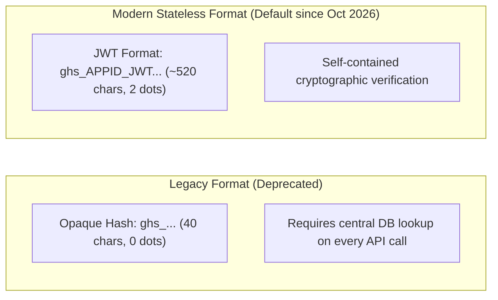
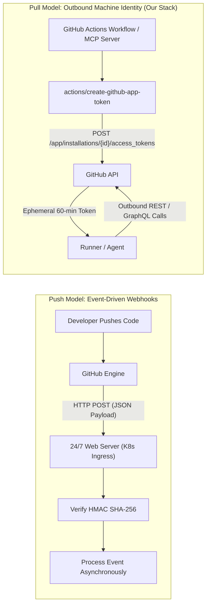

# GitHub App Core Fundamentals, Webhook Architecture & Token Taxonomy
**Organization**: `tupynambalucas-dev`  
**Domain**: Enterprise Identity, Governance, CI/CD Automation & Workstation Integration  
**Suite**: [GitHub App Architecture Suite](./README.md)  
**Classification**: Senior Architectural Specification  
**Standard**: en-US Technical Specification (Strict Zero-Emoji Policy)

---

## 1. Executive Summary & Purpose

In modern cloud-native engineering organizations, managing access to source code, deployment artifacts, organizational rulesets, and release distribution requires a robust, zero-trust machine identity layer.

Relying on human developer credentials—such as Personal Access Tokens (Classic or Fine-Grained)—introduces catastrophic operational risks: credential leakage, lack of centralized rotation, attribution pollution in Git histories, hard rate limit exhaustion, and immediate pipeline failures when developers rotate passwords or leave the organization.

This guide provides the authoritative architectural blueprint for establishing sovereign **GitHub Apps** as first-class machine identities across the `tupynambalucas-dev` organization. It provides:
1. Conceptual foundation on what GitHub Apps are mechanically, explaining why they operate as pure permission/identity vehicles and do not require server code or hosting infrastructure.
2. A deep dive into GitHub App Webhooks: push vs pull architecture, why webhooks are unnecessary for outbound machine identities, and the operational hazards of activating webhooks without an active listener.
3. Multi-repository topology analysis across `org-core` (`agent-mesh`, `.github`, `gh-tl`, `platform`, `docs`) establishing a comprehensive **Three-Tier App model** (`tupynambalucas-org-manager`, `tupynambalucas-ci-bot`, and `tupynambalucas-developer-tools`) under the Principle of Least Privilege (PoLP) and Separation of Duties (SoD).
4. Near-Total Organizational Freedom specification for `tupynambalucas-org-manager`, detailing how to pre-configure organization-level roles and repository permissions directly on functional teams rather than individual developers.
5. Role-to-App Access Control Architecture and 5-Layer Defense-in-Depth Enforcement Model governing which teams have access to which apps and how unauthorized access is strictly blocked.
6. Exhaustive Master Permission Catalog comparing all 76 permissions supported by GitHub Apps across all three apps, mapped directly to plugin consumers in `agent-mesh/plugins`.
7. Dedicated interactive developer identity tier (`tupynambalucas-developer-tools`) implementing OAuth Device Flow, enabling CLI tooling (`gh-tl`) and developer workstations to authenticate seamlessly without private key sprawl.
8. The architectural boundary between human developer workstation configuration (`gh-tl`) and machine automation under the Dual-Verification Standard.
9. Strict Operator Authority Guard governing [`@tupynambalucas-dev/plugin-github-org`](../../../../agent-mesh/plugins/packages/github-org), ensuring only organization owners and top-tier administrative teams can execute high-privilege operations.
10. An exhaustive, didactic, screen-by-screen and checkbox-by-checkbox manual setup walkthrough for creating all three apps and assigning GitHub App Managers via GitHub's web interface.
11. Concrete runbooks for generating private keys, installing the apps on the organization, capturing Installation IDs, enrolling secrets into Infisical and GitHub Organization Secrets, and consuming them inside GitHub Actions workflows.

---

## 2. Core Conceptual Fundamentals: How GitHub Apps Work

### 2.1 What is a GitHub App?
A **GitHub App** is a dedicated, first-class machine identity registered within GitHub. Unlike a personal user account, a GitHub App:
- Is owned directly by the organization (`tupynambalucas-dev`), not tied to any individual developer.
- Does not consume a paid GitHub seat.
- Has dedicated, separate API rate limits (5,000 to 15,000 requests per hour depending on organization plan).
- Issues temporary, cryptographically bounded tokens on demand.
- Signs its own Git commits with GitHub's green `Verified` badge under its official bot persona (`[bot]`).

### 2.2 Do GitHub Apps Need Code or Do They Serve Just to Grant Permissions?

> [!IMPORTANT]
> **A GitHub App DOES NOT inherently require external code, hosting infrastructure, or webhook servers to function.**

GitHub Apps operate across two distinct architectural modes:

```mermaid
flowchart TD
    subgraph ModeA ["Mode 1: Headless Machine Identity (Zero Server Code)"]
        A1["GitHub App Registration (App ID + RSA Key)"] --> A2["Client / CI Runner / MCP Server"]
        A2 --> A3["Signs RS256 JWT Locally using .pem"]
        A3 --> A4["Exchanges JWT with GitHub API for Installation Token"]
        A4 --> A5["Performs API Calls, Releases, Git Operations"]
    end

    subgraph ModeB ["Mode 2: Event-Driven Reactive Service (Code-Backed)"]
        B1["GitHub Event Occurs (Push, PR, Issue)"] --> B2["GitHub Webhook POST Request"]
        B2 --> B3["Publicly Hosted Backend Server (Node.js/Go on K8s)"]
        B3 --> B4["Verifies Webhook Secret HMAC SHA-256"]
        B4 --> B5["Executes Automated Response Logic"]
    end
```

1. **Headless Machine Identity (Zero-Code Mode)**:
   - **Operational Purpose**: CI/CD pipelines (GitHub Actions), local CLI tools, automated release publishers (`release.yml`, `renovate.yml`, `deploy-docs.yaml`), and scoped MCP servers (`@tupynambalucas-dev/mcp-github-org` and `@tupynambalucas-dev/mcp-github-flow` powered by `@tupynambalucas-dev/mcp-core-github`).
   - **How it works**: The app exists purely as an authentication and permission principal. It has **No Webhook URL** (`Active: false`), **No callback server**, and **No hosting cost**. GitHub Actions runners or local developer environments sign a JSON Web Token (JWT) using the app's RSA private key (`.pem`), exchange it with GitHub for a 60-minute ephemeral **Installation Access Token (IAT)**, and execute operations.
2. **Event-Driven Service (Code-Backed Mode)**:
   - **Operational Purpose**: Continuous background daemons that must react in real time to events (e.g. an issue comment triggering a Kubernetes agent pod, or a custom pull request gatekeeper).
   - **How it works**: Requires a public HTTP endpoint (`Webhook URL`) running a server (e.g. Express, Probot, or Go) to receive and verify webhook payloads signed with a shared secret.

For our organizational requirements, our GitHub Apps operate in **Mode 1 (Headless Machine Identity)**, providing sovereign credentials with zero infrastructure overhead.

### 2.3 The Three Authentication Tokens of GitHub Apps

GitHub Apps support three distinct token flows:

| Token Type | Abbreviation | Lifetime | Mechanics | Primary Use Case |
| :--- | :--- | :--- | :--- | :--- |
| **JSON Web Token** | `JWT` | Max 10 minutes | Signed locally via RS256 using App ID and RSA Private Key (`.pem`). | Authenticating as the App itself to query installations or request an installation token. |
| **Installation Access Token** | `IAT` | Exactly 60 minutes | Minted by calling `POST /app/installations/{id}/access_tokens` using a JWT. | **Server-to-Server automation**; all CI/CD, release publishing, repository governance, and package management. |
| **User Access Token** | `UAT` | 8 hours (with refresh token) | Minted via OAuth authorization or Device Flow when a user authorizes the App. | **User-to-Server developer tooling**; interactive CLI commands (`gh-tl`), developer portals, and IDE extensions. |

### 2.4 Modern Token Evolution: The Stateless Installation Token Transition

In May 2026 (completed October 2026), GitHub introduced and concluded the rollout of a **stateless, JWT-based format for GitHub App installation access tokens (`ghs_`)**, replacing the legacy 40-character opaque stateful token.

#### Key Architecture Principles of the New Token Format:
1. **Format and Structure**:
   - Classic token: 40-character alphanumeric string without periods (`ghs_[A-Za-z0-9]{36}`).
   - Stateless token: ~520-character base64-encoded JWT with the `ghs_` prefix and **two dots** separating the header, payload, and signature.
2. **Why GitHub Migrated to Stateless Tokens**:
   - State-less tokens do not require round-trip database queries inside GitHub's infrastructure for every single REST/GraphQL API request, drastically increasing throughput, reducing latency, and eliminating token-validation database bottlenecks during high-load CI/CD bursts.
3. **The `X-GitHub-Stateless-S2S-Token` Override Header**:
   - During the staged rollout (May–November 2026), GitHub provided a temporary HTTP request header on `POST /app/installations/:installation_id/access_tokens`:
     - `X-GitHub-Stateless-S2S-Token: enabled`: Forces the generation of the stateless ~520-character JWT token.
     - `X-GitHub-Stateless-S2S-Token: disabled`: Forces the legacy 40-character opaque format.
   - **Deprecation Date**: The override header will be permanently deprecated and ignored on **November 30, 2026**. All newly minted installation tokens will unconditionally use the stateless format.
4. **Organizational Readiness & Compliance**:
   - **No Hardcoded Length Assumptions**: Code and storage must never assume installation tokens are 40 characters.
   - **Regex Guidance**: When matching installation tokens, use the official GitHub pattern `ghs_[A-Za-z0-9\.\-_]{36,}`.
   - **Tupynamba Lucas Stack Compliance**: Our stack (`agent-mesh`, `platform`, `gh-tl`, `actions/create-github-app-token`) consumes tokens dynamically via environment variables without length or character restrictions, guaranteeing complete native compliance with zero required changes.

---

## 3. Webhooks Deep Dive: Push vs. Pull Architecture & Inactive Discipline

### 3.1 Architectural Paradigms: Push (Webhooks) vs Pull (API Tokens)

Understanding whether an organization requires webhooks comes down to the direction of event dispatching:

- **Push Model (Webhooks)**: GitHub actively initiates an outbound HTTP `POST` request to an external server whenever a subscribed repository or organization event occurs. The external server must acknowledge the request with an HTTP 2xx status within 10 seconds.
- **Pull / On-Demand Model (API Tokens)**: Our internal automation tools (GitHub Actions workflows or MCP servers) initiate outbound HTTPS requests to GitHub's REST/GraphQL API using an ephemeral token. GitHub never calls our infrastructure; our infrastructure calls GitHub.

### 3.2 Do We Need Webhooks for Our GitHub Apps?

> [!IMPORTANT]
> **NO, we DO NOT need webhooks for our GitHub Apps.**  
> When registering all three apps in GitHub, the **Webhook Active checkbox MUST BE UNCHECKED (Inactive)**.

Here is the exhaustive technical rationale:

1. **GitHub Actions Executes on GitHub Infrastructure**:
   - Our CI/CD workflows (`publish.yml`, `admin-packages.yml`, `ci.yml`, `release.yml`, `renovate.yml`) are triggered internally by GitHub's native workflow engine via triggers like `on: push`, `on: pull_request`, `on: schedule`, or `on: workflow_dispatch`.
   - Workflows do not need an external webhook to wake them up. They generate the GitHub App token inline using the official action `actions/create-github-app-token`.
2. **MCP Agents Execute on Local Developer or Runner Prompts**:
   - Our scoped MCP servers (`@tupynambalucas-dev/mcp-github-org` and `@tupynambalucas-dev/mcp-github-flow`, backed by `@tupynambalucas-dev/mcp-core-github`) operate on demand when an AI agent requests a tool invocation (such as `list_rulesets`, `list_secret_scanning_alerts`, `list_pull_requests`, or `get_repo_info`).
   - The MCP server uses the App ID and Private Key to mint an Installation Access Token and execute outbound queries. It never receives inbound webhook events.
3. **Developer CLI Tools Authenticate via Device Flow**:
   - Developer tools (`gh-tl`) use OAuth Device Flow (`POST /login/device/code` and polling `POST /login/oauth/access_token`), which is an outbound HTTP polling flow. Webhooks are not used.
4. **Zero Hosting Requirement**:
   - By leaving webhooks inactive, we eliminate the need to run, monitor, patch, and maintain a publicly reachable HTTP server, domain name, SSL certificate, or Kubernetes ingress controller.

### 3.3 Operational Hazards of Leaving Webhooks Active Without a Listener

If an administrator mistakenly checks **Active** on the Webhook configuration without providing an active, 24/7 web server:

1. **100% Delivery Failures & Red Alarms**:
   - Every single Git push, commit, pull request, or issue created in any repository across the organization will cause GitHub to dispatch an HTTP POST request to the Webhook URL.
   - If the URL is blank, invalid, or pointing to an inactive host, GitHub records a delivery failure.
   - GitHub displays persistent red warning banners in the GitHub App settings dashboard indicating that deliveries are failing.
2. **Resource Waste & Retry Throttling**:
   - GitHub implements automatic retry loops with exponential backoff for failed deliveries, consuming unnecessary outbound queue resources and polluting GitHub audit logs.
3. **Security Ingress Liability**:
   - Activating a webhook requires exposing an endpoint to the public internet, necessitating HMAC-SHA256 signature verification (`X-Hub-Signature-256`), replay attack protection, rate limiting, and DDoS mitigation.

### 3.4 Future Scenarios: When and How Webhooks Would Be Activated

Webhooks would only be activated if the organization chooses to deploy an event-driven bot daemon in the future:

- **Scenario 1: Reactive Kubernetes ChatOps Bot**: An automated agent daemon running in `platform/k8s` that continuously listens for issue or PR comments (e.g. `/deploy staging`, `/run-benchmark`, `/review-a11y`) and acts immediately upon receipt.
- **Scenario 2: Real-Time Organization Audit Sink**: An audit daemon that intercepts `repository.created` or `member.added` events to enforce instant compliance policies before any code is committed.

If such a service is deployed in the future:
1. Navigate to `GitHub -> Organization Settings -> Developer settings -> GitHub Apps -> Edit`.
2. Check **Active**.
3. Set **Webhook URL** to the production ingress endpoint (e.g. `https://api.tupynambalucas.dev/webhooks/github`).
4. Generate a 64-character high-entropy secret, set **Webhook secret**, and record it in Infisical.
5. Subscribe only to specific, required events.

For our current requirements, **keeping Webhook Inactive is strictly mandatory across all three apps**.

---

## 4. Comparative Analysis: GitHub App vs Other Token Types

| Architectural Vector | Personal Access Token (Classic) | Fine-Grained Personal Access Token | Default `GITHUB_TOKEN` | GitHub App (`Installation Token`) | GitHub App (`User Access Token`) |
| :--- | :--- | :--- | :--- | :--- | :--- |
| **Ownership** | Human developer account | Human developer account | GitHub Actions runner | **Organization (`tupynambalucas-dev`)** | **Organization (delegated to User)** |
| **Lifecycle** | Manual / Static (months/years) | Hard expiry (max 1 year) | Per-job ephemeral | **Ephemeral 60-minute dynamic tokens** | **8-hour token with refresh rotation** |
| **Authentication Secret** | Static plaintext string | Static plaintext string | Automatic | **2048-bit RSA Private Key (`.pem`)** | **OAuth Device Flow (No private key)** |
| **Organization Packages** | Can delete if `delete:packages` | **BLOCKED** on org endpoints | **BLOCKED** on org deletion | **FULLY SUPPORTED** (`packages: write`) | Bounded by user team RBAC |
| **Trigger Downstream CI** | Yes (risk of infinite loops) | Yes | **Blocked** (cannot trigger CI) | **Yes (cleanly triggers workflows)** | **Yes (attributed to human user)** |
| **Commit Signature** | Requires developer SSH key | Requires developer SSH key | Generic Actions bot | **Cryptographically `Verified` by Bot** | **Attributed to Developer Account** |
| **Rate Limit** | 5,000/hr (shared with user) | 5,000/hr (shared with user) | 1,000/hr | **5,000 - 15,000/hr dedicated** | 5,000/hr dedicated per user |
| **Role Separation** | Impossible (coarse scopes) | Repository-only granular | Repository-only | **Tiered Organizational Separation** | **App Scopes ∩ Team RBAC** |

---

---

## Navigation

- [GitHub App Architecture Suite README](./README.md)
- Next: [Three-Tier Identity Topology & Master Permissions Catalog](./topology-and-permissions-catalog.md)
- [Parent Architectural Plans Index](../README.md)
