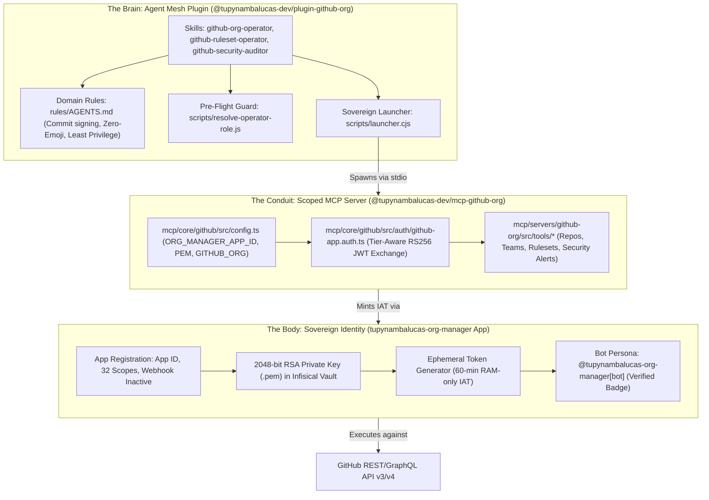
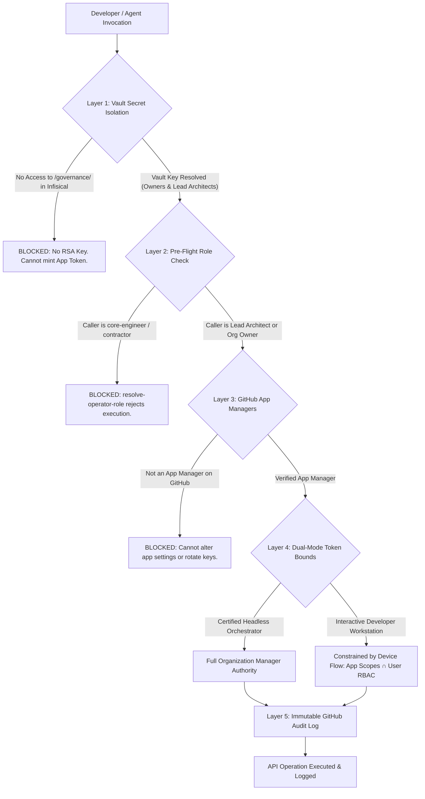

# GitHub App Plugin Integration, Custom MCP Architecture & Multi-User Authorization Model
**Organization**: `tupynambalucas-dev`  
**Domain**: Enterprise AI Agent Governance, MCP Integration & Machine Identity Security  
**Suite**: [GitHub App Architecture Suite](./README.md)  
**Classification**: Senior Architectural Specification & Security Enforcement Blueprint  
**Standard**: en-US Technical Specification (Strict Zero-Emoji Policy)

---

## 1. Executive Summary & Context

As the `tupynambalucas-dev` agent mesh expands across repositories, managing access to high-privilege organizational operations creates a fundamental security requirement:
- **The Codebase is Accessible**: Multiple developers across functional teams (`core-engineers`, `technical-writers`, `creative-team`, `contractors`) clone, contribute to, and interact with `agent-mesh` and `org-core`.
- **The Operations are Sovereign**: Only **Organization Owners** and dedicated **Lead Architects** (`@tupynambalucas-dev/lead-architects`) must have the capability to create organization teams, bind organization-level roles, modify branch protection rulesets, and triage secret-scanning leaks.
- **The Machine Identity is Unified**: Operations executed by autonomous agents must carry cryptographic authenticity, emit clean audit trails, and be attributed to the official `@tupynambalucas-org-manager[bot]` persona.

This specification establishes:
1. The architectural coupling between [`@tupynambalucas-dev/plugin-github-org`](../../../../agent-mesh/plugins/packages/github-org) and the Tier-1 GitHub App (`tupynambalucas-org-manager`), and between [`@tupynambalucas-dev/plugin-github-flow`](../../../../agent-mesh/plugins/packages/github-flow) and the Tier-3 GitHub App (`tupynambalucas-developer-tools`).
2. The role of the shared foundation package ([`@tupynambalucas-dev/mcp-core-github`](../../../../agent-mesh/mcp/core/github)) and the two scoped Model Context Protocol servers ([`@tupynambalucas-dev/mcp-github-org`](../../../../agent-mesh/mcp/servers/github-org) and [`@tupynambalucas-dev/mcp-github-flow`](../../../../agent-mesh/mcp/servers/github-flow)).
3. The **Five-Layer Defense-in-Depth Authorization Model**, ensuring that workspace access never equates to administrative authority.
4. The operational distinction between **Headless Server-to-Server** operations and **Interactive User-to-Server** operations via OAuth Device Flow.

---

## 2. Plugin Architecture: The Brain and Body Paradigm

The integration between the agent plugins and the GitHub Apps implements a strict separation of concerns:



1. **The Brain (`plugin-github-org` & `plugin-github-flow`)**:
   - Encapsulates domain logic, reasoning heuristics, pre-flight verification gates, and lifecycle hooks.
   - Declares the scoped MCP server binding (`@tupynambalucas-dev/mcp-github-org` or `@tupynambalucas-dev/mcp-github-flow`) in its `mcp.json` manifest.
   - Does NOT store private keys or hardcoded tokens.
2. **The Conduit (`mcp-core-github`, `mcp-github-org` & `mcp-github-flow`)**:
   - Shared foundation lives in `agent-mesh/mcp/core/github` (`@tupynambalucas-dev/mcp-core-github`); scoped servers live in `agent-mesh/mcp/servers/github-org` and `agent-mesh/mcp/servers/github-flow`.
   - Implements Model Context Protocol handlers conforming to `@modelcontextprotocol/sdk`.
   - Bridges the agent's natural language tool calls into strongly-typed Octokit API requests.
3. **The Body (`tupynambalucas-org-manager` & `tupynambalucas-developer-tools`)**:
   - Holds the cryptographic permission grant registered in GitHub's authorization database.
   - Signs commits and API requests with the green `Verified` badge.
   - Emits structured events to GitHub's organization audit log.

---

## 3. Scoped MCP Server Architecture (`@tupynambalucas-dev/mcp-core-github`, `mcp-github-org`, `mcp-github-flow`)

### 3.1 Existing Implementation State

The GitHub MCP ecosystem in `agent-mesh/mcp/` implements a 2-server + 1-core architecture with tier-isolated GitHub App authentication:

- **Authentication Logic ([`mcp/core/github/src/auth/github-app.auth.ts`](../../../../agent-mesh/mcp/core/github/src/auth/github-app.auth.ts))**:
  ```typescript
  export async function getOctokitClient(tier: GitHubAppTier = 'org-manager'): Promise<Octokit> {
    const creds = resolveTierCredentials(tier);
    if (creds.appId && creds.privateKey && creds.installationId) {
      const auth = createAppAuth({
        appId: creds.appId,
        privateKey: creds.privateKey,
        installationId: parseInt(creds.installationId, 10),
      });
      const installationAuth = await auth({ type: 'installation' });
      return new Octokit({ auth: installationAuth.token });
    }
    const token = config.GITHUB_PERSONAL_ACCESS_TOKEN || config.GITHUB_TOKEN;
    return token ? new Octokit({ auth: token }) : new Octokit();
  }
  ```
- **Graceful Fallback**: If an engineer runs `agent-mesh` locally without GitHub App credentials, the server seamlessly falls back to `GITHUB_TOKEN` or `GITHUB_PERSONAL_ACCESS_TOKEN`, preventing crashes.
- **Scoped Tools by Server**:
  - `@tupynambalucas-dev/mcp-github-org` (`tier = 'org-manager'`, 7 tools): `get_repo_info`, `list_org_repos`, `list_org_teams`, `list_rulesets`, `get_ruleset`, `list_dependabot_alerts`, `list_secret_scanning_alerts`.
  - `@tupynambalucas-dev/mcp-github-flow` (`tier = 'developer-tools'`, 6 tools): `get_repo_info`, `list_branches`, `list_pull_requests`, `get_pull_request`, `list_workflow_runs`, `get_workflow_run`.

### 3.2 Roadmap: Governance Mutation Tools

To unlock the full potential of `tupynambalucas-org-manager`, the custom MCP server will be expanded with the following governance mutation tools:

| Planned Tool Name | GitHub REST Endpoint | Required Permission | Operational Capability |
| :--- | :--- | :--- | :--- |
| `create_team` | `POST /orgs/{org}/teams` | `Members: Read and write` | Provision functional teams (`lead-architects`, `core-engineers`) programmatically. |
| `assign_team_membership` | `PUT /orgs/{org}/teams/{slug}/memberships/{user}` | `Members: Read and write` | Add, promote (maintainer), or remove team members. |
| `assign_org_role_to_team` | `PUT /orgs/{org}/organization-roles/teams/{slug}/{role_id}` | `Members: Read and write`, `Custom organization roles: Read and write` | **MASTER RBAC**: Bind organization-level roles directly to functional teams. |
| `create_org_ruleset` | `POST /orgs/{org}/rulesets` | `Administration: Read and write` | Deploy organization-wide branch protection rulesets (mandatory SSH signing, linear history). |
| `update_org_ruleset` | `PUT /orgs/{org}/rulesets/{id}` | `Administration: Read and write` | Calibrate bypass actors, ruleset conditions, or target repositories. |
| `triage_pat_request` | `PATCH /orgs/{org}/personal-access-token-requests/{id}` | `Personal access token requests: Read and write` | Programmatically approve or deny developer fine-grained PAT requests. |
| `revoke_pat` | `DELETE /orgs/{org}/personal-access-tokens/{id}` | `Personal access tokens: Read and write` | Instantly revoke compromised or non-compliant developer tokens. |

---

## 4. Multi-User Authorization Strategy: 5-Layer Defense-in-Depth

The critical security question in enterprise AI agent systems is:
> *If many engineers have access to the agent mesh codebase, how do we prevent unauthorized engineers from using the AI agent to trigger administrative operations via `tupynambalucas-org-manager`?*

We enforce authorization across five independent defense perimeters:



### 4.1 Layer 1: Cryptographic Vault Isolation (Infisical Path-Based RBAC)
- **The Invariant**: Source code does not grant authority; private keys grant authority.
- The 2048-bit RSA private key (`.pem`) of `tupynambalucas-org-manager` is stored exclusively in **Infisical Cloud**:
  ```text
  Project:      tupynambalucas-dev-platform [prod]
  Secret Path:  /governance/github-apps/org-manager/private-key
  ```
- **Access Boundary**:
  - **Organization Owners & Lead Architects**: Assigned Infisical Machine Identities with read access to `/governance/`.
  - **Standard Developers (`core-engineers`, `contractors`)**: Assigned access strictly to project `tupynambalucas-dev-agent-mesh [dev]` with role "Viewer" or "Developer". The `/governance/` path is invisible and strictly forbidden.
- **Outcome**: A standard developer running `agent-mesh` locally has an empty `GITHUB_APP_PRIVATE_KEY`. Their agent cannot sign RS256 JWTs and is mechanically incapable of acting as the `org-manager` bot.

### 4.2 Layer 2: Pre-Flight Caller Verification (`resolve-operator-role.js`)
- Before invoking any organizational mutation, `plugin-github-org` executes:
  ```bash
  node agent-mesh/plugins/packages/github-org/skills/github-org-operator/scripts/resolve-operator-role.js
  ```
- The script queries GitHub API using the developer's personal authenticated CLI session:
  1. Calls `GET /user` to identify the GitHub handle.
  2. Calls `GET /user/teams` to inspect membership across `tupynambalucas-dev`.
  3. Evaluates governance domain:
     - `lead-architects` -> **Level 3 (Organization Admin)**: Permitted to run team provisioning, ruleset mutation, and secret enrollment.
     - `security-managers` -> **Level 2 (Security Auditing)**: Permitted to run alert inspection and Dependabot triage.
     - `core-engineers` / other -> **Level 1 (Developer Operations)**: BLOCKED from executing `plugin-github-org` mutations.
- **Outcome**: Even if a developer had access to a temporary token, the plugin guard aborts execution before any mutating REST request is dispatched.

### 4.3 Layer 3: GitHub App Managers Perimeter
- In GitHub Organization Settings:
  ```text
  https://github.com/organizations/tupynambalucas-dev/settings/apps/tupynambalucas-org-manager/installations
  -> App managers
  ```
- Only verified Organization Owners and `@tupynambalucas-dev/lead-architects` are registered as **App Managers**.
- Standard developers cannot view the app settings page, cannot generate additional private keys, cannot modify webhook endpoints, and cannot alter permissions.

### 4.4 Layer 4: Dual-Mode Token Bounds (Server-to-Server vs User-to-Server)
The organization operates under two distinct token flows:

| Property | Mode 1: Server-to-Server (Org Manager) | Mode 2: User-to-Server (Developer Tools) |
| :--- | :--- | :--- |
| **Primary App** | `tupynambalucas-org-manager` | `tupynambalucas-developer-tools` |
| **Authentication** | RS256 JWT signed via RSA Private Key | OAuth 2.0 Device Flow (`https://github.com/login/device`) |
| **Token Type** | Installation Access Token (IAT) | User Access Token (UAT) with refresh token |
| **Token Lifespan** | Exactly 60 minutes | 8 hours |
| **Effective Authority** | Full App Permissions (32 scopes) | **Strict Intersection**: `App Scopes ∩ User RBAC` |
| **Primary Users** | Autonomous Agent Runners, Owners, Lead Architects | All verified engineers across functional teams |
| **Key Custody** | Vaulted in Infisical (Zero developer distribution) | Zero private keys (Public Client ID only) |

> [!IMPORTANT]
> When a standard developer interacts with GitHub via `gh-tl` or AI developer tools, they authenticate through **App 3 (`tupynambalucas-developer-tools`)**.
> Because of GitHub's **Permission Intersection Rule**, even if App 3 requested administrative permissions, GitHub automatically restricts the resulting token to what that specific user personally has access to. A regular engineer can NEVER exceed their team privileges.

### 4.5 Layer 5: Immutable Organization Audit Logging
- Every single API interaction executed by `tupynambalucas-org-manager` is permanently recorded in GitHub's organizational audit log:
  ```text
  https://github.com/organizations/tupynambalucas-dev/settings/audit-log
  ```
- Each audit log entry captures:
  - **Actor**: `tupynambalucas-org-manager[bot]`
  - **Action**: e.g., `team.create`, `protected_branch.update_ruleset`, `org_secret.create`
  - **Source IP Address**: Developer workstation or GitHub Actions runner IP
  - **Timestamp**: High-precision UTC timestamp
  - **Target Resource**: Target repository or team slug
- Unauthorized attempts or unusual bursts of administrative calls trigger automated alerting via Infisical and GitHub Security.

---

## 5. Workstation, CI/CD and Production Runtime Matrix

The table below defines how credentials and authorization are allocated across environments:

| Environment | GitHub Identity | Credentials Consumed | Access Level | Governing Defense Layers |
| :--- | :--- | :--- | :--- | :--- |
| **Standard Developer Workstation** | Personal User via `gh` & App 3 (`developer-tools`) | Public Client ID, personal OAuth token in OS Keychain | Domain 1: Developer Operations (PRs, issues, commits, branches) | Layer 1 (No Infisical Key) + Layer 2 (Guard Block) + Layer 4 (User RBAC Bound) |
| **Lead Architect Workstation** | Personal User + App 1 (`org-manager`) | Infisical Universal Auth token in RAM (`infisical run`) | Domain 3: Full Organization Administration | Layer 1 (Vault Authorized) + Layer 2 (Verified Lead) + Layer 3 (App Manager) |
| **GitHub Actions CI/CD** | App 2 (`ci-bot`) | `GH_APP_ID` and `GH_APP_PRIVATE_KEY` from Organization Secrets | Domain 2: Release Publishing & Package Administration | Scoped to specific repos, zero organization admin reach |
| **Production Agent Pod (K8s)** | App 1 (`org-manager`) via Cortex Gateway | Infisical Kubernetes Operator (`InfisicalSecret` CRD) | Domain 3: Autonomous Scheduled Governance Tasks | Kubernetes Namespace Isolation + Mutual TLS + Infisical RBAC |

---

## 6. Navigation

- [GitHub App Architecture Suite README](./README.md)
- Previous: [Actionable Execution Checklist & Roadmap](./execution-checklist-and-roadmap.md)
- [Three-Tier Identity Topology & Master Permissions Catalog](./topology-and-permissions-catalog.md)
- [Manual Setup Guide: Organization Manager App (Tier 1)](./setup-org-manager-app.md)
- [Parent Architectural Plans Index](../README.md)
