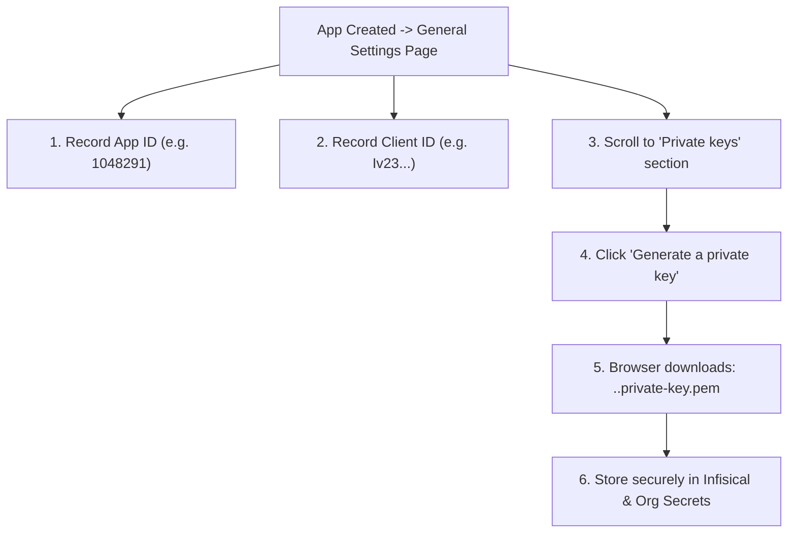

# GitHub App Secret Governance, Key Custody & Workflow Integration Runbook
**Organization**: `tupynambalucas-dev`  
**Domain**: Enterprise Identity, Governance, CI/CD Automation & Workstation Integration  
**Suite**: [GitHub App Architecture Suite](./README.md)  
**Classification**: Senior Operational Runbook & CI/CD Architecture  
**Standard**: en-US Technical Specification (Strict Zero-Emoji Policy)

---

## 1. Post-Creation Key Generation & Installation

### 6.6 Generating and Securing the RSA Private Key (`.pem`)

Immediately after creating `tupynambalucas-org-manager` (Tier 1) and `tupynambalucas-ci-bot` (Tier 2), GitHub displays the **General** settings page for the new app:



1. **Record the App ID**: At the top of the **General** page, find **App ID** (numeric string, e.g. `1149202`). Copy this number.
2. **Record the Client ID**: Right below App ID, find **Client ID** (alphanumeric string, e.g. `Iv23...`). Copy this value.
3. **Generate Private Key**:
   - Scroll down to the section titled **Private keys**.
   - Click the button **Generate a private key**.
   - GitHub generates a 2048-bit RSA private key and downloads a file named `<app-name>.<timestamp>.private-key.pem` to your computer.
   - Store this file securely. Never commit it to any Git repository.

---

### 6.7 Installing the Apps on the Organization and Capturing Installation IDs

A registered GitHub App cannot perform any actions until it is **installed** on the organization:

1. On the left navigation sidebar of your GitHub App settings, click **Install App**.
2. GitHub displays a list of accounts where you have administrative access. Locate `tupynambalucas-dev` and click the green **Install** button next to it.
3. In the repository selection prompt:
   - Select **All repositories** *(ensures all 5 repositories in `org-core` inherit the identity)*.
4. Click **Install**.
5. GitHub redirects you to the organization settings page for the installation:
   - Examine your browser's address bar URL:
     `https://github.com/organizations/tupynambalucas-dev/settings/installations/62345678`
   - The trailing integer (e.g. `62345678`) is your **Installation ID**.
   - Copy this number for Infisical storage.

---

### 6.8 Configuring GitHub App Managers (Step-by-Step UI Guide)

To enforce Layer 1 of our Defense-in-Depth model, the Organization Owner must delegate App Management authority strictly to authorized functional teams:

#### 6.8.1 Assigning App Managers to `tupynambalucas-org-manager` (Tier 1)
1. In the top-right corner of GitHub, click your profile picture -> **Your organizations** -> click **tupynambalucas-dev**.
2. Click the **Settings** tab under the organization profile.
3. In the left navigation sidebar, scroll down to **Developer settings** and click **GitHub Apps**.
4. In the list of GitHub Apps, click on the name or icon of **`tupynambalucas-org-manager`**.
5. In the inner left sidebar of the app settings, click **App managers**.
6. In the search box under *App managers*, type the team name: `lead-architects`.
7. Click **Grant**.
8. Confirm that `lead-architects` appears in the App managers list.
9. Verify that NO OTHER TEAMS (`core-engineers`, `infra-ops`, etc.) are listed.

#### 6.8.2 Assigning App Managers to `tupynambalucas-ci-bot` (Tier 2)
1. Repeat steps 1 to 4 and select **`tupynambalucas-ci-bot`**.
2. In the inner left sidebar, click **App managers**.
3. In the search box, type `lead-architects` and click **Grant**.
4. In the search box, type `infra-ops` and click **Grant**.
5. Confirm that both `lead-architects` and `infra-ops` appear as managers.

---

---

## 7. Alternative Automated Provisioning via Manifest Flow

For developers who prefer command-line automation, the repository provides a pre-configured provisioner in `agent-mesh`:

```bash
cd C:\Users\tupyn\projects\organizations\tupynambalucas-dev\org-core\agent-mesh

# Run the automated manager provisioner:
node plugins/packages/github-org/skills/github-app-operator/scripts/provision-app.js --profile=manager
```

### What the Script Executes:
1. Spawns an ephemeral HTTP callback listener on `http://localhost:3333`.
2. Encodes the complete JSON manifest (name, permissions, inactive webhooks) into a POST form.
3. Automatically launches your desktop browser at `https://github.com/organizations/tupynambalucas-dev/settings/apps/new`.
4. Displays GitHub's pre-filled confirmation screen: click **Create GitHub App**.
5. GitHub redirects back to `http://localhost:3333/callback` with an exchange code.
6. The script exchanges the code with GitHub's API, securely outputs the App ID, Client ID, and saves the RSA Private Key to `tupynambalucas-org-manager.private-key.pem` (mode `0600`).
7. Automatically opens the installation page: select **All repositories** and confirm.

---

---

## 8. Secret Governance & Storage Runbook

To adhere strictly to Rule 4 (Secret Hygiene):
> [!CAUTION]
> Never commit `.pem` private keys or output raw private keys into terminal logs. All private keys are strictly git-ignored.

### 8.1 GitHub Actions Organization Secrets Enrollment

To make the credentials universally accessible across all workflows in all five repositories, configure them as **Organization Secrets** (`https://github.com/organizations/tupynambalucas-dev/settings/secrets/actions`):

| Secret Name | Value to Input | Repository Access Policy |
| :--- | :--- | :--- |
| **`ORGANIZATION_APP_ID`** | Numeric App ID of `tupynambalucas-org-manager` (Tier 1) | Selected repositories: `agent-mesh`, `platform`, `.github`, `docs`, `gh-tl` |
| **`ORGANIZATION_APP_PRIVATE_KEY`** | Full text content of the downloaded `org-manager` `.pem` file | Selected repositories: `agent-mesh`, `platform`, `.github`, `docs`, `gh-tl` |
| **`CI_APP_ID`** | Numeric App ID of `tupynambalucas-ci-bot` (Tier 2) | All repositories |
| **`CI_APP_PRIVATE_KEY`** | Full text content of the `ci-bot` `.pem` file | All repositories |
| **`DEVELOPER_TOOLS_CLIENT_ID`** | Alphanumeric Client ID of `tupynambalucas-developer-tools` (Tier 3) | All repositories / Publicly accessible configuration |

### 8.2 Infisical Cloud Vault Enrollment & Path-Based Access Control

Store all identity parameters in Infisical project `tupynambalucas-dev-platform` with path-based access segregation:

```bash
# Tier 1 Vault Enrollment (Restricted Folder: /governance - Lead Architects Only)
infisical secrets set --env=prod --path=/governance GITHUB_APP_ID="<Numeric App ID of org-manager>"
infisical secrets set --env=prod --path=/governance GITHUB_APP_CLIENT_ID="<Client ID of org-manager>"
infisical secrets set --env=prod --path=/governance GITHUB_APP_INSTALLATION_ID="<Installation ID of org-manager>"
infisical secrets set --env=prod --path=/governance GITHUB_APP_PRIVATE_KEY="<Complete contents of org-manager .pem file>"

# Tier 2 Vault Enrollment (CI/CD Folder: /ci-cd - Runners & Infra-Ops)
infisical secrets set --env=staging --path=/ci-cd CI_APP_ID="<Numeric App ID of ci-bot>"
infisical secrets set --env=staging --path=/ci-cd CI_APP_CLIENT_ID="<Client ID of ci-bot>"
infisical secrets set --env=staging --path=/ci-cd CI_APP_INSTALLATION_ID="<Installation ID of ci-bot>"
infisical secrets set --env=staging --path=/ci-cd CI_APP_PRIVATE_KEY="<Complete contents of ci-bot .pem file>"

# Tier 3 Vault Enrollment (Developer Tools - Accessible to All Workspace Projects)
infisical secrets set --env=dev --path=/tooling DEVELOPER_TOOLS_CLIENT_ID="<Client ID of developer-tools>"
```

---

---

## 9. Workflow Consumption Architecture

Workflows across `agent-mesh`, `platform`, `docs`, and `gh-tl` consume the GitHub App token via the standard, pinned action `actions/create-github-app-token@c1a285145b9d317df6ced56c09f525b5c2b6f755`:

### 9.1 Package Deletion & Administration (`agent-mesh/.github/workflows/admin-packages.yml`)
```yaml
      - name: Generate GitHub App Token
        id: app-token
        if: ${{ (secrets.ORGANIZATION_APP_ID || secrets.APP_ID) != '' && (secrets.ORGANIZATION_APP_PRIVATE_KEY || secrets.APP_PRIVATE_KEY) != '' }}
        uses: actions/create-github-app-token@c1a285145b9d317df6ced56c09f525b5c2b6f755 # v1.11.1
        with:
          app-id: ${{ secrets.ORGANIZATION_APP_ID || secrets.APP_ID }}
          private-key: ${{ secrets.ORGANIZATION_APP_PRIVATE_KEY || secrets.APP_PRIVATE_KEY }}
          owner: ${{ github.repository_owner }}

      - name: Execute Package Administration Script
        env:
          ADMIN_TOKEN: ${{ steps.app-token.outputs.token || secrets.ADMIN_PACKAGES_TOKEN || secrets.GITHUB_TOKEN }}
          ADMIN_ACTION: ${{ inputs.action }}
          TARGET_PACKAGE: ${{ inputs.package_name }}
          DRY_RUN: ${{ inputs.dry_run }}
        run: node .github/scripts/manage-packages.js
```

### 9.2 Native Package Publishing (`agent-mesh/.github/workflows/publish.yml`)
```yaml
      - name: Generate GitHub App Token
        id: app-token
        if: ${{ (secrets.ORGANIZATION_APP_ID || secrets.APP_ID) != '' && (secrets.ORGANIZATION_APP_PRIVATE_KEY || secrets.APP_PRIVATE_KEY) != '' }}
        uses: actions/create-github-app-token@c1a285145b9d317df6ced56c09f525b5c2b6f755 # v1.11.1
        with:
          app-id: ${{ secrets.ORGANIZATION_APP_ID || secrets.APP_ID }}
          private-key: ${{ secrets.ORGANIZATION_APP_PRIVATE_KEY || secrets.APP_PRIVATE_KEY }}
          owner: ${{ github.repository_owner }}

      - name: Publish Workspace Packages Idempotently (Native pnpm)
        env:
          NODE_AUTH_TOKEN: ${{ steps.app-token.outputs.token || secrets.GITHUB_TOKEN }}
        run: pnpm run packages:publish
```

### 9.3 Cross-Platform CLI Extension Release (`gh-tl/.github/workflows/release.yml`)
```yaml
name: release
on:
  push:
    tags:
      - "v*"

jobs:
  release:
    runs-on: ubuntu-latest
    steps:
      - uses: actions/checkout@11d5960a326750d5838078e36cf38b85af677262 # v4.2.2

      - name: Generate GitHub App Token
        id: app-token
        if: ${{ (secrets.ORGANIZATION_APP_ID || secrets.APP_ID) != '' && (secrets.ORGANIZATION_APP_PRIVATE_KEY || secrets.APP_PRIVATE_KEY) != '' }}
        uses: actions/create-github-app-token@c1a285145b9d317df6ced56c09f525b5c2b6f755 # v1.11.1
        with:
          app-id: ${{ secrets.ORGANIZATION_APP_ID || secrets.APP_ID }}
          private-key: ${{ secrets.ORGANIZATION_APP_PRIVATE_KEY || secrets.APP_PRIVATE_KEY }}
          owner: ${{ github.repository_owner }}

      - uses: cli/gh-extension-precompile@v2
        env:
          GITHUB_TOKEN: ${{ steps.app-token.outputs.token || secrets.GITHUB_TOKEN }}
        with:
          generate_attestations: true
          go_version_file: go.mod
```

---

---

## Navigation

- [GitHub App Architecture Suite README](./README.md)
- Previous: [Setup Guide - Developer Tools Workstation Identity (Tier 3)](./setup-developer-tools-app.md)
- Next: [Actionable Execution Checklist & Roadmap](./execution-checklist-and-roadmap.md)
- [Parent Architectural Plans Index](../README.md)
