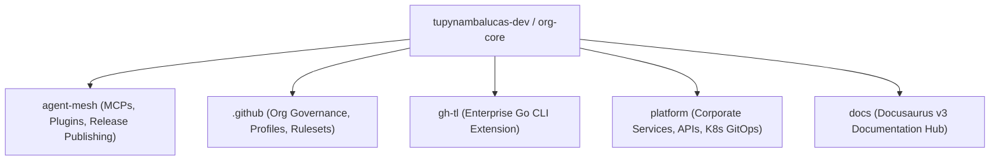
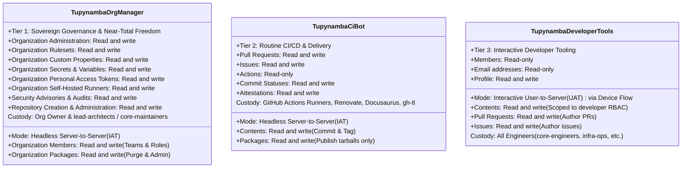
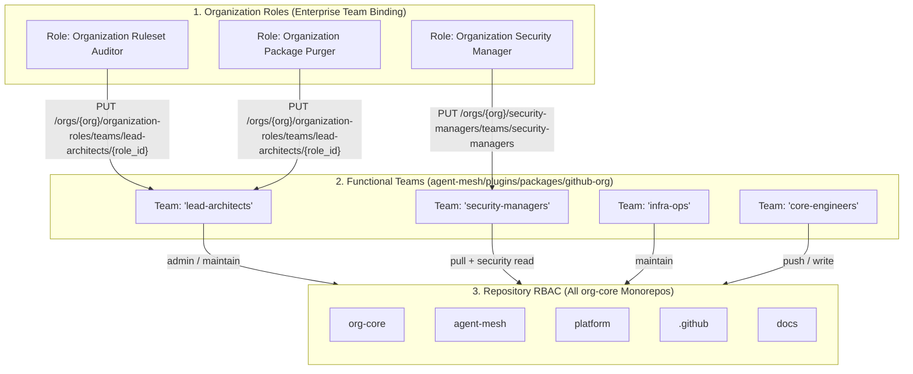
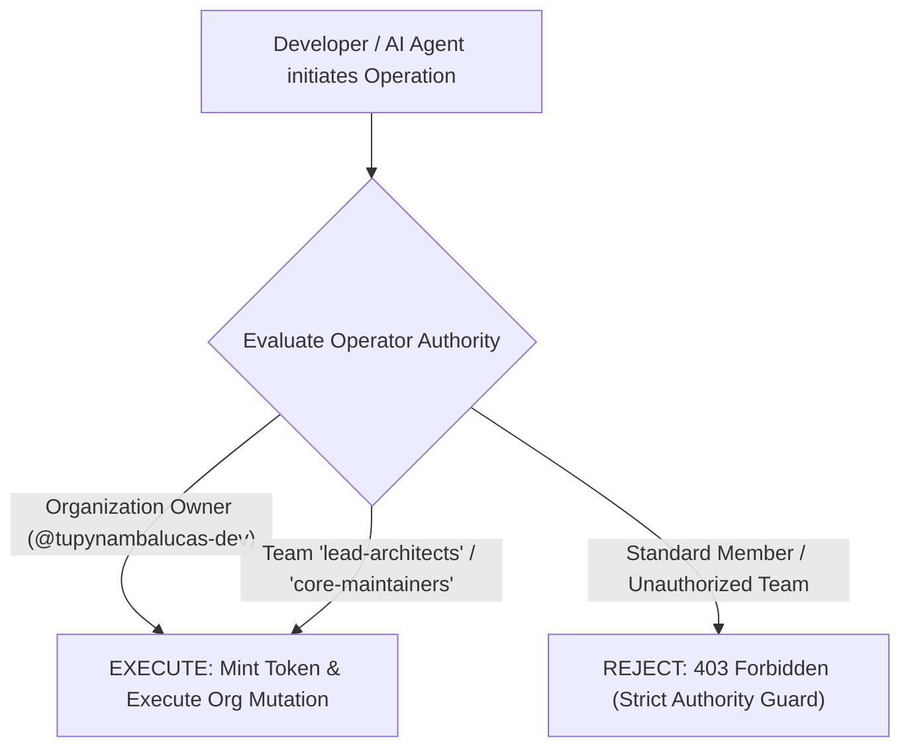
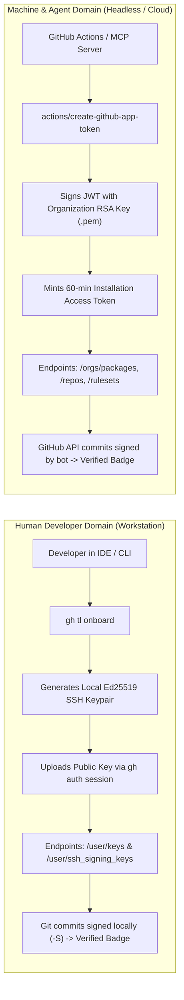

# Multi-Repository Identity Topology, Team Role Freedom & Master Permissions Catalog
**Organization**: `tupynambalucas-dev`  
**Domain**: Enterprise Identity, Governance, CI/CD Automation & Workstation Integration  
**Suite**: [GitHub App Architecture Suite](./README.md)  
**Classification**: Senior Architectural Specification & Security Matrix  
**Standard**: en-US Technical Specification (Strict Zero-Emoji Policy)

---

## 5. Multi-Repository Topology & The Three-Tier Enterprise Identity Architecture

### 5.1 Meta-Repository Analysis (`org-core`)

Our umbrella meta-repository coordinates five distinct repositories:

1. **`agent-mesh`**:
   - Compiles and publishes 17 internal packages (7 MCP servers + 10 domain plugins) to `npm.pkg.github.com`.
   - Administers package registry versions (listing, purging obsolete packages via REST API).
   - Hosts `@tupynambalucas-dev/mcp-github`, interrogating GitHub Security APIs (Secret Scanning, Dependabot), repository rulesets, and pull requests.
2. **`.github`**:
   - Manages organization-level configurations, community health files, issue/PR templates, and organization rulesets.
3. **`gh-tl`**:
   - Compiled Go CLI extension for developer onboarding and readiness verification.
   - Built and released via automated GitHub Actions (`cli/gh-extension-precompile@v2`).
4. **`platform`**:
   - Core monorepo running corporate backend services and frontend applications.
   - Executes Renovate Bot for automated dependency updates (`platform/.github/workflows/renovate.yml`).
   - Hosts Kubernetes GitOps manifests (`k8s/`).
5. **`docs`**:
   - Sovereign documentation hub powered by Docusaurus v3 and Crowdin localization actions.

### 5.2 Why the Three-Tier Model is the Enterprise Gold Standard

In top-tier engineering organizations, identity must be strictly segmented across three orthogonal axes:
1. **Executive Organizational Governance** (High privilege, strictly controlled custody).
2. **Autonomous Machine Delivery** (Headless CI/CD, limited delivery scope, zero administrative rights).
3. **Interactive Developer Tooling** (Developer persona, OAuth Device Flow, zero private key distribution).

#### App 1: `tupynambalucas-org-manager` (Tier 1 - Sovereign Governance & Near-Total Freedom)
- **Primary Persona**: `@tupynambalucas-org-manager[bot]`
- **Authentication Model**: Server-to-Server via RSA Private Key (`.pem`) -> Installation Access Token (`IAT`).
- **Scope of Action**:
  - Sovereign organization-level administration, team provisioning, and member management.
  - Pre-defining organization-level roles directly onto functional teams (`PUT /orgs/{org}/organization-roles/teams/{team_slug}/{role_id}`).
  - Designating official Security Manager teams across all repositories (`PUT /orgs/{org}/security-managers/teams/{team_slug}`).
  - Assigning pre-defined repository RBAC permissions to teams across all monorepos (`PUT /orgs/{org}/teams/{team_slug}/repos/{owner}/{repo}`).
  - Administrative deletion and cleanup of packages on `npm.pkg.github.com` via `admin-packages.yml`.
  - Managing organization secrets, variables, fine-grained PAT requests, and repository rulesets.
- **Custody & Usage**: Strictly restricted to the Organization Owner (`@tupynambalucas-dev`) and the executive engineering council (`lead-architects` / `core-maintainers`). Consumed exclusively in administrative workflow runs (`workflow_dispatch`), MCP security tools, and emergency governance runbooks.

#### App 2: `tupynambalucas-ci-bot` (Tier 2 - Operational Machine Delivery)
- **Primary Persona**: `@tupynambalucas-ci-bot[bot]`
- **Authentication Model**: Server-to-Server via RSA Private Key (`.pem`) -> Installation Access Token (`IAT`).
- **Scope of Action**:
  - Standard package publishing (`pnpm -r publish` in `publish.yml`).
  - Automated pull request creation, comments, and approvals.
  - Renovate Bot automated dependency management (`platform/.github/workflows/renovate.yml`).
  - Creating Git tags and releases for `gh-tl` binaries.
  - Crowdin translation synchronizations in `docs`.
- **Custody & Usage**: Used across routine daily CI/CD pipelines in all repositories. Possesses zero permissions to delete repositories, purge organization packages, alter members, or modify security rulesets.

#### App 3: `tupynambalucas-developer-tools` (Tier 3 - Interactive Developer Self-Service)
- **Primary Persona**: The authenticated human developer (attributed as `actor: octocat`, `programmatic_access_type: GitHub App user-to-server token`).
- **Authentication Model**: Interactive User-to-Server via **OAuth Device Flow** -> User Access Token (`UAT`) with 8-hour rotation.
- **Why Tier 3 Eliminates Developer Friction and Security Vulnerabilities**:
  1. **Zero Personal Access Tokens (PATs)**: Developers no longer create static Personal Access Tokens that leak on disk, bypass SSO, or outlive the developer's tenure.
  2. **Zero Private Key Distribution**: The App's RSA private key is never distributed to developer workstations. The CLI tool (`gh-tl`) only embeds the public `Client ID`.
  3. **Device Flow Authentication**: When running `gh tl login` or internal CLI commands, the developer is prompted to visit `https://github.com/login/device` and enter a temporary 8-character code, granting an ephemeral 8-hour token with refresh tokens.
  4. **Dual-Bounded Principle of Least Privilege**: Actions performed by Tier 3 are strictly bounded by the **intersection** of the App's permissions and the developer's assigned team RBAC. A developer cannot perform actions their team does not allow.
  5. **Instant Central Revocation**: If a developer's laptop is compromised or lost, an administrator can revoke the App's authorization with a single click in GitHub Organization settings, instantly killing all active sessions.

---

### 5.3 Near-Total Organizational Freedom: Pre-Configuring Roles Directly on Teams

A critical requirement of our organization model is that we do not want developers or administrators to manually configure permissions user-by-user or repository-by-repository. Instead, **functional teams must be first-class security principals endowed with pre-defined organization roles and pre-defined repository permissions**.

#### How `tupynambalucas-org-manager` Executes Team Role Bindings:
1. **Assigning Organization Roles to Teams**:
   - Calling `PUT /orgs/{org}/organization-roles/teams/{team_slug}/{role_id}` assigns an organization-level role directly to a team.
   - Any engineer assigned to `lead-architects` or `infra-ops` automatically inherits that organization role without individual user role grants.
2. **Assigning Security Manager Authority**:
   - Calling `PUT /orgs/{org}/security-managers/teams/{team_slug}` designates a team as an official Security Manager, granting its members read access to all private repositories and full access to Secret Scanning, Dependabot, and CodeQL alerts organization-wide.
3. **Pre-Defining Repository Permissions**:
   - Calling `PUT /orgs/{org}/teams/{team_slug}/repos/{owner}/{repo}` binds the team to repositories with pre-configured access levels (`admin`, `maintain`, `push`, `pull`).
   - New repositories provisioned by the bot automatically inherit these team mappings.

---

### 5.4 Operator Authority Guard for `@tupynambalucas-dev/plugin-github-org`

Because `tupynambalucas-org-manager` holds near-total organizational authority, access to invoke [`@tupynambalucas-dev/plugin-github-org`](../../../../agent-mesh/plugins/packages/github-org) (`github-org-operator`, `github-app-operator`, `github-ruleset-operator`, `github-security-auditor`) must be strictly governed:

#### Governing Rules:
1. **Repository/Organization Owner Exclusivity**: The organization owner (`tupynambalucas-dev`) retains sovereign, unrestricted authority to trigger all operations.
2. **Near-Maximal Administrative Teams**: In automated environments, only callers belonging to `lead-architects` or `core-maintainers` are authorized to invoke `github-org-operator`.
3. **Cryptographic Boundary**: The App private key (`.pem`) is never exposed in plain text, never saved to developer machines, and is accessible solely via Infisical Cloud Vault and GitHub Actions Organization Secrets.

---

### 5.5 Role-to-App Access Control Architecture & 5-Layer Defense-in-Depth Enforcement Model

To resolve the fundamental governance question of how access to each App is granted to specific roles while strictly preventing unauthorized teams or developers from abusing elevated privileges, the organization implements a **5-Layer Defense-in-Depth Security Model**:

```mermaid
flowchart TD
    subgraph Layer1 ["Layer 1: GitHub Web UI 'App Managers' Delegation"]
        L1["Organization Settings -> GitHub Apps -> App managers"]
        L1 --> L1A["App 1 (org-manager): Assigned ONLY to 'lead-architects' & Owner"]
        L1 --> L1B["App 2 (ci-bot): Assigned to 'lead-architects' & 'infra-ops'"]
        L1 --> L1C["App 3 (developer-tools): Managed by 'lead-architects'"]
    end

    subgraph Layer2 ["Layer 2: Cryptographic Vault Isolation (Infisical RBAC)"]
        L2["Infisical Cloud Vault Permissions"]
        L2 --> L2A["Project: platform / Environment: prod (Folder: /governance)"]
        L2A -->|Holds Org Manager .pem| L2A1["Readable ONLY by Owner & 'lead-architects'"]
        L2 --> L2B["Project: platform / Environment: staging / ci-cd"]
        L2B -->|Holds CI Bot .pem| L2B1["Readable by CI Machine Identities & 'infra-ops'"]
        L2 --> L2C["App 3: NO RSA KEY EXISTS (Public Client ID only)"]
    end

    subgraph Layer3 ["Layer 3: GitHub Organization Secrets Repository & Environment Scoping"]
        L3["GitHub Organization Secrets Policy"]
        L3 --> L3A["ORGANIZATION_APP_PRIVATE_KEY: Scoped ONLY to .github and org-core"]
        L3 --> L3B["CI_APP_PRIVATE_KEY: Scoped to all delivery monorepos"]
        L3 --> L3C["Environment Approval Gates: Production deployment requires Owner sign-off"]
    end

    subgraph Layer4 ["Layer 4: Runtime Operator Authority Guard (Plugin Hook)"]
        L4["resolve-operator-role.js in @tupynambalucas-dev/plugin-github-org"]
        L4 --> L4A{"Evaluate Caller Team Membership"}
        L4A -- "Caller in lead-architects or Owner" --> L4B["Permit Execution (privilegeLevel = level-3)"]
        L4A -- "Caller in other teams" --> L4C["Reject with 403 Forbidden: Missing Level-3 Privilege"]
    end

    subgraph Layer5 ["Layer 5: OAuth Device Flow User Access Token (UAT) Dual-Boundary"]
        L5["Developer Workstations running gh-tl login"]
        L5 --> L5A["Mints User Access Token (UAT) for App 3"]
        L5A --> L5B["Effective Rights = App 3 Scopes ∩ Developer Team RBAC"]
        L5B --> L5C["Zero Org Admin Rights physically possible via App 3"]
    end
```

#### 5.5.1 The Complete Organizational Role-to-App Access Matrix

| Functional Role / Team | Privilege Tier | Access to App 1 (`org-manager`) | Access to App 2 (`ci-bot`) | Access to App 3 (`developer-tools`) | Primary Enforcement Mechanism |
| :--- | :---: | :---: | :---: | :---: | :--- |
| **Organization Owner** (`@tupynambalucas-dev`) | **Sovereign** | **Full Direct Access** | **Full Direct Access** | **Full Direct Access** | GitHub Root Owner + Infisical Master Key. |
| **`lead-architects`** / `core-maintainers` | **Level 3 (Admin)** | **Authorized Operator** | Audit / Manage | **Authorized User** | GitHub App Manager + Infisical Prod Vault (`/governance`). |
| **`security-managers`** | **Level 2 (Security)** | Read Alerts via Security Role | No Access | **Authorized User** | Designated via `PUT /security-managers/teams/security-managers`. |
| **`infra-ops`** | **Level 2 (DevOps)** | **BLOCKED** | CI Runner Execution | **Authorized User** | GitHub App Manager on CI Bot + Infisical Staging Vault. |
| **`core-engineers`** | **Level 1 (Developer)** | **BLOCKED** | Indirect via CI Triggers | **Authorized User** | Device Flow UAT (`gh tl login`) ∩ Repository `push` RBAC. |
| **`technical-writers`** | **Level 1 (Docs)** | **BLOCKED** | Indirect via CI Triggers | **Authorized User** | Device Flow UAT (`gh tl login`) ∩ Repository `maintain` on `docs`. |
| **`creative-team`** | **Level 1 (Creative)** | **BLOCKED** | Indirect via CI Triggers | **Authorized User** | Device Flow UAT (`gh tl login`) ∩ Repository `push` on assets. |
| **`contractors`** | **Level 0 (External)** | **BLOCKED** | **BLOCKED** | **BLOCKED** (or Delegated) | Org Third-Party App Policy blocks unauthorized app installation. |

#### 5.5.2 How Unauthorized Roles Are Physically and Cryptographically Blocked:
1. **Why `core-engineers` Cannot Use `tupynambalucas-org-manager`**:
   - `tupynambalucas-org-manager` is a Server-to-Server App. It has no user login, no device flow, and no OAuth web interface.
   - To invoke it, a client MUST sign a JWT using the 2048-bit RSA Private Key (`.pem`).
   - The RSA Private Key is vaulted in Infisical under `tupynambalucas-dev-platform [prod] /governance/`.
   - The Infisical RBAC policy restricts access to `/governance/` strictly to identities bound to `lead-architects` and the Organization Owner.
   - When a core engineer runs `infisical export`, Infisical denies access with `403 Forbidden`. Without the `.pem` file, generating an Installation Access Token is cryptographically impossible.
2. **Why `infra-ops` Cannot Escalate to Org Administration**:
   - `infra-ops` engineers manage CI/CD pipelines and infrastructure, having access to Infisical `staging` and GitHub Actions secrets for daily delivery.
   - They are granted App Manager status on `tupynambalucas-ci-bot` (Tier 2), allowing them to manage CI bot credentials.
   - However, they are NOT granted App Manager on `tupynambalucas-org-manager` (Tier 1), preventing them from viewing or regenerating the Tier 1 key.
   - Furthermore, the runtime Operator Authority Guard script (`resolve-operator-role.js`) assigns `privilegeLevel = level-2` to `infra-ops`, automatically disabling `capabilities.organizationAdmin`.
3. **Why Developers Authenticating via App 3 Cannot Elevate Privileges**:
   - When developers run `gh tl login`, they authenticate through **App 3 (`tupynambalucas-developer-tools`)** via OAuth Device Flow.
   - The token issued by GitHub is a **User Access Token (UAT)**.
   - GitHub enforces: `Effective Permissions = App 3 Scopes ∩ Developer's Personal/Team Permissions`.
   - Even if App 3 declares `Contents: Read and write`, if a developer only has `pull` access to `org-core`, GitHub prevents write operations.
   - Additionally, App 3 declares **zero administrative scopes** on the organization (`organization_administration: no access`, `organization_secrets: no access`, `organization_rulesets: no access`), making privilege escalation structurally impossible.

---

### 5.6 Human Developer Identity (`gh-tl`) vs Machine Identity (GitHub Apps): The Dual-Verification Standard

The enterprise architecture enforces a strict boundary between human workstations and cloud automation:

#### Why `gh-tl` Operates Exclusively on the Developer's Personal Session:
1. **User Scope Isolation**: When a developer runs `gh tl onboard`, the goal is to register an authentication key (`POST /user/keys`) and an SSH signing key (`POST /user/ssh_signing_keys`) on that **individual human's personal GitHub account**. A GitHub App installation token represents the organization or bot, not the human user, and intentionally lacks permission to modify arbitrary personal user profiles.
2. **Native SDK Inheritance**: `gh-tl` uses `github.com/cli/go-gh/v2/pkg/api` (`api.DefaultRESTClient()`), which natively consumes the developer's existing `gh auth login` token or Tier 3 User Access Tokens.
3. **Zero Private Key Sprawl**: Distributing an organizational GitHub App's private key (`.pem`) to developer laptops is a critical security vulnerability. Developer machines must never hold bot master keys.

#### Dual-Verification Compliance Result:
- Human commits: Signed with local SSH Ed25519 keys provisioned by `gh-tl onboard`.
- Bot/Agent commits: Signed by GitHub's bot authority using GitHub App installation tokens.
- Result: 100% `Verified` green commit badges across all 5 repositories with zero credential leakage.

---

---

### 6.1 Master GitHub App Permission Matrix (Exhaustive Catalog)

The following master catalog maps all permissions supported by GitHub Apps, comparing the exact required levels across our three apps and identifying the primary consumer plugins in `agent-mesh/plugins`:

#### 6.1.1 Repository Permissions (34 Total Permissions)

| UI Permission Name | API Slug | Tier 1: `org-manager` | Tier 2: `ci-bot` | Tier 3: `developer-tools` | Primary Consumers & Purpose |
| :--- | :--- | :---: | :---: | :---: | :--- |
| **Actions** | `actions` | **Read and write** | **Read-only** | **Read-only** | `plugin-github-flow` (`github-actions-operator`), CI runner inspection, `gh-tl`. |
| **Administration** | `administration` | **Read and write** | No access | No access | `plugin-github-org` (`github-org-operator`, `github-ruleset-operator`). |
| **Agent secrets** | `agent_secrets` | No access | No access | No access | Copilot custom agent secrets (not currently utilized). |
| **Agent variables** | `agent_variables` | No access | No access | No access | Copilot custom agent variables (not currently utilized). |
| **Artifact metadata** | `artifact_metadata` | **Read and write** | **Read and write** | No access | Build artifact provenance inspection and release publishing. |
| **Attestations** | `attestations` | **Read and write** | **Read and write** | No access | Sigstore/SLSA build attestations for npm packages and `gh-tl` binaries. |
| **Checks** | `checks` | **Read and write** | **Read and write** | **Read-only** | `plugin-github-flow`, test suites, linting reports, CI checks. |
| **Code quality** | `code_quality` | No access | No access | No access | Automated code quality metrics (reserved for future linters). |
| **Code scanning alerts** | `code_scanning_alerts` | **Read and write** | No access | No access | `plugin-github-org` (`github-security-auditor`), CodeQL triage. |
| **Codespaces** | `codespaces` | No access | No access | No access | Codespace instance lifecycle management. |
| **Codespaces lifecycle admin** | `codespaces_lifecycle_admin` | No access | No access | No access | Codespace auto-shutdown policies. |
| **Codespaces metadata** | `codespaces_metadata` | No access | No access | No access | Codespace devcontainer specifications. |
| **Codespaces secrets** | `codespaces_secrets` | No access | No access | No access | Codespace repository secret injection. |
| **Commit statuses** | `statuses` | **Read and write** | **Read and write** | **Read-only** | `plugin-github-flow`, CI commit status markers, `gh-tl` status checks. |
| **Contents** | `contents` | **Read and write** | **Read and write** | **Read and write** | `plugin-github-flow`, `plugin-repo`, `gh-tl`, Git branching, commits, release tags. |
| **Copilot agent settings** | `copilot_agent_settings` | No access | No access | No access | Repository-level Copilot extension enablement. |
| **Custom properties** | `custom_properties` | **Read and write** | No access | No access | `plugin-github-org`, repository custom property definitions. |
| **Dependabot alerts** | `dependabot_alerts` | **Read and write** | No access | No access | `plugin-github-org` (`github-security-auditor`), Dependabot alert audits. |
| **Dependabot secrets** | `dependabot_secrets` | **Read and write** | No access | No access | `plugin-github-org`, private registry secrets for Dependabot. |
| **Deployments** | `deployments` | **Read and write** | **Read and write** | **Read-only** | CI deployment tracking, environment rollouts, `gh-tl`. |
| **Discussions** | `discussions` | No access | No access | **Read and write** | Developer community discussions and Q&A interactions. |
| **Environments** | `environments` | **Read and write** | **Read and write** | No access | `plugin-github-org`, deployment protection rules, reviewer requirements. |
| **Issues** | `issues` | **Read and write** | **Read and write** | **Read and write** | `plugin-github-flow`, `gh-tl`, CI issue reporting, triage workflows. |
| **Metadata** | `metadata` | **Read-only (Mandatory)** | **Read-only (Mandatory)** | **Read-only (Mandatory)** | Universal repository metadata inspection (always enforced by GitHub). |
| **Packages** | `packages` | **Read and write** | **Read and write** | No access | `agent-mesh` release publishing (Tier 2) and package purging/admin (Tier 1). |
| **Pages** | `pages` | No access | No access | No access | GitHub Pages deployment (docs hosted via sovereign platform). |
| **Pull requests** | `pull_requests` | **Read and write** | **Read and write** | **Read and write** | `plugin-github-flow`, `plugin-repo`, `gh-tl`, Renovate PR creation and review. |
| **Repository creation** | `repository_creation` | **Read and write** | No access | No access | `plugin-github-org` (`github-org-operator`), new repo provisioning. |
| **Repository security advisories** | `repository_security_advisories` | **Read and write** | No access | No access | `plugin-github-org` (`github-security-auditor`), CVE disclosure management. |
| **Repository app installation access** | `repository_app_installation_access` | **Read and write** | No access | No access | `plugin-github-org`, managing which repos an app is installed on. |
| **Secret scanning alerts** | `secret_scanning_alerts` | **Read and write** | No access | No access | `plugin-github-org` (`github-security-auditor`), token leak triage. |
| **Secrets** | `secrets` | **Read and write** | No access | No access | `plugin-github-org`, repository encrypted secret management. |
| **Variables** | `variables` | **Read and write** | No access | No access | `plugin-github-org`, repository configuration variables. |
| **Webhooks** | `webhooks` | No access | No access | No access | Inactive per Section 3 discipline. |
| **Workflows** | `workflows` | **Read and write** | **Read and write** | **Read and write** | `plugin-github-flow`, `plugin-repo`, editing `.github/workflows/` files. |
| **Merge queues** | `merge_queues` | **Read and write** | No access | No access | Manage merge queue order and locks for high-concurrency PR merges. |
| **Repository license policy** | `repository_license_policy` | **Read-only** | No access | No access | `plugin-repo` (`license-architect`), audit repository license policy and check package compliance. |
| **License compliance alerts** | `license_compliance_alerts` | **Read-only** | No access | No access | Ingest compliance alerts for third-party open source packages. |
| **Secret scanning alert dismissal requests** | `secret_scanning_alert_dismissal_requests` | **Read and write** | No access | No access | Review and triage requests to dismiss secret scanning alerts. |
| **Secret scanning push protection bypass requests** | `secret_scanning_push_protection_bypass_requests` | **Read and write** | No access | No access | `plugin-github-org` (`github-security-auditor`), triage developer bypass requests. |

#### 6.1.2 Organization Permissions (28 Total Permissions)

| UI Permission Name | API Slug | Tier 1: `org-manager` | Tier 2: `ci-bot` | Tier 3: `developer-tools` | Primary Consumers & Purpose |
| :--- | :--- | :---: | :---: | :---: | :--- |
| **Administration (Rulesets Master)** | `organization_administration` | **Read and write** | No access | No access | `plugin-github-org`, org settings, security managers, Actions policies. |
| **Agent secrets** | `organization_agent_secrets` | No access | No access | No access | Org-wide Copilot agent secrets (not currently utilized). |
| **Agent variables** | `organization_agent_variables` | No access | No access | No access | Org-wide Copilot agent variables (not currently utilized). |
| **API Insights** | `organization_api_insights` | **Read-only** | No access | No access | Rate limit usage analytics and route-by-actor statistics. |
| **Blocking users** | `organization_user_blocking` | **Read and write** | No access | No access | `plugin-github-org`, blocking abusive accounts from org repos. |
| **Campaigns** | `organization_campaigns` | No access | No access | No access | Code scanning remediation campaigns across the organization. |
| **Copilot Spaces** | `organization_copilot_spaces` | No access | No access | No access | Shared context containers for GitHub Copilot. |
| **Copilot agent settings** | `organization_copilot_agent_settings` | No access | No access | No access | Organizational Copilot agent extension settings. |
| **Copilot content exclusion** | `organization_copilot_content_exclusion` | No access | No access | No access | Excluding proprietary repos from Copilot indexing. |
| **Custom organization roles** | `organization_custom_org_roles` | **Read and write** | No access | No access | `plugin-github-org`, managing and assigning custom org roles to teams. |
| **Custom properties** | `organization_custom_properties` | **Read and write** | No access | No access | `plugin-github-org`, defining org property schemas and values. |
| **Events** | `organization_events` | **Read-only** | No access | **Read-only** | Org public event audit logs, developer activity monitoring. |
| **GitHub Copilot Business** | `organization_copilot_business` | No access | No access | No access | Managing Copilot seats for functional teams. |
| **Issue Fields** | `organization_issue_fields` | No access | No access | No access | Custom field schemas for organization projects. |
| **Issue Types** | `organization_issue_types` | No access | No access | No access | Custom organization issue types (Bug, Feature, Chore, Epic). |
| **Members** | `organization_members` | **Read and write** | No access | **Read-only** | **MASTER RBAC**: Team creation, team repo binding, org roles on teams. |
| **Organization Copilot metrics** | `organization_copilot_metrics` | No access | No access | No access | Aggregated Copilot engagement reports. |
| **Organization private registries** | `organization_private_registries` | **Read and write** | No access | No access | Configuring access to external private package registries. |
| **Organization rulesets** | `organization_rulesets` | **Read and write** | No access | No access | `plugin-github-org` (`github-ruleset-operator`), branch/tag protection. |
| **Organization security advisories** | `organization_security_advisories` | **Read and write** | No access | No access | `plugin-github-org` (`github-security-auditor`), org-wide CVE posture. |
| **Packages** | `organization_packages` | **Read and write** | No access | No access | `agent-mesh` administrative package deletion via `admin-packages.yml`. |
| **Personal access token requests** | `organization_personal_access_token_requests` | **Read and write** | No access | No access | `plugin-github-org`, approving/denying fine-grained PAT requests. |
| **Personal access tokens** | `organization_personal_access_tokens` | **Read and write** | No access | No access | `plugin-github-org`, auditing and revoking active personal tokens. |
| **Projects** | `organization_projects` | **Read and write** | No access | No access | Managing organization-level GitHub Projects (v2) boards and views. |
| **Secrets** | `organization_secrets` | **Read and write** | No access | No access | `plugin-github-org`, organization-wide encrypted secret management. |
| **Self-hosted runners** | `organization_self_hosted_runners` | **Read and write** | No access | No access | Managing org-wide runner groups and registration tokens. |
| **Variables** | `organization_variables` | **Read and write** | No access | No access | `plugin-github-org`, organization-wide configuration variables. |
| **Organization announcement banners** | `organization_announcement_banners` | **Read and write** | No access | No access | Broadcast organization-wide maintenance and operational notices. |
| **Organization bypass requests for secret scanning** | `organization_secret_scanning_bypass_requests` | **Read and write** | No access | No access | Organization-level review of push protection bypass requests. |
| **Organization dismissal requests for Dependabot** | `organization_dependabot_dismissal_requests` | **Read and write** | No access | No access | Audit and approve Dependabot vulnerability dismissal requests. |
| **Organization dismissal requests for code scanning** | `organization_code_scanning_dismissal_requests` | **Read and write** | No access | No access | Audit and approve CodeQL code scanning dismissal requests. |
| **Webhooks** | `organization_hooks` | No access | No access | No access | Inactive per Section 3 discipline. |

#### 6.1.3 Account (User) Permissions (14 Total Permissions)

| UI Permission Name | API Slug | Tier 1: `org-manager` | Tier 2: `ci-bot` | Tier 3: `developer-tools` | Primary Consumers & Purpose |
| :--- | :--- | :---: | :---: | :---: | :--- |
| **Block another user** | `block_another_user` | No access | No access | No access | User-level blocked user management. |
| **Codespaces user secrets** | `codespaces_user_secrets` | No access | No access | No access | User personal Codespaces secret management. |
| **Email addresses** | `email_addresses` | No access | No access | **Read-only** | `gh-tl`, retrieving verified primary email for local Git config. |
| **Followers** | `followers` | No access | No access | No access | Social following capabilities. |
| **Gists** | `gists` | No access | No access | No access | Personal gist authoring. |
| **Git SSH keys** | `git_ssh_keys` | No access | No access | **Read and write** | **REQUIRED FOR GH-TL**: Allows `gh tl onboard` to register developer authentication SSH keys (`POST /user/keys`). |
| **GPG keys** | `gpg_keys` | No access | No access | **Read-only** | Audit legacy GPG signing keys during workstation onboarding. |
| **Interaction limits** | `interaction_limits` | No access | No access | No access | User-level interaction restriction management. |
| **Plan** | `plan` | No access | No access | **Read-only** | `gh-tl`, querying user billing tier for CLI capability checks. |
| **Private repository invitations** | `private_repository_invitations` | No access | No access | No access | Accepting incoming collaborator invitations. |
| **Profile** | `profile` | No access | No access | **Read and write** | `gh-tl`, retrieving developer avatar, bio, and username for terminal UI (GitHub UI only provides 'No access' or 'Read and write'). |
| **SSH signing keys** | `ssh_signing_keys` | No access | No access | **Read and write** | **CRITICAL FOR GH-TL**: Programmatic registration of developer public SSH Ed25519 signing key. |
| **Starring** | `starring` | No access | No access | **Read and write** | Developer bookmarking and repository starring. |
| **Watching** | `watching` | No access | No access | **Read and write** | Developer repository notification and thread subscriptions. |

---

---

## Navigation

- [GitHub App Architecture Suite README](./README.md)
- Previous: [Core Fundamentals, Webhook Architecture & Token Taxonomy](./core-fundamentals-and-webhooks.md)
- Next: [Setup Guide - Organization Manager App (Tier 1)](./setup-org-manager-app.md)
- [Parent Architectural Plans Index](../README.md)
