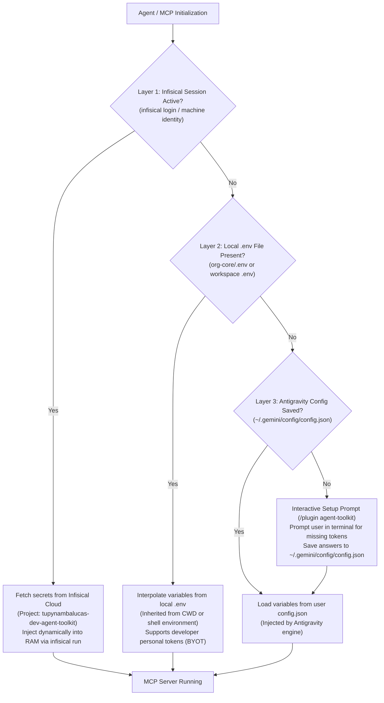
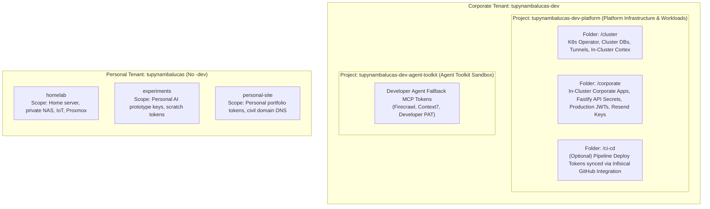

# Infisical Secret Governance & Multi-Layer Fallback Architecture: Unified Tenant Configuration, Token Segregation, and Plugin Topology

## 1. Executive Summary and Problem Statement

When operating an AI-driven, multi-repository ecosystem comprised of a meta-repository ([`org-core`](https://github.com/tupynambalucas-dev/org-core)), specialized monorepos ([`platform`](https://github.com/tupynambalucas-dev/platform), [`docs`](https://github.com/tupynambalucas-dev/docs)), and an autonomous tooling package ([`agent-toolkit`](https://github.com/tupynambalucas-dev/agent-mesh)), secret management must reconcile four fundamental operational realities:

1. **Zero-Disk Security & Centralized Enterprise Auditing**: Corporate secrets must never be committed in plaintext to version control or hardcoded in configuration files.
2. **On-Demand Developer Autonomy & Bring-Your-Own-Token (BYOT)**: External contractors or temporary collaborators may not have access to corporate Infisical projects or may wish to supply their own personal API keys for scraping and search without administrative barriers.
3. **Strict Blast Radius & Quota Domain Segregation**: Local developer agent sessions in fallback mode must NEVER share API keys or token quotas with the production/staging Kubernetes platform (`platform/hub/cortex`). A runaway loop during developer testing must not exhaust production quotas or compromise infrastructure credentials.
4. **Tenant Isolation (PF vs. PJ)**: Personal homelab and private hobby secrets must never reside in the same Infisical organization as corporate enterprise infrastructure, avoiding metadata exposure and RBAC privilege leaks to external contributors.

This document serves as the **Single Source of Truth (SSOT)** for configuring Infisical Cloud, governing the 3-tier fallback resolution, managing the `agent-toolkit` plugin variables, and executing deterministic secret provisioning across all repositories.

---

## 2. Cascading Multi-Layer Secret Resolution Architecture

To provide maximum flexibility across local development, temporary contractors, and enterprise environments, the agent runtime implements a deterministic 3-tier cascade:



### 2.1 Layer 1: Enterprise Infisical Cloud (Recommended / Zero-Disk)
- **Execution Mechanism**: The MCP servers are invoked through the Infisical CLI:
  ```bash
  pnpm dlx @infisical/cli run --env=dev -- <command>
  ```
- **Authentication Lifecycle**:
  1. The engineer executes `pnpm dlx @infisical/cli login` once.
  2. The session token is securely stored in the OS credential vault (**Windows Credential Manager** / macOS Keychain / Linux Secret Service).
  3. When an MCP subprocess starts, the CLI queries Infisical Cloud over TLS, pulls the scoped project secrets, and injects them directly into Node.js `process.env` in volatile RAM.
- **Disk Footprint**: Exactly **0 bytes** stored on disk.
- **Target Audience**: Core team members with authorized Infisical access.

### 2.2 Layer 2: Local Workspace `.env` Hierarchy (BYOT Supported)
- **Execution Mechanism**: The developer creates an uncommitted `.env` file at the root of their active workspace:
  - Meta-repository root: `org-core/.env` (protected by root `.gitignore`).
  - Monorepo standalone: `platform/.env` or `platform/k8s/.env`.
- **Inheritance Behavior**: Antigravity, Node.js, and child subprocesses automatically inherit environment variables from the current working directory (`process.cwd()`).
- **Bring-Your-Own-Token (BYOT) Advantage**: Temporary contractors without Infisical access copy `.env.example` to `.env` and supply their own personal Firecrawl, Context7, or GitHub keys. No corporate credentials are shared.

### 2.3 Layer 3: Interactive Antigravity Setup (`/plugin agent-toolkit` / Zero-Env BYOT)
- **Execution Mechanism**: Declared in [`agent-toolkit/mcp_config.json`](https://github.com/tupynambalucas-dev/agent-mesh) under `variables`:
  ```json
  "variables": [
    { "name": "TUPYNAMBA_GATEWAY_TOKEN" },
    { "name": "FIRECRAWL_API_KEY" },
    { "name": "CONTEXT7_API_KEY" },
    { "name": "GITHUB_TOKEN" },
    { "name": "INFISICAL_UNIVERSAL_AUTH_CLIENT_ID" },
    { "name": "INFISICAL_UNIVERSAL_AUTH_CLIENT_SECRET" },
    { "name": "INFISICAL_PROJECT_ID" }
  ]
  ```
- **Interactive Trigger**: If neither Layer 1 (Infisical) nor Layer 2 (local `.env`) provides the required environment variables, Antigravity flags the plugin as `needs setup`.
- **Resolution**:
  - The developer runs `/plugin agent-toolkit` in the Antigravity CLI or IDE.
  - The runtime interactively prompts for the missing values.
  - Answers are persisted locally in `~/.gemini/config/config.json`.
- **Scope**: Applied globally across all workspaces on that workstation without needing `.env` files.

---

## 3. Dual-Tenant Infisical Architecture: Corporate vs. Personal

To maintain strict compliance, zero metadata leakage, and operational simplicity without project sprawl, Infisical Cloud is partitioned into two tenant organizations, with the corporate tenant hosting exactly **two core projects**:



### 3.1 Corporate Infisical Organization (`tupynambalucas-dev`)
- **Display Name**: `tupynambalucas.dev` (or `tupynambalucas-dev`)
- **Organization Slug**: `tupynambalucas-dev`
- **Root Admin Email**: `admin@tupynambalucas.dev` (via Cloudflare Email Routing or Google Workspace)
- **Access Governance**: Strict RBAC. Contractors are invited strictly at the **Project Level** (Viewer/Contributor on `tupynambalucas-dev-agent-toolkit`). Contractors **never** receive access to `tupynambalucas-dev-platform` or organization-level admin privileges.

#### Corporate Project Directory & Security Matrix:

| Infisical Project Slug | Display Name | Internal Folder Path | Scope & Target Secrets | Target Consumers | RBAC Policy |
| :--- | :--- | :--- | :--- | :--- | :--- |
| **`tupynambalucas-dev-platform`** | `Platform Infrastructure & Workloads` | `/cluster` | `CORTEX_MCP_TOKEN`, `CLOUDFLARE_TUNNEL_TOKEN_HUB`, `GRAFANA_ADMIN_PASSWORD`, `MONGO_INITDB_ROOT_PASSWORD`, `REDIS_PASSWORD`, `FIRECRAWL_API_KEY`. | Kubernetes Operator (`InfisicalSecret` CRD in cluster). | Lead Architect / DevOps only. Zero contractor access. |
| | | `/corporate` | `FASTIFY_JWT_SECRET`, `RESEND_API_KEY`, `CORPORATE_DB_URL`, `CORPORATE_API_KEY`. | In-cluster corporate applications & APIs. | Core backend team only. |
| | | `/ci-cd` | `CLOUDFLARE_API_TOKEN`, `CLOUDFLARE_ACCOUNT_ID` (if centrally synced). | Synced to GitHub Organization Secrets via Infisical Integration. | CI/CD Machine Identity. |
| **`tupynambalucas-dev-agent-toolkit`** | `Agent Toolkit` | `/` | `FIRECRAWL_API_KEY`, `CONTEXT7_API_KEY`, `GITHUB_TOKEN`, `TUPYNAMBA_GATEWAY_TOKEN`. | Local developer agents via `infisical run` / fallback. | Internal engineers & authorized contractors. |

### 3.2 GitHub Actions Workflows vs. Infisical: Architectural Decision & Best Practices

#### A. Does `docs` GitHub Workflow Really Need Infisical?
**Verdict: No. It is an anti-pattern for static documentation.**
- The [`docs`](https://github.com/tupynambalucas-dev/docs) repository builds a static Docusaurus site and deploys it to Cloudflare Pages.
- It requires exactly two credentials: `CLOUDFLARE_API_TOKEN` and `CLOUDFLARE_ACCOUNT_ID`.
- Forcing the GitHub Actions workflow in `docs` to invoke an Infisical CLI or action adds:
  1. **Build Latency**: 15 to 30 seconds added to every commit run to spin up, authenticate, and query Infisical Cloud.
  2. **Single Point of Failure (SPOF)**: Any transient API latency or rate limit from the secret manager aborts static site publication.
  3. **Circular Bootstrap Friction**: The workflow needs an `INFISICAL_CLIENT_SECRET` saved in GitHub Secrets just to pull the Cloudflare token from Infisical.
- **The Ideal Solution for `docs`**:
  - Define `CLOUDFLARE_API_TOKEN` and `CLOUDFLARE_ACCOUNT_ID` directly in **GitHub Organization Secrets** (`github.com/organizations/tupynambalucas-dev/settings/secrets/actions`) with repository access granted to `docs` and `platform`.
  - Alternatively, connecting `docs` directly through Cloudflare Pages Git Integration deploys on push with zero credentials stored in GitHub Actions.

#### B. The Folder Strategy for CI/CD Secrets in Infisical
If the organization decides to audit and rotate all deployment credentials through Infisical as the Single Source of Truth:
- **Never create separate projects for individual workflows or repositories**.
- Instead, place them inside [`tupynambalucas-dev-platform`](https://github.com/tupynambalucas-dev/platform) under the folder `/ci-cd` (or `/github-actions`).
- **Use Infisical's Native GitHub Integration (Push Sync)**:
  - Infisical Cloud connects directly to the GitHub Organization `tupynambalucas-dev`.
  - Infisical automatically pushes secrets from `/ci-cd` to GitHub Organization Secrets.
  - In GitHub workflows, jobs consume standard `${{ secrets.CLOUDFLARE_API_TOKEN }}` with zero build latency, while Infisical retains centralized rotation and audit logs.

### 3.3 Personal Infisical Organization (`tupynambalucas`)
- **Display Name**: `Tupynambá Lucas (Personal)`
- **Organization Slug**: `tupynambalucas` (strictly without `-dev`)
- **Root Owner Email**: `tupynambalucas@gmail.com`
- **Access Governance**: Strict single-user boundary. Zero contractors, zero external associates.
- **Project Slugs**: Clean and un-prefixed (`homelab`, `experiments`, `personal-site`).

---

## 4. Step-by-Step Infisical Provisioning Runbook

### 4.1 Step 1: Corporate Organization & Project Migration
1. Log in to [Infisical Cloud](https://app.infisical.com).
2. Switch to the corporate organization and verify the **Slug** is set to `tupynambalucas-dev`.
3. **Consolidate Platform & Corporate into `tupynambalucas-dev-platform`**:
   - Locate the existing project `tupynambalucas-core-ez7a`.
   - Navigate to **Project Settings -> General**.
   - Change **Project Name** to: `Platform Infrastructure & Workloads`.
   - Change **Project Slug** to: `tupynambalucas-dev-platform`.
   - Create internal folders:
     - `/cluster`: For Kubernetes Operator, database passwords, in-cluster Cortex, and tunnel secrets.
     - `/corporate`: For in-cluster corporate microservices, Fastify JWTs, and API credentials.
     - `/ci-cd`: For GitHub Actions deployment tokens (if using Infisical GitHub Sync).
4. **Provision the Agent Toolkit Project**:
   - In the organization project switcher, click **Create New Project**.
   - Project Name: `Agent Toolkit`.
   - Project Slug: `tupynambalucas-dev-agent-toolkit`.
   - In the `dev` environment (root `/`), add the developer fallback tokens:
     - `FIRECRAWL_API_KEY`: Dedicated developer pool key from Firecrawl.
     - `CONTEXT7_API_KEY`: Dedicated developer pool key from Upstash/Context7.
     - `GITHUB_TOKEN`: Organization developer PAT (scopes: `repo`, `read:org`).
     - `TUPYNAMBA_GATEWAY_TOKEN`: Bearer token for Cortex AgentGateway.
5. **No Separate Docs or Corporate Projects**:
   - Do NOT create `tupynambalucas-dev-docs` or `tupynambalucas-dev-corporate`.
   - All in-cluster corporate workloads reside in `tupynambalucas-dev-platform` under `/corporate`.
   - All `docs` deployment secrets reside in GitHub Organization Secrets or under `/ci-cd`.

### 4.2 Step 2: Personal Organization Provisioning
1. In the top-left organization dropdown, click **Create Organization**.
2. Display Name: `Tupynambá Lucas (Personal)`.
3. Organization Slug: `tupynambalucas`.
4. Create initial isolated projects:
   - `homelab`: For domestic IoT, NAS, local VPN tokens.
   - `experiments`: For personal AI API keys.
   - `personal-site`: For personal portfolio deployment keys.
5. Leave members list with exactly **1 member** (yourself).

---

## 5. Token Segregation & Canonical Variable Naming

In accordance with 12-Factor App principles, environment variables use their canonical, vendor-native names (e.g. `FIRECRAWL_API_KEY`, `GITHUB_TOKEN`). There is **zero need** for synthetic prefixes like `PLATFORM_FIRECRAWL_API_KEY`: isolation is enforced at the **Infisical Project Boundary**, not through variable name decoration.

| Variable Name | Context / Project | Scope & Purpose | Target Infisical Project | Fallback Source Tier |
| :--- | :--- | :--- | :--- | :--- |
| **`FIRECRAWL_API_KEY`** | `agent-toolkit` (Developer) | Developer web scraping & search via `firecrawl-mcp`. Uses isolated developer pool key. | `tupynambalucas-dev-agent-toolkit` | Tier 1 (Infisical) OR Tier 2 (`.env`) OR Tier 3 (`/plugin`). |
| **`CONTEXT7_API_KEY`** | `agent-toolkit` (Developer) | Framework documentation retrieval via `@upstash/context7-mcp`. | `tupynambalucas-dev-agent-toolkit` | Tier 1 (Infisical) OR Tier 2 (`.env`) OR Tier 3 (`/plugin`). |
| **`GITHUB_TOKEN`** | `agent-toolkit` (Developer) | Repository and PR analysis via `github-mcp-server-js`. | `tupynambalucas-dev-agent-toolkit` | Developer PAT OR Tier 2 (`.env`) OR Tier 3 (`/plugin`). |
| **`TUPYNAMBA_GATEWAY_TOKEN`** | `agent-toolkit` (Developer) | Bearer authentication against Cortex AgentGateway Ingress (`https://mcp.tupynambalucas.dev/mcp`). | `tupynambalucas-dev-agent-toolkit` | Tier 1 (Infisical) OR Tier 2 (`.env`). |
| **`FIRECRAWL_API_KEY`** | `platform` (In-Cluster) | In-cluster Cortex vector embeddings and scheduled scraper workers. Uses production corporate key. | `tupynambalucas-dev-platform` (`/cluster`) | Kubernetes Secret via Infisical Operator. |
| **`GITHUB_APP_PRIVATE_KEY`** | `platform` (In-Cluster) | GitHub App credentials for CI/CD automation and deployment webhooks. | `tupynambalucas-dev-platform` (`/cluster`) | Kubernetes Secret via Infisical Operator. |
| **`CORTEX_MCP_TOKEN`** | `platform` (In-Cluster) | Internal gateway inter-service authentication token. | `tupynambalucas-dev-platform` (`/cluster`) | Kubernetes Secret (`k8s/hub/cortex`). |

---

## 6. The `agent-toolkit` Universal Plugin Architecture

The dedicated submodule repository [`agent-toolkit`](https://github.com/tupynambalucas-dev/agent-mesh) serves as the sovereign agent governance package.

### 6.1 Package Identity and Canonical Layout
- **NPM Package**: `@tupynambalucas-dev/agent-toolkit`
- **Submodule Location**: `org-core/agent-toolkit`
- **Remote Origin**: `git@github.com:tupynambalucas-dev/agent-toolkit.git`
- **Layout**:
  ```text
  agent-toolkit/
  ├── package.json             # NPM package manifest (version 0.1.0)
  ├── plugin.json              # Antigravity & Agent Plugins 1.0 manifest
  ├── .claude-plugin/
  │   └── plugin.json          # Claude Code manifest
  ├── mcp_config.json          # Strict MCP servers and variables declaration
  ├── .vscode/                 # Workspace settings, recommended extensions, tasks
  ├── .gitignore               # Ignores .env*, node_modules, logs
  ├── .env.example             # Documented template for Tier 2 BYOT
  ├── rules/
  │   └── AGENTS.md            # Consolidated enterprise governance SSOT
  └── skills/
      ├── agent-router-expert/ # Routing domain queries
      ├── markdown-expert/     # Syntax & table formatting
      ├── plugin-expert/       # Plugin authoring standards
      ├── skill-expert/        # Skill validation & progressive disclosure
      ├── secrets-expert/      # Infisical & secret hygiene
      └── github-org-manager/  # GitHub RBAC and organization governance
  ```

### 6.2 Validated `mcp_config.json` Specification
The configuration passes strict validation (`agy plugin validate agent-toolkit --strict`) with zero errors and zero warnings:

```json
{
  "mcpServers": {
    "enterprise-gateway": {
      "type": "streamable-http",
      "url": "https://mcp.tupynambalucas.dev/mcp",
      "headers": {
        "Authorization": "Bearer ${TUPYNAMBA_GATEWAY_TOKEN}"
      }
    },
    "infisical-mcp": {
      "command": "infisical",
      "args": ["run", "--env=dev", "--", "pnpm", "dlx", "@infisical/mcp"]
    },
    "github-mcp": {
      "command": "infisical",
      "args": ["run", "--env=dev", "--", "pnpm", "dlx", "@modelcontextprotocol/server-github"]
    },
    "firecrawl-mcp": {
      "command": "infisical",
      "args": ["run", "--env=dev", "--", "pnpm", "dlx", "firecrawl-mcp"]
    },
    "context7-mcp": {
      "command": "infisical",
      "args": ["run", "--env=dev", "--", "pnpm", "dlx", "@upstash/context7-mcp"]
    }
  },
  "variables": [
    { "name": "TUPYNAMBA_GATEWAY_TOKEN" },
    { "name": "FIRECRAWL_API_KEY" },
    { "name": "CONTEXT7_API_KEY" },
    { "name": "GITHUB_TOKEN" }
  ]
}
```

### 6.3 Monorepo Consumption & Approach A Discovery
- **`platform/package.json`**: `"@tupynambalucas-dev/agent-toolkit": "github:tupynambalucas-dev/agent-toolkit"`
- **`docs/package.json`**: `"@tupynambalucas-dev/agent-toolkit": "github:tupynambalucas-dev/agent-toolkit"`
- **`org-core/.agents/plugins.json`**:
  ```json
  {
    "entries": [
      { "path": "agent-toolkit" },
      { "path": "platform/.agents/plugins" }
    ]
  }
  ```
- **`org-core/.agents/skills.json`**:
  ```json
  {
    "entries": [
      { "path": "docs/.agents/skills" },
      { "path": "platform/.agents/skills" }
    ]
  }
  ```

---

## 7. Audit of Historical Backups & Zero Component Loss

An exhaustive audit of the immutable backup directory confirms zero loss of historical skills, rules, or plugins:
`C:\Users\tupyn\projects\organizations\tupynambalucas-dev\backup\agents/`

1. **`backup/agents/.github/.agents/`** (314 files): All enterprise skills (`agent-router-expert`, `markdown-expert`, `plugin-expert`, `skill-expert`, `secrets-expert`, `github-org-manager`) were safely consolidated into `agent-toolkit/skills/`.
2. **`backup/agents/platform/.agents/`** (308 files): Duplicate global skills removed; domain-specific plugin `platform/.agents/plugins/k8s-expert` preserved with valid `rules/k8s-docs.md` frontmatter triggers.
3. **`backup/agents/docs/.agents/`** (268 files): Duplicate global skills removed; domain-specific skill `docs/.agents/skills/docusaurus-expert` preserved for Diátaxis technical writing.

---

## 8. Implementation Checklist & Governance Sign-Off

- [x] Create and commit `.vscode/` configuration in `agent-toolkit`.
- [x] Declare `variables` in `agent-toolkit/mcp_config.json` for interactive Antigravity setup.
- [x] Pass `agy plugin validate agent-toolkit --strict` with 0 errors and 0 warnings.
- [x] Add root `.gitignore` and `.env.example` to `org-core` and `agent-toolkit`.
- [x] Standardize Monorepo dependencies (`package.json`) to `github:tupynambalucas-dev/agent-toolkit`.
- [ ] Rename Infisical project `tupynambalucas-core-ez7a` to `tupynambalucas-dev-platform` (Display: `Platform Infrastructure & Workloads`).
- [ ] Create internal folders `/cluster`, `/corporate`, and `/ci-cd` inside `tupynambalucas-dev-platform`.
- [ ] Create corporate Infisical project `tupynambalucas-dev-agent-toolkit` (Display: `Agent Toolkit`) and populate fallback keys.
- [ ] Configure `CLOUDFLARE_API_TOKEN` and `CLOUDFLARE_ACCOUNT_ID` directly in GitHub Organization Secrets for `docs` (or sync via Infisical GitHub Integration).
- [ ] Create personal Infisical organization `tupynambalucas` with clean projects (`homelab`, `experiments`, `personal-site`).
- [ ] Verify contractor invitation protocol (Project-level Viewer on `tupynambalucas-dev-agent-toolkit` only).
