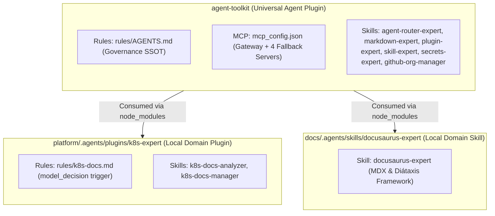

# Infisical Secret Governance & Multi-Layer Fallback Architecture: Cascading Resolution, Token Segregation, and Plugin Topology

## 1. Executive Summary and Problem Statement

When operating an AI-driven, multi-repository ecosystem comprised of a meta-repository ([`org-core`](file:///C:/Users/tupyn/projects/organizations/tupynambalucas-dev/org-core)), specialized monorepos ([`platform`](file:///C:/Users/tupyn/projects/organizations/tupynambalucas-dev/org-core/platform), [`docs`](file:///C:/Users/tupyn/projects/organizations/tupynambalucas-dev/org-core/docs)), and an autonomous tooling package ([`agent-toolkit`](file:///C:/Users/tupyn/projects/organizations/tupynambalucas-dev/org-core/agent-toolkit)), secret management must reconcile three fundamental operational realities:
1. **Zero-Disk Security & Centralized Enterprise Auditing**: Enterprise secrets must never be committed in plaintext to version control or hardcoded in configuration files.
2. **On-Demand Developer Autonomy & Bring-Your-Own-Token (BYOT)**: External contractors or temporary collaborators may not have access to corporate Infisical projects or may wish to supply their own personal API keys for scraping and search without administrative barriers.
3. **Strict Blast Radius & Billing Domain Segregation**: Local developer agent sessions in fallback mode must NEVER share API keys or token quotas with the production/staging Kubernetes platform (`platform/hub/cortex`). A runaway loop during developer testing must not exhaust production quotas or compromise infrastructure credentials.

This plan establishes the definitive **Cascading Multi-Layer Resolution Strategy**, defines the dedicated **Infisical Project Topology for Token Segregation**, presents a complete audit of the historical `.agents` backups, and catalogs every token required for offline fallback operations.

---

## 2. Cascading Multi-Layer Secret Resolution Architecture

To provide maximum flexibility across local development, temporary contractors, and enterprise environments, the agent runtime implements a deterministic 3-tier cascade:


### 2.1 Layer 1: Enterprise Infisical Cloud (Recommended / Zero-Disk)
- **Mechanism**: The MCP server is executed through `pnpm dlx @infisical/cli run --env=dev --path=/fallback -- <command>`.
- **How it Works**: The developer runs `pnpm dlx @infisical/cli login` once. The session token is stored securely in the OS vault (**Windows Credential Manager** / Keychain). During MCP execution, the CLI fetches keys over TLS and injects them directly into the Node.js `process.env` in RAM.
- **Disk Footprint**: Zero tokens stored on disk.
- **Target Audience**: Core team members with corporate Infisical access.

### 2.2 Layer 2: Local Workspace `.env` Hierarchy (BYOT Supported)
- **Mechanism**: The developer creates an uncommitted `.env` file at the root of their active workspace:
  - When working in `org-core`: `org-core/.env` (protected by root `.gitignore`).
  - When working standalone in `platform`: `platform/.env` or `platform/k8s/.env`.
- **How it Works**: Antigravity automatically inherits process environment variables from the current working directory.
- **BYOT Advantage**: Temporary contractors can place their own personal Firecrawl, Context7, or GitHub tokens in their local `.env` without requesting corporate credentials.

### 2.3 Layer 3: Interactive Antigravity Setup (`/plugin` / Zero-Env BYOT)
- **Mechanism**: Declared in [agent-toolkit/mcp_config.json](file:///C:/Users/tupyn/projects/organizations/tupynambalucas-dev/org-core/agent-toolkit/mcp_config.json) via `variables`:
  ```json
  "variables": [
    { "name": "FIRECRAWL_API_KEY" },
    { "name": "CONTEXT7_API_KEY" },
    { "name": "GITHUB_TOKEN" }
  ]
  ```
- **How it Works**: If neither Layer 1 nor Layer 2 supplies the keys, the Antigravity engine marks the plugin as `needs setup`. When the developer runs `/plugin agent-toolkit` (or initializes the workspace), Antigravity interactively prompts for the values and saves them into `~/.gemini/config/config.json`.
- **Scope**: Applied globally across all projects on that developer's workstation.

---

## 3. Token Segregation: Dedicated Infisical Project for `agent-toolkit`

### 3.1 The Risk of Shared Credentials
Sharing tokens between `platform` and `agent-toolkit` violates basic principle of least privilege (PoLP) and creates high-risk cross-contamination:
- A developer running heavy agent searches locally could consume the monthly Firecrawl request quota needed by platform ingestion pipelines.
- An accidental leak of an agent fallback token would expose the production Kubernetes cluster gateway and database secrets if the same project/keys were reused.

### 3.2 Infisical Project Topology

| Dimension | Project 1: `tupynambalucas-platform` | Project 2: `tupynambalucas-agent-toolkit` |
| :--- | :--- | :--- |
| **Infisical Project Slug** | `tupynambalucas-core-ez7a` | `tupynambalucas-agent-toolkit` *(To be created)* |
| **Scope & Purpose** | Kubernetes cluster, Cortex services, Databases, Cloudflare Tunnels, Production API. | AI Agent development, local MCP fallbacks, developer tooling. |
| **Execution Environment** | Kubernetes Pods (`k3d`, staging, prod) via `InfisicalSecret` Operator CRD. | Local developer workstations via `infisical run` or direct environment variables. |
| **Access Control (RBAC)** | Restricted strictly to Lead Architect / DevOps administrators. | Granted to all developers and temporary contractors. |
| **Blast Radius** | Critical: Compromise impacts live platform services. | Low: Compromise impacts only search/scraping dev quotas. |

---

## 4. Comprehensive Catalog of Fallback Tokens

The following table catalogs all tokens required when operating in fallback mode (Cortex AgentGateway offline), segregated by context:

| Variable Name | Context | Purpose | Fallback Source Layer |
| :--- | :--- | :--- | :--- |
| **`FIRECRAWL_API_KEY`** | `agent-toolkit` (Fallback) | Web scraping, crawl, and Google search via `firecrawl-mcp`. | Dedicated Toolkit Infisical Project OR local `.env` OR `/plugin`. |
| **`CONTEXT7_API_KEY`** | `agent-toolkit` (Fallback) | Up-to-date documentation retrieval for frameworks via `@upstash/context7-mcp`. | Dedicated Toolkit Infisical Project OR local `.env` OR `/plugin`. |
| **`GITHUB_TOKEN`** | `agent-toolkit` (Fallback) | Git repository analysis, PR inspections, issue querying via `github-mcp-server-js`. | Developer Personal Access Token (PAT) with `repo`, `read:org` scopes. |
| **`TUPYNAMBA_GATEWAY_TOKEN`** | `agent-toolkit` (Gateway) | Bearer token for authenticating against Cortex AgentGateway when online. | Infisical `/hub/cortex` (when gateway is active). |
| **`PLATFORM_FIRECRAWL_KEY`** | `platform` (Cluster) | Reserved exclusively for in-cluster Cortex vector search and automated scrapers. | Managed inside `platform/k8s/.env` and `tupynambalucas-core-ez7a`. |
| **`PLATFORM_GITHUB_APP_TOKEN`**| `platform` (Cluster) | GitHub App / Bot credentials for automated CI/CD and deployment webhooks. | Managed inside `tools/github/services/gh` and `tupynambalucas-core-ez7a`. |

---

## 5. Audit of Historical `.agents` Backups and Component Segregation

A complete verification was conducted on the immutable backup directory:
`C:\Users\tupyn\projects\organizations\tupynambalucas-dev\backup\agents/`

### 5.1 Backup Verification Matrix

| Location | Status | Preserved Items | Final Destination |
| :--- | :--- | :--- | :--- |
| **`backup/agents/.github/.agents/`** | 314 files (2.09 MB) | `cortex`, `cortex-fallback`, `github-organization`, `k8s-expert`, `secrets-expert`, `agent-router-expert`, `docusaurus-expert`, `markdown-expert`, `plugin-expert`, `skill-expert`, `scripts/`, `references/`. | Verified. Duplicate skills removed; governance `AGENTS.md` and `plans/` retained. |
| **`backup/agents/platform/.agents/`** | 308 files (2.05 MB) | Identical duplicates of `.github` skills and plugins, plus `k8s-expert`. | Verified. Purged duplicates; `k8s-expert` preserved as local domain plugin with valid trigger frontmatter. |
| **`backup/agents/docs/.agents/`** | 268 files (1.73 MB) | Duplicate global skills plus `docusaurus-expert`. | Verified. Purged global duplicates; `docusaurus-expert` preserved as local documentation skill. |

### 5.2 Plugin Architecture Summary



- **Zero Skills Lost**: All 6 enterprise skills are consolidated into `agent-toolkit/skills/`.
- **Zero Plugins Lost**:
  - `github-organization` and `secrets-expert` logic were elevated into canonical skills in `agent-toolkit`.
  - Insecure plaintext configurations from `cortex` and `cortex-fallback` were replaced by sanitized, multi-transport definitions in `agent-toolkit/mcp_config.json`.
  - `k8s-expert` remains intact in `platform`.
  - `docusaurus-expert` remains intact in `docs`.
- **Reference Assets Preserved**: Historical documentation in `references/` (`agentgateway`, `brand-identity`, `ai-concepts`) remains safely preserved in the immutable backup and can be selectively incorporated into `agent-toolkit/references/` as needed.

---

## 6. Implementation Action Plan

1. **Infisical Project Provisioning**:
   - Create a dedicated project in Infisical Cloud: `tupynambalucas-agent-toolkit`.
   - Populate development secrets: `FIRECRAWL_API_KEY`, `CONTEXT7_API_KEY`, `GITHUB_TOKEN`.
   - Update `agent-toolkit/mcp_config.json` to target project `tupynambalucas-agent-toolkit` for fallback execution.
2. **Onboarding Documentation**:
   - Provide contractors with standard onboarding guide:
     1. Option A (Enterprise): `pnpm dlx @infisical/cli login` (access to `tupynambalucas-agent-toolkit`).
     2. Option B (BYOT): Add personal tokens to `.env` or run `/plugin agent-toolkit`.
3. **Continuous Auditing**:
   - Ensure all future plugins adhere to strict validation: `agy plugin validate <dir> --strict`.
