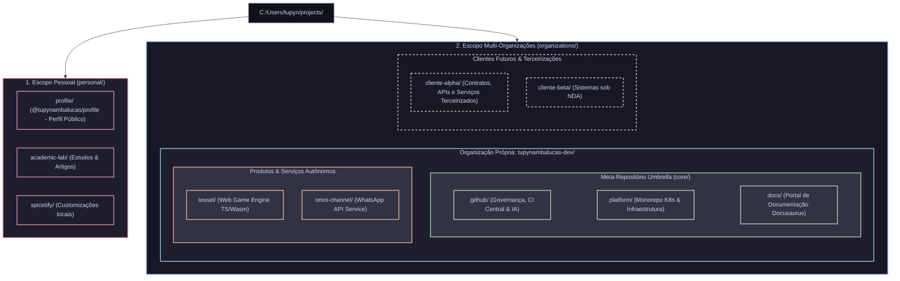

# Plano de Arquitetura: Workstation Corporativa Multi-Tenant e Ecossistema Umbrella

Este documento especifica o design arquitetural da estação de desenvolvimento (`projects/`) e a governança do ecossistema de repositórios para suportar operações **Multi-Organização**. Ele estabelece a segregação física e contextual entre o **escopo pessoal** e o **escopo de organizações** (`organizations/`), permitindo acomodar a organização própria (`tupynambalucas-dev`) e futuras organizações de clientes ou terceirizações de forma isolada e escalável.

---

## 1. Princípios Arquiteturais e Objetivos

1. **Escalabilidade Multi-Tenant (Empresa Própria & Terceirizações)**:
   - A raiz `projects/` mantém apenas dois namespaces mestres: `personal/` e `organizations/`.
   - Cada organização possui sua pasta dedicada dentro de `organizations/` (ex.: `organizations/tupynambalucas-dev/`, `organizations/cliente-x/`).
2. **Hermeticidade Jurídica, de Contratos (NDAs) e Sandboxing de IA**:
   - A Antigravity CLI (`agy`) e a IDE indexam recursivamente a partir da raiz do workspace aberto.
   - O núcleo corporativo da empresa própria (`core/`) opera unificado sem interferência de clientes ou produtos.
   - Repositórios de terceirizações e clientes operam em sandboxes estanques, sem risco de vazamento de segredos industriais ou código proprietário na janela de contexto de agentes de IA.
3. **Automação Criptográfica de Identidade Git (`includeIf:gitdir`)**:
   - Cada cliente ou empresa terceirizada exige um endereço de e-mail corporativo (ex.: `lucas@cliente.com`), chaves SSH dedicadas e perfis de assinatura específicos.
   - O Git alterna automaticamente chaves, e-mails e assinaturas com base no caminho físico da organização no disco.
4. **Soberania e Versionamento Atômico**:
   - Repositórios filhos mantêm histórico Git, branches e CI/CD autônomos.
   - O meta-repositório umbrella atua como manifesto corporativo fixando commits compatíveis.

---

## 2. Topologia Completa da Workstation (`C:/Users/tupyn/projects`)

### Visão Panorâmica de Arquitetura



---

### Árvore Estrutural por Repositório (`projects/`)

Mapeamento da raiz física delimitando os limites de cada repositório e suas responsabilidades arquiteturais:

```text
C:/Users/tupyn/projects/
│
├── personal/                                         <- Escopo de projetos pessoais (github.com/tupynambalucas/*)
│   ├── profile/                                      <- Perfil pessoal no GitHub e gerador dinâmico de cards SVG (@tupynambalucas/profile)
│   ├── academic-lab/                                 <- Estudos, pesquisas acadêmicas e protótipos experimentais
│   └── spicetify/                                    <- Extensões e temas de customização do Spotify
│
└── organizations/                                    <- Escopo corporativo e multi-tenant (Empresas & Clientes)
    │
    ├── tupynambalucas-dev/                           <- Organização própria (github.com/tupynambalucas-dev/*)
    │   ├── core/                                     <- Meta-Repositório Umbrella (Orquestra submódulos corporativos)
    │   │   ├── .github/                              <- [Submódulo] Governança institucional, CI/CD central e agentes de IA
    │   │   ├── platform/                             <- [Submódulo] Monorepo de engenharia, Kubernetes GitOps e ferramentas Hub
    │   │   └── docs/                                 <- [Submódulo] Portal oficial de documentação da empresa (Docusaurus v3)
    │   │
    │   ├── tessel/                                   <- [Standalone] Engine de jogos web em TypeScript/Wasm (Produto Independente)
    │   └── omni-channel/                             <- [Standalone] Serviço de API e mensageria para WhatsApp (Serviço Independente)
    │
    └── [cliente-futuro]/                             <- [Exemplo] Organização de cliente / terceirização (github.com/cliente/*)
        ├── repo-servico-a/                           <- Repositório do cliente sob contrato/NDA
        └── repo-servico-b/                           <- Repositório do cliente sob contrato/NDA
```

---

## 3. Detalhamento Estrutural dos Diretórios

### A. Escopo Pessoal (`C:/Users/tupyn/projects/personal/`)
Abriga exclusivamente repositórios de propriedade da conta pessoal de usuário (`tupynambalucas`):

| Diretório | Repositório Remoto | Escopo e Responsabilidade |
| :--- | :--- | :--- |
| **`profile/`** | `git@github.com:tupynambalucas/tupynambalucas.git` | Repositório especial de perfil pessoal com gerador `@tupynambalucas/profile` e branch `generated`. |
| **`academic-lab/`** | `git@github.com:tupynambalucas/academic-lab.git` | Estudos acadêmicos, simulações e documentação de pesquisa pessoal. |
| **`spicetify/`** | Repositório pessoal / fork local | Customizações de ambiente de desenvolvimento pessoal. |

### B. Escopo Multi-Organizações (`C:/Users/tupyn/projects/organizations/`)
Abriga organizações empresariais distintas, garantindo isolamento total de código, chaves e contratos:

#### 1. Organização Própria (`organizations/tupynambalucas-dev/`)
* **Meta-Repositório Umbrella (`core/`)**: O repositório `tupynambalucas-dev/tupynambalucas-dev` orquestra os 3 pilares fundamentais da empresa via Git Submodules:
  * **[`.github/`](./.github)**: Governança corporativa, fluxos centralizados de GitHub Actions, plugins e regras de IA.
  * **[`platform/`](./platform)**: Monorepo que orquestra clusters Kubernetes locais (k3d/Skaffold) e cloud, Traefik ingress, observabilidade LGTM e serviços de infraestrutura (Hub, Cortex).
  * **[`docs/`](./docs)**: Portal oficial de documentação institucional da empresa (Docusaurus v3 soberano com Crowdin).
* **Produtos Satélites Autônomos (`tessel/` e `omni-channel/`)**:
  * **`tessel/` (`tupynambalucas-dev/tessel`)**: Engine de jogos web em TypeScript/Wasm com pipeline desacoplado.
  * **`omni-channel/` (`tupynambalucas-dev/omni-channel`)**: Serviço de mensageria e API de integração com WhatsApp.

#### 2. Organizações de Clientes / Terceirizações (`organizations/<cliente>/`)
* Repositórios de terceirizados residem em subpastas isoladas com credenciais, e-mails de commit e chaves SSH exclusivas do cliente, impedindo cruzamento de dados.

---

## 4. Matriz de Sandboxing e Hermeticidade da Antigravity

A tabela abaixo define como a Antigravity CLI e a IDE se comportam em cada nível da estrutura:

| Diretório de Lançamento | Modo Antigravity | Escopo de Visibilidade da IA | Limite de Fronteira (Sandboxing) |
| :--- | :--- | :--- | :--- |
| **`organizations/tupynambalucas-dev/core`** | **Unified Core** | `.github`, `platform`, `docs` (indexação simultânea). | **Isolamento Total**: Zero visibilidade sobre produtos satélites, clientes ou perfil pessoal. |
| **`organizations/tupynambalucas-dev/tessel`** | **Sandboxed Product** | Restrito estritamente aos arquivos da game engine `tessel`. | **Hermético**: Não acessa `platform`, `docs` nem o meta-repo. |
| **`organizations/tupynambalucas-dev/omni-channel`** | **Sandboxed Service** | Restrito estritamente à API do WhatsApp. | **Hermético**: Não acessa infraestrutura nem outros produtos. |
| **`organizations/<cliente>`** | **Client Sandbox** | Restrito estritamente aos repositórios daquele cliente. | **Isolamento Legal**: Zero acesso a código ou infraestrutura de `tupynambalucas-dev`. |
| **`personal/profile`** | **Personal Profile** | Restrito ao repositório de perfil pessoal e assets SVG. | **Hermético**: Não acessa nenhuma organização corporativa. |

---

## 5. Governança Git Automatizada via `includeIf:gitdir`

Para garantir que a identidade do Git (nome, e-mail e chave de assinatura) seja aplicada deterministicamente sem intervenção manual em ambientes multi-organização, o arquivo global `~/.gitconfig` deve delegar as configurações com base no caminho físico do repositório:

### Configuração no `C:/Users/tupyn/.gitconfig`
```ini
[core]
    autocrlf = true
    fscache = true
    symlinks = false

[init]
    defaultbranch = main

# --- Delegação Condicional por Namespace Físico ---

# 1. Escopo Pessoal
[includeIf "gitdir:C:/Users/tupyn/projects/personal/"]
    path = C:/Users/tupyn/.gitconfig-personal

# 2. Escopo da Organização Própria (tupynambalucas-dev)
[includeIf "gitdir:C:/Users/tupyn/projects/organizations/tupynambalucas-dev/"]
    path = C:/Users/tupyn/.gitconfig-tupynambalucas-dev

# 3. Escopo de Clientes Terceirizados (Adicionados sob demanda por cliente)
# [includeIf "gitdir:C:/Users/tupyn/projects/organizations/cliente-x/"]
#     path = C:/Users/tupyn/.gitconfig-cliente-x
```

### Arquivo: `C:/Users/tupyn/.gitconfig-personal`
```ini
[user]
    name = tupynambalucas
    email = tupynambalucas@gmail.com
    signingkey = C:/Users/tupyn/.ssh/github_tupynambalucas_ed25519.pub

[commit]
    gpgsign = true

[gpg]
    format = ssh
```

### Arquivo: `C:/Users/tupyn/.gitconfig-tupynambalucas-dev`
```ini
[user]
    name = tupynambalucasdev
    email = contato@tupynambalucas.dev
    signingkey = C:/Users/tupyn/.ssh/github_tupynambalucas_ed25519.pub

[commit]
    gpgsign = true

[gpg]
    format = ssh
```

---

## 6. Especificação Técnica do Meta-Repositório (`core/`)

O meta-repositório localizado em `C:/Users/tupyn/projects/organizations/tupynambalucas-dev/core` orquestra o ecossistema essencial através de três manifestos principais:

### A. Manifesto de Submódulos (`.gitmodules`)
```ini
[submodule ".github"]
	path = .github
	url = git@github.com:tupynambalucas-dev/.github.git
	branch = main
	update = merge

[submodule "platform"]
	path = platform
	url = git@github.com:tupynambalucas-dev/platform.git
	branch = develop
	update = merge

[submodule "docs"]
	path = docs
	url = git@github.com:tupynambalucas-dev/docs.git
	branch = develop
	update = merge
```

### B. Workspace Multi-Root (`tupynambalucas-dev.code-workspace`)
Permite ao desenvolvedor e à Antigravity IDE abrir simultaneamente os 3 repositórios em uma janela de trabalho coesa:

```json
{
  "folders": [
    {
      "name": ".github (Org Governance)",
      "path": ".github"
    },
    {
      "name": "platform (Core Monorepo)",
      "path": "platform"
    },
    {
      "name": "docs (Documentation Hub)",
      "path": "docs"
    }
  ],
  "settings": {
    "git.autoRepositoryDetection": true,
    "files.exclude": {
      "**/.git": false
    }
  },
  "tasks": {
    "version": "2.0.0",
    "tasks": [
      {
        "label": "Antigravity CLI (Core Scope)",
        "type": "process",
        "command": "wt.exe",
        "windows": {
          "command": "wt.exe",
          "args": ["-d", "${workspaceFolder:.github (Org Governance)}\\..", "powershell.exe", "-NoExit", "-Command", "agy"]
        },
        "problemMatcher": []
      },
      {
        "label": "Submodules: Update & Sync",
        "type": "shell",
        "command": "git submodule update --remote --merge",
        "problemMatcher": []
      }
    ]
  }
}
```

---

## 7. Comparativo de Vantagens Arquiteturais

| Dimensão | Estrutura sem `organizations/` | Nova Estrutura Multi-Tenant (`organizations/`) |
| :--- | :--- | :--- |
| **Escalabilidade Corporativa** | Mistura repositórios de clientes com a empresa própria na raiz de `projects/`. | **Multi-Tenant Puro**: Cada empresa tem sua pasta em `organizations/<empresa>`. |
| **Janela de Contexto de IA** | Agentes podem indexar projetos de clientes simultaneamente à infraestrutura própria. | **Hermeticidade Rigorosa**: O agente só acessa a organização aberta no momento. |
| **Gestão de Identidade Git** | Conflito de e-mails de commit entre clientes diferentes e a empresa. | **Zero Conflito**: Cada cliente possui um bloco `includeIf:gitdir` isolado. |
| **Conformidade Legal & NDAs** | Risco de auditoria de cliente encontrar código de outros clientes no mesmo diretório. | **Total Conformidade**: Diretórios fisicamente separados facilitam auditoria e limpeza. |

---

## 8. Roteiro Passo a Passo de Execução da Migração

```powershell
# 1. Criação das pastas de namespace em C:\Users\tupyn\projects
New-Item -ItemType Directory -Path "C:\Users\tupyn\projects\personal" -Force
New-Item -ItemType Directory -Path "C:\Users\tupyn\projects\organizations" -Force
New-Item -ItemType Directory -Path "C:\Users\tupyn\projects\organizations\tupynambalucas-dev-temp" -Force

# 2. Migração dos repositórios pessoais para personal/
Move-Item -Path "C:\Users\tupyn\projects\tupynambalucas" -Destination "C:\Users\tupyn\projects\personal\profile"
Move-Item -Path "C:\Users\tupyn\projects\academic-lab" -Destination "C:\Users\tupyn\projects\personal\academic-lab"
if (Test-Path "C:\Users\tupyn\projects\spicetify") {
    Move-Item -Path "C:\Users\tupyn\projects\spicetify" -Destination "C:\Users\tupyn\projects\personal\spicetify"
}

# 3. Retirada dos produtos corporativos autônomos de dentro do meta-repo para organizations/tupynambalucas-dev/
Move-Item -Path "C:\Users\tupyn\projects\tupynambalucas-dev\tessel" -Destination "C:\Users\tupyn\projects\organizations\tupynambalucas-dev-temp\tessel"
Move-Item -Path "C:\Users\tupyn\projects\tupynambalucas-dev\omni-channel" -Destination "C:\Users\tupyn\projects\organizations\tupynambalucas-dev-temp\omni-channel"

# 4. Estruturação do meta-repositório como "core" dentro de organizations/tupynambalucas-dev/
Move-Item -Path "C:\Users\tupyn\projects\tupynambalucas-dev" -Destination "C:\Users\tupyn\projects\organizations\tupynambalucas-dev-temp\core"
Rename-Item -Path "C:\Users\tupyn\projects\organizations\tupynambalucas-dev-temp" -NewName "tupynambalucas-dev"

# 5. Correção do remote origin de Tessel para a organização oficial
git -C "C:\Users\tupyn\projects\organizations\tupynambalucas-dev\tessel" remote set-url origin git@github.com:tupynambalucas-dev/tessel.git

# 6. Limpeza do .gitignore no meta-repositório core
Set-Location -Path "C:\Users\tupyn\projects\organizations\tupynambalucas-dev\core"
git add .gitignore
git commit -S -m "chore: remove detached product folders from gitignore"
git push origin main
```
