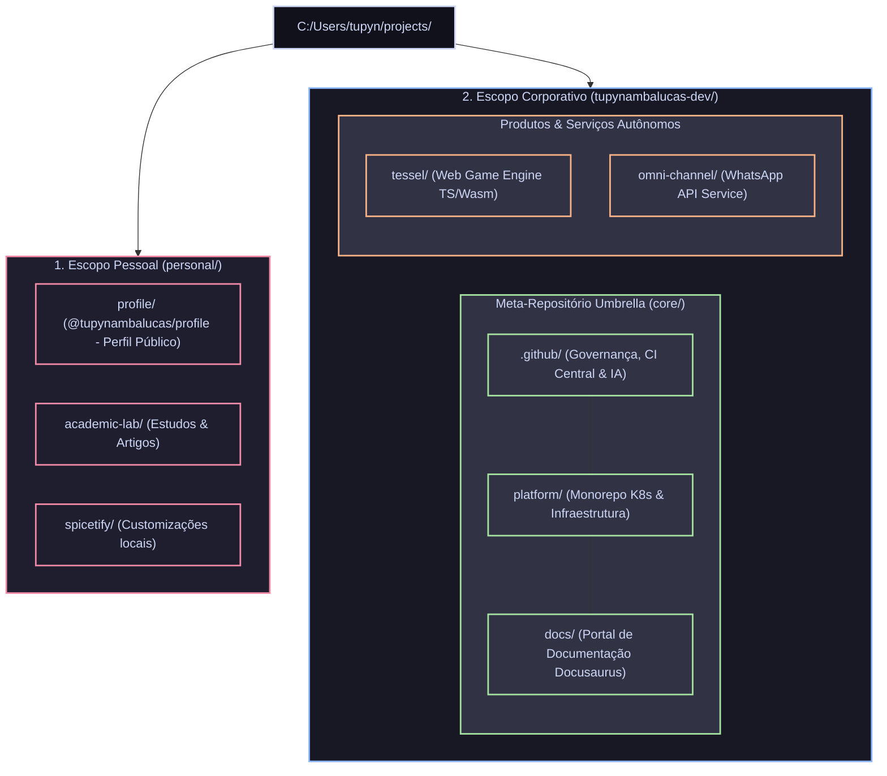

# Plano de Arquitetura: Workstation Corporativa e Ecossistema Umbrella (`tupynambalucas-dev`)

Este documento especifica o design arquitetural da estação de desenvolvimento (`projects/`) e a governança do ecossistema de repositórios da organização `tupynambalucas-dev`. Ele estabelece a segregação física e contextual entre o **escopo pessoal** e o **escopo corporativo**, além de delimitar a atuação do **Meta-Repositório Umbrella** em relação aos **produtos e serviços satélites autônomos**.

---

## 1. Princípios Arquiteturais e Objetivos

1. **Hermeticidade e Sandboxing para Agentes de IA (Antigravity CLI / IDE)**:
   - A Antigravity CLI (`agy`) e a IDE indexam toda a árvore de arquivos a partir da raiz de execução (`workspaceRoot`).
   - O núcleo corporativo de infraestrutura (`.github`, `platform`, `docs`) necessita de contexto unificado e visão cruzada.
   - Aplicações de negócio e produtos específicos (como `tessel` e `omni-channel`) devem operar em sandboxes estritas, sem acesso nem interferência cruzada com a infraestrutura corporativa.
2. **Segregação de Namespaces (Personal vs. Organization)**:
   - Espelhamento exato da taxonomia de proprietários do GitHub (`github.com/tupynambalucas/*` vs `github.com/tupynambalucas-dev/*`) no sistema de arquivos local.
3. **Automação Criptográfica de Identidade Git (`includeIf:gitdir`)**:
   - Alternância transparente de chaves SSH, e-mails de autor e assinaturas GPG/SSH com base no caminho físico do repositório, eliminando commits cruzados de identidade por erro humano.
4. **Soberania e Versionamento Atômico**:
   - Repositórios filhos mantêm histórico Git, branches, versionamento e pipelines de CI/CD autônomos.
   - O meta-repositório umbrella atua como manifesto corporativo, fixando commits compatíveis entre governança, infraestrutura e documentação.

---

## 2. Topologia Completa da Workstation (`C:/Users/tupyn/projects`)



---

## 3. Detalhamento Estrutural dos Diretórios

### A. Escopo Pessoal (`C:/Users/tupyn/projects/personal/`)
Abriga exclusivamente repositórios de propriedade da conta pessoal de usuário (`tupynambalucas`):

| Diretório | Repositório Remoto | Escopo e Responsabilidade |
| :--- | :--- | :--- |
| **`profile/`** | `git@github.com:tupynambalucas/tupynambalucas.git` | Repositório especial de perfil pessoal com gerador `@tupynambalucas/profile` e branch `generated`. |
| **`academic-lab/`** | `git@github.com:tupynambalucas/academic-lab.git` | Estudos acadêmicos, simulações e documentação de pesquisa pessoal. |
| **`spicetify/`** | Repositório pessoal / fork local | Customizações de ambiente de desenvolvimento pessoal. |

### B. Escopo Corporativo (`C:/Users/tupyn/projects/tupynambalucas-dev/`)
Abriga exclusivamente repositórios pertencentes à organização `tupynambalucas-dev`, subdivididos em **Infraestrutura Core** e **Produtos de Negócio**:

#### 1. Meta-Repositório Umbrella (`tupynambalucas-dev/core/`)
O repositório `tupynambalucas-dev/tupynambalucas-dev` orquestra os 3 pilares fundamentais da empresa via Git Submodules:
* **[`.github/`](./.github)**: Governança corporativa, fluxos centralizados de GitHub Actions, plugins e regras de IA.
* **[`platform/`](./platform)**: Monorepo que orquestra clusters Kubernetes locais (k3d/Skaffold) e cloud, Traefik ingress, observabilidade LGTM e serviços de infraestrutura (Hub, Cortex).
* **[`docs/`](./docs)**: Portal oficial de documentação institucional da empresa (Docusaurus v3 soberano com Crowdin).

#### 2. Produtos e Serviços Autônomos (`tupynambalucas-dev/tessel/` e `tupynambalucas-dev/omni-channel/`)
* **`tessel/` (`tupynambalucas-dev/tessel`)**: Engine de jogos web em TypeScript. Possui dependências pesadas de física, rendering (WebGL/WebGPU) e ciclo de release completamente desacoplado da infraestrutura corporativa.
* **`omni-channel/` (`tupynambalucas-dev/omni-channel`)**: Serviço de mensageria e API de integração com WhatsApp. Opera com regras próprias de segurança, webhooks e microserviço independente.

---

## 4. Matriz de Sandboxing e Hermeticidade da Antigravity

A tabela abaixo define como a Antigravity CLI e a IDE se comportam em cada nível da estrutura:

| Diretório de Lançamento | Modo Antigravity | Escopo de Visibilidade da IA | Limite de Fronteira (Sandboxing) |
| :--- | :--- | :--- | :--- |
| **`tupynambalucas-dev/core`** | **Unified Core** | `.github`, `platform`, `docs` (indexação simultânea). | **Isolamento Total**: Zero visibilidade sobre `tessel`, `omni-channel` ou repositórios pessoais. |
| **`tupynambalucas-dev/tessel`** | **Sandboxed Product** | Restrito estritamente aos arquivos da game engine `tessel`. | **Hermético**: Não acessa `platform`, `docs` nem o meta-repo. |
| **`tupynambalucas-dev/omni-channel`** | **Sandboxed Service** | Restrito estritamente à API do WhatsApp. | **Hermético**: Não acessa infraestrutura nem outros produtos. |
| **`personal/profile`** | **Personal Profile** | Restrito ao repositório de perfil pessoal e assets SVG. | **Hermético**: Não acessa a organização corporativa. |

---

## 5. Governança Git Automatizada via `includeIf:gitdir`

Para garantir que a identidade do Git (nome, e-mail e chave de assinatura) seja aplicada deterministicamente sem intervenção manual, o arquivo global `~/.gitconfig` deve delegar as configurações com base no caminho físico do repositório:

### Configuração no `C:/Users/tupyn/.gitconfig`
```ini
[core]
    autocrlf = true
    fscache = true
    symlinks = false

[init]
    defaultbranch = main

# --- Delegação Condicional por Namespace Físico ---

[includeIf "gitdir:C:/Users/tupyn/projects/personal/"]
    path = C:/Users/tupyn/.gitconfig-personal

[includeIf "gitdir:C:/Users/tupyn/projects/tupynambalucas-dev/"]
    path = C:/Users/tupyn/.gitconfig-org
```

### Arquivo: `C:/Users/tupyn/.gitconfig-personal`
```ini
[user]
    name = tupynambalucas
    email = tupynambalucas@gmail.com
    signingkey = C:/Users/tupyn/.ssh/github_tupynambalucas_ed25519.pub

[commit]
    gpgsign = true

[gpg]
    format = ssh
```

### Arquivo: `C:/Users/tupyn/.gitconfig-org`
```ini
[user]
    name = tupynambalucasdev
    email = contato@tupynambalucas.dev
    signingkey = C:/Users/tupyn/.ssh/github_tupynambalucas_ed25519.pub

[commit]
    gpgsign = true

[gpg]
    format = ssh
```

---

## 6. Especificação Técnica do Meta-Repositório (`core/`)

O meta-repositório localizado em `C:/Users/tupyn/projects/tupynambalucas-dev/core` orquestra o ecossistema essencial através de três manifestos principais:

### A. Manifesto de Submódulos (`.gitmodules`)
```ini
[submodule ".github"]
	path = .github
	url = git@github.com:tupynambalucas-dev/.github.git
	branch = main
	update = merge

[submodule "platform"]
	path = platform
	url = git@github.com:tupynambalucas-dev/platform.git
	branch = develop
	update = merge

[submodule "docs"]
	path = docs
	url = git@github.com:tupynambalucas-dev/docs.git
	branch = develop
	update = merge
```

### B. Workspace Multi-Root (`tupynambalucas-dev.code-workspace`)
Permite ao desenvolvedor e à Antigravity IDE abrir simultaneamente os 3 repositórios em uma janela de trabalho coesa:

```json
{
  "folders": [
    {
      "name": ".github (Org Governance)",
      "path": ".github"
    },
    {
      "name": "platform (Core Monorepo)",
      "path": "platform"
    },
    {
      "name": "docs (Documentation Hub)",
      "path": "docs"
    }
  ],
  "settings": {
    "git.autoRepositoryDetection": true,
    "files.exclude": {
      "**/.git": false
    }
  },
  "tasks": {
    "version": "2.0.0",
    "tasks": [
      {
        "label": "Antigravity CLI (Core Scope)",
        "type": "process",
        "command": "wt.exe",
        "windows": {
          "command": "wt.exe",
          "args": ["-d", "${workspaceFolder:.github (Org Governance)}\\..", "powershell.exe", "-NoExit", "-Command", "agy"]
        },
        "problemMatcher": []
      },
      {
        "label": "Submodules: Update & Sync",
        "type": "shell",
        "command": "git submodule update --remote --merge",
        "problemMatcher": []
      }
    ]
  }
}
```

---

## 7. Comparativo de Vantagens Arquiteturais

| Dimensão | Estrutura Anterior (Tudo na Raiz de `tupynambalucas-dev`) | Nova Estrutura (Namespace Segregation) |
| :--- | :--- | :--- |
| **Janela de Contexto de IA** | Poluição com código de game engine e mensageria em sessões de infraestrutura. | **Otimização Máxima**: Cada agente consome tokens apenas do seu domínio restrito. |
| **Risco de Commit Cruzado** | Alto risco de assinar commits corporativos com e-mail pessoal. | **Zero Risco**: O Git detecta automaticamente o diretório via `includeIf:gitdir`. |
| **Higiene do Root Git** | Diretórios untracked exigindo regras artificiais em `.gitignore`. | **100% Limpo**: O meta-repo possui apenas os 3 submódulos centrais declarados. |
| **Escalabilidade da Empresa** | Cada novo serviço polui a raiz do meta-repo. | **Linear**: Novos serviços são clonados em `tupynambalucas-dev/<servico>` sem afetar o core. |

---

## 8. Roteiro Passo a Passo de Execução da Migração

```powershell
# 1. Criação das pastas de namespace em C:\Users\tupyn\projects
New-Item -ItemType Directory -Path "C:\Users\tupyn\projects\personal" -Force
New-Item -ItemType Directory -Path "C:\Users\tupyn\projects\tupynambalucas-dev-temp" -Force

# 2. Migração dos repositórios pessoais para personal/
Move-Item -Path "C:\Users\tupyn\projects\tupynambalucas" -Destination "C:\Users\tupyn\projects\personal\profile"
Move-Item -Path "C:\Users\tupyn\projects\academic-lab" -Destination "C:\Users\tupyn\projects\personal\academic-lab"
if (Test-Path "C:\Users\tupyn\projects\spicetify") {
    Move-Item -Path "C:\Users\tupyn\projects\spicetify" -Destination "C:\Users\tupyn\projects\personal\spicetify"
}

# 3. Retirada dos produtos corporativos autônomos de dentro do meta-repo
Move-Item -Path "C:\Users\tupyn\projects\tupynambalucas-dev\tessel" -Destination "C:\Users\tupyn\projects\tupynambalucas-dev-temp\tessel"
Move-Item -Path "C:\Users\tupyn\projects\tupynambalucas-dev\omni-channel" -Destination "C:\Users\tupyn\projects\tupynambalucas-dev-temp\omni-channel"

# 4. Estruturação do meta-repositório como "core" dentro de tupynambalucas-dev
Move-Item -Path "C:\Users\tupyn\projects\tupynambalucas-dev" -Destination "C:\Users\tupyn\projects\tupynambalucas-dev-temp\core"
Rename-Item -Path "C:\Users\tupyn\projects\tupynambalucas-dev-temp" -NewName "tupynambalucas-dev"

# 5. Correção do remote origin de Tessel para a organização oficial
git -C "C:\Users\tupyn\projects\tupynambalucas-dev\tessel" remote set-url origin git@github.com:tupynambalucas-dev/tessel.git

# 6. Limpeza do .gitignore no meta-repositório core
Set-Location -Path "C:\Users\tupyn\projects\tupynambalucas-dev\core"
# Remove referências obsoletas a tessel e omni-channel do .gitignore e comita
git add .gitignore
git commit -S -m "chore: remove detached product folders from gitignore"
git push origin main
```
