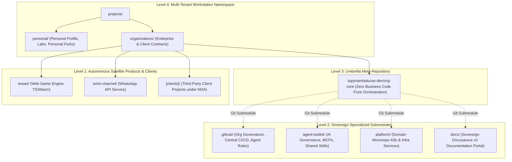

# Meta-Repository Architecture and Multi-Repo Orchestration Plan

Master architectural plan and operational framework for the `tupynambalucas-dev` umbrella
meta-repository (`org-core`), workstation multi-tenant namespace isolation, Git submodule
governance, and developer onboarding.

## Decisions

- **Umbrella Meta-Repository (`org-core`)**: Central orchestrator managing child repositories via
  native Git Submodules (`.github`, `agent-toolkit`, `platform`, `docs`). Zero business code is
  stored at the root; only orchestration configurations and master agent context files exist here.
- **Physical Namespace Segregation (`projects/`)**: Clear two-tier filesystem boundary separating
  `personal/` (`github.com/tupynambalucas/*`) and `organizations/` (`github.com/tupynambalucas-dev/*`
  and future third-party client contracts).
- **Automated Identity Switching (`includeIf:gitdir`)**: Path-based dynamic Git configuration in
  `~/.gitconfig` delegating commit author names, emails, and SSH signing keys without manual switching.
- **Cryptographic Commit Signing**: Mandatory SSH keypair Ed25519 commit signing (`commit.gpgsign = true`)
  across all organizational repositories, verified by GitHub branch rulesets.
- **Submodule Pointer Pinning**: Gitlinks recorded as deterministic `160000 commit` pointers.
  Autonomous child-to-parent synchronization via GitHub Actions `repository_dispatch` and the
  `@tupynambalucas-org-manager[bot]` GitHub App.
- **Zero-Disk Secret Management**: Infisical CLI with volatile RAM injection (`infisical run -- ...`)
  eliminating persistent plaintext `.env` credential files on disk.
- **Worktree Coexistence (`git worktree`)**: Recommended for concurrent branch development inside child
  repositories, while `git subtree` is rejected due to commit graph bloating and history pollution.

## Execution Status & Topology

The `tupynambalucas-dev` organizational architecture operates under a 4-tier federated hybrid model:

## Documents

1. [Meta-Repository Architecture](./meta-repository-architecture.md): Complete architectural
   specification for the workstation multi-tenant namespace layout (`projects/personal` vs
   `projects/organizations`), the umbrella meta-repository pattern (`org-core`), Antigravity AI
   context window sandboxing, and dynamic Git identity switching via `includeIf:gitdir`.
2. [Git Submodules & Multi-Repo Orchestration](./git-submodules-and-multi-repo-orchestration-plan.md):
   In-depth engineering analysis of Git Submodules mechanics, `gitlink` pointers, evaluation against
   `git worktree` and `git subtree`, operational hazards (Detached HEAD, pointer drift, out-of-order
   pushes, empty directories, and Hazard 5: Standalone Developer Workflow), and automated GitHub
   Actions dispatch mitigation runbooks.
3. [Developer Workstation & GitHub Onboarding](./developer-workstation-and-github-onboarding-plan.md):
   Automated workstation bootstrapping (`bootstrap-workstation.ps1` / `.sh`), pre-flight readiness gate
   evaluation (7 compliance gates GV1-GV7), team-by-team capability matrix, Ed25519 SSH commit signing,
   GitHub CLI (`gh`) standard setup, and local pre-push hook enforcement.
4. [GitHub Organization Security & Rulesets](./github-organization-security-and-rulesets-plan.md):
   Centralized security baseline, secret scanning push protection, branch protection rulesets on
   `main` and `develop` (mandatory commit signing, linear history, review threads), CODEOWNERS submodule
   governance, and automated REST provisioning runbooks.
