# Master Plan: Developer Workstation Provisioning, Automated Bootstrapping, and GitHub Governance Onboarding

This document establishes the official enterprise onboarding standard, automated workstation provisioning,
and compliance verification framework for developers across all functional teams in `tupynambalucas-dev`.
It integrates Git Submodule hardening, cryptographic SSH commit signing, physical namespace isolation,
GitHub CLI automation, and Infisical secret vault workflows.

---

## 1. Executive Overview and Architecture Principles

To reconcile developer autonomy, zero-friction setup, and enterprise multi-tenant compliance, every
developer workstation operates under four foundational architectural principles:

```mermaid
flowchart TD
    subgraph Layer1 ["Layer 1: Git Protocol & Submodule Hardening"]
        SSH["Ed25519 SSH Keypair<br/>(Signing Key & Auth Key)"]
        GitConfig["Git includeIf Namespace Isolation<br/>(Personal vs tupynambalucas-dev)"]
        SubmoduleRules["Git Submodule Safety Engine<br/>(submodule.recurse & push.recurseSubmodules)"]
        SSH --> GitConfig
        GitConfig --> SubmoduleRules
        SubmoduleRules --> SignedCommit["Cryptographically Signed Commits (-S)<br/>Verified Badge on GitHub"]
    end

    subgraph Layer2 ["Layer 2: Platform API & Operator Governance"]
        GhCli["GitHub CLI (gh auth login)<br/>(OAuth Token in OS Keyring, Protocol: SSH)"]
        OpRole["resolve-operator-role.js<br/>(Dynamic Domain & Team Enforcement)"]
        GhCli --> OpRole
        OpRole --> DevPRs["PR Creation, CODEOWNERS, CI/CD Triage"]
    end

    subgraph Layer3 ["Layer 3: Secret Management (Zero-Disk)"]
        Infisical["Infisical CLI (infisical login)<br/>(RBAC Scoped by Team & Project)"]
        Infisical --> RAMEnv["Volatile RAM Injection (infisical run)<br/>0 Plaintext Secret Files on Disk"]
    end

    subgraph Layer4 ["Layer 4: Automated Readiness Gates"]
        Bootstrapper["bootstrap-workstation.ps1 / .sh<br/>(1-Command Zero-Friction Setup)"]
        Verifier["verify-workstation.ps1 / .sh<br/>(7 Pre-Flight Compliance Gates)"]
        PrePushHook[".git/hooks/pre-push<br/>(Local Push Interceptor)"]
        Bootstrapper --> Verifier
        Verifier --> PrePushHook
    end
```



1. **Cryptographic Accountability (Zero Unsigned Commits)**: All commits and annotated tags must be
   signed using an Ed25519 SSH key (`commit.gpgsign = true`, `gpg.format = ssh`). Commits failing
   verification are rejected at push time by organization branch rulesets on `main` and `develop`.
2. **Defensive Submodule Configuration**: Workstations must enforce `submodule.recurse = true` and
   `push.recurseSubmodules = check` to prevent accidental pointer rollbacks and unpushed gitlink references.
3. **Physical Namespace Delegation (`includeIf`)**: Developers working on both personal and corporate
   repositories on the same machine keep identities strictly isolated to prevent metadata leaks.
4. **Automated Verification & Zero-Friction Bootstrapping**: Developers do not manually configure dozens of
   settings; an automated bootstrapper provisions the environment, and a pre-flight readiness gate
   guarantees compliance before any code is pushed.

---

## 2. Team Capability and Tooling Requirement Matrix

Different functional teams interact with distinct layers of the infrastructure:

| Requirement / Tool | `lead-architects` | `infra-ops` | `security-managers` | `core-engineers` | `technical-writers` | `creative-team` | `contractors` |
| :--- | :---: | :---: | :---: | :---: | :---: | :---: | :---: |
| **Ed25519 SSH Signing Key** | Mandatory | Mandatory | Mandatory | Mandatory | Mandatory | Mandatory | Mandatory (scoped) |
| **Git `includeIf` Config** | Mandatory | Mandatory | Mandatory | Mandatory | Mandatory | Mandatory | Recommended |
| **Submodule Safety Configs**| Mandatory | Mandatory | Mandatory | Mandatory | Mandatory | Optional | Mandatory |
| **`url.insteadOf` SSH Rewrite** | Mandatory | Mandatory | Mandatory | Mandatory | Mandatory | Mandatory | Mandatory |
| **GitHub CLI (`gh`)** | Mandatory | Mandatory | Recommended | Recommended | Recommended | Optional | Optional |
| **Infisical CLI (`infisical`)** | Mandatory | Mandatory | Mandatory | Mandatory | Mandatory | Optional | Forbidden |
| **Permitted Governance Domain** | Domain 1, 2, 3 | Domain 1, 2 | Domain 1, 2 | Domain 1 | Domain 1 | Domain 1 | Scoped Domain 1 |
| **Target Workspace Scope** | `org-core` | `platform` / `org-core` | All Repos | `platform` standalone / `org-core` | `docs` standalone / `org-core` | Scoped Assets | Scoped Repo |

---

## 3. Fast-Track: Automated Workstation Bootstrapping (1-Command Setup)

To eliminate manual configuration errors, newly onboarded developers execute the official
automated bootstrapper script:

### Windows (PowerShell Runbook)
```powershell
# Run the automated bootstrapper from PowerShell (Run as Administrator or Developer)
irm https://raw.githubusercontent.com/tupynambalucas-dev/org-core/main/scripts/bootstrap-workstation.ps1 | iex
```

### Linux / macOS / WSL2 (Bash Runbook)
```bash
curl -fsSL https://raw.githubusercontent.com/tupynambalucas-dev/org-core/main/scripts/bootstrap-workstation.sh | bash
```

### What the Bootstrapper Does Automatically:
1. **Checks Prerequisites**: Verifies Git (`>= 2.38.0`), GitHub CLI (`>= 2.40.0`), and Node.js (`>= 20.0.0`).
2. **Configures Global Git Defaults**:
   - `init.defaultBranch = main`
   - `submodule.recurse = true` (ensures checkout/pull recurses into submodules)
   - `push.recurseSubmodules = check` (blocks pushing superproject if child commits are unpushed)
   - `status.submoduleSummary = true` (displays commit diffs in status)
   - `diff.submodule = log` (displays commit logs in diff)
   - `fetch.recurseSubmodules = on-demand` (fetches new commits for submodules)
   - `url."git@github.com:".insteadOf = https://github.com/` (transparent SSH rewrite)
3. **Generates Ed25519 SSH Keypair**: Creates `~/.ssh/github_tupynambalucas_ed25519` if missing.
4. **Configures Namespace Isolation (`includeIf`)**: Creates `~/.gitconfig-tupynambalucas-dev` and links it in `~/.gitconfig`.
5. **Configures GitHub CLI**: Sets `git_protocol = ssh` and runs `gh auth setup-git`.
6. **Installs Local Pre-Push Hooks**: Installs the compliance checker into repository `.git/hooks/`.

---

## 4. Manual Configuration Reference (For Verification & Auditing)

If manual inspection or step-by-step configuration is required, follow the specifications below:

### 4.1 Global Git Configuration (`~/.gitconfig`)

```ini
[init]
	defaultBranch = main

[url "git@github.com:"]
	insteadOf = https://github.com/

[core]
	autocrlf = true
	fscache = true
	symlinks = false

[submodule]
	recurse = true

[push]
	recurseSubmodules = check

[status]
	submoduleSummary = true

[diff]
	submodule = log

[fetch]
	recurseSubmodules = on-demand

[gpg]
	format = ssh

[commit]
	gpgsign = true

[tag]
	gpgsign = true

# Dynamic Workspace Identity Delegation
[includeIf "gitdir:C:/Users/tupyn/projects/organizations/tupynambalucas-dev/"]
	path = C:/Users/tupyn/.gitconfig-tupynambalucas-dev

[includeIf "gitdir:C:/Users/tupyn/projects/personal/"]
	path = C:/Users/tupyn/.gitconfig-personal
```

> [!NOTE]
> On Linux, macOS, and WSL2, replace `C:/Users/...` with standard POSIX paths (e.g.
> `gitdir:~/projects/organizations/tupynambalucas-dev/` and `path = ~/.gitconfig-tupynambalucas-dev`).
> The trailing slash `/` in `gitdir:` is mandatory.

### 4.2 Corporate Git Configuration (`~/.gitconfig-tupynambalucas-dev`)

```ini
[user]
	name = tupynambalucasdev
	email = contato@tupynambalucas.dev
	signingkey = C:/Users/tupyn/.ssh/github_tupynambalucas_ed25519.pub

[commit]
	gpgsign = true

[tag]
	gpgsign = true

[gpg]
	format = ssh
```

### 4.3 SSH Key Dual-Registration on GitHub

GitHub distinguishes between **Authentication Keys** and **Signing Keys**:

1. Open [GitHub Settings -> SSH and GPG keys](https://github.com/settings/keys).
2. **Add as Authentication Key**:
   - Title: `Workstation - Personal Laptop (Auth)`
   - Key type: **Authentication Key**
   - Paste contents of `~/.ssh/github_tupynambalucas_ed25519.pub`
3. **Add as Signing Key**:
   - Click **New SSH key** again
   - Title: `Workstation - Personal Laptop (Signing)`
   - Key type: **Signing Key**
   - Paste the exact same public key contents (`github_tupynambalucas_ed25519.pub`)

> [!IMPORTANT]
> If the public key is not registered as a **Signing Key**, GitHub will accept your `git push`
> over SSH but will flag every signed commit with an **Unverified** warning badge, causing organization
> branch ruleset checks on `main` and `develop` to reject your pull requests immediately.

### 4.4 GitHub CLI Standard Configuration

Execute the following commands to standardize `gh`:

```bash
# 1. Authenticate with SSH protocol
gh auth login --git-protocol ssh --web

# 2. Standardize preferences
gh config set git_protocol ssh
gh config set prompt enabled

# 3. Setup git credential integration
gh auth setup-git
```

---

## 5. Phase 5: Enterprise Secrets Onboarding via Infisical

Internal developers authenticate to Infisical Cloud to obtain fallback and runtime API keys:

1. **Authenticate to Infisical**:
   ```bash
   pnpm dlx @infisical/cli login
   ```
2. **Verify Vault Access**:
   Core team members test secret injection into volatile RAM:
   ```bash
   pnpm dlx @infisical/cli run --project=tupynambalucas-dev-agent-toolkit --env=dev -- node -e "console.log('Infisical session active')"
   ```
3. **Zero Plaintext Rule**: Developers must never run `infisical export > .env`. Secrets must remain
   in volatile RAM during execution.

---

## 6. Pre-Flight Readiness Gate: Automated Verification Script

How do we guarantee that developers have the correct configurations installed on their machines
before they can push or cause issues?

Every developer workstation must pass the **7 Compliance Readiness Gates (GV1 to GV7)** evaluated by
`verify-workstation.ps1` (or `verify-workstation.sh`):

```bash
# Run the verification gate from org-core root
pnpm run verify:workstation
# Or run script directly:
powershell -ExecutionPolicy Bypass -File scripts/verify-workstation.ps1
```

### The 7 Compliance Gates (GV1 to GV7):

| Gate ID | Check Description | Required Value | Remediation if Failed |
| :--- | :--- | :--- | :--- |
| **GV1** | Git Binary Version | `>= 2.38.0` | `winget upgrade Git.Git` / `brew upgrade git` |
| **GV2** | SSH Signing Key Exists | `~/.ssh/github_tupynambalucas_ed25519.pub` exists | `ssh-keygen -t ed25519 ...` |
| **GV3** | Git Signing Config | `commit.gpgsign = true`, `gpg.format = ssh` | `git config --global commit.gpgsign true` |
| **GV4** | Submodule Recurse | `submodule.recurse = true` | `git config --global submodule.recurse true` |
| **GV5** | Submodule Push Check | `push.recurseSubmodules = check` or `on-demand` | `git config --global push.recurseSubmodules check` |
| **GV6** | GitHub CLI Auth Status | Logged in as authorized org member | `gh auth login` |
| **GV7** | Submodule Tree Integrity | All 4 submodules populated & on tracking branch | `git submodule update --init --recursive` |

If any gate fails, the script outputs a red failure message with the exact command to fix it and exits with code `1`.

---

## 7. Workstation Scopes: Meta-Repository vs. Standalone Child Repositories

### 7.1 Scenario A: Working Inside `org-core` (Multi-Root Workspace)

When developing across multiple components or managing infrastructure:
1. Open `org-core` in VS Code / Antigravity IDE:
   `code tupynambalucas-dev.code-workspace`
2. All 4 child submodules appear in the explorer.
3. Because `submodule.recurse = true` is configured:
   - `git pull` updates both `org-core` and all child submodules simultaneously.
   - `git checkout` switches branches seamlessly without leaving stale trees.
4. **Pointer Bumping**: When committing in a child submodule, stage the updated pointer in `org-core`:
   ```bash
   git -C platform commit -S -m "feat(api): add auth endpoint"
   git -C platform push origin develop
   git add platform
   git commit -S -m "chore(submodules): bump platform pointer"
   git push origin main
   ```

### 7.2 Scenario B: Working in Standalone Child Repositories (Independent Workspaces)

When a developer (e.g., frontend engineer or technical writer) clones ONLY `platform` or ONLY `docs`:
```bash
git clone git@github.com:tupynambalucas-dev/platform.git
cd platform
git checkout develop
```

- **How this works safely**:
  1. The developer does NOT need `org-core` locally.
  2. The developer commits and pushes directly to `platform:develop`.
  3. **Automated Synchronization**: The GitHub Actions workflow in `platform` emits a `repository_dispatch`
     event to `org-core`.
  4. The `@tupynambalucas-org-manager[bot]` in `org-core` automatically bumps the pointer in `org-core`,
     ensuring downstream meta-repo consumers are never left out of sync.

---

## 8. Local Git Pre-Push Hook Enforcement

To prevent accidental pushes of non-compliant commits before they reach GitHub ruleset rejection,
install the pre-push hook:

Create `.git/hooks/pre-push` in `org-core`:

```bash
#!/usr/bin/env bash
set -euo pipefail

echo "Running pre-flight workstation readiness gate before push..."

# 1. Check submodule recursion config
if [ "$(git config --get submodule.recurse)" != "true" ]; then
    echo "ERROR: 'submodule.recurse' must be set to 'true'. Run: git config --global submodule.recurse true"
    exit 1
fi

# 2. Check push.recurseSubmodules
RECURSE_PUSH="$(git config --get push.recurseSubmodules || true)"
if [ "$RECURSE_PUSH" != "check" ] && [ "$RECURSE_PUSH" != "on-demand" ]; then
    echo "ERROR: 'push.recurseSubmodules' must be 'check' or 'on-demand'. Run: git config --global push.recurseSubmodules check"
    exit 1
fi

# 3. Check commit signing
if [ "$(git config --get commit.gpgsign)" != "true" ]; then
    echo "ERROR: 'commit.gpgsign' must be set to 'true'. Commits must be signed."
    exit 1
fi

echo "Pre-flight checks passed successfully. Proceeding with push."
exit 0
```
