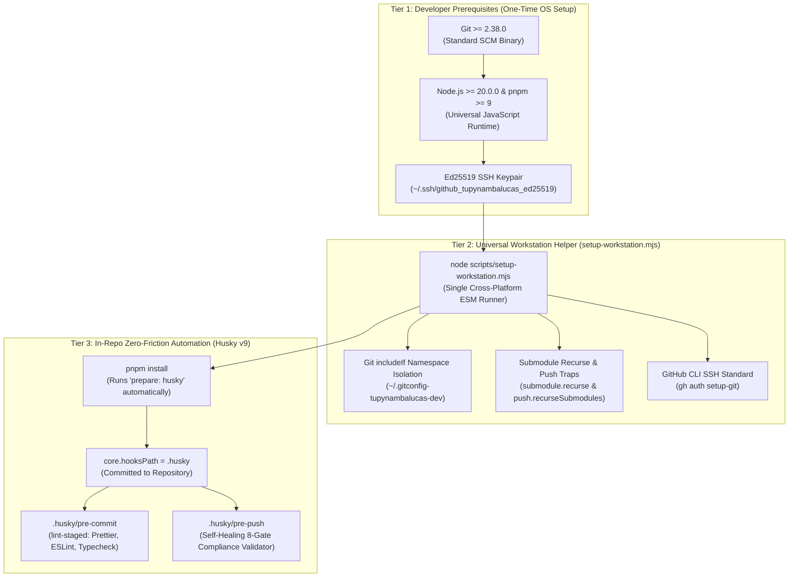

# Master Plan: Minimal Developer Workstation Onboarding, Husky Git Hooks, and Universal Governance

This document serves as the **single authoritative source of truth** for developer onboarding, workstation
provisioning, Git hooks management, and compliance verification across all repositories in `tupynambalucas-dev`.
It consolidates and supersedes all fragmented onboarding scripts, replacing OS-specific PowerShell (`.ps1`) and
Bash (`.sh`) bootstrap scripts with **zero-friction Husky v9 Git hooks**, a **universal Node.js setup helper**,
and automated self-healing pre-push guardrails.

---

## 1. Executive Architecture: The Minimal Setup Paradigm

Traditional enterprise onboarding suffers from fragile OS-specific scripts (`irm ... | iex` or `curl ... | bash`),
PowerShell execution policy restrictions, manual hook copying into `.git/hooks/`, and configuration drift. 

To achieve **minimal friction with maximum compliance**, the workstation onboarding architecture is unified
into three deterministic tiers:



### Foundational Principles:
1. **Zero OS-Specific Shell Scripts**: No divergent `.ps1` or `.sh` files to maintain. The setup helper is a
   single cross-platform Node.js script (`scripts/setup-workstation.mjs`) that executes identically on
   Windows (cmd/PowerShell), macOS, and Linux/WSL2.
2. **Zero Manual Hook Copying**: Git hooks are tracked in version control under `.husky/`. When a developer
   runs `pnpm install`, the standard `"prepare": "husky"` lifecycle script configures Git's native
   `core.hooksPath` automatically.
3. **Self-Healing Guardrails in `.husky/pre-push`**: Instead of forcing developers to remember a manual
   verification command (`verify-workstation.ps1`), the pre-push hook intercepts pushes in real time. If any
   setting is missing (e.g., unsigned commits, branch naming violations, or missing submodule recursion),
   it outputs the exact 1-line remediation command.
4. **Scope Independence**: Developers can onboard into a **Standalone Child Repository** (e.g., [`platform`](file:///C:/Users/tupyn/projects/organizations/tupynambalucas-dev/org-core/platform))
   or the **Umbrella Meta-Repository** ([`org-core`](file:///C:/Users/tupyn/projects/organizations/tupynambalucas-dev/org-core))
   with zero configuration difference.

---

## 2. Team Capability and Tooling Matrix

| Requirement / Tool | `lead-architects` | `infra-ops` | `security-managers` | `core-engineers` | `technical-writers` | `contractors` |
| :--- | :---: | :---: | :---: | :---: | :---: | :---: |
| **Node.js (>= 20) & pnpm** | Mandatory | Mandatory | Mandatory | Mandatory | Mandatory | Mandatory |
| **Ed25519 SSH Signing Key** | Mandatory | Mandatory | Mandatory | Mandatory | Mandatory | Mandatory (scoped) |
| **Universal Setup Helper** | Mandatory | Mandatory | Mandatory | Mandatory | Mandatory | Mandatory |
| **Husky v9 Git Hooks** | Mandatory | Mandatory | Mandatory | Mandatory | Mandatory | Mandatory |
| **GitHub CLI (`gh`)** | Mandatory | Mandatory | Recommended | Recommended | Recommended | Optional |
| **Infisical CLI (`infisical`)** | Mandatory | Mandatory | Mandatory | Mandatory | Optional | Forbidden |
| **Target Workspace Scope** | `org-core` / All | `platform` / `org-core` | All Repos | `platform` standalone | `docs` standalone | Scoped Repo |

---

## 3. Fast-Track: The 2-Step Minimal Onboarding Runbook

### Step 1: Workstation Prerequisite Setup (Run Once per Machine)

Ensure Node.js (`>= 20.0.0`), pnpm (`>= 9.0.0`), and Git (`>= 2.38.0`) are installed, then generate
an Ed25519 SSH keypair if you do not already possess one:

```bash
# Generate dedicated organizational SSH keypair
ssh-keygen -t ed25519 -C "contato@tupynambalucas.dev" -f ~/.ssh/github_tupynambalucas_ed25519
```

Register this key on [GitHub SSH and GPG Settings](https://github.com/settings/keys):
1. Add as **Authentication Key** (type: Authentication Key).
2. Add as **Signing Key** (type: Signing Key, using the exact same public key string).

Authenticate the GitHub CLI:
```bash
gh auth login --git-protocol ssh --web
```

### Step 2: Clone and Install (Hooks Self-Activate)

#### Path A: Standalone Child Repository (e.g., Platform / Web / API Engineer)
```bash
git clone git@github.com:tupynambalucas-dev/platform.git
cd platform

# Installs dependencies AND initializes Husky Git hooks automatically via prepare
pnpm install

# Run the cross-platform setup helper to configure Git includeIf and safety flags
node scripts/setup-workstation.mjs
```

#### Path B: Umbrella Meta-Repository (Lead Architects & Cross-System Engineers)
```bash
git clone --recursive git@github.com:tupynambalucas-dev/org-core.git
cd org-core

pnpm install
node scripts/setup-workstation.mjs
```

**That is all.** The developer workstation is now 100% compliant, hooks are active, and identity isolation
is locked in.

---

## 4. The Universal Setup Helper (`scripts/setup-workstation.mjs`)

This single, cross-platform ECMAScript module replaces all prior `.ps1` and `.sh` scripts. It uses
only Node.js standard libraries (`node:child_process`, `node:fs`, `node:path`, `node:os`) and executes
identically across Windows, macOS, and Linux:

```javascript
#!/usr/bin/env node
/**
 * setup-workstation.mjs
 * Cross-platform enterprise workstation bootstrapper for tupynambalucas-dev.
 * Replaces OS-specific bootstrap-workstation.ps1 and .sh scripts.
 */

import { execSync } from "node:child_process";
import fs from "node:fs";
import path from "node:path";
import os from "node:os";

function run(command, options = {}) {
  try {
    return execSync(command, { encoding: "utf8", stdio: options.silent ? "pipe" : "inherit" });
  } catch (err) {
    if (!options.allowFailure) {
      console.error(`[ERROR] Command failed: ${command}`);
      process.exit(1);
    }
    return null;
  }
}

console.log("=== Configuring tupynambalucas-dev Workstation Standards ===");

// 1. Configure Global Defensive Git Settings
const gitConfigs = [
  ["init.defaultBranch", "main"],
  ["submodule.recurse", "true"],
  ["push.recurseSubmodules", "check"],
  ["status.submoduleSummary", "true"],
  ["diff.submodule", "log"],
  ["fetch.recurseSubmodules", "on-demand"],
  ["url.git@github.com:.insteadOf", "https://github.com/"],
  ["core.autocrlf", os.platform() === "win32" ? "true" : "input"],
  ["core.fscache", "true"]
];

for (const [key, value] of gitConfigs) {
  run(`git config --global ${key} "${value}"`);
}
console.log("[OK] Defensive Git submodule and protocol standards applied.");

// 2. Configure Dynamic Workspace Identity Isolation (includeIf)
const homeDir = os.homedir();
const corporateGitConfigPath = path.join(homeDir, ".gitconfig-tupynambalucas-dev");
const sshKeyPath = path.join(homeDir, ".ssh", "github_tupynambalucas_ed25519.pub").replace(/\\/g, "/");

const corporateGitConfigContent = `[user]
\tname = tupynambalucasdev
\temail = contato@tupynambalucas.dev
\tsigningkey = ${sshKeyPath}

[commit]
\tgpgsign = true

[tag]
\tgpgsign = true

[gpg]
\tformat = ssh
`;

fs.writeFileSync(corporateGitConfigPath, corporateGitConfigContent, "utf8");
console.log(`[OK] Created corporate Git configuration at: ${corporateGitConfigPath}`);

// Link includeIf in global .gitconfig
const isWin = os.platform() === "win32";
const orgPathPattern = isWin
  ? "gitdir:C:/Users/tupyn/projects/organizations/tupynambalucas-dev/"
  : "gitdir:~/projects/organizations/tupynambalucas-dev/";

run(`git config --global includeIf."${orgPathPattern}".path "${corporateGitConfigPath.replace(/\\/g, "/")}"`);
console.log(`[OK] Bound organizational namespace (${orgPathPattern}) to corporate identity.`);

// 3. Configure GitHub CLI
try {
  run("gh config set git_protocol ssh", { silent: true });
  run("gh config set prompt enabled", { silent: true });
  run("gh auth setup-git", { silent: true });
  console.log("[OK] GitHub CLI configured with SSH protocol and credential helper.");
} catch {
  console.warn("[WARN] GitHub CLI ('gh') not authenticated or not installed. Run 'gh auth login'.");
}

console.log("\n=== Workstation Configuration Complete ===");
console.log("Run 'pnpm install' to ensure Husky hooks are active in your repository.");
```

---

## 5. Zero-Script Git Hooks Architecture via Husky v9

Instead of instructing developers to manually copy files into `.git/hooks/`, all hooks are managed
declaratively inside `.husky/` and versioned in Git.

### 5.1 Package Manifest Configuration (`package.json`)
The root `package.json` in [`platform`](file:///C:/Users/tupyn/projects/organizations/tupynambalucas-dev/org-core/platform/package.json)
declares the lifecycle script:

```json
{
  "scripts": {
    "prepare": "husky"
  },
  "devDependencies": {
    "husky": "catalog:",
    "lint-staged": "catalog:"
  }
}
```

When any engineer executes `pnpm install`, pnpm automatically executes `husky`, which sets:
`git config core.hooksPath .husky`

### 5.2 Pre-Commit Hook: Automated Code Quality (`.husky/pre-commit`)
Enforces formatting and linting across staged files before allowing a commit to be created:

```bash
#!/usr/bin/env sh
. "$(dirname -- "$0")/_/husky.sh"

# Run lint-staged on modified files only
pnpm exec lint-staged
```

### 5.3 Pre-Push Hook: Self-Healing 8-Gate Compliance Validator (`.husky/pre-push`)
This hook intercepts `git push` and evaluates the **8 Compliance Gates (GV1 to GV8)**.
If any gate fails, it aborts the push immediately and prints the exact remediation command:

```bash
#!/usr/bin/env sh
. "$(dirname -- "$0")/_/husky.sh"

echo "Evaluating workstation compliance gates before push..."

# GV1: Check Git Version
GIT_VERSION=$(git --version | awk '{print $3}')
# GV2 & GV3: Check Commit Signing
COMMIT_SIGN=$(git config --get commit.gpgsign || echo "false")
GPG_FORMAT=$(git config --get gpg.format || echo "")
if [ "$COMMIT_SIGN" != "true" ] || [ "$GPG_FORMAT" != "ssh" ]; then
    echo "[REJECTION: GV3] Cryptographic commit signing is mandatory." >&2
    echo "Remediation: git config --global commit.gpgsign true && git config --global gpg.format ssh" >&2
    exit 1
fi

# GV4: Check Submodule Recurse
SUB_RECURSE=$(git config --get submodule.recurse || echo "false")
if [ "$SUB_RECURSE" != "true" ]; then
    echo "[REJECTION: GV4] 'submodule.recurse' must be set to 'true'." >&2
    echo "Remediation: git config --global submodule.recurse true" >&2
    exit 1
fi

# GV5: Check Submodule Push Trap
PUSH_RECURSE=$(git config --get push.recurseSubmodules || echo "")
if [ "$PUSH_RECURSE" != "check" ] && [ "$PUSH_RECURSE" != "on-demand" ]; then
    echo "[REJECTION: GV5] 'push.recurseSubmodules' must be 'check' or 'on-demand'." >&2
    echo "Remediation: git config --global push.recurseSubmodules check" >&2
    exit 1
fi

# GV6: Check Target Branch (Block Direct Push to main)
CURRENT_BRANCH=$(git symbolic-ref --short HEAD 2>/dev/null || true)
if [ "$CURRENT_BRANCH" = "main" ]; then
    echo "[REJECTION: GV6] Direct pushes to 'main' are strictly forbidden." >&2
    echo "Remediation: Create a feature branch (git switch -c feature/<name>) and open a PR." >&2
    exit 1
fi

# GV7: Check Branch Taxonomy Standard
VALID_TAXONOMY="^(feature|hotfix|bugfix|chore|refactor|docs)\/[a-z0-9._-]+$"
if ! echo "$CURRENT_BRANCH" | grep -Eq "$VALID_TAXONOMY"; then
    echo "[REJECTION: GV7] Branch name '$CURRENT_BRANCH' violates organizational taxonomy." >&2
    echo "Allowed prefixes: feature/, hotfix/, bugfix/, chore/, refactor/, docs/" >&2
    exit 1
fi

# GV8: Submodule Tree Integrity (When operating inside org-core)
if [ -f ".gitmodules" ]; then
    git submodule status | while read -r status sha name branch; do
        case "$status" in
            U*)
                echo "[REJECTION: GV8] Unmerged submodule conflict in $name." >&2
                exit 1
                ;;
        esac
    done
fi

echo "[SUCCESS] All compliance gates passed. Proceeding with push."
exit 0
```

---

## 6. The 8 Compliance Gates (Summary Reference)

| Gate ID | Check Description | Enforced By | Automatic Remediation Command |
| :--- | :--- | :--- | :--- |
| **GV1** | Git Version (`>= 2.38.0`) | `.husky/pre-push` | `winget upgrade Git.Git` / `brew upgrade git` |
| **GV2** | Ed25519 SSH Key Registered | Setup Helper | `ssh-keygen -t ed25519 -f ~/.ssh/github_tupynambalucas_ed25519` |
| **GV3** | Cryptographic SSH Signing | `.husky/pre-push` | `git config --global commit.gpgsign true && git config --global gpg.format ssh` |
| **GV4** | Submodule Recursion (`submodule.recurse = true`) | `.husky/pre-push` | `git config --global submodule.recurse true` |
| **GV5** | Submodule Push Check (`push.recurseSubmodules = check`) | `.husky/pre-push` | `git config --global push.recurseSubmodules check` |
| **GV6** | Block Direct Push to `main` | `.husky/pre-push` & Ruleset | `git switch -c feature/<description>` |
| **GV7** | Branch Naming Taxonomy Standard | `.husky/pre-push` & Ruleset | Use prefix: `feature/`, `hotfix/`, `bugfix/`, `chore/`, `refactor/`, `docs/` |
| **GV8** | Submodule Tree Integrity | `.husky/pre-push` | `git submodule update --init --recursive` |

---

## 7. Developer Daily Workflows (Quick Reference)

### 7.1 Developing in a Standalone Child Repository
```bash
# 1. Switch to main and pull latest changes
git switch main
git pull

# 2. Branch using standardized taxonomy
git switch -c feature/corporate-api-telemetry

# 3. Author code and declare semantic version change
pnpm corporate:typecheck
pnpm changeset

# 4. Commit (Husky validates formatting; Git signs with SSH key)
git add .
git commit -S -m "feat(api): add telemetry health check endpoint"

# 5. Push (Husky validates branch taxonomy and signing before transmission)
git push -u origin feature/corporate-api-telemetry
gh pr create --web
```

### 7.2 Cross-Repository Development in `org-core`
```bash
# 1. Update superproject and all 4 child submodules in one command
cd org-core
git pull --recurse-submodules

# 2. Work inside any submodule directory
cd platform
git switch -c feature/shared-auth-guard
# ... author, pnpm changeset, commit with -S, push branch ...

# 3. Pull updated submodule pointer into org-core once PR merges remotely
cd /path/to/org-core
git submodule update --remote --merge platform
git add platform
git commit -S -m "chore(submodules): bump platform to latest main"
git push origin main
```

---

## 8. Cross-Document Architectural References

This master plan interfaces directly with the other specialized plans in this directory:
- [Meta-Repository Architecture](./meta-repository-architecture.md): Specifies the multi-tenant namespace filesystem layout (`projects/personal` vs `projects/organizations`) and dynamic identity switching.
- [Git Submodules & Multi-Repo Orchestration](./git-submodules-and-multi-repo-orchestration-plan.md): In-depth mechanics of `160000 commit` gitlink pointers, hazard mitigations, and `repository_dispatch` automation.
- [GitHub Organization Security & Rulesets](./github-organization-security-and-rulesets-plan.md): Declarative ruleset definitions (`enforce-branch-naming-standard` and `enterprise-production-main`) enforcing remote protection.
- [GitHub Flow & Automated Changesets](./github-flow-and-changesets-branch-governance-plan.md): Full lifecycle specification for `@changesets/cli`, ephemeral preview deployments, and PR testing gates.
