# Master Plan: Minimal Developer Workstation Onboarding, Husky Git Hooks, and Universal Governance

This document serves as the **single authoritative source of truth** for developer onboarding, workstation
provisioning, Git hooks management, and compliance verification across all repositories in `tupynambalucas-dev`.
It consolidates and supersedes all fragmented onboarding scripts, replacing OS-specific PowerShell (`.ps1`) and
Bash (`.sh`) bootstrap scripts with **zero-friction Husky v9 Git hooks**, a **universal Node.js setup helper**,
**URL-based Git conditional configuration (`hasconfig:remote.*.url`)**, and automated self-healing pre-push guardrails.

---

## 1. Executive Architecture: Enterprise Best Practices & The Out-of-the-Box Paradigm

Senior platform engineers and enterprise organizations (e.g., Google, Stripe, Microsoft, Shopify) reject
fragile, path-dependent workstation scripts. If an onboarding guide instructs developers to clone into a
hardcoded directory path (such as `C:/Users/tupyn/projects/organizations/...`), it immediately breaks for
any developer who clones to their Desktop, `~/code`, `D:\workspace`, or `/tmp`.

Furthermore, forcing all developers to commit under a single shared mailbox (such as `contato@tupynambalucas.dev`)
violates foundational security principles:
1. **Destruction of Non-Repudiation (Auditability)**: If all developers commit as `contato@...`, `git blame`
   and security audit logs attribute all changes to the founder/administrative account, making it impossible
   to identify who introduced a bug, altered a contract, or leaked a token.
2. **Failure of GitHub Cryptographic Verification**: GitHub awards the **`Verified`** badge only when the
   commit email (`git config user.email`) matches an email address registered and verified on the GitHub account
   owning the signing SSH key. If developer "Jane" signs with her personal SSH key but stamps the commit with
   `contato@tupynambalucas.dev`, GitHub flags the commit as **`Unverified`**, and our organization branch rulesets
   reject the push.

To achieve **true enterprise-grade out-of-the-box onboarding**, the architecture implements four pillars:

```mermaid
flowchart TD
    subgraph Pillar1 ["Pillar 1: Location-Independent Remote Matching (Git 2.36+)"]
        RemoteRule["includeIf hasconfig:remote.*.url<br/>(Matches git@github.com:tupynambalucas-dev/**)"]
        AnyLocation["Developer Clones Anywhere<br/>(Desktop, ~/dev, D:\workspace, /tmp)"]
        AnyLocation --> RemoteRule
        RemoteRule --> AutoConfig["Applies Corporate Config Automatically"]
    end

    subgraph Pillar2 ["Pillar 2: Cryptographic Individual Identity Policy"]
        DevUser["Developer Individual Identity<br/>(Nominal Email or GitHub No-Reply)"]
        DevSSH["Developer Personal Ed25519 Signing Key<br/>(Added to their own GitHub profile)"]
        DevUser --> VerifiedBadge["GitHub Verified Badge<br/>(Matches Signer + Verified Email)"]
        DevSSH --> VerifiedBadge
    end

    subgraph Pillar3 ["Pillar 3: In-Repo Zero-Script Automation (Husky v9)"]
        PnpmInstall["pnpm install<br/>(Auto-triggers 'prepare: husky')"]
        HuskyPath["core.hooksPath = .husky<br/>(Tracks inside Git repo)"]
        PrePush[".husky/pre-push<br/>(Self-Healing 8-Gate Compliance Validator)"]
        PnpmInstall --> HuskyPath
        HuskyPath --> PrePush
    end

    subgraph Pillar4 ["Pillar 4: Cloud & Container Environments (Horizon)"]
        DevContainer[".devcontainer / GitHub Codespaces<br/>(1-Click Zero-Friction Hermetic Environment)"]
    end
```



---

## 2. Organization Email and Commit Identity Policy

To guarantee strict compliance with GitHub verified commit standards and enterprise non-repudiation:

### 2.1 The Administrative Email (`contato@tupynambalucas.dev`)
- **Strict Role**: The `contato@tupynambalucas.dev` address is the **Organization Root Administrative Contact**.
- **Prohibition**: Human developers, external contractors, and team members **must NEVER author commits** using
  `contato@tupynambalucas.dev`. Commits from developers using this address will be flagged for security audit review.

### 2.2 Developer Commit Email Standards (Approved Options)

Every developer must configure their commit identity using one of the two authorized options:

#### Option A: Nominal Corporate Email (Preferred for Core Employees)
- Format: `<firstname>.<lastname>@tupynambalucas.dev` or `<username>@tupynambalucas.dev` (e.g., `jane.doe@tupynambalucas.dev`).
- Requirement: The developer must add and verify this email address in their GitHub account under
  [GitHub Settings -> Emails](https://github.com/settings/emails).

#### Option B: GitHub Privacy-Preserving No-Reply Email (Preferred for Contractors / Personal Accounts)
- Format: `<id>+<username>@users.noreply.github.com` (e.g., `12345678+janedoe@users.noreply.github.com`).
- Requirement: Retrieved directly from [GitHub Settings -> Emails -> Keep my email addresses private](https://github.com/settings/emails).
- Benefit: Guarantees 100% verified commit badges without exposing personal email addresses publicly in git logs.

---

## 3. Location-Agnostic Git Configuration via `hasconfig:remote.*.url`

In Git 2.36+, the brittle path-dependent `gitdir:` directive is superseded by **`hasconfig:remote.*.url`**.
This matches based on the repository's upstream remote URL rather than the local filesystem path.

### How it Works in Practice
Whether a developer clones to `C:\Users\jane\Desktop\platform`, `/home/jane/code/platform`, or `D:\repos\platform`,
Git inspects `remote.origin.url`. If the remote belongs to `tupynambalucas-dev`, Git automatically applies the
corporate configuration without requiring a fixed directory hierarchy:

```ini
# ~/.gitconfig (Global configuration on developer workstation)

[url "git@github.com:"]
	insteadOf = https://github.com/

[submodule]
	recurse = true

[push]
	recurseSubmodules = check

[status]
	submoduleSummary = true

[diff]
	submodule = log

[fetch]
	recurseSubmodules = on-demand

# Dynamic Remote URL Matching (Location-Independent)
[includeIf "hasconfig:remote.*.url:git@github.com:tupynambalucas-dev/**"]
	path = ~/.gitconfig-tupynambalucas-dev

[includeIf "hasconfig:remote.*.url:https://github.com/tupynambalucas-dev/**"]
	path = ~/.gitconfig-tupynambalucas-dev
```

And inside `~/.gitconfig-tupynambalucas-dev`:
```ini
# ~/.gitconfig-tupynambalucas-dev (Applied dynamically to all org repositories)
[user]
	name = Jane Doe
	email = jane.doe@tupynambalucas.dev
	signingkey = ~/.ssh/github_tupynambalucas_ed25519.pub

[commit]
	gpgsign = true

[tag]
	gpgsign = true

[gpg]
	format = ssh
```

---

## 4. Fast-Track: The 2-Step Out-of-the-Box Onboarding Runbook

### Step 1: Workstation Prerequisite Setup (Run Once per Machine)

1. Ensure **Node.js** (`>= 20.0.0`), **pnpm** (`>= 9.0.0`), and **Git** (`>= 2.38.0`) are installed.
2. Authenticate the GitHub CLI:
   ```bash
   gh auth login --git-protocol ssh --web
   ```
3. Generate an Ed25519 SSH keypair (using your verified GitHub email):
   ```bash
   ssh-keygen -t ed25519 -C "your-email@tupynambalucas.dev" -f ~/.ssh/github_tupynambalucas_ed25519
   ```
4. Register the key on [GitHub SSH Keys](https://github.com/settings/keys):
   - Add as **Authentication Key**.
   - Add as **Signing Key** (using the exact same public key string).

### Step 2: Clone and Install (Hooks Self-Activate)

The developer clones to **any location of their choice** (Desktop, workspace, etc.):

#### Path A: Standalone Child Repository (e.g., Platform / Web / API Engineer)
```bash
git clone git@github.com:tupynambalucas-dev/platform.git
cd platform

# Installs dependencies AND initializes Husky Git hooks automatically via prepare
pnpm install

# Run the universal setup helper (detects identity from gh CLI and configures hasconfig rules)
node scripts/setup-workstation.mjs
```

#### Path B: Umbrella Meta-Repository (Lead Architects & Cross-System Engineers)
```bash
git clone --recursive git@github.com:tupynambalucas-dev/org-core.git
cd org-core

pnpm install
node scripts/setup-workstation.mjs
```

---

## 5. The Universal Setup Helper (`scripts/setup-workstation.mjs`)

This cross-platform Node.js script automatically queries the developer's identity via `gh api user`,
writes their specific `~/.gitconfig-tupynambalucas-dev`, and binds the URL-based `hasconfig` rules:

```javascript
#!/usr/bin/env node
/**
 * setup-workstation.mjs
 * Universal enterprise workstation bootstrapper for tupynambalucas-dev.
 * Cross-platform (Windows, macOS, Linux). Requires zero shell dependencies.
 */

import { execSync } from "node:child_process";
import fs from "node:fs";
import path from "node:path";
import os from "node:os";

function run(cmd, opts = {}) {
  try {
    return execSync(cmd, { encoding: "utf8", stdio: opts.silent ? "pipe" : "inherit" });
  } catch (err) {
    if (!opts.allowFailure) {
      console.error(`[ERROR] Command failed: ${cmd}`);
      process.exit(1);
    }
    return null;
  }
}

function query(cmd) {
  try {
    return execSync(cmd, { encoding: "utf8", stdio: "pipe" }).trim();
  } catch {
    return "";
  }
}

console.log("=== Configuring tupynambalucas-dev Enterprise Workstation Standards ===");

// 1. Detect Developer Identity from GitHub CLI
let ghUser = query("gh api user --jq .login");
let ghName = query("gh api user --jq .name") || ghUser;
let ghEmail = query("gh api user/public_emails --jq '.[0].email'") || query("gh api user --jq .email");

if (!ghUser) {
  console.warn("[WARN] GitHub CLI ('gh') is not authenticated. Run 'gh auth login --git-protocol ssh' first.");
  ghUser = os.userInfo().username;
  ghName = ghUser;
  ghEmail = `${ghUser}@users.noreply.github.com`;
}

console.log(`[INFO] Detected Developer Persona: ${ghName} (@${ghUser}) <${ghEmail}>`);

// 2. Configure Global Defensive Git Settings
const gitConfigs = [
  ["init.defaultBranch", "main"],
  ["submodule.recurse", "true"],
  ["push.recurseSubmodules", "check"],
  ["status.submoduleSummary", "true"],
  ["diff.submodule", "log"],
  ["fetch.recurseSubmodules", "on-demand"],
  ["url.git@github.com:.insteadOf", "https://github.com/"],
  ["core.autocrlf", os.platform() === "win32" ? "true" : "input"],
  ["core.fscache", "true"]
];

for (const [key, value] of gitConfigs) {
  run(`git config --global ${key} "${value}"`);
}
console.log("[OK] Defensive Git submodule and protocol standards applied.");

// 3. Configure Dynamic Remote URL Matching (hasconfig:remote.*.url)
const homeDir = os.homedir();
const corporateGitConfigPath = path.join(homeDir, ".gitconfig-tupynambalucas-dev");

// Detect SSH key path (checks organizational key, fallback to default id_ed25519)
let sshKeyPath = path.join(homeDir, ".ssh", "github_tupynambalucas_ed25519.pub");
if (!fs.existsSync(sshKeyPath)) {
  sshKeyPath = path.join(homeDir, ".ssh", "id_ed25519.pub");
}
const normalizedSshKeyPath = sshKeyPath.replace(/\\/g, "/");

const corporateGitConfigContent = `# Auto-generated by setup-workstation.mjs
[user]
\tname = ${ghName}
\temail = ${ghEmail}
\tsigningkey = ${normalizedSshKeyPath}

[commit]
\tgpgsign = true

[tag]
\tgpgsign = true

[gpg]
\tformat = ssh
`;

fs.writeFileSync(corporateGitConfigPath, corporateGitConfigContent, "utf8");
console.log(`[OK] Generated corporate identity config at: ${corporateGitConfigPath}`);

// Apply location-independent remote matching
const normalizedConfigPath = corporateGitConfigPath.replace(/\\/g, "/");
run(`git config --global includeIf."hasconfig:remote.*.url:git@github.com:tupynambalucas-dev/**".path "${normalizedConfigPath}"`);
run(`git config --global includeIf."hasconfig:remote.*.url:https://github.com/tupynambalucas-dev/**".path "${normalizedConfigPath}"`);
console.log("[OK] Bound 'hasconfig:remote.*.url' for tupynambalucas-dev (location-independent).");

// 4. Configure GitHub CLI
try {
  run("gh config set git_protocol ssh", { silent: true });
  run("gh config set prompt enabled", { silent: true });
  run("gh auth setup-git", { silent: true });
  console.log("[OK] GitHub CLI configured with SSH protocol and credential helper.");
} catch {
  console.warn("[WARN] Could not finalize GitHub CLI settings.");
}

console.log("\n=== Enterprise Workstation Configuration Complete ===");
console.log("You can now clone any organization repository anywhere on your machine.");
```

---

## 6. Zero-Script Git Hooks Architecture via Husky v9

Git hooks are managed declaratively inside `.husky/` and versioned in Git.

### 6.1 Package Manifest Configuration (`package.json`)
The root `package.json` in [`platform`](file:///C:/Users/tupyn/projects/organizations/tupynambalucas-dev/org-core/platform/package.json)
declares:

```json
{
  "scripts": {
    "prepare": "husky"
  },
  "devDependencies": {
    "husky": "catalog:",
    "lint-staged": "catalog:"
  }
}
```

When any engineer executes `pnpm install`, pnpm executes `husky`, which sets:
`git config core.hooksPath .husky`

### 6.2 Pre-Push Hook: Self-Healing 8-Gate Compliance Validator (`.husky/pre-push`)
This hook intercepts `git push` and evaluates the **8 Compliance Gates (GV1 to GV8)**.
If any gate fails, it aborts the push immediately and prints the exact remediation command:

```bash
#!/usr/bin/env sh
. "$(dirname -- "$0")/_/husky.sh"

echo "Evaluating workstation compliance gates before push..."

# GV1: Check Git Version
GIT_VERSION=$(git --version | awk '{print $3}')

# GV2 & GV3: Check Commit Signing
COMMIT_SIGN=$(git config --get commit.gpgsign || echo "false")
GPG_FORMAT=$(git config --get gpg.format || echo "")
if [ "$COMMIT_SIGN" != "true" ] || [ "$GPG_FORMAT" != "ssh" ]; then
    echo "[REJECTION: GV3] Cryptographic commit signing is mandatory." >&2
    echo "Remediation: git config --global commit.gpgsign true && git config --global gpg.format ssh" >&2
    exit 1
fi

# GV4: Check Submodule Recurse
SUB_RECURSE=$(git config --get submodule.recurse || echo "false")
if [ "$SUB_RECURSE" != "true" ]; then
    echo "[REJECTION: GV4] 'submodule.recurse' must be set to 'true'." >&2
    echo "Remediation: git config --global submodule.recurse true" >&2
    exit 1
fi

# GV5: Check Submodule Push Trap
PUSH_RECURSE=$(git config --get push.recurseSubmodules || echo "")
if [ "$PUSH_RECURSE" != "check" ] && [ "$PUSH_RECURSE" != "on-demand" ]; then
    echo "[REJECTION: GV5] 'push.recurseSubmodules' must be 'check' or 'on-demand'." >&2
    echo "Remediation: git config --global push.recurseSubmodules check" >&2
    exit 1
fi

# GV6: Check Target Branch (Block Direct Push to main)
CURRENT_BRANCH=$(git symbolic-ref --short HEAD 2>/dev/null || true)
if [ "$CURRENT_BRANCH" = "main" ]; then
    echo "[REJECTION: GV6] Direct pushes to 'main' are strictly forbidden." >&2
    echo "Remediation: Create a feature branch (git switch -c feature/<name>) and open a PR." >&2
    exit 1
fi

# GV7: Check Branch Taxonomy Standard
VALID_TAXONOMY="^(feature|hotfix|bugfix|chore|refactor|docs)\/[a-z0-9._-]+$"
if ! echo "$CURRENT_BRANCH" | grep -Eq "$VALID_TAXONOMY"; then
    echo "[REJECTION: GV7] Branch name '$CURRENT_BRANCH' violates organizational taxonomy." >&2
    echo "Allowed prefixes: feature/, hotfix/, bugfix/, chore/, refactor/, docs/" >&2
    exit 1
fi

# GV8: Submodule Tree Integrity (When operating inside org-core)
if [ -f ".gitmodules" ]; then
    git submodule status | while read -r status sha name branch; do
        case "$status" in
            U*)
                echo "[REJECTION: GV8] Unmerged submodule conflict in $name." >&2
                exit 1
                ;;
        esac
    done
fi

echo "[SUCCESS] All compliance gates passed. Proceeding with push."
exit 0
```

---

## 7. The 8 Compliance Gates (Summary Reference)

| Gate ID | Check Description | Enforced By | Automatic Remediation Command |
| :--- | :--- | :--- | :--- |
| **GV1** | Git Version (`>= 2.38.0`) | `.husky/pre-push` | `winget upgrade Git.Git` / `brew upgrade git` |
| **GV2** | Ed25519 SSH Key Registered | Setup Helper | `ssh-keygen -t ed25519 -f ~/.ssh/github_tupynambalucas_ed25519` |
| **GV3** | Cryptographic SSH Signing | `.husky/pre-push` | `git config --global commit.gpgsign true && git config --global gpg.format ssh` |
| **GV4** | Submodule Recursion (`submodule.recurse = true`) | `.husky/pre-push` | `git config --global submodule.recurse true` |
| **GV5** | Submodule Push Check (`push.recurseSubmodules = check`) | `.husky/pre-push` | `git config --global push.recurseSubmodules check` |
| **GV6** | Block Direct Push to `main` | `.husky/pre-push` & Ruleset | `git switch -c feature/<description>` |
| **GV7** | Branch Naming Taxonomy Standard | `.husky/pre-push` & Ruleset | Use prefix: `feature/`, `hotfix/`, `bugfix/`, `chore/`, `refactor/`, `docs/` |
| **GV8** | Submodule Tree Integrity | `.husky/pre-push` | `git submodule update --init --recursive` |

---

## 8. Horizon: Dev Containers (`.devcontainer`) for 1-Click Onboarding

For developers or contractors who want **zero machine setup**, repositories can optionally include a
`.devcontainer/devcontainer.json` file.
- **How it works**: Opening the project in VS Code prompts: *"Reopen in Container"*.
- **Features**: Docker launches an ephemeral container with Node.js, pnpm, Git, and all extensions pre-installed.
- **SSH Forwarding**: The host machine's SSH Agent automatically forwards the developer's Ed25519 signing key
  into the container, achieving zero-friction local development without touching host system configurations.

---

## 9. Cross-Document Architectural References

- [Meta-Repository Architecture](./meta-repository-architecture.md): Topology of the 4-tier organization and namespace isolation.
- [Git Submodules & Multi-Repo Orchestration](./git-submodules-and-multi-repo-orchestration-plan.md): Deep-dive into `160000 commit` gitlink mechanics and hazard prevention.
- [GitHub Organization Security & Rulesets](./github-organization-security-and-rulesets-plan.md): Remote enforcement of branch naming and signed commits on GitHub Enterprise.
- [GitHub Flow & Automated Changesets](./github-flow-and-changesets-branch-governance-plan.md): Specification for `@changesets/cli` semantic releases and PR quality gates.
