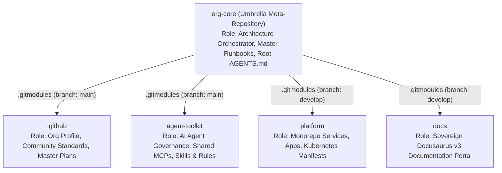
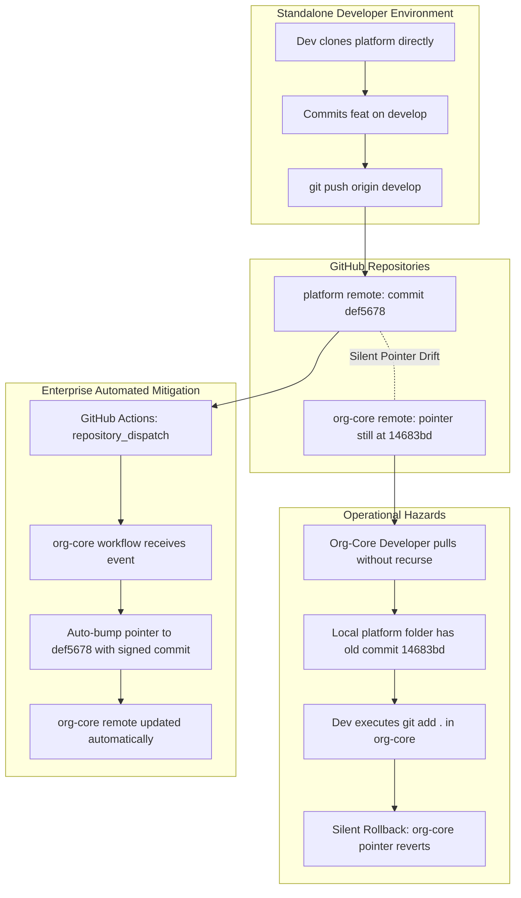

# Master Plan: Git Submodules, Umbrella Meta-Repository Architecture, and Worktree/Subtree Evaluation

This document establishes the official architectural reference and operational runbook for Git
Submodule orchestration in the `tupynambalucas-dev/org-core` meta-repository. It details how
submodules function across our ecosystem, evaluates advantages and operational hazards, and provides
an exhaustive technical assessment of **Git Worktrees (`git worktree`)** and **Git Subtrees
(`git subtree`)** within our multi-repo governance model.

---

## 1. Executive Summary & Architectural Topology

`org-core` functions as an **Umbrella Meta-Repository (Layer 1 Governance Root)**. Rather than
amalgamating all code into an unwieldy monolithic repository, `org-core` uses Git Submodules to
bind four sovereign repositories into a single, cohesive, version-controlled developer workspace:



### 1.1 The Mechanics of a Submodule: Gitlink Pointers

Inside the Git object database of `org-core`, submodules do not store the physical source tree of
child repositories. Instead, they are recorded as special 160-bit SHA tree entries called
**gitlinks** (mode `160000`):

```text
160000 commit e631ba4a4da3c5cbe853917af091ae76d4375bf4    .github
160000 commit 7d2cf0ab9ac37041bb8fab3998434e42d9709673    agent-toolkit
160000 commit 8f975fec245e485c88a964e4d81283cf6683c6bf    docs
160000 commit 14683bdc6b962c95eed3e9bba2c12030d60ee0cb    platform
```

The matching [`.gitmodules`](file:///C:/Users/tupyn/projects/organizations/tupynambalucas-dev/org-core/.gitmodules) file maps the logical submodule name to its remote URL, tracking branch, update policy, and recursive fetch strategy (as defined in the official Git SCM `gitmodules(5)` specification):

```ini
[submodule ".github"]
	path = .github
	url = git@github.com:tupynambalucas-dev/.github.git
	branch = main
	update = merge
	fetchRecurseSubmodules = on-demand

[submodule "platform"]
	path = platform
	url = git@github.com:tupynambalucas-dev/platform.git
	branch = develop
	update = merge
	fetchRecurseSubmodules = on-demand

[submodule "docs"]
	path = docs
	url = git@github.com:tupynambalucas-dev/docs.git
	branch = develop
	update = merge
	fetchRecurseSubmodules = on-demand

[submodule "agent-toolkit"]
	path = agent-toolkit
	url = git@github.com:tupynambalucas-dev/agent-toolkit.git
	branch = main
	update = merge
	fetchRecurseSubmodules = on-demand
```

#### Official `gitmodules(5)` Property Definitions:
- **`branch`**: Defines the remote branch tracked when executing `git submodule update --remote`. Setting `branch = develop` for `platform` and `docs`, and `branch = main` for `.github` and `agent-toolkit` ensures automatic upstream alignment without guessing branch names.
- **`update = merge`**: Defines the update procedure. Instead of checking out commits in a detached HEAD state (the Git default), `merge` merges the remote tracking commit into the local branch, preserving local history and preventing commit abandonment.
- **`fetchRecurseSubmodules = on-demand`**: Ensures `git fetch` and `git pull` in the superproject automatically fetch new commits for all populated submodules.

---

## 2. Strategic Advantages of the `org-core` Submodule Pattern

1. **Autonomous CI/CD Lifecycles & Zero Blast Radius**:
   - Each child repository runs its own focused CI/CD pipeline.
   - An MDX documentation edit in [`docs`](file:///C:/Users/tupyn/projects/organizations/tupynambalucas-dev/org-core/docs) deploys immediately to Cloudflare Pages in under 60 seconds without triggering continuous integration tests, container builds, or Kubernetes linting in [`platform`](file:///C:/Users/tupyn/projects/organizations/tupynambalucas-dev/org-core/platform).
2. **Granular RBAC and Secret Segregation**:
   - GitHub permissions are enforced at the repository boundary.
   - Members of `@technical-writers` hold `maintain` rights on `docs`, while retaining read-only (`pull`) rights on `platform`. In a traditional monorepo, restricting write access to specific subdirectories requires expensive third-party tools or complex CODEOWNERS rulesets that fail to protect Actions secrets.
3. **Selective Workstation Footprints**:
   - Engineers only clone what they need. A frontend developer working on Docusaurus can clone `docs` directly without downloading gigabytes of backend cluster Docker layers.
   - Architects and AI agents clone `org-core` with `--recursive` to obtain holistic, cross-system context.
4. **Deterministic Snapshot Reproducibility**:
   - Bumping submodule pointers in `org-core` creates an immutable cryptographic checkpoint.
   - Rolling back `org-core` to a previous commit restores the exact historical combination of platform code, documentation, and agent tooling that was active at that instant.

---

## 3. Operational Risks, Gotchas, and Hazard Mitigation

While architecturally sound, Git Submodules introduce friction if developers are unfamiliar with
their mechanics. Below are the 5 primary operational hazards and their standard mitigation protocols:

### Hazard 1: The Detached HEAD State Trap

- **The Problem**: When running `git submodule update`, Git checks out the exact commit SHA recorded
  in the superproject rather than tracking the tip of a branch. If a developer edits files and commits
  while in this state, their commits are created on a detached HEAD and will become unreachable
  (orphaned) once another update is triggered.
- **The Mitigation**:
  - Always verify branch status before authoring code inside a submodule:
    ```bash
    cd agent-toolkit
    git checkout main   # or develop for platform/docs
    ```
  - Alternatively, use the `--remote` and `--merge` flags when updating:
    ```bash
    git submodule update --remote --merge
    ```

### Hazard 2: Submodule Pointer Drift

- **The Problem**: An engineer commits and pushes changes within `platform`, but forgets to stage
  and commit the updated gitlink pointer in `org-core`.
  - The child repository has the new code, but the parent repository continues pointing to the older
    commit SHA.
- **The Mitigation**:
  - Enforce the **Pointer Bumping Runbook** in `org-core`:
    ```bash
    git -C platform commit -S -m "feat(api): add healthcheck endpoint"
    git -C platform push origin develop
    # Stage pointer update in superproject
    git add platform
    git commit -S -m "chore(submodules): bump platform to latest develop"
    git push origin main
    ```

### Hazard 3: The Out-of-Order Push Disaster

- **The Problem**: A developer commits a new submodule pointer in `org-core` and pushes `org-core`
  to GitHub **before** pushing the commit in the child submodule.
  - Anyone else pulling `org-core` will encounter a fatal error: `fatal: reference is not a tree`
    because the referenced commit does not exist on the remote child repository.
- **The Mitigation**:
  - Configure Git to automatically block out-of-order pushes:
    ```bash
    git config --global push.recurseSubmodules check
    ```
  - If unpushed submodule commits exist, Git aborts the push on `org-core` immediately.
  - Use `push.recurseSubmodules on-demand` to push submodule commits automatically prior to the parent.

### Hazard 4: Empty Directory on First Clone

- **The Problem**: Running `git clone git@github.com:tupynambalucas-dev/org-core.git` leaves all
  submodule directories (`platform`, `docs`, `agent-toolkit`, `.github`) completely empty.
- **The Mitigation**:
  - Always instruct developers to clone with the `--recursive` flag:
    ```bash
    git clone --recursive git@github.com:tupynambalucas-dev/org-core.git
    ```
  - If already cloned without `--recursive`, initialize them:
    ```bash
    git submodule update --init --recursive
    ```

### Hazard 5: The Standalone Developer Workflow (Independent Pushes to Child Repositories)

- **The Problem**: An engineer works exclusively inside a standalone clone of a child repository
  (e.g., `platform`), commits changes, and pushes directly to `origin/develop` without using
  `org-core` or multi-root workspaces.
  - **What actually happens**:
    1. The remote `tupynambalucas-dev/platform` repository successfully advances to the new commit SHA
       (e.g., `def5678`).
    2. The superproject `tupynambalucas-dev/org-core` on GitHub **does NOT update automatically**. It
       remains frozen at the historical gitlink pointer (e.g., `14683bd`). Git has no native upstream
       awareness or server-side reactive hooks to notify parent repositories when child repositories
       advance.
    3. Any developer, CI/CD runner, Docker container, or AI agent that clones `org-core --recursive`
       continues to checkout the stale commit `14683bd`, unaware that `def5678` exists.



#### Detailed Breakdown of Operational Risks

1. **Risk 5.1: The Accidental Pointer Rollback Disaster (Silent Reversion)**:
   - **The Scenario**:
     - Developer A pushes commit `def5678` to `platform/develop` standalone.
     - Either via manual bumping or automated bot, `org-core`'s `main` branch pointer is updated to `def5678`.
     - Developer B is working in `org-core` on `docs/` and pulls `org-core` with standard `git pull`.
     - Because Developer B did not pass `--recurse-submodules` (or lacks `submodule.recurse = true`),
       Git updates `org-core`'s index, but Developer B's physical filesystem directory `platform/`
       remains checked out at the historical commit `14683bd`.
     - Git flags `platform` as modified:
       ```text
       Changes not staged for commit:
         modified: platform (new commits)
       ```
     - Developer B finishes editing `docs/guide.md` and carelessly executes:
       ```bash
       git add .
       git commit -S -m "docs(guide): update developer guide"
       git push origin main
       ```
     - **The Catastrophe**: Developer B's commit stages `platform` pointing back to `14683bd`. Developer A's
       features are **silently rolled back in `org-core`**. Any engineer or deployment pipeline pulling
       `org-core` has their platform code silently regressed, breaking production builds while Developer
       A's branch still looks healthy in the child repository.

2. **Risk 5.2: The `libgit2` Web Pull Request Blockade (Cloud Merge Conflicts)**:
   - **The Scenario**:
     - While local Git engines using the `ort` strategy can auto-resolve submodule pointer changes when one
       commit is a direct ancestor of the other, **GitHub and GitLab web UIs use `libgit2`**.
     - In `libgit2/src/libgit2/merge.c`, submodule pointers are treated as opaque hashes without fetching
       or traversing child commit graphs.
     - **The Catastrophe**: When a developer opens a Pull Request in `org-core` while another pointer bump
       was merged into `main`, GitHub cannot fast-forward the submodule and marks the PR with an unresolvable
       conflict banner: `Can't automatically merge. Don't worry, you can still create the pull request.`
       Auto-merge queues and merge buttons in the GitHub UI are completely blocked.

3. **Risk 5.3: Cross-Repository CI/CD Desynchronization & False Green Tests**:
   - **The Scenario**:
     - Developer A pushes breaking API changes to `platform/develop`.
     - Unit tests pass inside the isolated `platform` GitHub Actions pipeline.
     - Meanwhile, integration tests or Docusaurus documentation builds in `org-core` run against the pinned
       submodule pointer `14683bd`.
     - **The Catastrophe**: Integration tests in `org-core` pass against stale contracts (false positives),
       masking critical integration bugs until downstream services attempt to consume the actual live APIs.

4. **Risk 5.4: Stale Local Working Tree Confusion (Ghost Modifications)**:
   - **The Scenario**:
     - When `org-core`'s pointer is updated on GitHub, other developers run `git pull`.
     - Because Git does not automatically sync submodule trees by default, their local `git status` reports:
       `modified: platform (new commits)`.
     - Developers waste hours investigating phantom modifications, believing they accidentally broke code
       in `platform`.

#### Mitigation Protocols for Standalone Pushes

- **Mitigation 5.1: Autonomous Event-Driven Synchronization via GitHub Actions**:
  - Implement a `repository_dispatch` trigger in child repositories so every push to `develop` or `main`
    notifies `org-core` to auto-bump the pointer.
  - **Child Workflow** (`platform/.github/workflows/notify-org-core.yml`):
    ```yaml
    name: Dispatch org-core Pointer Bump
    on:
      push:
        branches: [develop, main]
    jobs:
      dispatch-bump:
        runs-on: ubuntu-latest
        steps:
          - name: Generate GitHub App Token
            id: app-token
            uses: actions/create-github-app-token@v1
            with:
              app-id: ${{ secrets.ORG_MANAGER_APP_ID }}
              private-key: ${{ secrets.ORG_MANAGER_PRIVATE_KEY }}
              owner: tupynambalucas-dev
          - name: Emit Repository Dispatch Event
            uses: peter-evans/repository-dispatch@v3
            with:
              token: ${{ steps.app-token.outputs.token }}
              repository: tupynambalucas-dev/org-core
              event-type: submodule-bump
              client-payload: '{"submodule": "platform", "branch": "${{ github.ref_name }}", "commit_sha": "${{ github.sha }}"}'
    ```
  - **Parent Workflow** (`org-core/.github/workflows/auto-bump-submodule.yml`):
    - Receives `client-payload.commit_sha`, updates the gitlink pointer, creates an SSH-signed commit as
      `@tupynambalucas-org-manager[bot]`, and pushes to `main`.

- **Mitigation 5.2: Enforce Global Workstation Recursive Submodules**:
  - Every engineer working in the organization must configure Git to recursively synchronize submodules:
    ```bash
    git config --global submodule.recurse true
    ```
  - This guarantees that `git pull`, `git checkout`, and `git switch` automatically update submodule
    working directories, eliminating stale trees and accidental rollbacks.

- **Mitigation 5.3: Strict Ban on Root `git add .` in `org-core`**:
  - Developers and AI agents must never run indiscriminate `git add .` or `git add -A` from `org-core` root.
  - Enforce explicit directory staging:
    ```bash
    git add docs/
    git add agent-toolkit/
    ```
  - If a submodule was accidentally staged, unstage it immediately before committing:
    ```bash
    git restore --staged platform
    ```
  - To discard accidental working directory changes in a submodule:
    ```bash
    git submodule update --init --recursive platform
    ```

- **Mitigation 5.4: Submodule Gitlink Conflict Resolution Runbook**:
  - When a submodule merge conflict occurs (`both modified: platform`):
    ```bash
    # 1. Enter the submodule directory and fetch upstream changes
    cd platform
    git fetch origin develop

    # 2. Inspect the latest authoritative commit SHA
    git log -3 --oneline origin/develop

    # 3. Checkout the target authoritative commit
    git checkout origin/develop

    # 4. Return to superproject root and stage the resolved pointer
    cd ..
    git add platform

    # 5. Commit with cryptographic SSH signature
    git commit -S -m "merge(submodule): resolve platform gitlink pointer to latest develop"
    ```

- **Mitigation 5.5: Manual Fast-Forward Sync Runbook**:
  - For developers working inside `org-core` who want to immediately sync their submodule with the standalone
    remote without waiting for auto-bump automation:
    ```bash
    git submodule update --remote --merge platform
    ```

### 3.6 The 5-Pillar Global Git Configuration Standard

Based on official Git SCM documentation (`gitsubmodules`, `gitmodules`, `git-config`), the following
5 configurations eliminate 95% of common developer submodule failures:

1. **`submodule.recurse = true`**:
   - Forces Git to recurse into all active submodules for `checkout`, `switch`, `reset`, and `pull`.
   - Prevents stale local working tree skew and accidental pointer rollbacks.
2. **`push.recurseSubmodules = check`**:
   - Prevents pushing `org-core` if any child submodule commit hasn't been pushed to its remote. This
     completely eliminates the `fatal: reference is not a tree` error for other team members.
   - Alternatively, `push.recurseSubmodules = on-demand` automatically pushes child commits before the parent.
3. **`status.submoduleSummary = true`**:
   - Displays a summary of commits in modified submodules directly in `git status`, making pointer drifts
     immediately visible to human developers.
4. **`diff.submodule = log`**:
   - `git diff` shows commit logs and commit titles rather than obscure 40-character SHAs (`Subproject commit <sha1>` vs `<sha2>`).
5. **`fetch.recurseSubmodules = on-demand`**:
   - Ensures any `git fetch` automatically fetches new commits for populated submodules when new commits
     are referenced by the superproject.

```bash
# Execute these commands to apply the 5-Pillar standard:
git config --global submodule.recurse true
git config --global push.recurseSubmodules check
git config --global status.submoduleSummary true
git config --global diff.submodule log
git config --global fetch.recurseSubmodules on-demand
```

### 3.7 Automated Workstation Bootstrapping & Readiness Gates

To guarantee compliance and eliminate manual setup friction, developers do not configure these settings
manually. The organization provides:

1. **Automated Bootstrapper** (`scripts/bootstrap-workstation.ps1` / `scripts/bootstrap-workstation.sh`):
   - Sets up all Git defaults, SSH Ed25519 keys, GitHub CLI, and workspace paths in a single automated command.
2. **Pre-Flight Readiness Gate** (`scripts/verify-workstation.ps1` / `scripts/verify-workstation.sh`):
   - Evaluates the 7 compliance gates (GV1 to GV7) before code is pushed to remote branches.
3. **Local Pre-Push Hook** (`.git/hooks/pre-push`):
   - Blocks non-compliant pushes locally before they trigger GitHub branch ruleset rejections.

For detailed onboarding and script specifications, consult
[Developer Workstation & GitHub Onboarding](./developer-workstation-and-github-onboarding-plan.md).
For repository security and branch ruleset configurations, consult
[GitHub Organization Security & Rulesets](./github-organization-security-and-rulesets-plan.md).

---

## 4. Deep-Dive Evaluation: Git Worktree (`git worktree`)

### 4.1 What is a Git Worktree?

A Git Worktree allows multiple working directories (worktrees) to be attached to a **single local
repository `.git` database**:

```text
main-repository/              # Main worktree on branch 'main'
├── .git/                     # Authoritative object and ref database
└── src/
worktrees/
├── feature-auth/             # Linked worktree on branch 'feat/oauth'
│   └── .git (gitfile)        # Points to main-repository/.git/worktrees/feature-auth
└── emergency-fix/            # Linked worktree on branch 'hotfix/patch-1'
    └── .git (gitfile)        # Points to main-repository/.git/worktrees/emergency-fix
```

Instead of performing expensive `git stash` and `git checkout` sequences (which discard uncommitted
changes, trigger editor re-indexing, and invalidate language server caches), `git worktree add`
creates an independent folder checked out to a different branch instantly.

### 4.2 Git Worktrees in Multi-Agent AI Systems

In autonomous coding environments, **Git Worktrees are the foundational primitive for parallel agent
execution**:

1. **Parallel Execution Without File Lock Contention**: Two AI agents can work on the same repository
   simultaneously—one fixing a bug on `fix/test-race` while another implements a feature on `feat/ui`—without
   overwriting each other's files or colliding on `.git/index.lock`.
2. **Instantaneous Setup (Zero Network Transfer)**: Because all worktrees share the same local object
   database (`.git`), creating a new worktree takes under 100 milliseconds and consumes zero network
   bandwidth.

### 4.3 Should We Implement Git Worktrees in `org-core`?

#### The Verdict: YES, but strictly at the Child Submodule Level (NOT from the Umbrella Root).

- **Why Worktrees at the Root (`org-core`) are an Anti-Pattern**:
  - Running `git worktree add ../org-core-feature feat/branch` from the root of `org-core` creates
    a new parent directory, but the nested submodule pointers break unless every submodule is also
    independently re-initialized and synchronized in the linked worktree.
  - Submodule relative gitdir paths (`gitdir: ../.git/modules/platform`) fail or corrupt when
    relocated outside the primary umbrella hierarchy.
- **The Recommended Pattern (Child Worktrees)**:
  - When an engineer or AI agent needs to work on multiple branches in [`platform`](file:///C:/Users/tupyn/projects/organizations/tupynambalucas-dev/org-core/platform)
    or [`docs`](file:///C:/Users/tupyn/projects/organizations/tupynambalucas-dev/org-core/docs), create the worktree **inside that specific child repository**:
    ```bash
    cd platform
    # Create an isolated worktree for an agent task
    git worktree add ../../worktrees/platform-hotfix hotfix/cluster-cortex
    cd ../../worktrees/platform-hotfix
    # Work freely with 0 impact on the main platform directory
    ```
  - When the task completes, merge the branch, push to remote, and prune:
    ```bash
    cd ../../org-core/platform
    git worktree remove ../../worktrees/platform-hotfix
    ```

---

## 5. Deep-Dive Evaluation: Git Subtree (`git subtree`)

### 5.1 What is a Git Subtree?

`git subtree` is an alternative subproject management mechanism where an external repository's
entire directory tree and commit history are physically merged directly into a subdirectory of
the parent repository:

```mermaid
graph TD
  subgraph Submodule ["Git Submodule Architecture"]
    Parent1["Superproject (.git)"] -->|Pointer (SHA: 160000)| Gitlink["Pointers only (Zero source files in parent Git object store)"]
    Gitlink -.-> ExtRepo["Child Repository (Separate .git)"]
  end

  subgraph Subtree ["Git Subtree Architecture"]
    Parent2["Superproject (.git)"] --> Embedded["Embedded Source Files + Monolithic Commit Graph"]
    Embedded -->|Every external commit copied into parent| MergedHist["Merged History (Single giant Git object store)"]
  end
```

### 5.2 Submodule vs. Subtree vs. Worktree Comparison Matrix

| Dimension | Git Submodule (`git submodule`) | Git Subtree (`git subtree`) | Git Worktree (`git worktree`) |
| :--- | :--- | :--- | :--- |
| **Primary Concept** | **Pointer/Link**: Child repo linked by commit SHA. | **Physical Vendoring**: Child repo merged into parent commit graph. | **Parallel Checkout**: Multiple working folders sharing one `.git`. |
| **History Storage** | **Completely Decoupled**: Parent only stores 1 commit pointer. | **Tightly Coupled**: All upstream commits merged into parent history. | **Shared Object Store**: Single `.git` database. |
| **GitHub RBAC Granularity** | **Strictly Preserved**: Each repo retains independent permissions. | **Completely Lost**: Anyone with parent repo write access can modify files. | **Inherited**: Same permissions as underlying repository. |
| **Clone Complexity** | Requires `--recursive` or `submodule init`. | Normal `git clone` (zero submodule knowledge required). | N/A (local workstation workflow only). |
| **Upstream Sync Complexity** | Simple: `git checkout` & bump pointer. | Complex: `git subtree pull` and `git subtree push` (slow, merge conflicts). | N/A |
| **CI/CD Pipeline Impact** | Isolated per repo; zero noise. | High noise: Parent CI triggers on every vendored file change. | N/A |

### 5.3 Should We Implement Git Subtree in `org-core`?

#### The Verdict: NO. Git Subtrees are strongly rejected for `org-core`.

1. **Loss of Sovereign RBAC**: If we converted `platform`, `docs`, and `agent-toolkit` to subtrees,
   the entire enterprise becomes a single monolithic repository. A technical writer committing to
   Docusaurus would possess write access to Kubernetes manifests and cluster secrets in `platform`.
2. **Commit History Pollution**: Merging the histories of 4 repositories into `org-core` would inflate
   the repository size by hundreds of megabytes, slowing down Git operations across all developer machines.
3. **Friction with Conventional Commits and Signed Commits**: Extracting commits back upstream via
   `git subtree push --prefix=platform origin develop` rewrites commit hashes, breaking cryptographic
   SSH signatures (`-S`) and corrupting our strict Conventional Commits audit trails.
4. **The Only Valid Use Case for Subtree**: If a specific service inside `platform` ever needs to
   vendor a static, third-party, read-only open-source library without adding an external dependency
   manager, a localized `git subtree` inside `platform/vendor/` is acceptable. However, it must
   never replace submodules at the meta-repository governance layer.

---

## 6. Enterprise Developer Runbook for Submodules

### 6.1 Initial Setup (First-Time Clone)

```bash
git clone --recursive git@github.com:tupynambalucas-dev/org-core.git
cd org-core
```

### 6.2 Synchronizing and Updating All Submodules

To update all submodules to the latest development heads tracked in `.gitmodules`:

```bash
# Pulls latest updates on tracking branches and fast-forwards
git submodule update --remote --merge
```

### 6.3 Working Inside a Submodule

Always switch to a concrete branch before writing code:

```bash
cd agent-toolkit
git checkout main
# ... author changes ...
git add .
git commit -S -m "feat(plugin): add new governance hook"
git push origin main
```

### 6.4 Staging and Committing Submodule Pointer Bumps in `org-core`

Whenever a child repository advances, stage the updated pointer in `org-core`:

```bash
cd /path/to/org-core
# Verify pointer status
git status
# Output shows: modified: agent-toolkit (new commits)

# Stage and commit with SSH signature
git add agent-toolkit
git commit -S -m "chore(submodules): bump agent-toolkit to latest development head"
git push origin main
```

### 6.5 Safe Out-of-Order Push Configuration

Ensure your workstation never pushes an unpushed submodule commit pointer:

```bash
git config --global push.recurseSubmodules check
```

---

## 7. Harmonization with GitHub Flow and Changesets Release Automation

To resolve the friction of tracking long-lived `develop` branches across multiple submodules:
1. **GitHub Flow Standardization**: All organizational repositories standardize on `refs/heads/main` as the
   authoritative source of truth. Features are developed on ephemeral branches (`feature/*`, `hotfix/*`, `bugfix/*`)
   and merged directly into `main` via audited Pull Requests.
2. **Rejection of Gitflow**: Classical Gitflow is officially deprecated for submodule coordination. Tracking
   both `develop` and `main` across 4 submodules creates combinatorial pointer drift and merge conflicts in
   submodule gitlink SHAs that cannot be automatically resolved by GitHub's `libgit2` engine.
3. **Automated Semantic Versioning**: Repositories managing multiple packages (such as `platform`) utilize
   `@changesets/cli` and `changesets/action@v2`. Developers author declarative `.changeset/*.md` files in
   feature branches. Upon merge to `main`, an automated `Version Packages` PR is maintained. Merging this PR
   publishes packages, creates cryptographic Git tags, and emits a `repository_dispatch` to bump `org-core`
   deterministically.

For complete details on the branching taxonomy and Changesets lifecycle, consult:
[GitHub Flow, Automated Changesets & Branch Governance](./github-flow-and-changesets-branch-governance-plan.md).
