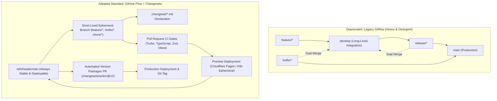
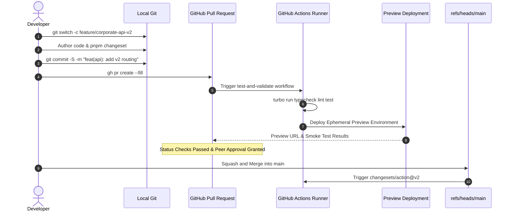
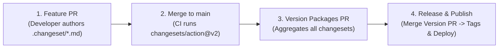

# Master Plan: GitHub Flow, Automated Changesets, and Branch Naming Governance

This document establishes the official enterprise branching model, automated versioning framework,
and branch naming governance for `tupynambalucas-dev`. It formalizes the adoption of **GitHub Flow**,
integrates semantic releases via **Changesets (`@changesets/cli`)**, establishes deterministic PR quality
gates, and deprecates legacy Gitflow tooling in favor of native Git and the GitHub CLI (`gh`).

---

## 1. Executive Summary and Paradigm Shift

Operating an umbrella meta-repository ([`org-core`](file:///C:/Users/tupyn/projects/organizations/tupynambalucas-dev/org-core))
with sovereign child submodules ([`platform`](file:///C:/Users/tupyn/projects/organizations/tupynambalucas-dev/org-core/platform),
[`docs`](file:///C:/Users/tupyn/projects/organizations/tupynambalucas-dev/org-core/docs),
[`agent-toolkit`](file:///C:/Users/tupyn/projects/organizations/tupynambalucas-dev/org-core/agent-toolkit),
and [`.github`](file:///C:/Users/tupyn/projects/organizations/tupynambalucas-dev/org-core/.github))
requires a branching model optimized for continuous integration and deterministic submodule pointer tracking.



### Why Gitflow is Officially Deprecated:
1. **Combinatorial Submodule Pointer Drift**: Gitflow maintains dual long-lived branches (`main` and `develop`).
   Mirroring this across 4 submodules creates 16+ potential pointer combinations, causing merge conflicts in
   submodule gitlink SHAs that cannot be resolved automatically by GitHub's `libgit2` merge engine.
2. **Delayed Quality Feedback**: In Gitflow, features merge into `develop` without mandatory production
   readiness. Bugs accumulate in `develop`, blocking subsequent releases.
3. **Dual-Merge Complexity**: Merging hotfixes and releases back into both `main` and `develop` produces
   non-linear commit graphs, violating our zero-unsigned-commit and linear history invariants.

### Why GitHub Flow is Adopted:
1. **Single Source of Truth**: `refs/heads/main` is the sole long-lived branch across all repositories.
   Every commit on `main` has passed all status checks and is deployable.
2. **Quality Validated Before Merge**: Comprehensive automated testing, contract validations, and preview
   deployments run inside the Pull Request container *before* touching `main`.
3. **Seamless Submodule Alignment**: The parent meta-repository (`org-core`) tracks a single deterministic
   stream of truth, simplifying automated pointer bumping via `repository_dispatch`.

---

## 2. Developer Tooling: Do We Still Need `git-flow` CLI?

### Formal Decision: The `git-flow` CLI is Obsolete and Prohibited

Developers **must NOT install or use** the legacy `git-flow` or `git-flow-avh` CLI extensions. 
These third-party binaries introduce opaque branch switching, automated merge commits that bypass SSH
signing invariants, and hardcoded expectations of a `develop` branch.

### Modern Developer Toolchain (Approved Standard)

Developers interact with branches, Pull Requests, and releases using four native tools:

1. **Native Git (`git switch`, `git checkout`)**: For local branch authoring and switching.
2. **GitHub CLI (`gh`)**: For frictionless Pull Request creation, status tracking, and review.
3. **Changesets CLI (`@changesets/cli`)**: For declarative semantic versioning and changelog management.
4. **Git Pre-Push Hook & Rulesets**: For local and remote enforcement of branch naming conventions.

### Tooling Comparison: Legacy Gitflow vs Modern Standard

| Task | Legacy `git-flow` CLI (Prohibited) | Modern Standard (Approved) |
| :--- | :--- | :--- |
| **Start Feature** | `git flow feature start auth` | `git switch -c feature/user-auth` |
| **Document Changes** | Manual changelog editing or none | `pnpm changeset` |
| **Publish Feature** | `git flow feature publish auth` | `git push -u origin feature/user-auth` |
| **Create Review** | Web UI navigation | `gh pr create --web` or `gh pr create --fill` |
| **Finish Feature** | `git flow feature finish auth` (bypasses CI) | Merge Pull Request on GitHub after CI passes |
| **Start Hotfix** | `git flow hotfix start patch-1` | `git switch -c hotfix/urgent-cve-patch` |
| **Release Version** | `git flow release finish 1.2.0` | Merge the automated `Version Packages` PR |

---

## 3. Strict Branch Naming Governance

To maintain absolute repository discipline, branches must follow a standardized taxonomy. Commits or pushes
to branches outside this taxonomy are rejected both locally and on GitHub.

### 3.1 Permitted Branch Taxonomy

All branches created in organizational repositories must adhere to the pattern:
`<type>/<kebab-case-description>`

| Branch Prefix | Allowed Scope | Examples |
| :--- | :--- | :--- |
| **`feature/`** | New user-facing capabilities, API endpoints, or platform features. | `feature/oauth2-pkce`, `feature/agent-router` |
| **`hotfix/`** | Critical production bugfixes requiring immediate remediation. | `hotfix/cors-header-leak`, `hotfix/tls-cert-renew` |
| **`bugfix/`** | Non-critical bug fixes identified during development or QA. | `bugfix/zod-schema-validation`, `bugfix/css-overflow` |
| **`chore/`** | Tooling upgrades, dependency updates, or workspace configuration. | `chore/bump-pnpm-12`, `chore/eslint-config-update` |
| **`refactor/`** | Code changes that neither fix a bug nor add a feature. | `refactor/api-response-formatter` |
| **`docs/`** | Documentation-only updates within the `docs` repository or skill files. | `docs/diataxis-migration`, `docs/readme-cleanup` |

### 3.2 Enforcement Mechanism 1: GitHub Repository Ruleset (`branch_name_pattern`)

Applied across all repositories via GitHub Organization Rulesets:

```json
{
  "name": "enforce-branch-naming-standard",
  "target": "branch",
  "enforcement": "active",
  "conditions": {
    "ref_name": {
      "include": ["refs/heads/*"],
      "exclude": ["refs/heads/main"]
    }
  },
  "rules": [
    {
      "type": "branch_name_pattern",
      "parameters": {
        "operator": "starts_with",
        "patterns": [
          "feature/",
          "hotfix/",
          "bugfix/",
          "chore/",
          "refactor/",
          "docs/"
        ]
      }
    }
  ]
}
```

Any attempt to push a branch named `teste`, `meu-branch`, or `wip` is rejected by GitHub with:
`remote: error: GH013: Repository rule violations found for refs/heads/...`

### 3.3 Enforcement Mechanism 2: Local Pre-Push Hook via Husky (`.husky/pre-push`)

Automatically activated upon `pnpm install` via Husky v9 (see [Developer Workstation Onboarding](./developer-workstation-and-github-onboarding-plan.md)):

```bash
#!/usr/bin/env sh
# .husky/pre-push

current_branch=$(git symbolic-ref --short HEAD 2>/dev/null || true)

# 1. Block direct pushes to main
if [ "$current_branch" = "main" ]; then
    echo "ERROR: Direct push to 'main' is forbidden. Open a Pull Request." >&2
    exit 1
fi

# 2. Enforce branch naming pattern
valid_pattern="^(feature|hotfix|bugfix|chore|refactor|docs)\/[a-z0-9._-]+$"
if [[ ! "$current_branch" =~ $valid_pattern ]] && [ -n "$current_branch" ]; then
    echo "ERROR: Branch '$current_branch' violates organizational naming convention." >&2
    echo "Allowed prefixes: feature/, hotfix/, bugfix/, chore/, refactor/, docs/" >&2
    exit 1
fi

exit 0
```

---

## 4. Quality Assurance Gates Before Merge (Testing Architecture)

Without a `develop` branch acting as an integration buffer, quality is guaranteed through three rigorous
pre-merge verification gates:



### Gate 1: Hermetic Status Checks (CI Matrix)
Every Pull Request must pass the following checks executed via Turborepo:
- **`typecheck`**: Strict TypeScript compilation (`tsc --noEmit`) with zero errors across all workspaces.
- **`lint`**: ESLint and Prettier validation with zero warnings treated as errors.
- **`test:unit`**: Vitest unit test suite validating business logic and domain functions.
- **`test:contracts`**: Zod schema validation ensuring API request/response contracts are strictly honored.

### Gate 2: Ephemeral Preview Environments
- Frontend applications (`corporate-web`) automatically deploy to ephemeral preview URLs (Cloudflare Pages Preview).
- E2E smoke tests (Playwright) run against the ephemeral preview URL before the PR can be merged.
- Once merged or closed, the preview environment is torn down immediately, leaving zero lingering cloud resources.

### Gate 3: Staging & Production Deployment Topology

Depending on the operational sensitivity of the application:
1. **Continuous Deployment to Staging**: Merging a PR into `main` automatically deploys the latest build
   to the `staging` Kubernetes namespace or Cloudflare Pages staging channel.
2. **Promotion to Production via GitHub Environments**: Deploying to `production` requires manual sign-off
   within GitHub Actions Environment Protection Rules by a member of `@tupynambalucas-dev/lead-architects`.

---

## 5. Automated Semantic Versioning with Changesets (`@changesets/cli`)

The [`platform`](file:///C:/Users/tupyn/projects/organizations/tupynambalucas-dev/org-core/platform) workspace
manages multi-package releases via `@changesets/cli` and `changesets/action@v2`.

### 5.1 The 4-Step Release Lifecycle



#### Step 1: Declaring Changes in the Feature Branch
Before submitting a PR, the engineer executes:
```bash
pnpm changeset
```
1. Selects the packages modified (e.g., `@tupynambalucas-dev/corporate-api`).
2. Selects the bump severity (`patch`, `minor`, `major`).
3. Enters a concise description in en-US following Conventional Commits.
4. Commits the generated `.changeset/<unique-name>.md` file.

#### Step 2: The Automated "Version Packages" Pull Request
When the feature PR merges into `main`, GitHub Actions executes `changesets/action@v2`:
- The action detects new `.changeset/*.md` files.
- It opens or updates a single persistent PR titled **`Version Packages`**.
- It calculates version bumps across `package.json` files and generates preview release notes.

#### Step 3: Triggering Production Release
When ready to publish a new release:
1. An architect reviews and merges the **`Version Packages`** PR into `main`.
2. The GitHub Actions workflow detects that no unconsumed changesets remain and runs `pnpm changeset publish`.
3. The workflow automatically:
   - Updates `CHANGELOG.md` files.
   - Creates cryptographic Git tags (e.g., `@tupynambalucas-dev/corporate-api@1.2.0`).
   - Publishes packages to internal/public registries.
   - Triggers production container builds and Kubernetes deployments.

---

## 6. Harmonization with `org-core` and Submodules

By standardizing all repositories on **GitHub Flow (`main`)**:
1. **Simplified `.gitmodules`**: All submodule entries in [`.gitmodules`](file:///C:/Users/tupyn/projects/organizations/tupynambalucas-dev/org-core/.gitmodules)
   track `branch = main`, eliminating branch fragmentation.
2. **Automated Submodule Synchronization**: When the `Version Packages` PR or an approved feature merges into
   `main` on `platform`, its GitHub Actions workflow emits a `repository_dispatch` event:
   ```yaml
   - name: Dispatch org-core Pointer Bump
     uses: peter-evans/repository-dispatch@v3
     with:
       token: ${{ steps.app-token.outputs.token }}
       repository: tupynambalucas-dev/org-core
       event-type: submodule-bump
       client-payload: '{"submodule": "platform", "branch": "main", "commit_sha": "${{ github.sha }}"}'
   ```
3. **Deterministic Parent State**: The `@tupynambalucas-org-manager[bot]` updates the gitlink pointer in `org-core`
   with an Ed25519 signed commit on `main`, ensuring the umbrella meta-repository always reflects production truth.

---

## 7. Developer Onboarding Runbook (Quick Reference)

```bash
# 1. Update your local main branch
git switch main
git pull --recurse-submodules

# 2. Create a standardized feature branch
git switch -c feature/my-new-service

# 3. Author code, run tests, and declare changes
pnpm corporate:typecheck
pnpm changeset

# 4. Commit using cryptographic SSH signature
git add .
git commit -S -m "feat(api): implement structured audit logging"

# 5. Push branch and open Pull Request
git push -u origin feature/my-new-service
gh pr create --web

# 6. Once CI passes and peer review is approved, squash and merge via GitHub UI
# (Never use git merge locally into main)
```
