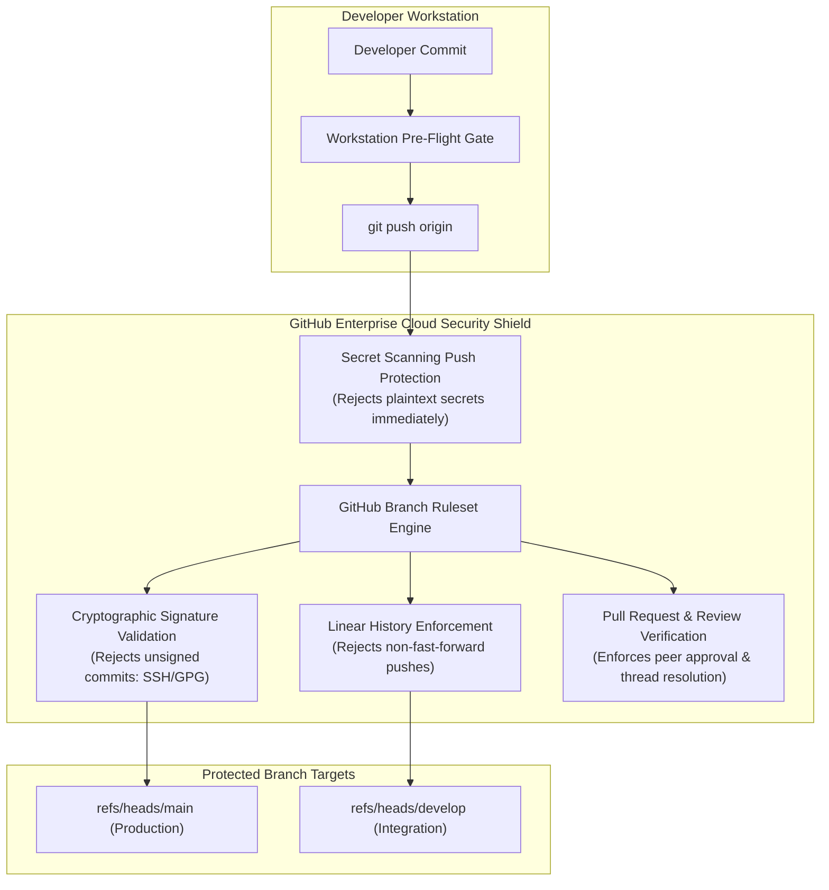

# Master Plan: GitHub Organization Security, Branch Rulesets, and Compliance Enforcement

This document establishes the official enterprise security baseline and compliance enforcement
architecture for the `tupynambalucas-dev` organization. It specifies branch rulesets, secret scanning,
push protection, cryptographic commit verification, and automated audit runbooks.

---

## 1. Executive Summary and Threat Model

Operating an umbrella meta-repository ([`org-core`](https://github.com/tupynambalucas-dev/org-core))
with autonomous child submodules ([`platform`](https://github.com/tupynambalucas-dev/platform),
[`docs`](https://github.com/tupynambalucas-dev/docs),
[`agent-toolkit`](https://github.com/tupynambalucas-dev/agent-mesh),
and [`.github`](https://github.com/tupynambalucas-dev/.github))
requires centralized security enforcement at the GitHub platform layer to counter five primary threat vectors:

1. **Unverified Commits and Identity Spoofing**: Commits authored without cryptographic signatures
   allow malicious actors or compromised machines to spoof commit author identities (`git config user.email`).
2. **Accidental Credential Exposure**: Accidental commits containing Infisical tokens, Cloudflare API
   keys, or SSH private keys immediately compromise organizational infrastructure.
3. **History Rewrites and Force Pushes**: Force-pushing (`git push --force`) to `main` or `develop`
   destroys Git history and invalidates submodule gitlink pointers across the organization.
4. **Submodule Gitlink Corruption**: Untested or unpushed submodule pointers committed to `org-core`
   break builds and onboarding for all engineering teams.
5. **Configuration Drift Across Repositories**: Individual child repositories operating with divergent
   branch protection settings, leaving weaker repositories vulnerable to direct pushes.



---

## 2. Organization-Wide Security Baseline Settings

The following organization-level security configurations must be active across all repositories in
`tupynambalucas-dev`:

| Security Feature | Scope | Status | Purpose |
| :--- | :--- | :--- | :--- |
| **Secret Scanning** | Organization | Mandatory | Automatically detects known credential patterns (tokens, API keys, private keys). |
| **Secret Push Protection** | Organization | Mandatory | Blocks `git push` in real time if any file in the commit diff contains sensitive secrets. |
| **Dependabot Alerts** | All Repositories | Mandatory | Continuously monitors package manifests (npm, cargo, pip, go) for CVE vulnerabilities. |
| **Dependabot Security Updates**| All Repositories | Mandatory | Automatically opens pull requests to bump vulnerable dependency versions. |
| **Default Branch Protections**| Organization | Mandatory | Replaces legacy branch protections with centralized GitHub Rulesets. |

---

## 3. Authoritative Branch Ruleset Specifications

GitHub Repository Rulesets provide declarative, tamper-proof governance across multiple repositories.
Every repository in `tupynambalucas-dev` enforces two standard rulesets:

### 3.1 Production Ruleset: `enterprise-production-main`

Applied to `refs/heads/main` on all repositories (`org-core`, `platform`, `docs`, `agent-toolkit`, `.github`, `tessel`):

```json
{
  "name": "enterprise-production-main",
  "target": "branch",
  "enforcement": "active",
  "conditions": {
    "ref_name": {
      "include": ["refs/heads/main"],
      "exclude": []
    }
  },
  "rules": [
    { "type": "deletion" },
    { "type": "non_fast_forward" },
    { "type": "required_linear_history" },
    { "type": "required_signatures" },
    {
      "type": "pull_request",
      "parameters": {
        "required_approving_review_count": 1,
        "dismiss_stale_reviews_on_push": true,
        "require_code_owner_review": false,
        "require_last_push_approval": true,
        "required_review_thread_resolution": true
      }
    }
  ]
}
```

#### Enforced Invariants:
- **`required_signatures`**: Every single commit in the branch history must carry a valid SSH signature
  verified by GitHub (`Verified` badge). Unsigned commits are rejected at push time with HTTP 422.
- **`required_linear_history`**: Merge commits are forbidden on `main`; all changes must be squashed
  or rebased cleanly, guaranteeing a clear audit trail.
- **`deletion` & `non_fast_forward`**: Prevents accidental or malicious branch deletion and force-pushes (`git push --force`).
- **`pull_request`**: Requires at least one peer approval, invalidates previous approvals when new commits
  are pushed, and requires all review comment threads to be marked as resolved.

---

### 3.2 Integration Ruleset: `enterprise-integration-develop`

Applied to `refs/heads/develop` on repositories that maintain integration branches (`platform`, `docs`):

```json
{
  "name": "enterprise-integration-develop",
  "target": "branch",
  "enforcement": "active",
  "conditions": {
    "ref_name": {
      "include": ["refs/heads/develop"],
      "exclude": []
    }
  },
  "rules": [
    { "type": "deletion" },
    { "type": "non_fast_forward" },
    { "type": "required_signatures" }
  ]
}
```

#### Enforced Invariants:
- Allows fast integration of approved feature branches while strictly maintaining the zero-unsigned-commit
  invariant and preventing history disruption.

---

### 3.3 Branch Naming Standard Ruleset: `enforce-branch-naming-standard`

Applied across all organizational repositories to prevent unauthorized or unstructured branch creation:

```json
{
  "name": "enforce-branch-naming-standard",
  "target": "branch",
  "enforcement": "active",
  "conditions": {
    "ref_name": {
      "include": ["refs/heads/*"],
      "exclude": ["refs/heads/main", "refs/heads/develop"]
    }
  },
  "rules": [
    {
      "type": "branch_name_pattern",
      "parameters": {
        "operator": "starts_with",
        "patterns": [
          "feature/",
          "hotfix/",
          "bugfix/",
          "chore/",
          "refactor/",
          "docs/"
        ]
      }
    }
  ]
}
```

#### Enforced Invariants:
- Blocks pushes of any branch that does not follow the standardized organizational taxonomy.
- Rejects branches created with personal handles, unstructured names (e.g., `teste`, `wip`, `patch`), or invalid delimiters.

---

## 4. Submodule Governance and CODEOWNERS in `org-core`

To prevent unauthorized submodule pointer updates or unintentional reversions in the meta-repository,
the `org-core` repository enforces root-level ownership via `.github/CODEOWNERS`:

```text
# org-core CODEOWNERS
# Master governance: Submodule gitlink changes require architect review

/.gitmodules               @tupynambalucas-dev/lead-architects
/platform                  @tupynambalucas-dev/lead-architects @tupynambalucas-dev/infra-ops
/docs                      @tupynambalucas-dev/lead-architects @tupynambalucas-dev/technical-writers
/agent-toolkit             @tupynambalucas-dev/lead-architects
/.github                   @tupynambalucas-dev/lead-architects
```

When a developer submits a PR bumping a submodule pointer in `org-core`, GitHub automatically assigns
the appropriate functional team for architectural review.

---

## 5. Security & Ruleset Provisioning Runbook

To provision or synchronize rulesets across all organization repositories, execute the automated
script from `agent-toolkit`:

```bash
# Verify caller role and permissions
node agent-toolkit/skills/github-org-manager/scripts/resolve-operator-role.js

# Configure rulesets on org-core
bash agent-toolkit/skills/github-org-manager/scripts/configure-rulesets.sh "tupynambalucas-dev" "org-core"

# Configure rulesets on platform
bash agent-toolkit/skills/github-org-manager/scripts/configure-rulesets.sh "tupynambalucas-dev" "platform"

# Configure rulesets on docs
bash agent-toolkit/skills/github-org-manager/scripts/configure-rulesets.sh "tupynambalucas-dev" "docs"

# Configure rulesets on agent-toolkit
bash agent-toolkit/skills/github-org-manager/scripts/configure-rulesets.sh "tupynambalucas-dev" "agent-toolkit"

# Configure rulesets on .github
bash agent-toolkit/skills/github-org-manager/scripts/configure-rulesets.sh "tupynambalucas-dev" ".github"
```

---

## 6. Audit and Verification Commands

Verify the active security posture of any repository using the GitHub CLI (`gh`):

```bash
# 1. Inspect active rulesets on a repository
gh api repos/tupynambalucas-dev/org-core/rulesets

# 2. Inspec secret scanning alerts (security managers only)
gh api repos/tupynambalucas-dev/platform/secret-scanning/alerts

# 3. Inspect Dependabot vulnerability alerts
gh api repos/tupynambalucas-dev/platform/dependabot/alerts

# 4. Verify cryptographic signature status of recent commits
gh api repos/tupynambalucas-dev/org-core/commits/main | jq '{sha: .sha, verified: .commit.verification.verified, reason: .commit.verification.reason}'
```
