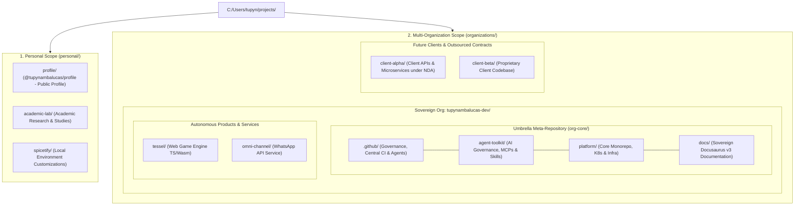

# Architectural Specification: Multi-Tenant Corporate Workstation and Umbrella Meta-Repository

This document specifies the architectural design of the local workstation filesystem (`projects/`)
and the repository ecosystem governance required to support **Multi-Organization operations**. It
establishes strict physical and contextual segregation between the **personal scope** (`personal/`)
and the **organizational scope** (`organizations/`), allowing the sovereign organization
(`tupynambalucas-dev`) and future external client contracts to operate in complete isolation.

---

## 1. Architectural Principles and Objectives

1. **Multi-Tenant Scalability (Sovereign Enterprise & Client Contracts)**:
   - The root development path `projects/` maintains only two top-level namespaces: `personal/`
     and `organizations/`.
   - Each enterprise entity resides in its dedicated directory within `organizations/`
     (e.g., `organizations/tupynambalucas-dev/`, `organizations/client-x/`).
2. **Legal Hermeticity, NDA Protection, and AI Agent Sandboxing**:
   - The Antigravity CLI (`agy`) and IDE recursively index workspace contents from the opened
     workspace root.
   - The organizational core (`org-core/`) operates unhindered by detached product or client scopes.
   - Client and outsourced repositories reside in strictly hermetic sandboxes, eliminating any risk
     of proprietary code or enterprise secrets leaking into AI agent context windows.
3. **Automated Cryptographic Git Identity Switching (`includeIf:gitdir`)**:
   - Different client organizations require unique corporate email addresses, dedicated SSH keypairs,
     and specific signing profiles.
   - Git automatically switches identities, email headers, and SSH signing keys based on the physical
     filesystem path of the active repository.
4. **Sovereign Repositories and Deterministic Snapshot Versioning**:
   - Submodule repositories maintain autonomous Git histories, branches, and CI/CD pipelines.
   - The umbrella meta-repository functions as an organizational manifest pinning compatible commit
     hashes across child domains.

---

## 2. Complete Workstation Topology (`projects/`)

### Panoramic Architectural Overview



---

### Physical Directory Hierarchy (`projects/`)

Mapping of the local filesystem defining repository boundaries and architectural responsibilities:

```text
C:/Users/tupyn/projects/
│
├── personal/                                         <- Personal scope (github.com/tupynambalucas/*)
│   ├── profile/                                      <- GitHub personal profile generator (@tupynambalucas/profile)
│   ├── academic-lab/                                 <- Academic research, papers, and experimental prototypes
│   └── spicetify/                                    <- Spotify desktop client customization scripts
│
└── organizations/                                    <- Multi-tenant corporate scope (Enterprises & Clients)
    │
    ├── tupynambalucas-dev/                           <- Sovereign organization (github.com/tupynambalucas-dev/*)
    │   ├── org-core/                                 <- Umbrella Meta-Repository (Orchestrates submodules)
    │   │   ├── .github/                              <- [Submodule] Institutional governance, CI/CD, agent rules
    │   │   ├── agent-toolkit/                        <- [Submodule] AI agent governance, shared MCPs, skills, sidecars
    │   │   ├── platform/                             <- [Submodule] Core domain monorepo, Kubernetes GitOps, services
    │   │   └── docs/                                 <- [Submodule] Sovereign Docusaurus v3 documentation portal
    │   │
    │   ├── tessel/                                   <- [Standalone] Web game engine in TypeScript/Wasm (Autonomous Product)
    │   └── omni-channel/                             <- [Standalone] WhatsApp API messaging service (Autonomous Product)
    │
    └── [future-client]/                              <- [Example] Client enterprise under commercial NDA (github.com/client/*)
        ├── client-service-a/                         <- Dedicated client microservice repository
        └── client-service-b/                         <- Dedicated client frontend repository
```

---

## 3. Directory Scope Details

### A. Personal Scope (`projects/personal/`)
Contains repositories owned exclusively by the personal user account (`tupynambalucas`):

| Directory | Remote Repository | Scope and Responsibility |
| :--- | :--- | :--- |
| **`profile/`** | `git@github.com:tupynambalucas/tupynambalucas.git` | Special personal profile repository with dynamic SVG card generator on branch `generated`. |
| **`academic-lab/`** | `git@github.com:tupynambalucas/academic-lab.git` | Academic research, algorithmic simulations, and personal notes. |
| **`spicetify/`** | Personal fork / local repository | Local developer workstation audio client styling. |

### B. Multi-Organization Scope (`projects/organizations/`)
Isolates separate corporate entities, guaranteeing complete segregation of code, credentials, and contracts:

#### 1. Sovereign Enterprise (`organizations/tupynambalucas-dev/`)
- **Umbrella Meta-Repository (`org-core/`)**: Orchestrates the 4 foundational pillars via Git Submodules:
  - **`.github/`**: Corporate governance, organization README, issue/PR templates, and root agent plans.
  - **`agent-toolkit/`**: Enterprise agent governance, reusable skills, shared MCP definitions, and sidecars.
  - **`platform/`**: Domain monorepo orchestrating local Kubernetes clusters (`k3d-hub`, `k3d-corporate` via Skaffold) and cloud clusters (ArgoCD), Traefik ingress, LGTM observability, and services (`corporate/web`, `corporate/api`).
  - **`docs/`**: Sovereign documentation hub built with Docusaurus v3 and Crowdin localization, deploying to Cloudflare Pages.
- **Autonomous Satellite Products (`tessel/` and `omni-channel/`)**:
  - **`tessel/` (`tupynambalucas-dev/tessel`)**: High-performance TypeScript/Wasm web game engine with detached rendering loop.
  - **`omni-channel/` (`tupynambalucas-dev/omni-channel`)**: Messaging and integration microservice for WhatsApp Business APIs.

#### 2. Client Organizations / Outsourced Contracts (`organizations/<client>/`)
- Repositories reside in isolated client subfolders configured with client-specific email addresses and dedicated SSH keys, completely preventing cross-tenant leakage.

---

## 4. Antigravity AI Agent Sandboxing Matrix

The table below defines how the Antigravity CLI and IDE behave across different directory roots:

| Workspace Root Path | Antigravity Mode | AI Visibility Scope | Boundary Enforcement |
| :--- | :--- | :--- | :--- |
| **`organizations/tupynambalucas-dev/org-core`** | **Unified Core** | `.github`, `agent-toolkit`, `platform`, `docs` simultaneously. | **Total Isolation**: Zero visibility into satellite products, external clients, or personal projects. |
| **`organizations/tupynambalucas-dev/tessel`** | **Sandboxed Product** | Strictly restricted to game engine source files. | **Hermetic**: Cannot access `platform`, `docs`, or meta-repository. |
| **`organizations/tupynambalucas-dev/omni-channel`** | **Sandboxed Service** | Strictly restricted to WhatsApp API files. | **Hermetic**: Cannot access core platform infrastructure. |
| **`organizations/<client>`** | **Client Sandbox** | Strictly restricted to repositories belonging to that specific client. | **Legal Hermeticity**: Zero access to `tupynambalucas-dev` code or infrastructure. |
| **`personal/profile`** | **Personal Profile** | Strictly restricted to personal SVG generator assets. | **Hermetic**: Zero access to any corporate repository. |

---

## 5. Automated Git Identity via `includeIf:gitdir`

To guarantee that Git identity (author name, email, and SSH signing key) switches deterministically
without human error across multi-tenant environments, the global `~/.gitconfig` delegates settings
based on repository filesystem paths:

### Global Configuration: `~/.gitconfig`
```ini
[core]
    autocrlf = true
    fscache = true
    symlinks = false

[init]
    defaultbranch = main

# --- Conditional Namespace Delegation ---

# 1. Personal Scope
[includeIf "gitdir:C:/Users/tupyn/projects/personal/"]
    path = C:/Users/tupyn/.gitconfig-personal

# 2. Sovereign Enterprise Scope (tupynambalucas-dev)
[includeIf "gitdir:C:/Users/tupyn/projects/organizations/tupynambalucas-dev/"]
    path = C:/Users/tupyn/.gitconfig-tupynambalucas-dev

# 3. External Client Scope (Configured on demand per client engagement)
# [includeIf "gitdir:C:/Users/tupyn/projects/organizations/client-x/"]
#     path = C:/Users/tupyn/.gitconfig-client-x
```

### Personal Configuration: `~/.gitconfig-personal`
```ini
[user]
    name = tupynambalucas
    email = tupynambalucas@gmail.com
    signingkey = C:/Users/tupyn/.ssh/github_tupynambalucas_ed25519.pub

[commit]
    gpgsign = true

[gpg]
    format = ssh
```

### Enterprise Configuration: `~/.gitconfig-tupynambalucas-dev`
```ini
[user]
    name = tupynambalucasdev
    email = contato@tupynambalucas.dev
    signingkey = C:/Users/tupyn/.ssh/github_tupynambalucas_ed25519.pub

[commit]
    gpgsign = true

[gpg]
    format = ssh
```

> [!NOTE]
> **Lean Sovereign Email Architecture**: The address `contato@tupynambalucas.dev` operates via Cloudflare Email
> Routing (inbound forwarding) and is verified specifically on the founder's GitHub account (`@tupynambalucasdev`).
> Other team members and external contributors do not require `@tupynambalucas.dev` mailboxes or paid Google
> Workspace licenses; they configure their commit identity using their own verified GitHub email or the native
> GitHub privacy address `<id>+<username>@users.noreply.github.com`, ensuring 100% verified cryptographic signatures
> at zero cost. Furthermore, Git 2.36+ `hasconfig:remote.*.url` enables location-independent matching regardless
> of where a developer clones organizational repositories. Complete details are formalized in
> [Developer Workstation Onboarding](./developer-workstation-and-github-onboarding-plan.md).

---

## 6. Technical Specification of the Meta-Repository (`org-core/`)

The meta-repository orchestrates the core ecosystem through three primary manifests:

### A. Submodules Manifest (`.gitmodules`)
```ini
[submodule ".github"]
	path = .github
	url = git@github.com:tupynambalucas-dev/.github.git
	branch = main
	update = merge

[submodule "platform"]
	path = platform
	url = git@github.com:tupynambalucas-dev/platform.git
	branch = develop
	update = merge

[submodule "docs"]
	path = docs
	url = git@github.com:tupynambalucas-dev/docs.git
	branch = develop
	update = merge

[submodule "agent-toolkit"]
	path = agent-toolkit
	url = git@github.com:tupynambalucas-dev/agent-toolkit.git
	branch = main
	update = merge
```

> [!NOTE]
> Under the standardized **GitHub Flow** architecture, all submodules converge toward tracking `branch = main`, eliminating the overhead and pointer fragmentation of maintaining dual long-lived branches (`main` and `develop`). Complete branch governance is specified in [GitHub Flow, Automated Changesets & Branch Governance](./github-flow-and-changesets-branch-governance-plan.md).

### B. Multi-Root Workspace Manifest (`tupynambalucas-dev.code-workspace`)
Enables developers and the Antigravity IDE to inspect all four repositories in a single window:

```json
{
  "folders": [
    {
      "name": ".github (Org Governance)",
      "path": ".github"
    },
    {
      "name": "agent-toolkit (AI Agent Governance)",
      "path": "agent-toolkit"
    },
    {
      "name": "platform (Core Monorepo)",
      "path": "platform"
    },
    {
      "name": "docs (Documentation Hub)",
      "path": "docs"
    }
  ],
  "settings": {
    "git.autoRepositoryDetection": true,
    "files.exclude": {
      "**/.git": false
    }
  },
  "tasks": {
    "version": "2.0.0",
    "tasks": [
      {
        "label": "Antigravity CLI (Core Scope)",
        "type": "process",
        "command": "wt.exe",
        "windows": {
          "command": "wt.exe",
          "args": ["-d", "${workspaceFolder:.github (Org Governance)}\\..", "powershell.exe", "-NoExit", "-Command", "agy"]
        },
        "problemMatcher": []
      },
      {
        "label": "Submodules: Update & Sync",
        "type": "shell",
        "command": "git submodule update --remote --merge",
        "problemMatcher": []
      }
    ]
  }
}
```

---

## 7. Architectural Evaluation: Meta-Repo vs. Mega-Monorepo vs. Polyrepo

Contemporary software engineering research (*The Dev Newsletter: The Meta-Repo Pattern (2026)*,
*Anyline Engineering Case Study: The Agents Meta-Repository Pattern*, and Context Engineering studies)
demonstrates why an **Umbrella Meta-Repository** (`org-core/`) operating above domain monorepos is
the most resilient approach for multi-domain scale:

### A. The Bounded Context of `platform`: A Domain-Bounded Monorepo
The `platform` repository is already a monorepo, perfectly scoped to its Bounded Context:
- It unifies Kubernetes manifests (`k8s/`), ingress controllers, LGTM observability, and services
  (`corporate/web`, `corporate/api`) that share cluster deployment lifecycles.
- These components share identical local runtime environments (`k3d-hub`, `k3d-corporate` via Skaffold)
  and cloud GitOps pipelines (ArgoCD).

### B. The "Mega-Monorepo" Antipattern: Why Not Merge Everything into `platform`?
Attempting to absorb all repositories into `platform` creates critical structural failures:
1. **GitHub Platform Governance Collision (`.github`)**:
   GitHub strictly requires organization profile READMEs, corporate PR/issue templates, and default
   rulesets to reside in an authoritative repository literally named `.github` (`github.com/<org>/.github`).
   If placed in an internal folder of `platform`, GitHub does not recognize them as organizational governance.
2. **CI/CD Blast Radius & Documentation Bloat (`docs`)**:
   The documentation portal (`docs`) runs Docusaurus v3 with its own Node graph and Crowdin workflows.
   Merging `docs` into `platform` causes every documentation typo fix to dirty the platform Git tree,
   triggering heavy CI pipelines (Helm validation, container builds, and Kubernetes linters) unless
   fragile path-filter matrices are maintained.
3. **Domain Boundary Violations in Autonomous Products (`tessel` and `omni-channel`)**:
   `tessel` is a Wasm game engine; `omni-channel` is a WhatsApp API microservice. Neither shares
   business logic with Kubernetes infrastructure or Docusaurus. Merging them creates an unwieldy
   monolith violating Single Responsibility and Interface Segregation principles.
4. **Context Window Degradation for AI Agents**:
   Unrelated products inside one repository pollute agent context windows with irrelevant files,
   increasing token consumption, inference latency, and hallucination rates.

### C. Comparative Evaluation Matrix

| Engineering Dimension | Mega-Monorepo (All in `platform`) | Pure Polyrepo (Loose Folders Without Meta-Repo) | Federated Hybrid: Meta-Repo Umbrella + Domain Monorepo |
| :--- | :--- | :--- | :--- |
| **Developer Ergonomics** | High for core, but bloated and slow clone times. | Low. Developers need multiple terminals to sync documentation and code. | **Maximum**. Single clone (`org-core/`) with orchestrated submodules via workspace. |
| **AI Agent Operation** | Low. Context window polluted with irrelevant code. | Medium. Agents cannot correlate governance, infra, and docs. | **Optimal**. 360-degree unified view in `org-core/`, hermetic sandboxing in products. |
| **CI/CD Blast Radius** | Critical. Documentation commits trigger Kubernetes builds. | Minimal. Each repo triggers only its isolated pipeline. | **Minimal**. Every child repository maintains sovereign, decoupled CI/CD. |
| **GitHub Governance & RBAC** | Incompatible with native `.github` requirements. | Good per repo, but lacks a unified corporate manifest. | **Perfect**. Fully complies with GitHub's sovereign `.github` requirement. |
| **Multi-Tenancy & NDAs** | Impossible. Client projects cannot share trees. | Fragile if loose in the root folder. | **Impeccable**. Physical segregation in `organizations/<client>` with `includeIf`. |

---

## 8. Summary

The **Umbrella Meta-Repository** pattern (`organizations/tupynambalucas-dev/org-core` orchestrating
`.github`, `agent-toolkit`, `platform`, and `docs`):
1. **Preserves `platform` as a clean domain monorepo** focused on Kubernetes and cloud-native infrastructure.
2. **Respects native GitHub architecture** by maintaining the sovereign `.github` governance repository.
3. **Decouples documentation releases (`docs`)** from engineering and infrastructure lifecycles.
4. **Guarantees strict sandboxing** for AI agent toolchains (`agent-toolkit`) and independent products (`tessel`, `omni-channel`).
