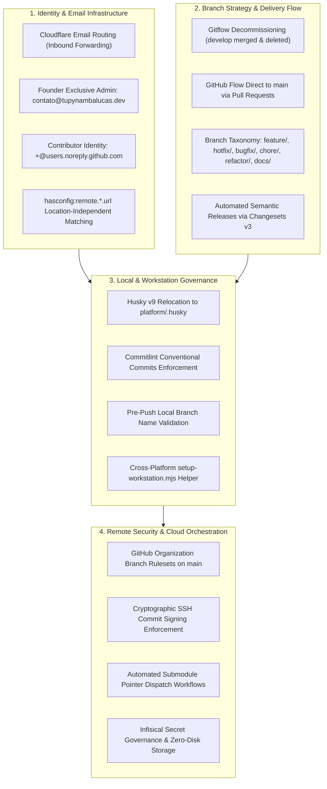

# Architecture Implementation Roadmap & Governance Progress Tracker

Master tracking document and operational execution roadmap for the `tupynambalucas-dev` organizational
governance, umbrella meta-repository (`org-core`), GitHub Flow migration, security rulesets, and developer workstation standards.

---

## 1. High-Level Architecture Topology

---

## 2. Completed Milestones (What Has Been Done)

| Stage | Milestone | Scope | Key Artifact / Commits |
| :--- | :--- | :--- | :--- |
| **01** | **Meta-Repository Pattern & Namespace Design** | Architectural design of `org-core` umbrella orchestrator with zero business code. Namespace separation of `projects/personal/` vs `projects/organizations/`. | [meta-repository-architecture.md](./meta-repository-architecture.md) |
| **02** | **Lean Sovereign Email Architecture** | Formulated policy for zero-cost Cloudflare Email Routing for `contato@tupynambalucas.dev` without paid Google Workspace or GitHub EMU. Contributor commit identity standard using native GitHub no-reply emails with guaranteed SSH verification. | [developer-workstation-and-github-onboarding-plan.md](./developer-workstation-and-github-onboarding-plan.md) |
| **03** | **Location-Independent Git Configuration** | Replaced fragile hardcoded filesystem paths with Git 2.36+ `hasconfig:remote.*.url` matching. Allows developers to clone `org-core` or submodules into any directory (Desktop, D:, Linux home) while dynamically loading organization SSH keys and commit personas. | [developer-workstation-and-github-onboarding-plan.md](./developer-workstation-and-github-onboarding-plan.md) |
| **04** | **Submodules & Multi-Repo Operational Analysis** | In-depth engineering study of Git submodule hazards (Detached HEAD, pointer drift, out-of-order pushes, standalone workflows) and formulated automated CI dispatch runbooks. | [git-submodules-and-multi-repo-orchestration-plan.md](./git-submodules-and-multi-repo-orchestration-plan.md) |
| **05** | **GitHub Flow Master Blueprint & Changesets Design** | Formalized rejection of legacy Gitflow and `git-flow` CLI in favor of single-branch `main` delivery, branch naming standard (`feature/*`, `hotfix/*`, `bugfix/*`, etc.), Changesets v3, and ephemeral preview deployments. | [github-flow-and-changesets-branch-governance-plan.md](./github-flow-and-changesets-branch-governance-plan.md) |
| **06** | **GitHub Organization Security & Rulesets Specification** | Designed remote enforcement baseline: secret scanning push protection, branch protection rulesets on `main`, required signed commits, and CODEOWNERS governance. | [github-organization-security-and-rulesets-plan.md](./github-organization-security-and-rulesets-plan.md) |
| **07** | **Husky v9 Migration to `platform/.husky`** | Relocated Husky from nested `shared/git/husky` to canonical root `platform/.husky`. Added `"prepare": "husky"` to `platform/package.json`, cleaned obsolete Husky v8 shims, and verified pre-commit lint-staged pipeline. | `platform`: commit `44dc0044` |
| **08** | **Gitflow Decommissioning: `develop` Merged & Purged** | Merged all active development from `develop` into `main` across `docs` and `platform` without data loss or conflicts. Deleted `develop` branches locally and remotely. Submodule pointers and `.gitmodules` updated to track `main`. | `docs`: `2e549b4` `platform`: `cc9c6aa5` `org-core`: `20a43f8` |

---

## 3. Pending Milestones & Future Execution Plan (What Remains to be Done)

The following stages represent the concrete engineering tasks required to complete the organizational transition to a fully automated, sovereign enterprise environment.

### Phase 1: Local Linting & Commit Governance Standardization
- [ ] **Task 1.1: Install Commitlint in `platform`**
  - Install `@commitlint/cli` and `@commitlint/config-conventional` as root `devDependencies` in `platform`.
  - Create `commitlint.config.mjs` extending `@commitlint/config-conventional`.
  - Add `.husky/commit-msg` hook running `pnpm exec commitlint --edit "$1"`.
- [ ] **Task 1.2: Enforce Local Branch Naming Pattern (`.husky/pre-push`)**
  - Implement `.husky/pre-push` hook in `platform` blocking direct pushes to `main` and validating branch names against `^(feature|hotfix|bugfix|chore|refactor|docs)\/[a-z0-9._-]+$`.
- [ ] **Task 1.3: Extend Husky to `docs` and `agent-toolkit`**
  - Add Husky v9 to `docs` and `agent-toolkit` root packages for uniform local governance across all organizational repositories.

### Phase 2: Automated Changesets Release Pipeline
- [ ] **Task 2.1: Finalize `.changeset/config.json` in `platform`**
  - Configure `access: "restricted"` (or `"public"` where appropriate), `baseBranch: "main"`, and ignore private workspace packages that should not be published.
- [ ] **Task 2.2: Implement GitHub Actions Release Workflow**
  - Create `.github/workflows/release.yaml` in `platform` triggering `changesets/action@v2` on pushes to `main`.
  - Automatically open and update the `Version Packages` PR for semantic release orchestration.

### Phase 3: Remote GitHub Organization Rulesets Provisioning
- [ ] **Task 3.1: Provision `enforce-main-branch-protection` Ruleset**
  - Apply organization-wide ruleset via GitHub REST API / `gh ruleset` targeting `refs/heads/main` across all repositories.
  - Require cryptographically signed commits, linear history, Pull Request review approvals, and blocking force pushes/deletions.
- [ ] **Task 3.2: Provision `enforce-branch-naming-standard` Ruleset**
  - Apply ruleset with `branch_name_pattern` operator `starts_with` enforcing prefixes `feature/`, `hotfix/`, `bugfix/`, `chore/`, `refactor/`, `docs/`.

### Phase 4: Autonomous Submodule Synchronization (Meta-Repository Dispatch)
- [ ] **Task 4.1: Submodule Bump Workflow in `org-core`**
  - Create `.github/workflows/sync-submodule-pointers.yaml` in `org-core` triggered by `repository_dispatch` with event type `submodule-update`.
  - Uses `@tupynambalucas-org-manager[bot]` credentials to create signed commits bumping the updated submodule gitlink to the latest `origin/main` commit.
- [ ] **Task 4.2: Dispatch Trigger in Child Repositories**
  - Add step in child repository release/push workflows (`platform`, `docs`, `agent-toolkit`) firing `repository_dispatch` to `org-core` upon merging to `main`.

### Phase 5: Zero-Script Developer Onboarding Assistant
- [ ] **Task 5.1: Create `scripts/setup-workstation.mjs`**
  - Author the cross-platform Node.js assistant in `org-core/scripts/setup-workstation.mjs`.
  - Automatically queries `gh api user` to discover developer identity, applies defensive Git settings (`submodule.recurse = true`, `push.recurseSubmodules = check`), sets up `~/.config/husky/init.sh`, and validates SSH commit signing.
- [ ] **Task 5.2: Verification and Developer Runbook Walkthrough**
  - Execute end-to-end dry run verifying clean workstation bootstrap on Windows and Linux/macOS environments.

---

## 4. Master Implementation Status Matrix

| Track | Action Item | Target Scope | Priority | Status |
| :--- | :--- | :--- | :--- | :--- |
| **Identity** | Cloudflare Email Routing & Zero-Cost Developer Identity | All Repositories | Critical | **COMPLETED** |
| **Identity** | `hasconfig:remote.*.url` Dynamic Git Configuration | Developer Workstation | High | **COMPLETED** |
| **Branching** | Merge `develop` into `main` without data loss | `docs`, `platform` | Critical | **COMPLETED** |
| **Branching** | Purge `develop` branches locally and on remote | `docs`, `platform` | High | **COMPLETED** |
| **Branching** | Update `org-core/.gitmodules` to track `main` | `org-core` | Critical | **COMPLETED** |
| **Tooling** | Relocate Husky to `platform/.husky` | `platform` | High | **COMPLETED** |
| **Governance** | Install Commitlint & `.husky/commit-msg` | `platform`, `docs` | High | **PENDING (Phase 1)** |
| **Governance** | Local branch validation `.husky/pre-push` | `platform` | Medium | **PENDING (Phase 1)** |
| **Release** | Changesets v3 config & GitHub Actions release bot | `platform` | High | **PENDING (Phase 2)** |
| **Security** | GitHub Org Rulesets (Signed commits & Branch naming) | GitHub Organization | Critical | **PENDING (Phase 3)** |
| **Meta-Repo** | Automated `repository_dispatch` submodule bump | `org-core`, Submodules | High | **PENDING (Phase 4)** |
| **Onboarding** | Standalone `setup-workstation.mjs` helper script | `org-core` | Medium | **PENDING (Phase 5)** |
