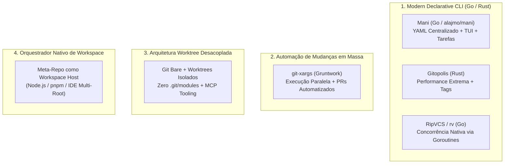
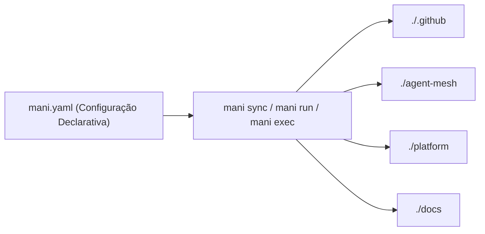
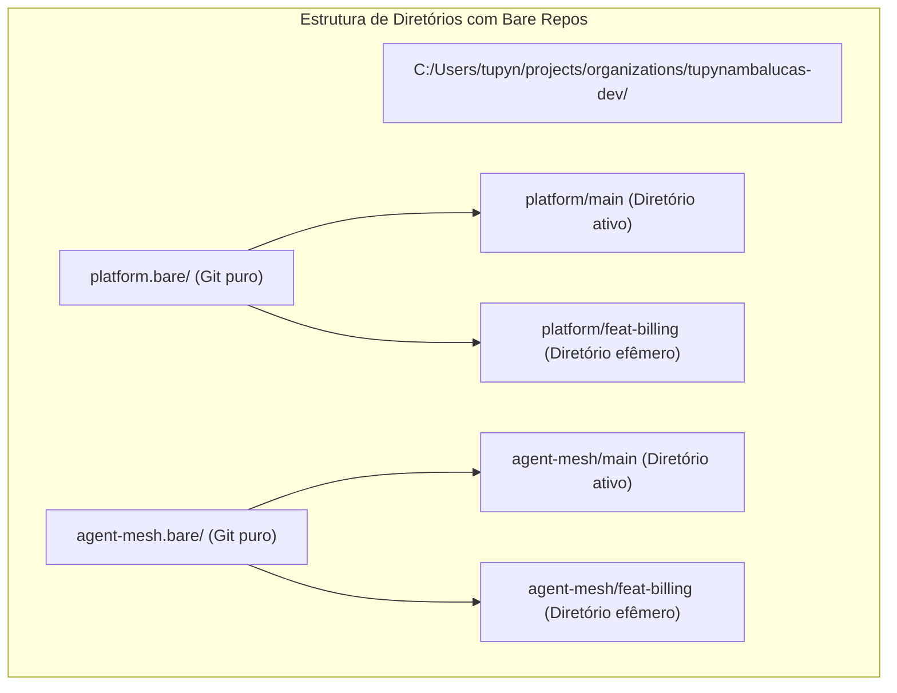

# Dossiê Arquitetural: Ferramentas Contemporâneas (2024–2026) para Gestão Multi-Repo e Orquestração do `org-core`

Este documento expande a análise de substitutos ao Git Submodules, investigando o cenário tecnológico contemporâneo (2024 a 2026) além de soluções legadas como `meta` (Node.js, 2017) ou `gita` (Python, utilitário pessoal). 

O foco é identificar ferramentas profissionais capazes de orquestrar a arquitetura federada da organização [`tupynambalucas-dev`](https://github.com/tupynambalucas-dev) (`org-core`, `.github`, `agent-mesh`, `platform`, `docs`) com alta performance, suporte a Windows/PowerShell, zero fricção de ponteiros e compatibilidade nativa com Agentes de IA autônomos.

---

## 1. O Cenário Tecnológico Contemporâneo de Multi-Repo (2024–2026)

Com a evolução da engenharia em nuvem e a explosão de agentes autônomos de código (Antigravity, Cursor, Claude Code, OpenHands), o ecossistema multi-repositório abandonou ferramentas baseadas em scripts lentos ou embutimento rígido de submódulos. 

O mercado atual divide-se em quatro categorias fundamentais:



---

## 2. Análise Profunda das Ferramentas Modernas

### 2.1 Mani (`alajmo/mani`) — O Padrão Moderno Mais Elegante

**O que é**: CLI declarativo escrito em Go, ativamente mantido, desenhado especificamente para desenvolvedores e empresas que operam dezenas de microsserviços ou repositórios federados.



#### Como Funciona
No repositório raiz do `org-core`, substitui-se o `.gitmodules` por um manifesto limpo `mani.yaml`:

```yaml
projects:
  .github:
    url: git@github.com:tupynambalucas-dev/.github.git
    path: .github
    desc: Organization governance and public profile
    tags: [governance, templates]

  agent-mesh:
    url: git@github.com:tupynambalucas-dev/agent-mesh.git
    path: agent-mesh
    desc: Universal AI agent mesh and MCP packages
    tags: [ai, plugins, mcp]

  platform:
    url: git@github.com:tupynambalucas-dev/platform.git
    path: platform
    desc: Core platform services and Kubernetes manifests
    tags: [core, services, k8s]

  docs:
    url: git@github.com:tupynambalucas-dev/docs.git
    path: docs
    desc: Sovereign documentation hub
    tags: [docs, docusaurus]

tasks:
  sync-all:
    desc: Synchronize all repositories to main
    cmd: git switch main && git pull origin main

  typecheck-all:
    desc: Run typecheck across all TypeScript workspaces
    cmd: pnpm typecheck
    spec:
      tags: [ai, core, docs]

  status-overview:
    desc: Inspect git status in a clean table
    cmd: git status -s
```

#### Vantagens para o `org-core`
1. **Binário Único Sem Dependências de Runtime**: Distribuído como binário compilado em Go (disponível via `winget install mani` ou `scoop install mani` no Windows). Não exige Node.js, Python ou Ruby globais.
2. **Eliminação Radical de Gitlinks e Locks**: Cada repositório é clonado como um clone Git independente. Não existe redirecionamento `.git/modules/` nem arquivo de trava de ponteiro.
3. **Comandos por Tag e Filtragem Dinâmica**: Permite rodar tarefas apenas em subconjuntos do ecossistema (ex: `mani run typecheck-all --tags ai`).
4. **Interface Visual no Terminal (TUI)**: Oferece um dashboard interativo para inspecionar branches, commits não enviados e diffs pendentes em um único comando.

---

### 2.2 `git-xargs` (Gruntwork) — Orquestrador de Mudanças e PRs em Escala

**O que é**: Ferramenta em Go mantida pela Gruntwork (líder em arquitetura de infraestrutura como código). Diferente de ferramentas locais, o `git-xargs` foi projetado para **automação corporativa contínua de mudanças através de repositórios**.

#### Como Funciona
O `git-xargs` clona os repositórios em diretórios de trabalho temporários, aplica um script ou comando, commita com Conventional Commits, faz o push de uma branch efêmera e **abre automaticamente Pull Requests em todos os repositórios selecionados**.

```bash
git-xargs \
  --branch-name chore/align-node-version \
  --github-org tupynambalucas-dev \
  --repos .github,agent-mesh,platform,docs \
  --commit-message "chore(deps): bump node engine to >= 22.x" \
  ./scripts/update-node-engine.sh
```

#### Vantagens para o `org-core`
- **Ideal para Governança Corporativa**: Perfeito quando a organização precisa atualizar licenças, arquivos de CI/CD, configurações do Prettier ou dependências compartilhadas em toda a frota de repositórios de uma só vez, com zero intervenção manual.
- **Respeita 100% os Rulesets**: Não tenta fazer push direto. Ele cria a branch e abre o Pull Request automaticamente via GitHub REST API, acionando os CI checks e as revisões necessárias.

---

### 2.3 `gitopolis` — O Gerenciador Multi-Repo em Rust

**O que é**: Ferramenta recente construída em Rust, focada em altíssima velocidade e ergonomia para engenheiros que mantêm ecossistemas distribuídos.

#### Características:
- Gerencia grupos de repositórios através de tags e expressões regulares.
- Muito mais rápido que ferramentas baseadas em Node (`meta`) ou Python (`gita`), pois roda operações de Git em paralelo usando threads nativas de SO.
- Ideal para máquinas de desenvolvimento locais com SSDs NVMe e processadores multinúcleo.
- *Limitação*: Comunidade ainda menor que a do `mani`, com menos integrações em pipelines de CI.

---

### 2.4 Arquitetura Bare Clones + Git Worktrees Paralelos

**O que é**: O padrão técnico que as empresas de ponta e ambientes de agentes de IA adotaram em 2025/2026 para eliminar o atrito de troca de branches e evitar arquivos sujos de Git.



#### Por que Essa Arquitetura Ganhou Força?
- **Agentes de IA Concorrentes**: Permite que múltiplos agentes trabalhem em paralelo em features diferentes sem nunca causarem conflito na branch local de desenvolvimento.
- **Zero Bloqueio no Windows**: Não existem vínculos de submódulo. Se um processo mantiver um arquivo aberto em um worktree, o worktree principal da `main` permanece intacto e funcional.

---

## 3. Matriz Comparativa: Ferramentas Tradicionais vs. Modernas (2025/2026)

| Dimensão de Comparação | Git Submodules (Atual) | Meta (2017) | Gita (Python) | Mani (Go 2024–2026) | Git-Xargs (Gruntwork) | Workspace Host Scriptado (Node) |
| :--- | :--- | :--- | :--- | :--- | :--- | :--- |
| **Tecnologia / Runtime** | Git Nativo C | Node.js | Python | **Go (Binário Nativo)** | **Go (Binário Nativo)** | **Node.js (Já no monorepo)** |
| **Manifesto Versionável** | `.gitmodules` | `.meta` (JSON) | Não (Local) | **`mani.yaml`** | CLI Flags / Listas | `package.json` + `workspace` |
| **Elimina `160000` Gitlinks?** | Não (Depende) | Sim | Sim | **Sim** | Sim | **Sim** |
| **Erros de Trava NTFS (Windows)**| Frequente | Raro | Raro | **Zero** | Zero | **Zero** |
| **Execução de Tarefas em Lote**| Limitada (`foreach`)| Sim | Sim | **Poderosa (Tags/Tasks)**| Focada em PRs | Via `pnpm` / scripts |
| **Automação de PRs Coordenados**| Nula (Manual) | Nula | Nula | Nula (Executa scripts) | **Totalmente Nativa** | Nula (Executa scripts) |
| **Dependência de Instalação** | Nenhuma | `npm i -g meta`| `pip install` | `winget install mani` | `brew`/`go install` | **Zero (Usa Node já existente)**|
| **Curva de Aprendizado** | Alta | Baixa | Baixa | **Baixa** | Baixa | **Zero** |

---

## 4. Como Ficaria o `org-core` Sem Submódulos: Três Cenários de Modernização

### Cenário A: O Padrão `Mani` (Recomendado se Buscar Ferramenta CLI Especializada)

Se o objetivo for adotar a melhor ferramenta dedicada moderna:

1. Remove-se `.gitmodules` e desativa-se os submodules no `org-core`.
2. Adiciona-se o arquivo `mani.yaml` na raiz do `org-core`.
3. O comando de onboarding passa a ser:
   ```bash
   # Clona a raiz do org-core
   git clone git@github.com:tupynambalucas-dev/org-core.git
   cd org-core

   # Sincroniza e clona todos os repositórios filhos de forma autônoma
   mani sync
   ```
4. Operações diárias:
   - `mani run status` $\rightarrow$ Tabela visual mostrando o status dos 4 repositórios.
   - `mani run pull` $\rightarrow$ Atualiza todos para a `main`.

---

### Cenário B: O Padrão "Zero-Third-Party" (Workspace Host via Node/pnpm)

Se o objetivo for **não obrigar ninguém a instalar ferramentas novas** (nem Mani, nem Gita, nem Meta), mantendo 100% da stack em Node/TypeScript:

1. O `org-core` passa a ter um script em `scripts/ecosystem.mjs` (já suportado pelo Node 22 nativo sem build):
   ```javascript
   // scripts/ecosystem.mjs
   import { execSync } from 'node:child_process';
   import fs from 'node:fs';

   const repos = [
     { name: '.github', url: 'git@github.com:tupynambalucas-dev/.github.git' },
     { name: 'agent-mesh', url: 'git@github.com:tupynambalucas-dev/agent-mesh.git' },
     { name: 'platform', url: 'git@github.com:tupynambalucas-dev/platform.git' },
     { name: 'docs', url: 'git@github.com:tupynambalucas-dev/docs.git' }
   ];

   const cmd = process.argv[2] || 'status';

   for (const repo of repos) {
     if (!fs.existsSync(repo.name)) {
       console.log(`Cloning ${repo.name}...`);
       execSync(`git clone ${repo.url} ${repo.name}`, { stdio: 'inherit' });
     } else if (cmd === 'sync') {
       console.log(`Syncing ${repo.name}...`);
       execSync('git switch main && git pull origin main', { cwd: repo.name, stdio: 'inherit' });
     } else if (cmd === 'status') {
       const st = execSync('git status -s', { cwd: repo.name }).toString().trim();
       console.log(`[${repo.name}] ${st || 'Clean (on main)'}`);
     }
   }
   ```
2. O `package.json` expõe:
   - `pnpm sync`: Atualiza todas as pastas filhas.
   - `pnpm status`: Mostra o status de todos.
3. O arquivo `tupynambalucas-dev.code-workspace` continua unindo os 4 no editor.
4. **Vantagem Absoluta**: Funciona no Windows, Linux, macOS, em qualquer agente de IA e em qualquer máquina limpa que tenha `pnpm` instalado.

---

### Cenário C: Orquestração Contínua de Governança com `git-xargs`

Utilizado em conjunto com o Cenário A ou B para automações cross-repo na organização:
- Quando criarmos novos padrões de rulesets, novos linters ou novos pacotes compartilhados, um job de GitHub Actions na organização roda o `git-xargs` para disparar PRs sincronizados em todos os repositórios simultaneamente, sem exigir trabalho manual pasta por pasta.

---

## 5. Conclusão e Veredito

1. **Sobre `meta` e `gita`**: Ambos foram superados. `meta` pertence a uma geração anterior de tooling de micro-pacotes (2017) e `gita` é puramente um script pessoal de conveniência de terminal sem valor para automação corporativa.
2. **A Melhor Ferramenta CLI Moderna de Multi-Repo**: **`mani` (`alajmo/mani`)**. Se a organização deseja um utilitário dedicado com manifesto centralizado (`mani.yaml`), dashboards coloridos no terminal e comandos por tags, o `mani` é hoje a opção mais madura, rápida e bem desenhada do mercado.
3. **A Solução Mais Pragmática e Sem Dependências**: O **Cenário B (Workspace Host Scriptado com Node nativo)**. Como nosso ecossistema já utiliza Node.js LTS e pnpm, criar 50 linhas de script nativo no `org-core` entrega 100% dos benefícios do `meta` ou `mani` sem obrigar ninguém da equipe nem nenhum agente a instalar pacotes ou binários adicionais no sistema operacional.
