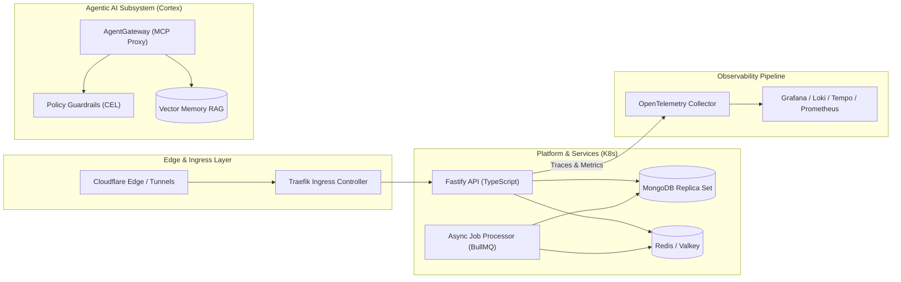

# Plano de Arquitetura: Perfil Pessoal GitHub (@tupynambalucas)

Este plano define a estratégia de posicionamento, design e engenharia para o perfil pessoal do GitHub (`github.com/tupynambalucas`), desvinculando a identidade pessoal da organização corporativa, porém ancorando a autoridade técnica na arquitetura real desenvolvida em `platform` (Domain-Driven Design, Bounded Contexts, Cloud-Native, GitOps e IA Agentica).

---

## 1. Diretrizes Estratégicas de Posicionamento

- **Público-Alvo**: Tech Leads, Staff/Principal Engineers, Headhunters internacionais, Arquitetos de Soluções e colaboradores de código aberto.
- **Diferencial Competitivo**: União de 10+ anos de fundamentos de engenharia de software (DDD, SOLID, Bounded Contexts, tipagem estrita) com infraestrutura cloud-native (Kubernetes, GitOps) e sistemas de IA de ponta (MCP, AgentGateway, RAG com memória vetorial).
- **Tom e Linguagem**:
  - Bio e README do perfil: Inglês formal técnico (en-US), padrão da indústria internacional.
  - Documentação deste plano: Português (pt-BR), conforme as regras de governança de `.agents/plans/`.
  - Zero emojis, layout minimalista, diagramas técnicos e dados dinâmicos mensuráveis.

---

## 2. Bio do Perfil (Limite Exato: 160 Caracteres)

### Opção Recomendada (Equilíbrio Arquitetura + DDD + IA)
```text
Software Engineer & Systems Architect. Strong SE foundations, DDD & Bounded Contexts, distributed systems, and AI-driven platform engineering.
```
*(143 caracteres)*

### Alternativa 1 (Foco em Sistemas Distribuídos e Cloud Native)
```text
Software Engineer & Systems Architect. Grounded in solid SE principles, Bounded Contexts, cloud-native architecture, and AI-driven systems.
```
*(138 caracteres)*

### Alternativa 2 (Foco em TypeScript, Plataformas e Agentes)
```text
Systems Architect & Software Engineer. Solid SE foundations, Bounded Contexts, TypeScript, distributed platforms, and AI-driven workflows.
```
*(138 caracteres)*

---

## 3. Estrutura do README do Perfil (`tupynambalucas/tupynambalucas`)

O template abaixo foi arquitetado para reutilizar o pipeline automatizado do `@/renderer` em `platform`, integrando os cards SVG de estatísticas gerados dinamicamente na branch `generated`.

```markdown
# Tupynambá Lucas

**Software Engineer & Systems Architect** with over a decade of hands-on experience designing end-to-end distributed systems, domain-driven architectures, and autonomous AI-driven platforms.

---

### Core Architectural Competencies

```
                  ┌─────────────────────────────────────────┐
                  │          Systems Architecture           │
                  │   DDD • Bounded Contexts • Hexagonal    │
                  └────────────────────┬────────────────────┘
                                       │
        ┌──────────────────────────────┴──────────────────────────────┐
        ▼                                                             ▼
┌───────────────────────────────┐             ┌───────────────────────────────┐
│     Cloud Native & GitOps     │             │     AI-Driven Engineering     │
│  Kubernetes • ArgoCD • Docker │             │    Model Context Protocol     │
│   Traefik • OpenTelemetry     │             │ AgentGateway • Memory Subsys  │
└───────────────────────────────┘             └───────────────────────────────┘
```

- **Domain Modeling & System Boundaries**: Deep implementation of Domain-Driven Design (DDD), formal Bounded Context isolation, Single Source of Truth (SSOT), and modular monorepos managed with PNPM Workspaces and Turborepo.
- **Backend & Distributed Systems**: Event-driven and transactional systems with Node.js/TypeScript and Fastify, Redis/Valkey for asynchronous job queuing (BullMQ), and multi-document ACID transactions with MongoDB replica sets.
- **Cloud-Native Infrastructure & GitOps**: Multi-cluster local and cloud Kubernetes orchestration (k3d, Skaffold, Helm), automated GitOps deployments via ArgoCD, Cloudflare edge networks (Tunnels, Pages, Workers), and cert-manager ACME automation.
- **Full-Stack Observability**: Production observability pipelines using OpenTelemetry Collector exporting metrics to Prometheus, logs to Grafana Loki, and distributed traces to Grafana Tempo (LGTM stack).
- **AI-Driven & Agentic Tooling**: Self-hosted Model Context Protocol (MCP) gateways, policy-enforced guardrails (CEL), vector RAG layers, and custom autonomous agent customization frameworks (Antigravity).

---

### Engineering Foundations

| Domain | Standard & Implementations |
| :--- | :--- |
| **Architectural Patterns** | Domain-Driven Design (DDD), Hexagonal Architecture, Ports & Adapters, Event-Driven. |
| **Language & Runtimes** | TypeScript (strict mode), Node.js (ESM), Go, Bash/PowerShell automation. |
| **API & Protocols** | REST, Fastify 5, WebSockets, Model Context Protocol (MCP), SSE, OpenAPI/JSON Schema. |
| **Storage & Data Integrity**| MongoDB (Replica Sets, ACID transactions, Vector Search), PostgreSQL, Redis, Valkey. |
| **Platform & Networking** | Kubernetes, Skaffold, Helm, Traefik v3, Cloudflare Zero Trust, Docker. |
| **Observability & SRE** | OpenTelemetry, Prometheus, Grafana, Loki, Tempo, Pyroscope. |
| **Quality & Security** | Deterministic builds, Infisical Secret Governance, Conventional Commits, Prettier/ESLint. |

---

### Platform Architecture Blueprint

Representative topology of distributed platforms and autonomous systems I engineer:



---

### Dynamic Engineering Metrics

<p align="center">
  <picture>
    <source media="(prefers-color-scheme: dark)" srcset="https://raw.githubusercontent.com/tupynambalucas/tupynambalucas/generated/cards/stats/overview.svg?raw=true#gh-dark-mode-only" />
    <source media="(prefers-color-scheme: light)" srcset="https://raw.githubusercontent.com/tupynambalucas/tupynambalucas/generated/cards/stats/overview.svg?raw=true" />
    
  </picture>&nbsp;&nbsp;<picture>
    <source media="(prefers-color-scheme: dark)" srcset="https://raw.githubusercontent.com/tupynambalucas/tupynambalucas/generated/cards/stats/languages.svg?raw=true#gh-dark-mode-only" />
    <source media="(prefers-color-scheme: light)" srcset="https://raw.githubusercontent.com/tupynambalucas/tupynambalucas/generated/cards/stats/languages.svg?raw=true" />
    
  </picture>
</p>

---

### Key Technical Principles

1. **Deterministic & Strict Typing**: Elimination of implicit any, schema validation at all system boundaries (Zod), and end-to-end compile-time safety.
2. **Architecture Driven by Requirements, Not Hype**: Pragmatic database and protocol selection matching workload demands (e.g., MongoDB replica sets for document models, Redis for state, PostgreSQL for relations).
3. **Defense in Depth**: Zero hardcoded credentials, centralized secrets via Infisical Universal Auth, network isolation, and branch protection rulesets.
4. **Autonomous AI as Infrastructure**: Agentic AI treated as first-class infrastructure with strict contracts, audit logs, and deterministic verification.
```

---

## 4. Estratégia de Repositórios em Destaque (Pinned Repositories)

Para maximizar a conversão profissional no perfil público, devem ser fixados 4 a 6 repositórios refletindo o tripé arquitetural (Fundamentos, Infraestrutura/GitOps e IA Agentica):

1. **`tupynambalucas/tupynambalucas`** (Special Profile Repo):
   - Contém o `README.md` compilado e o pipeline de asset cards.
2. **`platform`** (Monorepo de Plataforma):
   - Vitrine de orquestração Turborepo, Kubernetes (k3d/Skaffold), LGTM Observability e Traefik Ingress.
3. **`docs`** (Hub de Documentação Soberano):
   - Vitrine de Docusaurus 3 em escala corporativa, multi-instância, Crowdin i18n e Diátaxis Framework.
4. **Repositório de Agentic AI / MCP Tooling**:
   - Demonstração prática do ecossistema Cortex (AgentGateway, Guardrails CEL, Memória Vetorial).

---

## 5. Roteiro de Execução Passo a Passo

1. **Acessar GitHub Profile Settings**:
   - Definir a Bio com os 143 caracteres selecionados.
   - Definir localização, website (`https://tupynambalucas.dev`) e perfil LinkedIn/X.
2. **Criar ou Atualizar o Repositório do Perfil**:
   - Repositório: `tupynambalucas/tupynambalucas` (público).
   - Inserir o conteúdo do `README.md` definido na Seção 3.
3. **Disparar o Gerador de Cards (`@/renderer`)**:
   - Rodar o pipeline `pnpm --filter @tupynambalucas/renderer build` em `platform` para assegurar que as imagens em `https://raw.githubusercontent.com/tupynambalucas/tupynambalucas/generated/cards/stats/` estejam atualizadas.
4. **Fixar os Repositórios Principais (Pin Repositories)**:
   - Configurar os 4 pins estratégicos na página inicial do perfil.
