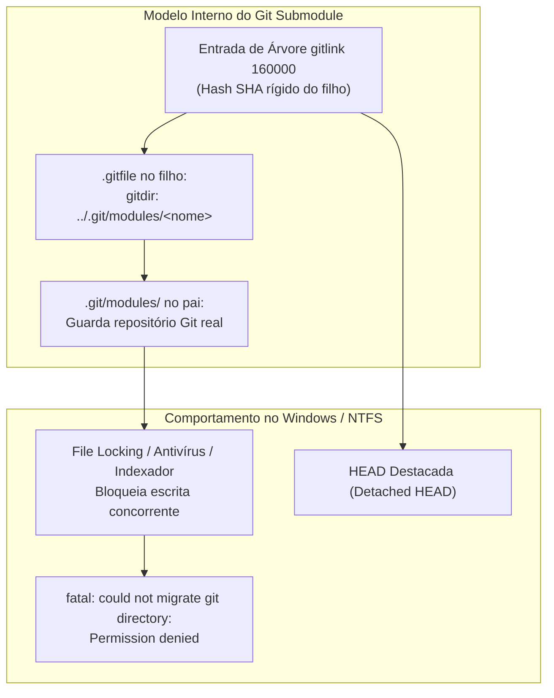
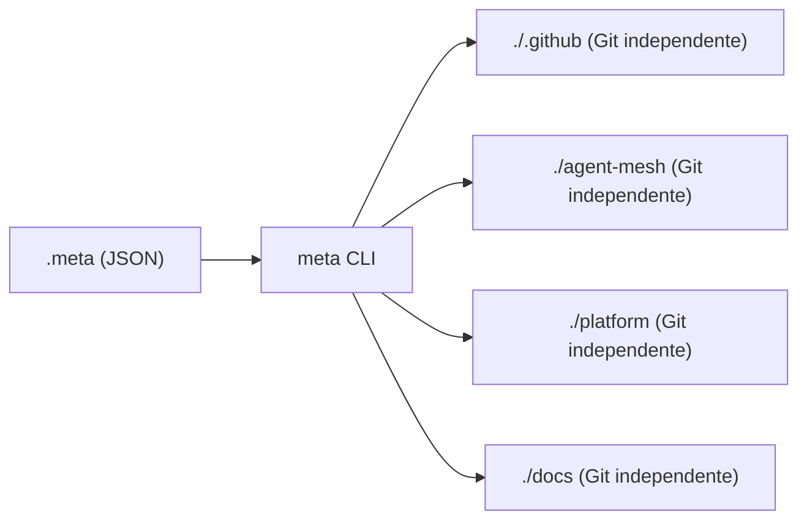
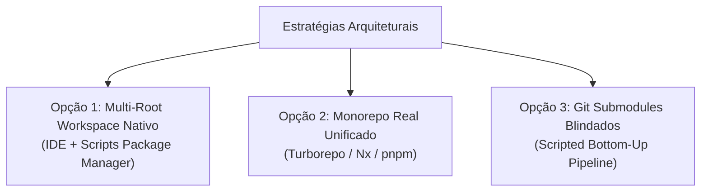

# Relatório Arquitetural: Avaliação de Alternativas ao Git Submodules no `org-core`

Este relatório analisa a arquitetura de orquestração de múltiplos repositórios sob o meta-repositório umbrella [`tupynambalucas-dev/org-core`](https://github.com/tupynambalucas-dev/org-core). Ele compara o modelo nativo de **Git Submodules** com ferramentas dedicadas de polyrepo/multi-repo (**Meta**, **Gita**, **Google Repo**, **Git Subrepo**) e padrões contemporâneos de **Monorepo e Workspaces** (**Turborepo**, **Nx**, **pnpm workspaces**).

---

## 1. O Diagnóstico: Por Que Git Submodules Causam Fricção no `org-core`?

A experiência recente de sincronização e avanço de ponteiros revelou atritos operacionais estruturais. Para avaliar substitutos com precisão, é necessário dissecar a raiz técnica dessas falhas.



### 1.1 As Quatro Falhas Estruturais do Git Submodule

1. **Acoplamento Falso e Ponteiros Rígidos (`160000 gitlink`)**:
   - Um submódulo não rastreia uma *branch* de verdade em tempo de execução; ele grava um hash SHA estático de 40 caracteres no índice do repositório pai.
   - Toda alteração em qualquer filho exige **dois commits, dois PRs e duas revisões**: primeiro no repositório filho, e depois no repositório pai (`org-core`) para atualizar o ponteiro.
2. **Incompatibilidade com o Mecanismo de Ingestão do GitHub (`.github` como Submódulo)**:
   - No Git, `.github` dentro do `org-core` é uma entrada de diretório delegada (`160000`).
   - O GitHub **ignora completamente** arquivos em submódulos para recursos de governança de repositório. O `org-core` não pode rodar workflows de GitHub Actions colocados em `.github/workflows/` se `.github` for um submódulo, pois o motor do GitHub só avalia árvores de objetos nativas daquele repositório.
3. **Fragilidade de Armazenamento no Windows (`.git/modules` e NTFS Locks)**:
   - A partir do Git 2.x, submódulos não mantêm suas pastas `.git/` dentro da pasta clonada; eles gravam um arquivo texto `.git` apontando para `.git/modules/<nome>`.
   - No Windows, qualquer processo em segundo plano (VS Code, Antigravity CLI, Language Servers do TypeScript, Windows Defender) que mantenha descritores de arquivo abertos em `.git/modules` gera erros como:
     ```text
     fatal: could not migrate git directory from '.../agent-mesh/.git' to '.../.git/modules/agent-mesh': Permission denied
     ```
4. **Estados de HEAD Destacada (`Detached HEAD`)**:
   - Comandos nativos como `git checkout` ou `git submodule update` colocam os repositórios filhos em estado desanexado. Desenvolvedores frequentemente realizam commits locais sem notar que não estão em nenhuma branch, gerando perda silenciosa de histórico ou bloqueios no CI.

---

## 2. Análise Detalhada das Ferramentas Especializadas

### 2.1 Meta (`mateodelnorte/meta`)

**Conceito**: Criado originalmente pela comunidade Node.js para mitigar os problemas dos submódulos em arquiteturas orientadas a micro-pacotes e micro-serviços.



- **Como Funciona**:
  - A pasta raiz não possui submódulos. Ela contém um arquivo de manifesto declarativo `.meta` (JSON).
  - O comando `meta git clone` clona os repositórios filhos lado a lado ou em subdiretórios declarados como repositórios Git 100% autônomos (cada um com seu próprio `.git/` real, sem ponteiros `160000` e sem pastas `.git/modules`).
  - Permite executar comandos em lote: `meta git status`, `meta git pull`, `meta exec "pnpm test"`.
- **Vantagens para o `org-core`**:
  - **Eliminação Completa de Ponteiros**: O `org-core` não precisa comitar hashes de submódulo nem aprovar PRs secundários apenas para registrar avanço de código dos filhos.
  - **Zero Problemas de Permissão no Windows**: Como não existe o redirecionamento de `.git/modules/`, o Git nativo do Windows trata cada pasta como um clone comum.
  - **Branches Normais**: Cada repositório permanece sempre em sua respectiva branch `main`, sem estados de `Detached HEAD`.
- **Desvantagens**:
  - **Necessidade de Ferramenta Externa**: Exige que qualquer desenvolvedor ou agente tenha a ferramenta instalada globalmente (`npm install -g meta`).
  - **Ausência de Travamento Estrito de Versão**: Não existe pinning criptográfico obrigatório de qual versão do filho está montada; depende de convenções de branch (`main`).
  - **Status de Manutenção**: O projeto original teve desaceleração de novos recursos nos últimos anos, embora o protocolo base seja simples e estável.

---

### 2.2 Gita (`nosarthur/gita`)

**Conceito**: Utilitário em Python focado em supervisão, dashboards e execução em lote para desenvolvedores que lidam com dezenas de repositórios independentes na mesma máquina.

- **Como Funciona**:
  - Não impõe arquivos de configuração versionados dentro do repositório por padrão. Os repositórios são registrados no cache do usuário (`gita add <caminho>`).
  - Apresenta um painel visual no terminal (`gita ll`) indicando a branch atual, se há commits para push/pull e se o index está limpo.
- **Vantagens**:
  - Extremamente leve e não-invasivo.
  - Execução paralela de comandos (`gita fetch --all`, `gita status`).
- **Desvantagens Críticas para o `org-core`**:
  - **Não é uma Ferramenta de Onboarding ou Governança**: Não provê um manifesto centralizado comitável no Git que um novo desenvolvedor ou agente em máquina limpa possa clonar para puxar o ecossistema inteiro de uma vez.
  - **Inadequado para CI/CD**: Não orquestra dependências nem automatiza builds entre os projetos.

---

### 2.3 Google Repo (`repo`)

**Conceito**: Desenvolvido pelo Google para orquestrar o Android Open Source Project (AOSP), coordenando centenas de repositórios Git independentes através de manifestos XML centralizados.

- **Como Funciona**:
  - Um repositório de manifesto contém um arquivo `default.xml` que mapeia URLs remotas, branches e caminhos locais.
  - Comandos como `repo init -u <manifest-url>` e `repo sync` baixam e mantêm a árvore unificada.
- **Vantagens**:
  - Padrão corporativo de altíssima escala, testado com milhares de repositórios.
  - Suporta tanto rastreamento dinâmico de branches (`revision="main"`) quanto hashes imutáveis.
  - Mantém repositórios isolados com permissões RBAC estritas.
- **Desvantagens Críticas para o `org-core`**:
  - **Dependência de Python e Ambiente UNIX**: O suporte no Windows nativo (fora de WSL) é historicamente problemático e propenso a falhas com symlinks e caminhos longos.
  - **Complexidade Desproporcional**: O `org-core` orquestra apenas 4 repositórios principais. Adotar o `repo` adiciona sobrecarga conceitual severa e desvia da convenção padrão do ecossistema TypeScript/Node.js.

---

### 2.4 Git Subrepo (`ingydotnet/git-subrepo`)

**Conceito**: Projetado especificamente para ser o substituto moderno e limpo tanto do Git Submodules quanto do Git Subtree.

- **Como Funciona**:
  - O código do repositório secundário é clonado fisicamente para dentro da pasta do repositório principal, mas o controle de upstream é registrado em um arquivo limpo `.gitrepo` dentro da pasta.
  - Quem apenas clona o `org-core` **não precisa do `git-subrepo` instalado**; os arquivos aparecem como arquivos Git normais.
  - Quando um arquiteto deseja puxar ou empurrar código para o repositório original, executa `git subrepo pull <pasta>` ou `git subrepo push <pasta>`.
- **Vantagens**:
  - Quem consome o repositório não sofre com `git submodule update`, `detached HEAD` ou falhas de autorização de submódulo.
  - O `.github/workflows/` do `org-core` passa a funcionar nativamente no GitHub, pois os arquivos residem de fato na árvore do repositório principal.
- **Desvantagens**:
  - Pushes e pulls geram commits sintetizados no histórico.
  - Como os arquivos residem fisicamente no repositório hospedeiro, duplica-se o armazenamento e perde-se a autonomia total dos repositórios filhos se o fluxo não for mantido com extremo rigor.

---

## 3. As Abordagens Modernas (2025/2026)

Na indústria de engenharia de software contemporânea, a gestão de múltiplos repositórios evoluiu para três padrões dominantes:



### 3.1 Opção 1: Multi-Root Workspace + Orquestração por Scripts de Workspace (Padrão Híbrido)

Em vez de usar Git Submodules para forçar o Git a "embutir" pastas, o meta-repositório `org-core` atua puramente como um **Orquestrador de Espaço de Trabalho (Workspace Host)**:

- O arquivo `tupynambalucas-dev.code-workspace` já monta os quatro repositórios lado a lado no editor.
- O `package.json` do `org-core` provê scripts de sincronização em Node.js ou PowerShell que usam clones irmãos simples:
  ```json
  {
    "scripts": {
      "clone:all": "node scripts/clone-ecosystem.mjs",
      "sync:all": "node scripts/sync-ecosystem.mjs",
      "status:all": "node scripts/status-ecosystem.mjs"
    }
  }
  ```
- **Por que é superior ao `meta` ou `gita`**: Não exige instalação de ferramentas globais de terceiros (`npm i -g ...` ou `pip install ...`). Qualquer desenvolvedor com Node.js e Git instalados roda comandos nativos sem atritos.

### 3.2 Opção 2: Monorepo Total Unificado (Turborepo + pnpm Catalog)

Consolidar o código de `platform`, `docs` e `agent-mesh` em um único repositório Git corporativo, mantendo apenas o repositório especial `.github` separado (por exigência de plataforma do GitHub).

- **Como Funciona**:
  - Elimina o `org-core` como umbrella de submódulos. O repositório passa a ser o monorepo definitivo.
  - O Turborepo (`turbo.json`) cuida do paralelismo, cache de builds e grafo de dependências.
  - Commits são 100% atômicos: alterar um plugin em `agent-mesh` e seu consumo em `platform` ocorre no mesmo Pull Request.
- **Desvantagem**: Perda do controle granular de permissões por repositório (RBAC) e impossibilidade de releases públicas e privadas com históricos completamente segregados.

---

## 4. Matriz Comparativa Completa

| Critério de Avaliação | Git Submodules (Atual) | Meta (`meta`) | Gita (`gita`) | Git Subrepo | Multi-Root Workspace (Scripts) | Monorepo Real (Turborepo) |
| :--- | :--- | :--- | :--- | :--- | :--- | :--- |
| **Ponteiros de Commit Rígidos** | Sim (gitlink `160000`) | Não | Não | Não (usa `.gitrepo`) | Não | Não (Histórico único) |
| **Atrito de HEAD Destacada** | Alto | Zero | Zero | Zero | Zero | Zero |
| **Erros de Bloqueio NTFS (Windows)** | Frequente (`.git/modules`) | Zero | Zero | Zero | Zero | Zero |
| **Exigência de CLI de Terceiros** | Nenhuma (Git nativo) | Sim (`meta` via npm) | Sim (`gita` via pip) | Sim (`git-subrepo`) | Nenhuma (Node nativo) | Nenhuma (pnpm/turbo) |
| **Compatibilidade com GitHub Actions** | Nula no root p/ `.github` | N/A | N/A | Total (código embutido) | N/A | Total |
| **Suporte a Commits Atômicos** | Complexo (2 etapas) | Não | Não | Complexo | Não | Nativo e imediato |
| **Isolamento de Permissões (RBAC)** | Alto | Alto | Alto | Moderado | Alto | Baixo |
| **Ergonomia para Agentes de IA** | Baixa (estados travados) | Média | Baixa | Média | Alta (arquivos normais) | Altíssima |

---

## 5. Análise de Vantagens e Desvantagens ao Substituir Submodules

### Se Substituirmos Git Submodules:

#### Vantagens Principais:
1. **Fim dos Erros de Permissão no Windows**: Elimina instantaneamente falhas de travamento de arquivo (`Permission denied` ao migrar diretórios Git) que ocorrem entre o terminal PowerShell e editores de código.
2. **Ciclo de Desenvolvimento Ágil**: Elimina a necessidade de fazer PR duplo para avançar código. Um merge na `main` de `platform` ou `agent-mesh` já coloca a versão mais recente disponível no workspace local.
3. **Ergonomia dos Agentes de IA**: Agentes como Antigravity e Claude Code operam com ferramentas de edição de arquivo simples (`edit_file`, `write_file`). Submódulos adicionam barreiras invisíveis onde agentes editam código mas esquecem de atualizar o ponteiro no pai, ou travam a árvore de trabalho com gitlinks inconsistentes.

#### Desvantagens e Riscos:
1. **Perda de Pinning Determinístico Centralizado**: Sem submódulos ou manifestos estritos, o meta-repositório não garante que o desenvolvedor A esteja exatamente no commit `X` do filho enquanto o desenvolvedor B está no commit `Y`, a menos que todos trabalhem estritamente alinhados na branch `main`.
2. **Necessidade de Script de Onboarding**: Um clone comum do `org-core` não baixa as pastas filhas por padrão (como faria um `git clone --recurse-submodules`), exigindo a execução de um script inicial (`pnpm sync` ou script equivalente).

---

## 6. Parecer Arquitetural e Recomendações

> [!IMPORTANT]
> **Conclusão Técnica**:
> O uso de **Git Submodules** para conectar repositórios com desenvolvimento ativo e diário (como `platform`, `agent-mesh` e `docs`) é considerado um anti-padrão de produtividade, especialmente no ecossistema Windows/NTFS. No entanto, ferramentas antigas como `meta` ou `gita` adicionam dependências de runtime externas desnecessárias sem resolver a governança corporativa.

### Roteiro de Decisão e Próximos Passos Sugeridos:

1. **Curto Prazo (Imediato - Manter Submódulos com Blindagem Operacional)**:
   - Manter a estrutura de submódulos atual, já que acabamos de unificar branches na `main`, assinaturas SSH e rulesets com histórico 100% limpo.
   - Manter a regra: o avanço de submódulos no `org-core` é sempre a **última etapa**, executada apenas após o merge bem-sucedido na `main` remota dos filhos.
2. **Médio Prazo (Recomendado - Migração para Multi-Root Workspace Desacoplado)**:
   - Converter o `org-core` de um "repositório com submódulos Git" para um **"Workspace Orchestrator" nativo**.
   - Remover os submódulos Git (`.gitmodules` e links `160000`).
   - Manter o `tupynambalucas-dev.code-workspace` como entrypoint oficial no VS Code e Antigravity IDE.
   - Adicionar scripts leves em Node.js (`scripts/orchestrator.mjs`) no `org-core` para clonar e sincronizar os 4 repositórios como repositórios irmãos independentes, eliminando de vez todos os problemas de permissão e HEADs destacadas.
