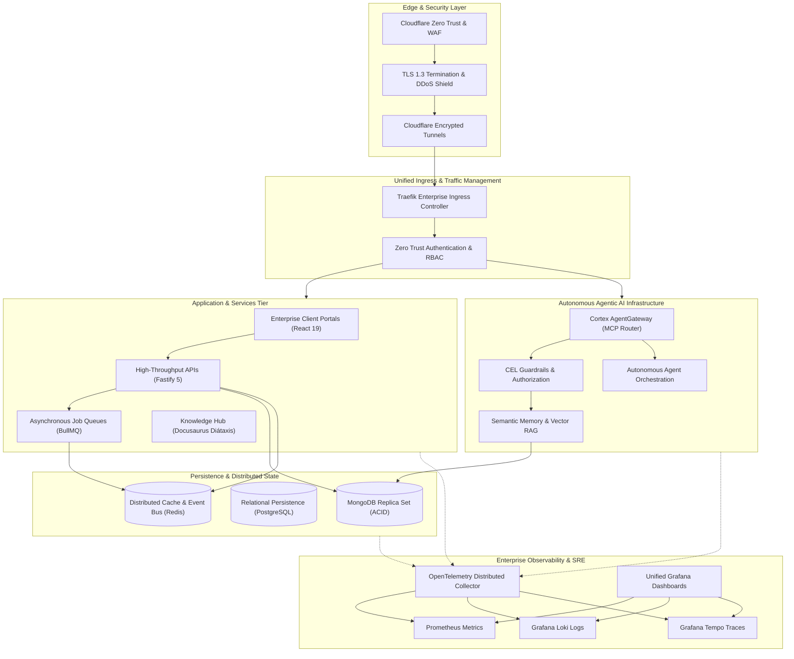

**Enterprise Software Engineering, Autonomous Agentic AI, and Cloud-Native Distributed Systems**

[Website](https://tupynambalucas.dev) &bull;
[Documentation](https://docs.tupynambalucas.dev) &bull;
[Corporate Inquiries](mailto:contato@tupynambalucas.dev) &bull;
[Security](mailto:security@tupynambalucas.dev)

---

## Executive Overview

Tupynambá Lucas is a specialized software engineering and technology consulting organization
providing enterprise architecture, autonomous agentic AI infrastructure, cloud-native platforms,
and high-performance distributed systems.

Our development and governance workflows are anchored in a **Context-Bounded, AI-Driven Monorepo
Architecture**, enforcing strict domain isolation, deterministic dependency graphs, and autonomous
multi-agent operations across all product boundaries. Guided by Domain-Driven Design (DDD),
Feature-Sliced Design (FSD), cryptographic verification, and strict operational security, every
solution is engineered for deterministic performance, horizontal scalability, fault tolerance,
and measurable business impact.

---

## Core Capabilities and Engineering Solutions

### 1. Cloud-Native Architecture and Distributed Systems

We design, deploy, and manage production-grade cloud environments characterized by resilience,
zero-trust security, and architectural parity across development, staging, and production:

- **Enterprise Kubernetes Orchestration**: Production-ready container platforms deployed across
  hybrid and multi-cloud environments, enforcing high availability and horizontal scaling.
- **Zero-Trust Edge and Ingress Security**: Edge routing via Cloudflare Zero Trust tunnels and
  Traefik ingress controllers, terminating TLS at the edge with DDoS mitigation, Web Application
  Firewall (WAF) policies, and elimination of exposed public entry points.
- **Declarative GitOps Delivery**: Automated continuous delivery pipelines managed declaratively
  through ArgoCD, Helm charts, and Kustomize overlays, eliminating configuration drift.
- **Fault-Tolerant Topologies**: Self-healing clusters, immutable container workloads, automated
  failover protocols, and deterministic disaster recovery strategies.

### 2. Autonomous Agentic AI and Cognitive Infrastructure

We build scalable, enterprise-grade infrastructure and orchestration runtimes for autonomous AI
agents and Model Context Protocol (MCP) ecosystems:

- **AgentGateway MCP Ingress and Routing**: Centralized, secure reverse proxy aggregating
  distributed MCP servers under a unified access layer with dynamic tool routing.
- **Policy Enforcement and Security Guardrails**: Real-time traffic inspection and tool invocation
  authorization powered by Common Expression Language (CEL).
- **Persistent Semantic Memory (Vector RAG)**: Multi-layer memory architecture incorporating
  vector similarity search, episodic knowledge graphs, and hybrid semantic indexing for deep
  contextual awareness.
- **Autonomous Agent Workflows**: Deterministic multi-agent collaboration, progressive tool
  disclosure, and specialized runtimes built on Google Antigravity (AGY) architectures.
- **AI Safety and Auditability**: Strict tool execution sandboxing, prompt injection defenses,
  immutable logging of model interactions, and zero-leakage enterprise credential handling.

### 3. High-Throughput Application Engineering

We engineer high-concurrency, low-latency web applications and backend microservices designed
for mission-critical workloads:

- **High-Velocity APIs**: High-throughput backends built with Node.js and Fastify, enforcing strict
  runtime validation via Zod schemas and asynchronous job queuing with Redis and BullMQ.
- **Modern Digital Interfaces & State Machines**: High-performance enterprise portals and
  interactive applications built with React 19, TypeScript, Vite, Tailwind CSS, GSAP, and Three.js,
  utilizing Zustand for reactive client state and XState for deterministic finite-state workflows.
- **Multi-Model Data Persistence**: Multi-document ACID transactions on distributed MongoDB replica
  sets, high-integrity relational schemas on PostgreSQL, and sub-millisecond in-memory caching
  with Redis and Valkey.
- **Domain-Driven Design (DDD)**: Codebases structured around strictly isolated bounded contexts
  and shared Single Source of Truth (SSOT) domain packages, preventing logic duplication.

### 4. Enterprise Observability and Site Reliability Engineering

We integrate end-to-end telemetry and monitoring pipelines to guarantee operational transparency
and uptime SLAs:

- **OpenTelemetry Instrumentation**: Distributed collection of application traces, metrics,
  and container runtime statistics across all service boundaries.
- **Unified Observability Hub**: Centralized operational dashboards with Grafana, long-term metric
  storage with Prometheus, distributed log aggregation with Grafana Loki, and trace analysis
  with Grafana Tempo.
- **Proactive SRE Protocols**: Service Level Objectives (SLOs), automated synthetic monitoring,
  and threshold-based alerting to diagnose and mitigate anomalies before service impact.

### 5. Technical Knowledge Management and Systems Governance

We establish rigorous documentation and architectural standards to ensure operational continuity
and velocity:

- **Diátaxis Documentation Framework**: Comprehensive knowledge bases structured into four distinct
  quadrants (Tutorials, How-To Guides, Reference, and Explanation) using Docusaurus.
- **Unified Design Systems**: Centralized visual identity, design token distribution, and reusable
  component libraries ensuring visual consistency across all digital touchpoints.
- **Deterministic Workflows**: Automated developer tooling, standardized workspace configurations,
  and continuous verification checks across monorepo environments.

---

## Enterprise Systems Architecture

---

## Technology Stack

| Domain                           | Technologies                                                                          |
| :------------------------------- | :------------------------------------------------------------------------------------ |
| **Languages**                    | TypeScript, Go (Golang), Python, Java, JavaScript, Shell (.sh / Bash)                 |
| **Frontend & State Management**  | React 19, TypeScript, Vite, Tailwind CSS, Zustand, XState, GSAP, Three.js, Docusaurus |
| **Backend & Microservices**      | Node.js 22+, Fastify 5, Zod, BullMQ, Nginx                                            |
| **Data Persistence & Cache**     | MongoDB (Replica Set rs0, ACID), Redis, Valkey, PostgreSQL                            |
| **Cloud & Orchestration**        | Kubernetes, Helm, Kustomize, ArgoCD GitOps, Cloudflare Zero Trust                     |
| **Autonomous AI Infrastructure** | AgentGateway (MCP), Vector RAG, CEL Guardrails, Antigravity (AGY)                     |
| **Observability & SRE**          | OpenTelemetry Collector, Prometheus, Grafana, Loki, Tempo, Pyroscope                  |
| **Security & Governance**        | Cryptographic SSH Signing, Infisical Secret Management, Git Rulesets                  |

---

## Engineering Standards and Governance

We enforce software engineering rigor across our entire organization:

- **Cryptographic Verification**: 100% of commits are signed using SSH keys (`ed25519`), ensuring
  verified authorship across the Git graph.
- **Conventional Commits**: Commit messages adhere to strict semantic formatting validated by
  automated pre-receive and CI checks.
- **Branch Protection Rulesets**: Linear Git history with mandatory pull request reviews, passing
  unit tests, type-checks, and linter gates prior to merging into protected branches.
- **Role-Based Access Control (RBAC)**: Administrative privileges partitioned across specialized
  teams adhering to the principle of least privilege.
- **Zero Secrets in Code**: Runtime secrets managed via Infisical and Sealed Secrets for GitOps;
  CI/CD credentials strictly isolated to GitHub Secrets.

---

## Software Engineering Fundamentals and Disciplines

Our engineering practice adheres to rigorous, battle-tested pillars to guarantee that all systems
remain robust, testable, maintainable, and horizontally scalable:

- **[SOLID Principles](https://guide.lucasmattos.dev/#/code-development/solid-principles)**:
  Five foundational object-oriented design principles (SRP, OCP, LSP, ISP, DIP) ensuring loose
  coupling, high cohesion, and modular evolvability across domain boundaries.
- **[Clean Code](https://guide.lucasmattos.dev/#/code-development/clean-code)**:
  Expressive naming conventions, single-purpose functions, minimal cognitive complexity, and
  self-documenting implementations understood immediately across cross-functional teams.
- **[Clean Architecture](https://guide.lucasmattos.dev/#/code-development/clean-architecture)**:
  Concentric layer decoupling where core business rules and domain entities remain entirely
  independent of external frameworks, databases, user interfaces, and transport protocols.
- **[Domain-Driven Design (DDD)](https://guide.lucasmattos.dev/#/code-development/ddd)**:
  Strategic context mapping, bounded contexts, aggregates, and ubiquitous language directly
  aligning technical software topology with real-world business domains.
- **[Test-Driven Development (TDD)](https://guide.lucasmattos.dev/#/code-development/tdd)**:
  Disciplined test-first authoring, comprehensive unit test suites, integration fixtures, and
  contract verification driving confident continuous delivery with zero regressions.
- **[Design Patterns](https://guide.lucasmattos.dev/#/code-development/design-patterns)**:
  Proven architectural and GoF structural, creational, and behavioral patterns paired with modern
  distributed systems patterns (Outbox, Circuit Breaker, Idempotency, and Event Sourcing).
- **[Data Structures & Memory Efficiency](https://guide.lucasmattos.dev/#/code-development/data-structures)**:
  Principled selection of in-memory data structures and algorithmic complexity to maximize
  computational throughput, cache locality, and memory efficiency.
- **[Parallelism and Concurrency](https://guide.lucasmattos.dev/#/code-development/parallelism-concurrency)**:
  Non-blocking asynchronous event loops, concurrent worker thread pools, mutex synchronization, and
  race-condition mitigation engineered for high-concurrency workloads.
- **[Rigorous Code Review](https://guide.lucasmattos.dev/#/code-development/code-review)**:
  Collaborative peer review workflows, mandatory automated branch rulesets, and CI quality gates
  verifying security, architecture adherence, and test coverage before merge.
- **[API Design & Contract Integrity](https://guide.lucasmattos.dev/#/code-development/api-design)**:
  Consistent RESTful contract modeling, strict schema validation (Zod/JSON Schema), deterministic
  error responses, and backwards-compatible semantic versioning.
- **[Realtime Design & Streaming](https://guide.lucasmattos.dev/#/code-development/realtime-design)**:
  Event-driven architectures utilizing bidirectional WebSockets, Server-Sent Events (SSE), and
  pub/sub message brokers to deliver low-latency push communications.

---

## Organization Ecosystem

- **[platform](https://github.com/tupynambalucas-dev/platform)**:
  Primary domain-driven monorepo containing corporate web products, high-throughput REST APIs,
  autonomous AI services, and Kubernetes infrastructure manifests.
- **[docs](https://github.com/tupynambalucas-dev/docs)**:
  Central enterprise knowledge base, architectural reference archives, and Diátaxis documentation
  hub.
- **[.github](https://github.com/tupynambalucas-dev/.github)**:
  Central GitHub organization profile, community health standards, governance rulesets, and AI
  agent configurations.

---

## Contact and Verification

- **Website**: [https://tupynambalucas.dev](https://tupynambalucas.dev)
- **Documentation**: [https://docs.tupynambalucas.dev](https://docs.tupynambalucas.dev)
- **Corporate Inquiries**: [contato@tupynambalucas.dev](mailto:contato@tupynambalucas.dev)
- **Security Disclosures**: [security@tupynambalucas.dev](mailto:security@tupynambalucas.dev)
