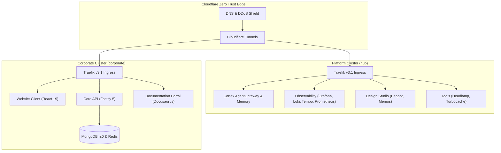

  <picture>
    <source media="(prefers-color-scheme: dark)" srcset="./assets/logo-horizontal-negative.svg" />
    <source media="(prefers-color-scheme: light)" srcset="./assets/logo-horizontal-positive.svg" />
    
  </picture>

  <strong>Enterprise Software Engineering, Autonomous Agentic AI, and Cloud-Native Platforms</strong>

  <a href="https://tupynambalucas.dev">Website</a> &bull;
  <a href="https://docs.tupynambalucas.dev">Documentation</a> &bull;
  <a href="mailto:contato@tupynambalucas.dev">Inquiries</a>

---

## Executive Overview

Tupynambá Lucas is a specialized software engineering firm delivering mission-critical
cloud platforms, enterprise Kubernetes architectures, autonomous AI toolchains, and
high-performance full-stack systems.

We operate on strict Domain-Driven Design (DDD) principles, resilient distributed topologies,
and rigorous cryptographic security standards. Our platforms are designed for deterministic
performance, operational isolation, and horizontal scalability.

---

## Core Capabilities and Services

### 1. Cloud-Native Architecture and Kubernetes Orchestration

We design and operate cloud-native environments characterized by architectural parity across
development, staging, and production:

- **Isolated Dual-Cluster Topologies**: Separation between internal platform management (`hub`)
  and customer-facing products (`corporate`) across both local k3d clusters and cloud Kubernetes.
- **GitOps Continuous Delivery**: Fully automated manifest delivery powered by ArgoCD,
  declarative Kustomize overlays, and Helm charts.
- **Zero Trust Edge Ingress**: Unified ingress routing via Cloudflare Zero Trust tunnels,
  terminating TLS at the edge with WAF and DDoS protection, eliminating public IPs and cloud
  load balancers.
- **Fast Local Feedback Loop**: Instant code-to-cluster synchronization using Skaffold v4,
  in-cluster container builds, and native Linux ext4 storage engines.

### 2. Autonomous Agentic AI Infrastructure (Cortex)

We develop scalable infrastructure for autonomous AI agents and Model Context Protocol (MCP)
ecosystems:

- **AgentGateway MCP Ingress**: Centralized reverse proxy aggregating multiple MCP servers under
  a single secure interface with policy routing.
- **Policy Enforcement and Guardrails**: Real-time traffic inspection and tool authorization
  using Common Expression Language (CEL).
- **Persistent Semantic Memory**: Vector RAG search, episodic conversational graphs, and document
  embeddings backed by MongoDB vector search and high-throughput Fastify APIs.
- **Custom Agent Customizations**: Reusable agent plugins, declarative rulesets, and specialized
  agent skills built for Antigravity (AGY) runtimes.

### 3. High-Throughput Application Engineering

We engineer high-traffic, real-time web applications and backend microservices:

- **High-Performance APIs**: Built with Fastify 5, strict schema validation using Zod,
  and asynchronous job queue processing with Redis and BullMQ.
- **Modern User Interfaces**: Interactive frontends built with React 19, TypeScript, Vite,
  Tailwind CSS, GSAP, and Three.js for immersive web experiences.
- **Transactional Persistence**: Multi-document ACID transactions on MongoDB replica sets (rs0),
  serverless relational data on Neon PostgreSQL, and low-latency caching on Redis and Valkey.
- **Knowledge Bases**: Technical documentation portals powered by Docusaurus v3 following
  the Diátaxis documentation framework.

### 4. Enterprise Observability and Site Reliability

Our systems incorporate end-to-end telemetry and monitoring pipelines:

- **OpenTelemetry Instrumentation**: Distributed collection of application traces, metrics,
  and container runtime statistics via OpenTelemetry Collector.
- **Unified Observability Hub**: Centralized visualization with Grafana, long-term metric
  storage with Prometheus, distributed log aggregation with Grafana Loki, and trace analysis
  with Grafana Tempo.

### 5. Design Systems and Studio Tooling

- **Collaborative Design**: Self-hosted Penpot design workspaces connected to AI-driven token
  extraction tools (Penpot Aide MCP).
- **Asset Compilation**: Dynamic vector SVG generation and markdown document compilation engines
  producing live GitHub profile cards and architectural metrics.

---

## Platform Architecture

---

## Technology Stack

| Domain                  | Technologies                                                          |
| :---------------------- | :-------------------------------------------------------------------- |
| **Languages**           | TypeScript, JavaScript, Zig, Bash, PowerShell                         |
| **Frontend**            | React 19, Vite, Tailwind CSS, GSAP, Three.js, Docusaurus v3           |
| **Backend**             | Node.js 22+, Fastify 5, Zod, BullMQ, Nginx                            |
| **Databases & Cache**   | MongoDB (Replica Set rs0), Redis, Valkey, Neon PostgreSQL             |
| **Orchestration & K8s** | Kubernetes, k3d, Skaffold v4, Kustomize, Helm, ArgoCD GitOps         |
| **Networking & Ingress**| Cloudflare Zero Trust Tunnels, Traefik v3.1                           |
| **Observability**       | OpenTelemetry Collector, Prometheus, Grafana, Loki, Tempo, Pyroscope  |
| **AI & Toolchains**     | Antigravity (AGY), AgentGateway (MCP), Vector RAG, CEL Guardrails     |
| **Design & Workspaces** | Penpot, Memos, Turborepo, PNPM Workspaces, Biome, Prettier            |

---

## Engineering Standards and Governance

We enforce strict software engineering rigor across our entire organization:

- **Cryptographic Verification**: 100% of commits are signed using SSH keys (`ed25519`), ensuring
  verified authorship across the Git graph.
- **Conventional Commits**: Commit messages follow strict semantic formatting validated by automated
  pre-receive and CI checks.
- **Branch Protection Rulesets**: Linear Git history with required pull request reviews, passing
  unit tests, type-checks, and linter gates prior to merging into protected branches.
- **Role-Based Access Control**: Permissions partitioned across specialized teams:
  `@core-engineers`, `@infra-ops`, and `@creative-team`.
- **Zero Secrets in Code**: Runtime secrets managed via Infisical and Bitnami Sealed Secrets for
  GitOps; CI/CD credentials isolated to GitHub Secrets.

---

## Repositories and Ecosystem

- **[tupynambalucas/tupynambalucas](https://github.com/tupynambalucas/tupynambalucas)**:
  Primary domain-driven monorepo containing corporate products, hub platform, Kubernetes manifests,
  and dynamic asset renderers.
- **[tupynambalucas/.github](https://github.com/tupynambalucas/.github)**:
  Central GitHub organization profile, community health standards, governance rulesets, and AI
  agent configurations.

---

## Contact and Verification

- **Website**: [https://tupynambalucas.dev](https://tupynambalucas.dev)
- **Documentation**: [https://docs.tupynambalucas.dev](https://docs.tupynambalucas.dev)
- **General Inquiries**: [contato@tupynambalucas.dev](mailto:contato@tupynambalucas.dev)
- **Security Disclosures**: [security@tupynambalucas.dev](mailto:security@tupynambalucas.dev)
