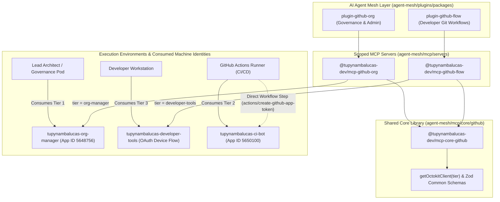

# Architectural Explanation: Three-Tier GitHub App Identity Architecture & Secret Governance

**Classification**: Diataxis Explanation (Understanding-Oriented)  
**Scope**: Enterprise Architecture, Identity Federation, and Threat Modeling  
**Organization**: `tupynambalucas-dev`  
**Standard**: en-US Technical Specification (Strict Zero-Emoji Policy)

---

## 1. Executive Summary & Architectural Motivation

In modern enterprise software engineering, relying on static **Personal Access Tokens (PATs)** or default runner credentials (`GITHUB_TOKEN`) introduces severe security and operational bottlenecks:

1. **Security Vulnerability of Static PATs**:
   * PATs are bound to individual human accounts. When an engineer departs or changes roles, their tokens either expire unexpectedly (causing pipeline outages) or remain active indefinitely (creating critical credential leakage vectors).
   * PATs possess broad, global account permissions that violate the **Principle of Least Privilege (PoLP)**.
2. **Workflow Trigger Limitations of `GITHUB_TOKEN`**:
   * To prevent accidental infinite recursive loops, GitHub intentionally prevents actions executed by `GITHUB_TOKEN` from triggering downstream GitHub Actions workflows (such as pull request verification, auto-publishing, or branch deployments).
3. **Rate Limiting Pressures**:
   * Classic tokens share a restrictive limit of 5,000 requests per hour per user. GitHub App installations receive up to 15,000 requests per hour across organization repositories.

To solve these challenges permanently, `tupynambalucas-dev` implements a sovereign **Three-Tier GitHub App Architecture**, providing deterministic machine identities, granular repository scoping, and cascading workflow automation.

---

## 2. The Three-Tier Identity Topology

```
+---------------------------------------------------------------------------------------------------+
|                                   tupynambalucas-dev Organization                                 |
+---------------------------------------------------------------------------------------------------+
                                                  |
         +----------------------------------------+----------------------------------------+
         |                                        |                                        |
         v                                        v                                        v
+-------------------------------+  +-------------------------------+  +-------------------------------+
|   Tier 1: Org Manager         |  |   Tier 2: CI/CD Bot           |  |   Tier 3: Developer Tools     |
|   (tupynambalucas-org-manager)|  |   (tupynambalucas-ci-bot)     |  |   (tupynambalucas-dev-tools)  |
+-------------------------------+  +-------------------------------+  +-------------------------------+
| * Headless Machine Identity   |  | * Automated Delivery Identity |  | * Interactive Workstation     |
| * Organization Administration |  | * Branch/Release Automation   |  | * OAuth 2.0 Device Flow       |
| * Ephemeral 1-Hour JWT Tokens |  | * Ephemeral 1-Hour JWT Tokens |  | * Auto-expiring 8-Hour UAT    |
| * Manages Rulesets & Teams    |  | * Triggers Downstream Workflows| * Human-Attributed Commits     |
| * Zero Human Interaction      |  | * Restricted to Pipeline Ops  | * ZERO Private Keys Stored    |
+-------------------------------+  +-------------------------------+  +-------------------------------+
```

### Tier 1: `tupynambalucas-org-manager` (Administrative Machine Identity)
* **Role**: Headless orchestrator for organization governance, repository provisioning, branch protection rulesets, and team RBAC assignments.
* **Operational Scope**: Consumed exclusively by administrative daemons, such as `@tupynambalucas-dev/mcp-github-org` in server mode and governance cron tasks.
* **Credential Model**: RSA 2048-bit Private Key minting short-lived 1-hour Installation Access Tokens.
* **App Managers**: Delegated exclusively to `@tupynambalucas-dev/lead-architects`.

### Tier 2: `tupynambalucas-ci-bot` (Autonomous Continuous Delivery Identity)
* **Role**: High-frequency delivery bot executing release tagging, automated code generation commits, documentation deployments, and dependency update pull requests.
* **Operational Scope**: Consumed by GitHub Actions workflows that mutate Git state or trigger downstream cascades (`platform/.github/workflows/renovate.yml`, `platform/.github/workflows/renderer-generate.yml`, `docs/.github/workflows/deploy-docs.yaml`, `gh-tl/.github/workflows/release.yml`) and as the Tier 2 (`'ci-bot'`) non-administrative machine fallback in `@tupynambalucas-dev/mcp-core-github`. *(Note: `npm.pkg.github.com` package publishing and repository-scoped package purging in `agent-mesh` use `secrets.GITHUB_TOKEN` per GitHub Packages granular permissions architecture).*
* **Critical Capability**: Commits, tags, and pull requests generated by `tupynambalucas-ci-bot` **can trigger downstream CI workflows**, resolving the anti-recursion limitation of `GITHUB_TOKEN` without exposing Tier 1 administrative privileges.
* **App Managers**: Delegated to `@tupynambalucas-dev/lead-architects` and `@tupynambalucas-dev/infra-ops`.

### Tier 3: `tupynambalucas-developer-tools` (Interactive Workstation Identity)
* **Role**: Passwordless developer workstation enablement powering internal CLI utilities (`gh-tl`) and local developer tooling.
* **Operational Scope**: Consumed interactively by human engineers on laptops and development machines.
* **Zero Private Key Invariant**: Employs **OAuth 2.0 Device Flow** (`https://github.com/login/device`). Developers authenticate interactively in their browser, generating 8-hour user access tokens. No RSA private key is ever distributed to workstations.
* **Attribution**: Commits and reviews authored via Tier 3 carry the individual developer's human username, maintaining complete auditability.

---

## 3. Dual-Boundary Security: The Intersection of Rights

A foundational security principle of Tier 3 is the **Dual-Boundary Intersection**:

$$\text{Effective Rights} = \text{App Scopes} \cap \text{Developer Team RBAC}$$

Even if `tupynambalucas-developer-tools` holds `Contents: Read and write`, an individual developer who authenticates via this App cannot push code to a repository where their GitHub account only has `Read` access. The GitHub authorization gateway dynamically computes the intersection of permissions in real time.

---

## 4. Secret Transportation and Storage Architectural Analysis

Why does our architecture enforce different formats for `.env`, Kubernetes, and GitHub Secrets?

```
+---------------------+-------------------------------+-----------------------------------------------+
| Destination Context | Required Storage Format       | Technical Architectural Rationale             |
+---------------------+-------------------------------+-----------------------------------------------+
| Local Development   | Base64 String (`_BASE64`)     | Line-oriented .env files corrupt on unescaped |
| and Cloud Envs      | Continuous ASCII string       | newlines. Base64 is shell-safe and atomic.    |
+---------------------+-------------------------------+-----------------------------------------------+
| Kubernetes Pods     | Secret Filesystem Volume      | Prevents secret leakage in /proc/<pid>/environ|
| (`platform/k8s`)    | (`_PATH` -> /var/run/secrets/)| core dumps, APM crash reports, and docker     |
|                     | readOnly: true, mode: 0400    | inspect logs.                                 |
+---------------------+-------------------------------+-----------------------------------------------+
| GitHub Actions      | Raw Multiline PEM Text        | GitHub's web UI natively provides multiline   |
| Org Secrets         | (Copy/Paste directly from pem)| textarea and libsodium encryption for Actions |
|                     | without quotes or escapes     | runner ingestion.                             |
+---------------------+-------------------------------+-----------------------------------------------+
```

### The Inherent Vulnerability of Environment Variables in Production
While environment variables are convenient for local development, passing raw cryptographic keys through `process.env` in container runtimes has well-documented failure modes:
1. Child processes inherit the entire environment table by default.
2. Application Performance Monitoring (APM) agents (Datadog, New Relic, Sentry) capture `process.env` upon uncaught exceptions, potentially transmitting private keys to third-party dashboards.
3. Linux exposes `/proc/<pid>/environ` to any process sharing the same user UID.

By supporting `ORG_MANAGER_APP_PRIVATE_KEY_PATH`, production services in `platform/k8s` read keys directly from POSIX-protected files with `chmod 0400`, ensuring zero plaintext leakage into environment tables.

---

## 5. The 5-Layer Defense-in-Depth Model

Access to our high-privilege identities is protected across five distinct boundaries:

1. **Layer 1: GitHub Web UI Delegation (`App managers`)**:
   Only verified members of `lead-architects` and `infra-ops` can alter app permissions or regenerate keys. General engineers are excluded.
2. **Layer 2: Infisical Path-Based RBAC**:
   Private keys are partitioned in Infisical Cloud Vault (`/governance/github-apps` for Tier 1; `/ci` for Tier 2; `/tooling` for Tier 3). Engineers cannot read Tier 1 secrets from developer workstations.
3. **Layer 3: Autonomous Operator Authority Checks**:
   Agent mesh plugins verify caller role metadata prior to executing mutations.
4. **Layer 4: Ephemeral Token Lifetime**:
   Tokens expire automatically after 60 minutes (JWT installations) or 8 hours (Device Flow), preventing token replay attacks.
5. **Layer 5: Enterprise Audit Logs**:
   Every token generation, key rotation, and administrative API call is permanently recorded in the GitHub Organization Audit Log.

---

## 6. Architectural Analysis: Scoped Domain MCP Servers with Shared Core vs Monolithic MCP Server

A key architectural question in AI agent ecosystems is:
> *Should we bundle all GitHub tools into a single monolithic MCP server, or partition them into domain-scoped MCP servers in `agent-mesh/mcp/servers/` backed by a shared core library in `agent-mesh/mcp/core/`?*

### The Verdict: Domain-Scoped MCP Servers (`mcp-github-org` & `mcp-github-flow`) Over a Shared Core (`mcp-core-github`)

Our architecture enforces **Subsystem-Internal Partitioning** (`agent-mesh/mcp/servers/*` and `agent-mesh/mcp/core/*`), isolating high-privilege administrative tools from high-frequency developer workflow tools while eliminating code duplication through `@tupynambalucas-dev/mcp-core-github`.



### Architectural Rationale

1. **Zero-Trust Process & Credential Isolation**:
   By binding [`@tupynambalucas-dev/plugin-github-org`](../../../agent-mesh/plugins/packages/github-org) exclusively to [`@tupynambalucas-dev/mcp-github-org`](../../../agent-mesh/mcp/servers/github-org) (`tier = 'org-manager'`) and [`@tupynambalucas-dev/plugin-github-flow`](../../../agent-mesh/plugins/packages/github-flow) exclusively to [`@tupynambalucas-dev/mcp-github-flow`](../../../agent-mesh/mcp/servers/github-flow) (`tier = 'developer-tools'`), a developer workflow session never loads administrative ruleset or security tools into its LLM context window and never requires Tier 1 RSA keys.

2. **DRY Shared Core & No-Privilege-Escalation Fallback (`@tupynambalucas-dev/mcp-core-github`)**:
   Both scoped MCP servers consume [`@tupynambalucas-dev/mcp-core-github`](../../../agent-mesh/mcp/core/github) (`agent-mesh/mcp/core/github`), which centralizes `getOctokitClient(tier: GitHubIdentityTier)`, PEM normalization (`_PATH` -> `_BASE64` -> raw PEM), `gh auth token` CLI fallback for Tier 3 OAuth Device Flow sessions, and shared Zod schemas.
   * **Strict Tier 1 Isolation**: `createOrgManagerOctokit()` (`tupynambalucas-org-manager`) is invoked **exclusively** when `tier === 'org-manager'` is requested by `@tupynambalucas-dev/mcp-github-org`.
   * **Non-Escalating Fallback Chain**: When `tier === 'developer-tools'` or `'auto'` is requested by `@tupynambalucas-dev/mcp-github-flow` and no workstation `GITHUB_TOKEN` or `gh auth token` is present, resolution falls back to Tier 2 (`createCiBotOctokit()` — `tupynambalucas-ci-bot`), **never** escalating silently to Tier 1 (`org-manager`).

3. **Why Tier 2 (`ci-bot`) Operates in Workflows & Non-Administrative Fallbacks**:
   `tupynambalucas-ci-bot` is built for **automated CI/CD pipelines** (`renovate.yml`, `renderer-generate.yml`, `deploy-docs.yaml`, `release.yml`) and repository-scoped automation.
   * GitHub Actions runners mint ephemeral tokens directly via `actions/create-github-app-token` using `CI_BOT_APP_ID` and `CI_BOT_APP_PRIVATE_KEY`.
   * Routine code pull requests, reviews, merges, and workflow dispatches are executed by human engineers via `gh` CLI (`tupynambalucas`) or by `tupynambalucas-ci-bot`, ensuring `tupynambalucas-org-manager[bot]` never appears as a workflow trigger (`github.actor`) or merge actor in delivery pipelines.

---

## 7. Navigation

- [Parent Reference Index](../README.md)
- [Tutorial: Creating a GitHub App End-to-End](../tutorials/creating-a-github-app-end-to-end.md)
- [How-To: Generating and Configuring GitHub App Keys](../how-to-guides/generating-and-configuring-github-app-keys.md)
- [Reference: GitHub Apps Catalog and Credentials](../reference/github-apps-catalog-and-credentials.md)
- [Reference: GitHub Packages and Token Boundary Governance](../reference/github-packages-and-token-boundary-governance.md)
