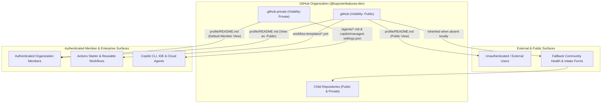

# `.github` vs `.github-private`: Architecture, Visibility Matrix & Capabilities

This document specifies the architectural roles, platform mechanics, visibility constraints, and functional differences between the `<org>/.github` and `<org>/.github-private` special repositories on GitHub.

---

## 1. Architectural Rationale: Why Two Repositories Exist

Organizations operate across two distinct trust boundaries: **external public visitors** (open-source contributors, prospective clients, security researchers) and **authenticated internal members** (engineers, SREs, AI agents, enterprise administrators).

GitHub enforces strict repository-level visibility checks on native platform features rather than per-folder ACLs. Attempting to place private internal documentation inside `<org>/.github` or making `<org>/.github` private breaks public platform features. Consequently, GitHub partitions organization-wide special repositories into two complementary namespaces:

1. **`<org>/.github` (Public Governance & Open Standards Layer)**: Powers public landing pages, organization-wide fallback Community Health files, Issue/PR/Discussion intake templates, and shared CI/CD starter workflows.
2. **`<org>/.github-private` (Internal Member & Enterprise Control Layer)**: Powers authenticated member-only organization landing pages, internal engineering runbooks, and centralized AI agent / Copilot managed settings without exposing proprietary topology to the public internet.

---

## 2. Side-by-Side Capability & Visibility Matrix

| Capability / Feature | `<org>/.github` | `<org>/.github-private` | Visibility & Access Constraint |
| :--- | :--- | :--- | :--- |
| **Public Organization Profile** (`profile/README.md`) | Supported | Not Supported | `.github` **MUST** be `Public`. Unavailable on Enterprise Managed Users (EMUs). |
| **Member-Only Organization Profile** (`profile/README.md`) | Not Supported | Supported | `.github-private` **MUST** be `Private` (`Internal` visibility does **not** render the member profile). |
| **Default Community Health Files** (`CONTRIBUTING.md`, `SECURITY.md`, `CODE_OF_CONDUCT.md`, `SUPPORT.md`, `ACCESSIBILITY.md`) | Supported | Not Supported | `.github` **MUST** be `Public`. Applies to both public and private child repositories lacking local overrides. |
| **Default Funding & Vulnerability Forms** (`.github/FUNDING.yml`, `.github/VULNERABILITY_REPORT.yml`) | Supported | Not Supported | `.github` **MUST** be `Public`. |
| **Default Issue, PR & Discussion Templates** (`.github/ISSUE_TEMPLATE/`, `PULL_REQUEST_TEMPLATE.md`, `.github/DISCUSSION_TEMPLATE/`) | Supported | Not Supported | `.github` **MUST** be `Public`. |
| **GitHub Actions Starter Workflows** (`workflow-templates/*.yml` + `.properties.json`) | Supported | Not Supported | Public `.github`: available to all repos. Internal `.github`: internal/private repos. Private `.github`: private repos only (requires Read access). |
| **Reusable Workflows & Composite Actions** (`.github/workflows/*`) | Supported (Public) | Supported (Private/Org) | `.github-private` requires `Settings > Actions > General > Access` enabled for organization repositories. |
| **Organization-Level Custom AI Agents** (`/agents/<name>.md`) | Supported | Supported | Available to all organization members even if they lack Read access to `.github-private`. |
| **Enterprise-Level Custom AI Agents** (`/agents/<name>.md`) | Not Supported | Supported | Designated via `Enterprise > AI controls > Agents` pointing to the owning organization's `.github-private`. |
| **Server-Managed Copilot Governance** (`copilot/managed-settings.json`, `copilot/team-mappings.json`) | Not Supported | Supported | Hosted in the enterprise's designated `.github-private` (`Private` or `Internal`). |

> [!WARNING]
> **Critical Visibility Conflict to Avoid:**
> While GitHub Enterprise allows `.github-private` to be created with `Internal` visibility for AI settings transparency, **Member-Only Organization Profile READMEs (`profile/README.md`) strictly require `.github-private` visibility to be set to `Private`**. Setting `.github-private` to `Internal` silently disables the member-only profile page. Always keep `.github-private` set to **`Private`** and grant team Read permissions explicitly if internal collaboration on files is desired.

---

## 3. Dual-View Organization Profile Mechanics

GitHub's Organization Overview tab (`https://github.com/<org>`) supports two distinct, context-aware views when both `.github/profile/README.md` and `.github-private/profile/README.md` are configured:

### A. View Resolution Logic

1. **External / Unauthenticated Visitors**: Always render the `Public` view sourced from `<org>/.github/profile/README.md` alongside public pinned repositories.
2. **Authenticated Organization Members**:
   - Render a **`View as: Member | Public`** switcher dropdown in the upper-right sidebar of the organization profile page.
   - Default automatically to the **`Member`** view whenever either `<org>/.github-private/profile/README.md` exists OR member-only pinned repositories are configured; otherwise default to `Public`.

### B. Dual Pinned Repository Sets

Organization owners can curate two independent sets of pinned repositories on the Organization Overview page:

- **Public Pins (up to 6 repositories)**: Displayed to the general public (must be public repositories).
- **Member Pins (up to 6 repositories)**: Displayed exclusively to authenticated organization members in `Member` view (can combine private, internal, and public repositories such as `org-core`, `platform`, `agent-mesh`, and internal infrastructure repos).

### C. Recommended Content Partitioning

| Dimension | Public Profile (`.github/profile/README.md`) | Member-Only Profile (`.github-private/profile/README.md`) |
| :--- | :--- | :--- |
| **Target Audience** | Clients, open-source users, partners, recruits, security researchers. | Internal engineers, contractors, SREs, and platform maintainers. |
| **Content Focus** | Executive overview, core capabilities, high-level system architecture, tech stack, public repos, and official contact/security emails. | Internal onboarding runbooks, staging/production cluster URLs, Grafana/ArgoCD/Infisical links, on-call escalation matrices, and quick-start CLI commands. |
| **Security Posture** | Zero internal endpoints, internal project codenames, or private SLAs. | Safe for internal operational links (still subject to strict Zero-Plaintext-Secret rules). |

---

## 4. Strategic Advantages of Using Both Repositories

1. **Single-Point Governance Maintenance**: Updating `SECURITY.md` or `CONTRIBUTING.md` once in `<org>/.github` immediately updates the policy across dozens of microservices and packages that do not define local overrides.
2. **Zero Git Tree Bloat in Downstream Repos**: Inherited community health files and starter templates do not add files, commits, or CI triggers to downstream repositories.
3. **Frictionless Internal Onboarding**: Engineers visiting `github.com/<org>` immediately see internal dashboards, repository topology, and pinned private monorepos via `.github-private/profile/README.md` without exposing internal links publicly.
4. **Decoupled RBAC & Ruleset Protection**: Both `.github` and `.github-private` can enforce strict branch rulesets, `CODEOWNERS`, and mandatory SSH commit signing so organizational policies and AI agent guardrails require executive/security review prior to merge.

---

## 5. Canonical Sources

- [Customizing your organization's profile - GitHub Docs](https://docs.github.com/en/organizations/collaborating-with-groups-in-organizations/customizing-your-organizations-profile)
- [Creating a .github-private repository - GitHub Docs](https://docs.github.com/en/copilot/how-tos/administer-copilot/manage-for-enterprise/manage-agents/create-github-private-repo)
- [Preparing to use custom agents in your organization - GitHub Docs](https://docs.github.com/en/copilot/how-tos/administer-copilot/manage-for-organization/prepare-for-custom-agents)
- [Parent Reference Index](./README.md)
