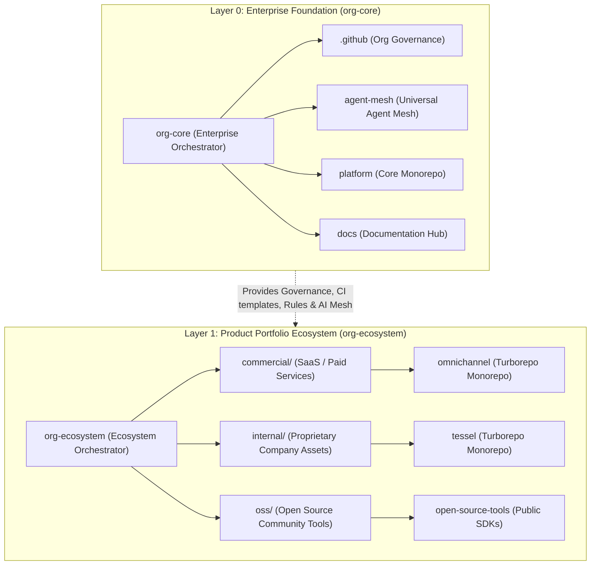

# Org-Ecosystem Architecture & Portfolio Workspace Governance

Authoritative technical specification defining the dual meta-repository architecture for `tupynambalucas-dev`: separating **Enterprise Foundation (`org-core`)** from **Portfolio Solutions & Services (`org-ecosystem`)**.

---

## 1. Architectural Foundation & Strategic Rationale

Modern technology enterprises managing diverse software portfolios—ranging from commercial SaaS products to proprietary intellectual property and open-source tools—require strict boundaries between **organizational governance** and **product delivery**.

Attempting to house product monorepos (`omnichannel`, `tessel`) inside the foundational meta-repository (`org-core`) produces severe architectural debt:
1. **Permission & IP Bleed**: Open-source contributors, SaaS product teams, and internal core developers become entangled in a single Git permission and notification scope.
2. **Context Window Contamination**: AI agents operating on core governance or platform infrastructure ingest irrelevant product schemas and business-logic code.
3. **Workspace Inefficiency**: Developers working on a single product must navigate across unrelated platform and governance repositories.

To resolve this, `tupynambalucas-dev` establishes a **Dual Meta-Repository Topology**:



---

## 2. Structural Comparison: `org-core` vs. `org-ecosystem`

| Dimension | `org-core` | `org-ecosystem` |
| :--- | :--- | :--- |
| **Architectural Layer** | **Layer 0: Enterprise Foundation** | **Layer 1: Product & Solutions Portfolio** |
| **Primary Responsibility** | Corporate governance, public profile, default community health, sovereign documentation, agent mesh plugins/skills, base Kubernetes infrastructure. | Commercial microservices, internal business intelligence/engines, customer-facing applications, open-source libraries. |
| **Managed Child Repos** | `.github`, `agent-mesh`, `platform`, `docs` | `commercial/omnichannel`, `internal/tessel`, `oss/*` |
| **Internal Topology of Children** | Mixed: monorepo (`platform`), plugin workspace (`agent-mesh`), documentation site (`docs`), governance hub (`.github`). | Monorepos & standalone applications: `omnichannel` (Turborepo), `tessel` (Turborepo). |
| **Mani Manifest Role** | Coordinates foundation builds, dependency alignment, and workstation bootstrapping. | Selective synchronization by domain tags (`commercial`, `internal`, `oss`). |
| **Target Audience** | Organization administrators, DevOps/Platform engineers, AI mesh architects. | Product engineers, frontend/backend developers, OSS contributors. |

---

## 3. `org-ecosystem` Directory Layout & Namespace Taxonomy

In `org-ecosystem`, repositories are partitioned into explicit operational namespaces:

```text
org-ecosystem/
├── mani.yaml                              # Declarative multi-repo sync & tag runner
├── README.md                              # Primary developer onboarding and orchestration runbook
├── AGENTS.md                              # Layer 1 context router for product ecosystem agents
├── org-ecosystem.code-workspace           # Multi-root VS Code workspace for the portfolio
├── .ignore                                # Ripgrep overrides enabling deep child indexing
├── .rgignore                              # Ripgrep search configuration
├── .gitignore                             # Git ignore rules for managed directories
│
├── commercial/                            # Paid SaaS solutions, client services, customer APIs
│   └── omnichannel/                       # Independent Monorepo (pnpm + Turborepo: api, core, references)
│
├── internal/                              # Strictly proprietary internal IP (confidential company asset)
│   └── tessel/                            # Independent Monorepo (pnpm + Turborepo: apps, packages, studio)
│
└── oss/                                   # Public open-source projects, community SDKs, CLI tools
    └── (future community repositories)
```

> [!IMPORTANT]
> Both `omnichannel` and `tessel` are already structured as **independent Monorepos** with their own `pnpm-workspace.yaml`, `turbo.json`, and TypeScript reference architectures. In `org-ecosystem`, they are checked out as whole sovereign repositories into their respective namespace folders (`commercial/omnichannel` and `internal/tessel`), preserving their git histories and monorepo configurations.

---

## 4. Declarative Mani Orchestration (`mani.yaml`)

The `org-ecosystem` manifest utilizes Mani tags to enable selective, on-demand synchronization:

```yaml
# Manifest specification: https://manicli.com
# tupynambalucas-dev Product Portfolio & Ecosystem Manifest

sync_gitignore: false

projects:
  # --- COMMERCIAL SAAS SOLUTIONS ---
  omnichannel:
    path: commercial/omnichannel
    url: git@github.com:tupynambalucas-dev/omnichannel.git
    desc: Commercial Omnichannel messaging engine and client platform (Turborepo Monorepo).
    tags:
      - commercial
      - saas
      - omnichannel
      - monorepo

  # --- PROPRIETARY INTERNAL ASSETS ---
  tessel:
    path: internal/tessel
    url: git@github.com:tupynambalucas-dev/tessel.git
    desc: Proprietary enterprise core platform and intellectual property (Turborepo Monorepo).
    tags:
      - internal
      - proprietary
      - tessel
      - monorepo

targets:
  all:
    all: true
  commercial:
    tags: [commercial]
  internal:
    tags: [internal]
  oss:
    tags: [oss]

tasks:
  status:
    desc: Check Git status across all ecosystem projects
    target: all
    cmd: git status -s
    spec:
      output: table

  fetch:
    desc: Fetch latest changes from remote origin across all projects
    target: all
    cmd: git fetch origin --prune
    spec:
      output: stream

  pull:
    desc: Pull latest main branch updates across all projects
    target: all
    cmd: git pull origin main
    spec:
      output: stream

  branch:
    desc: Display current active branch for all projects
    target: all
    cmd: git branch --show-current
    spec:
      output: table
```

### Developer Synchronization Workflows

```bash
# Sync exclusively commercial SaaS solutions (for omnichannel developers)
mani sync --tags commercial

# Sync strictly proprietary internal projects (for core IP developers)
mani sync --tags internal

# Sync exclusively open-source tools (for community contributors)
mani sync --tags oss

# Run tests only across commercial services
mani run test --tags commercial

# Inspect git status only for omnichannel
mani run status --tags omnichannel
```

---

## 5. IDE Multi-Root Workspace Taxonomy

To guarantee clarity across both development environments, workspace files define precise descriptive names:

### In `org-core` (`tupynambalucas-dev.code-workspace`)

```json
{
  "folders": [
    {
      "name": "org-core (Enterprise Foundation)",
      "path": "."
    },
    {
      "name": ".github (Org Governance)",
      "path": ".github"
    },
    {
      "name": "platform (Core Monorepo)",
      "path": "platform"
    },
    {
      "name": "docs (Documentation Hub)",
      "path": "docs"
    },
    {
      "name": "agent-mesh (Universal Agent Mesh)",
      "path": "agent-mesh"
    }
  ]
}
```

### In `org-ecosystem` (`org-ecosystem.code-workspace`)

```json
{
  "folders": [
    {
      "name": "org-ecosystem (Ecosystem Orchestrator)",
      "path": "."
    },
    {
      "name": "omnichannel (Commercial SaaS Monorepo)",
      "path": "commercial/omnichannel"
    },
    {
      "name": "tessel (Proprietary Enterprise Monorepo)",
      "path": "internal/tessel"
    }
  ],
  "settings": {
    "git.autoRepositoryDetection": true,
    "search.useIgnoreFiles": false,
    "search.useGlobalIgnoreFiles": false,
    "search.useParentIgnoreFiles": false,
    "search.exclude": {
      "**/node_modules": true,
      "**/.pnpm-store": true,
      "**/.git": true,
      "**/dist": true,
      "**/.turbo": true
    },
    "files.exclude": {
      "**/.git": false
    }
  }
}
```

---

## 6. Ripgrep & Indexer Decoupling

Following the governance standard established in `org-core`, `org-ecosystem` MUST include `.ignore` and `.rgignore` to un-ignore child directories for Antigravity's embedded `ripgrep` search engine:

```ignore
# org-ecosystem/.ignore and org-ecosystem/.rgignore
!commercial/
!internal/
!oss/
```

This ensures Antigravity's `@` mention and fuzzy file search indexes all product files instantly, while root `.gitignore` keeps Git status 100% clean.
