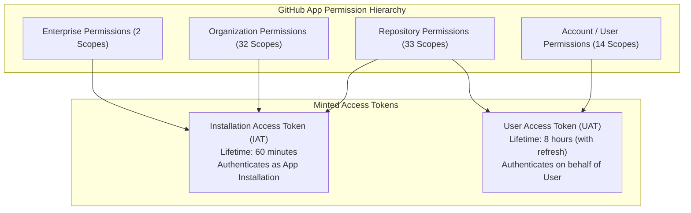
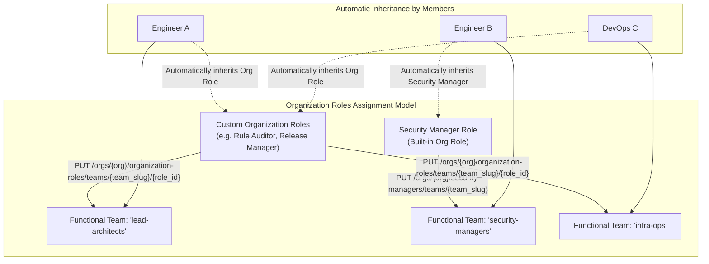
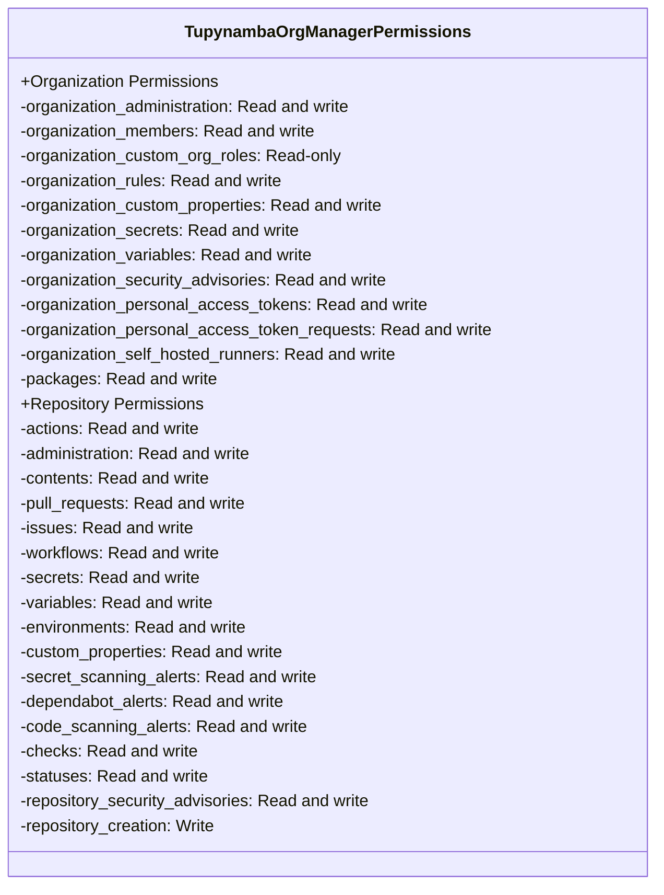
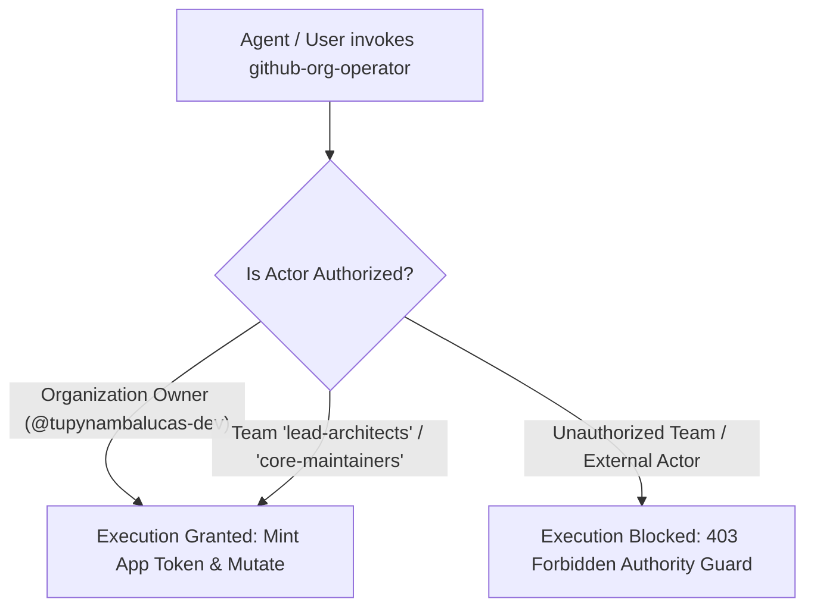

# GitHub App Permissions & API Access Technical Reference

**Document Identifier**: `REF-GH-PERMISSIONS-001`  
**Target Organization**: `tupynambalucas-dev`  
**API Version**: `2026-03-10` / `2022-11-28`  
**Standard**: en-US Technical Specification (Strict Zero-Emoji Policy)  
**Canonical Sources**: 
- [Choosing permissions for a GitHub App](https://docs.github.com/en/apps/creating-github-apps/registering-a-github-app/choosing-permissions-for-a-github-app)
- [Permissions required for GitHub Apps](https://docs.github.com/en/rest/authentication/permissions-required-for-github-apps)
- [REST API endpoints for organization roles](https://docs.github.com/en/rest/orgs/organization-roles)

---

## 1. Executive Summary & Conceptual Architecture

Permissions on GitHub Apps define the cryptographic boundaries, API authorization scopes, and webhook event subscriptions available to an application. Unlike OAuth Apps or Personal Access Tokens (PATs) that use coarse-grained scopes (`repo`, `admin:org`), GitHub Apps operate on fine-grained, resource-specific permissions.



### 1.1 Permission Types
1. **Repository Permissions**: Govern access to resources scoped to individual repositories (commits, branches, issues, pull requests, actions, secrets, workflows) within an account where the app is installed.
2. **Organization Permissions**: Govern access to resources scoped across the entire organization (team hierarchies, organization-level roles, member rosters, organization secrets, billing, runner groups, and organization rulesets).
3. **Enterprise Permissions**: Govern enterprise-level policies and metrics across multi-organization enterprise accounts.
4. **Account (User) Permissions**: Govern access to an individual developer's personal user profile, personal email addresses, personal GPG keys, and SSH signing keys when operating via OAuth User-to-Server flows.

### 1.2 Principle of Permission Monotonicity and Resolution
- **Installation Access Tokens (IAT)**: Evaluated purely against the permissions granted during App installation. If the App possesses `organization_administration: write`, the token has write access regardless of who triggers the pipeline.
- **User Access Tokens (UAT)**: Evaluated as the **intersection** of the App's permissions and the authorizing human user's personal permissions. An app cannot grant a user access to resources that the user does not personally have permission to access.
- **Troubleshooting Header**: Every response from the GitHub REST API includes the `X-Accepted-GitHub-Permissions` HTTP header, listing the specific permissions accepted by that endpoint.

---

## 2. Organization Permissions Specification (Complete Catalog)

Organization permissions apply across all repositories, teams, settings, and members within `tupynambalucas-dev`. There are **32 distinct Organization permissions** supported by GitHub.

### 2.1 Core Governance & Access Control

| Permission Name in UI | API Identifier | Available Levels | Endpoints & Capabilities Unlocked |
| :--- | :--- | :--- | :--- |
| **Administration** | `organization_administration` | `read`, `write` | `PATCH /orgs/{org}` (organization profile and settings), `PUT/DELETE /orgs/{org}/security-managers/teams/{team_slug}` (designate security manager teams), `POST/PUT/DELETE /orgs/{org}/rulesets` (org-wide repository rulesets), `PUT /orgs/{org}/actions/permissions` (org Actions policies, allowed actions, runner permissions), `POST/PATCH/DELETE /orgs/{org}/code-security/configurations`. |
| **Members** | `organization_members` | `read`, `write` | **Team & Member RBAC Master Scope**: `POST /orgs/{org}/teams` (create team), `PATCH /orgs/{org}/teams/{team_slug}` (update team), `DELETE /orgs/{org}/teams/{team_slug}` (delete team), `PUT /orgs/{org}/teams/{team_slug}/memberships/{username}` (assign team member), `PUT /orgs/{org}/teams/{team_slug}/repos/{owner}/{repo}` (assign team repo permissions), `PUT /orgs/{org}/organization-roles/teams/{team_slug}/{role_id}` (**assign organization-level role to a team**), `DELETE /orgs/{org}/organization-roles/teams/{team_slug}/{role_id}`, `PUT /orgs/{org}/organization-roles/users/{username}/{role_id}` (assign organization role to user), `POST/DELETE /orgs/{org}/invitations`. |
| **Custom organization roles** | `organization_custom_org_roles` | `read` | `GET /orgs/{org}/organization-roles` (list all custom organization roles), `GET /orgs/{org}/organization-roles/{role_id}` (inspect role definition and attached fine-grained permissions). |
| **Custom properties** | `organization_custom_properties` | `read`, `write` | `GET/PATCH /orgs/{org}/properties/schema` (create and edit custom property schemas), `PATCH /orgs/{org}/properties/values` (bulk assign property values to repositories for ruleset targeting). |
| **Organization rulesets** | `organization_rules` | `read`, `write` | `GET/POST/PUT/DELETE /orgs/{org}/rulesets` (enforce and audit global branch protections, tag protections, commit signing requirements, and linear history across all repositories). |
| **Organization security advisories** | `organization_security_advisories` | `read`, `write` | `GET/POST /orgs/{org}/security-advisories` (manage CVE disclosures and security alerts across all organization projects). |

### 2.2 Automation, CI/CD, Secrets & Infrastructure

| Permission Name in UI | API Identifier | Available Levels | Endpoints & Capabilities Unlocked |
| :--- | :--- | :--- | :--- |
| **Secrets** | `organization_secrets` | `read`, `write` | `GET/PUT/DELETE /orgs/{org}/actions/secrets` (create, update, delete organization-wide GitHub Actions secrets), `GET/PUT/DELETE /orgs/{org}/actions/secrets/{secret_name}/repositories` (bind org secrets to specific repos). |
| **Variables** | `organization_variables` | `read`, `write` | `GET/POST/PATCH/DELETE /orgs/{org}/actions/variables` (manage organization-wide non-sensitive configuration values). |
| **Organization dependabot secrets** | `organization_dependabot_secrets` | `read`, `write` | `GET/PUT/DELETE /orgs/{org}/dependabot/secrets` (manage credentials consumed by Dependabot automated PRs). |
| **Organization codespaces secrets** | `organization_codespaces_secrets` | `read`, `write` | `GET/PUT/DELETE /orgs/{org}/codespaces/secrets` (manage credentials for cloud development environments). |
| **Organization codespaces settings** | `organization_codespaces_settings` | `read`, `write` | Manage access control, idle timeouts, and machine specs for Codespaces. |
| **Organization codespaces** | `organization_codespaces` | `read`, `write` | Audit, start, stop, and terminate Codespaces instances across the org. |
| **Self-hosted runners** | `organization_self_hosted_runners` | `read`, `write` | `GET/POST/DELETE /orgs/{org}/actions/runners` (register, list, remove self-hosted runner daemons), `POST/PATCH/DELETE /orgs/{org}/actions/runner-groups` (manage runner groups and access policies). |
| **Hosted runner custom images** | `organization_hosted_runner_custom_images` | `read`, `write` | Manage custom VM/container images for GitHub-hosted runners. |
| **Network configurations** | `organization_network_configurations` | `read`, `write` | Manage Azure VNet or AWS VPC network attachments for hosted runners. |
| **Agent secrets** | `organization_agent_secrets` | `read`, `write` | Manage credentials injected into GitHub Copilot custom agents. |
| **Agent variables** | `organization_agent_variables` | `read`, `write` | Manage runtime variables for GitHub Copilot custom agents. |

### 2.3 Identity, Token Governance & Community

| Permission Name in UI | API Identifier | Available Levels | Endpoints & Capabilities Unlocked |
| :--- | :--- | :--- | :--- |
| **Personal access tokens** | `organization_personal_access_tokens` | `read`, `write` | `GET/POST /orgs/{org}/personal-access-tokens` (audit, revoke fine-grained personal access tokens issued across the organization). |
| **Personal access token requests** | `organization_personal_access_token_requests` | `read`, `write` | `GET/PATCH /orgs/{org}/personal-access-token-requests` (approve or deny fine-grained PAT access requests from developers). |
| **Organization private registries** | `organization_private_registries` | `read`, `write` | Configure access to external private package registries (e.g. AWS CodeArtifact, Artifactory). |
| **Blocking users** | `organization_user_blocking` | `read`, `write` | `GET/PUT/DELETE /orgs/{org}/blocks` (block abusive accounts from interacting with organization repositories). |
| **Projects** | `organization_projects` | `read`, `write`, `admin` | Manage GitHub Projects (v2) boards, fields, custom views, and project automations. |
| **Webhooks** | `organization_hooks` | `read`, `write` | `GET/POST/PATCH/DELETE /orgs/{org}/hooks` (manage organization-level webhooks and view delivery payloads). |
| **Events** | `organization_events` | `read` | `GET /orgs/{org}/events` (audit log of public events across the organization). |
| **API Insights** | `organization_api_insights` | `read` | Retrieve API rate usage statistics by actor, route, and subject. |
| **Campaigns** | `organization_campaigns` | `read`, `write` | Manage Code Scanning remediation campaigns across the organization. |
| **Copilot Spaces** | `organization_copilot_spaces` | `read`, `write` | Manage Copilot knowledge spaces and shared context containers. |
| **Copilot agent settings** | `organization_copilot_agent_settings` | `read`, `write` | Manage organizational enablement of GitHub Copilot agent extensions. |
| **Copilot content exclusion** | `organization_copilot_content_exclusion` | `read`, `write` | Configure paths and repositories excluded from Copilot code completion and indexing. |
| **GitHub Copilot Business** | `organization_copilot_business` | `read`, `write` | Manage Copilot seat assignments for users and functional teams. |
| **Organization Copilot metrics** | `organization_copilot_metrics` | `read` | Retrieve 1-day and 28-day Copilot engagement and completion reports. |
| **Issue Fields** | `organization_issue_fields` | `read`, `write` | Manage custom issue field schemas across organization projects. |
| **Issue Types** | `organization_issue_types` | `read`, `write` | Configure custom organization issue types (Bug, Feature, Chore, Epic). |

---

## 3. Repository Permissions Specification (Complete Catalog)

Repository permissions govern resources contained within individual repositories. There are **33 distinct Repository permissions**.

| Permission Name in UI | API Identifier | Available Levels | Endpoints & Capabilities Unlocked |
| :--- | :--- | :--- | :--- |
| **Actions** | `actions` | `read`, `write` | Trigger, cancel, re-run workflows, download workflow run artifacts, access job logs, inspect cache storage. |
| **Administration** | `administration` | `read`, `write` | Modify repository settings, manage branch protection rules, transfer repository, change repository visibility, manage collaborator access. |
| **Agent secrets** | `agent_secrets` | `read`, `write` | Manage repository-scoped credentials for Copilot custom agents. |
| **Agent variables** | `agent_variables` | `read`, `write` | Manage repository-scoped variables for Copilot custom agents. |
| **Artifact metadata** | `artifact_metadata` | `read`, `write` | Inspect and publish metadata and attestations for build artifacts. |
| **Attestations** | `attestations` | `read`, `write` | Cryptographically sign and write artifact provenance attestations (Sigstore/SLSA). |
| **Checks** | `checks` | `read`, `write` | Create check suites and check runs, publish test results and annotations on PR commits. |
| **Code quality** | `code_quality` | `read`, `write` | Read code quality metrics and automated linters. |
| **Code scanning alerts** | `code_scanning_alerts` | `read`, `write` | View, triage, dismiss, or resolve CodeQL and third-party SARIF security alerts. |
| **Codespaces lifecycle admin** | `codespaces_lifecycle_admin` | `read`, `write` | Manage lifecycle policies for Codespaces attached to the repository. |
| **Codespaces metadata** | `codespaces_metadata` | `read` | Inspect Codespaces configurations and devcontainer specifications. |
| **Codespaces secrets** | `codespaces_secrets` | `read`, `write` | Manage repository-level secrets exposed to GitHub Codespaces. |
| **Codespaces** | `codespaces` | `read`, `write` | Create and manage developer Codespaces instances for the repository. |
| **Commit statuses** | `statuses` | `read`, `write` | Post commit status indicators (`pending`, `success`, `failure`) visible on PRs. |
| **Contents** | `contents` | `read`, `write` | **Core Git & File Access**: Read code, commit files, create branches, push tags (`v1.0.0`), download tarballs, create GitHub Releases. |
| **Copilot agent settings** | `copilot_agent_settings` | `read`, `write` | Configure Copilot extension permissions for the repository. |
| **Custom properties** | `custom_properties` | `read`, `write` | Read and set repository-specific custom property values. |
| **Dependabot alerts** | `dependabot_alerts` | `read`, `write` | View, triage, and dismiss vulnerable dependency alerts. |
| **Dependabot secrets** | `dependabot_secrets` | `read`, `write` | Manage private registry tokens consumed by Dependabot version updates. |
| **Deployments** | `deployments` | `read`, `write` | Create deployment records, track environment rollouts and rollback states. |
| **Environments** | `environments` | `read`, `write` | Configure deployment environments, required reviewers, and branch limits. |
| **GitHub App installation repository access** | `repository_app_installation_access` | `read`, `write` | Manage which GitHub App installations have access to the repository. |
| **Issues** | `issues` | `read`, `write` | Open, close, edit issues, manage labels, assignees, milestones, issue comments. |
| **Metadata** | `metadata` | `read` *(Mandatory)* | Read basic repository metadata (name, owner, description, visibility). |
| **Pages** | `pages` | `read`, `write` | Configure GitHub Pages builds, custom domains, and deployment sources. |
| **Pull requests** | `pull_requests` | `read`, `write` | Create, merge, close pull requests, submit code reviews, add inline comments. |
| **Repository creation** | `repository_creation` | `write` | Create new repositories within the organization without granting full administration over existing repositories. |
| **Repository security advisories** | `repository_security_advisories` | `read`, `write` | Create private vulnerability reports and publish repository security advisories. |
| **Secret scanning alerts** | `secret_scanning_alerts` | `read`, `write` | Triage, view, and resolve detected secret leaks (API keys, tokens). |
| **Secrets** | `secrets` | `read`, `write` | Manage repository-level encrypted secrets for GitHub Actions. |
| **Variables** | `variables` | `read`, `write` | Manage repository-level configuration variables for GitHub Actions. |
| **Webhooks** | `webhooks` | `read`, `write` | Create and manage repository-level webhook endpoints. |
| **Workflows** | `workflows` | `read`, `write` | Create, update, or delete workflow files in `.github/workflows/`. |

---

## 4. Account (User) & Enterprise Permissions Specification

### 4.1 Account / User Permissions (OAuth User-to-Server)
When an app operates on behalf of a human user via User Access Tokens (UAT), these permissions specify what user-scoped resources the app can read or modify:

| Permission Name | Access Level | Unlocked Capabilities |
| :--- | :--- | :--- |
| **Block another user** | `read`, `write` | Manage the user's blocked users list. |
| **Codespaces user secrets** | `read`, `write` | Access personal secrets stored in the user's Codespaces profile. |
| **Email addresses** | `read` | Retrieve the user's primary and verified email addresses. |
| **Followers** | `read`, `write` | Follow or unfollow other GitHub users. |
| **GPG keys** | `read`, `write` | Upload or delete GPG commit signing keys on the user's account. |
| **Gists** | `read`, `write` | Create, list, edit, or delete personal code gists. |
| **Git SSH keys** | `read`, `write` | Add or delete SSH authentication keys (`POST /user/keys`). |
| **SSH signing keys** | `read`, `write` | Add or delete SSH commit signing keys (`POST /user/ssh_signing_keys`). |
| **Interaction limits** | `read`, `write` | Manage user-level interaction restrictions. |
| **Plan** | `read` | Query user billing plan details. |
| **Private repository invitations** | `read`, `write` | Accept or decline incoming repository collaborator invites. |
| **Profile** | `write` | Update user biographical details, website URL, and name. |
| **Starring** | `read`, `write` | Star or unstar repositories. |
| **Watching** | `read`, `write` | Manage repository notifications and subscriptions. |

### 4.2 Enterprise Permissions
Applicable when installing the app across a GitHub Enterprise Cloud or Enterprise Server account:

| Permission Name | Access Level | Unlocked Capabilities |
| :--- | :--- | :--- |
| **Enterprise Copilot metrics** | `read` | Aggregated usage, active seats, and acceptance rate metrics for Copilot across all enterprise organizations. |
| **Enterprise security products** | `read`, `write` | Enterprise-wide Dependabot, Secret Scanning, and CodeQL policy enforcement. |

---

## 5. Advanced Organizational Governance: Organization Roles vs. Team Roles

A fundamental architectural distinction in GitHub's RBAC model is the difference between **Repository Roles** (scoped to a repo) and **Organization Roles** (scoped across the entire organization).



### 5.1 Pre-Defining Roles Directly on Teams
Instead of assigning organization roles to individual users (`PUT /orgs/{org}/organization-roles/users/{username}/{role_id}`), enterprise best practice dictates **assigning organization roles directly to functional teams**:

```http
PUT /orgs/tupynambalucas-dev/organization-roles/teams/{team_slug}/{role_id}
```

#### Operational Advantages:
1. **Zero-Touch Onboarding**: When a developer is added to the team (e.g., `lead-architects` or `infra-ops`), they immediately inherit the organization-level capabilities attached to that team without manual administrator intervention.
2. **Instant Deprovisioning**: Removing a user from a team immediately strips all organization-level and repository-level privileges assigned via that team.
3. **Auditability**: Team-based role bindings are visible in code and declarative manifests (`mani.yaml`, `rbac-matrix.md`).

### 5.2 Pre-Defining Repository Permissions on Teams
Simultaneously, the team can be bound to all repositories across the organization:

```http
PUT /orgs/tupynambalucas-dev/teams/{team_slug}/repos/{owner}/{repo}
Content-Type: application/json

{
  "permission": "admin" | "maintain" | "push" | "triage" | "pull"
}
```

When combined, a functional team possesses both:
- **Organization-level capabilities** (managing rulesets, managing secrets, auditing logs).
- **Repository-level capabilities** (code push, review approval, release tagging).

---

## 6. Superpower Specification for `tupynambalucas-org-manager`

To grant `tupynambalucas-org-manager` near-total organizational authority—enabling [`@tupynambalucas-dev/plugin-github-org`](file:///C:/Users/tupyn/projects/organizations/tupynambalucas-dev/org-core/agent-mesh/plugins/packages/github-org) to autonomously manage teams, assign organization roles to teams, configure global rulesets, and administer packages—the app must be provisioned with the following configuration:



### 6.1 Exact UI Configuration Checklist for `tupynambalucas-org-manager`

#### Organization Permissions (UI Category: Organization permissions)
- [x] **Administration**: `Read and write` (Manage organization settings, security managers, Actions policies, hosted runners)
- [x] **Members**: `Read and write` (**Crucial: Create teams, add members, assign organization roles to teams via API**)
- [x] **Custom organization roles**: `Read-only` (List all custom organization roles and inspect role definitions)
- [x] **Custom properties**: `Read and write` (Define custom properties and assign them to repositories for ruleset targeting)
- [x] **Organization rulesets**: `Read and write` (Create, edit, audit, and delete organization-wide branch and tag rulesets)
- [x] **Organization security advisories**: `Read and write` (Manage vulnerability disclosures across the organization)
- [x] **Packages**: `Read and write` (List, manage, and delete organization packages and versions on GitHub Packages)
- [x] **Secrets**: `Read and write` (Manage organization-wide GitHub Actions secrets)
- [x] **Variables**: `Read and write` (Manage organization-wide GitHub Actions variables)
- [x] **Personal access tokens**: `Read and write` (Audit and revoke personal access tokens across the organization)
- [x] **Personal access token requests**: `Read and write` (Approve or reject fine-grained PAT requests)
- [x] **Self-hosted runners**: `Read and write` (Manage runner groups and runner registrations)

#### Repository Permissions (UI Category: Repository permissions)
- [x] **Actions**: `Read and write`
- [x] **Administration**: `Read and write`
- [x] **Checks**: `Read and write`
- [x] **Code scanning alerts**: `Read and write`
- [x] **Commit statuses**: `Read and write`
- [x] **Contents**: `Read and write`
- [x] **Custom properties**: `Read and write`
- [x] **Dependabot alerts**: `Read and write`
- [x] **Environments**: `Read and write`
- [x] **Issues**: `Read and write`
- [x] **Metadata**: `Read-only` (Mandatory)
- [x] **Packages**: `Read and write`
- [x] **Pull requests**: `Read and write`
- [x] **Repository creation**: `Read and write` (Allows creating new repositories in the org)
- [x] **Repository security advisories**: `Read and write`
- [x] **Secret scanning alerts**: `Read and write`
- [x] **Secrets**: `Read and write`
- [x] **Variables**: `Read and write`
- [x] **Workflows**: `Read and write`

---

## 7. Security Enforcement: Operator Authority Guard for `@tupynambalucas-dev/plugin-github-org`

Because `tupynambalucas-org-manager` possesses near-total administrative authority across the entire organization, access to the plugin and its underlying credentials must be strictly governed:



### 7.1 The Authority Guard Rules
1. **Owner Exclusivity**: The organization owner (`tupynambalucas-dev`) retains sovereign authority to execute all plugin operations.
2. **Administrative Team Exclusivity**: Automated scripts or developer invocations of `github-org-operator`, `github-app-operator`, and `github-ruleset-operator` MUST verify that the calling actor is an active member of `lead-architects` or `core-maintainers`.
3. **Zero Plaintext Key Distribution**: The RSA private key (`.pem`) is strictly registered in GitHub Actions Organization Secrets (`ORGANIZATION_APP_PRIVATE_KEY`) and Infisical Cloud Vault. It is never placed on developer workstations or shared with standard engineering teams.
4. **Audit Logging**: Every mutation executed by `tupynambalucas-org-manager` appears in GitHub's organizational audit log (`/orgs/{org}/audit-log`) attributed cleanly to the bot persona `tupynambalucas-org-manager[bot]`.
